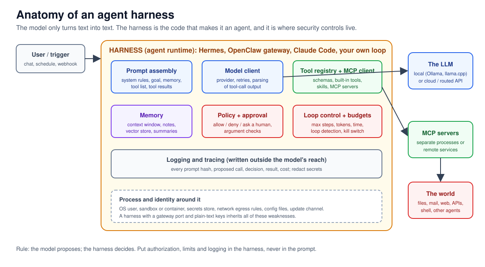

# 02: Anatomy of an Agent Harness

> **Chapter:** 1 · Agents, Harnesses and the Agentic Ecosystem · **Time:** ~3 hours
> **You will:** list what a harness wraps around a model, recognize real harnesses (Hermes Agent, the OpenClaw ecosystem, OpenCode and others) and the security lessons from them, separate agent runtime, MCP server and LLM, and build your own minimal harness.

| | |
|---|---|
| **Prerequisites** | [Lesson 01](01-agent-vs-llm-call.md) |
| **Lab** | [`labs/minimal-agent-harness`](labs/minimal-agent-harness/) (the build exercise); [`labs/tool-calling-determinism`](labs/tool-calling-determinism/) (why parsing and schemas matter) |
| **Real tools (hedged, not tested)** | [Hermes Agent, local and OpenRouter](real-tools/hermes-agent-local-and-openrouter.md), [LibreChat with MCP](real-tools/librechat-mcp-local-ollama.md) |
| **Syllabus lines** | Anatomy of an Agent Harness · What a "harness" actually wraps around a model · Real-world harnesses [Hermes, OpenClaw Ecosystem, and more] · Agent runtimes vs. MCP servers vs. the underlying LLM · Building your own minimal agent harness |
| **Maps to** | OWASP ASI02, ASI03, ASI04, ASI05, ASI10 · OWASP LLM03 (Excessive Agency), LLM04 (Supply Chain) · MCP: [CMCPSE chapter 1](../../cmcpse-course/ch1-introduction-to-mcp-and-agentic-ecosystem/README.md) |

> **Verify at source.** Agent products change monthly: names, features, versions, star counts and security status. Everything below about named products is a snapshot as of late 2026, hedged. Check each project's own documentation and security advisories before you rely on a claim.

---

## 1. Why this matters

People say "the agent" as if it were the model. It is not. The model is one part. The **harness** (also called the agent runtime, scaffold or orchestrator) is the code around it that builds prompts, calls the model, runs tools, stores memory, enforces limits and writes logs. Two teams can use the same model and get very different security, because the harness is where permissions, approvals, budgets and sandboxes live.

When a real incident happens (a stolen token, a malicious skill, an exposed gateway), it is nearly always a **harness** failure, not a model failure. That is why this course starts with its anatomy.

## 2. Understand it



### 2.1 What a harness wraps around a model

| Part | What it does | Security question |
|---|---|---|
| **Model client** | Talks to a provider (local server or cloud API), handles retries, streaming and parsing of tool-call output | Where does the prompt go? Which provider logs it? Is the served model the one you asked for? |
| **Prompt assembly** | Builds the context from system rules, the goal, memory, tool descriptions and previous results | Is untrusted text mixed with rules? Are tool descriptions from untrusted servers? |
| **Tool registry and MCP client** | Holds built-in tools, skills and connections to MCP servers; validates and runs calls | Who may add a tool? Are arguments validated? Are server descriptions pinned? |
| **Memory** | Context window, notes, vector stores, summaries | Who can write to it? Is there provenance? Is it per user? |
| **Policy and approval** | Allow, deny or ask a human before an action | Is it deterministic code the model cannot edit? Are approvals bound to the exact action? |
| **Loop control and budgets** | Max steps, tokens, time and money; loop detection; kill switch | Can a runaway agent be stopped without the agent's cooperation? |
| **Logging and tracing** | Record prompts (or hashes), proposed calls, decisions and results | Is the log outside the agent's reach? Are secrets redacted? |
| **Process and identity** | The OS user, sandbox, secrets store, network rules, config files, update channel | Plain-text keys? An open port? Runs as admin? |

Build order for your own: model client, then the loop, then the registry, then policy, then budgets, then logs. The [minimal-agent-harness lab](labs/minimal-agent-harness/harness.py) has all of them in about 200 lines.

### 2.2 Real-world harnesses

> Hedged snapshot, as of late 2026. These are descriptions to help you recognize the landscape, not endorsements and not tested instructions.

**Hermes Agent (Nous Research).** An open-source (MIT license), model-agnostic agent harness that was launched in February 2026, as far as we know. It can use several providers (for example Nous Portal, OpenRouter, or local servers), acts as an **MCP client** over stdio and HTTP with per-server tool filtering (the CLI has `hermes mcp add/list/test/remove`, and it can also serve as an MCP server), has built-in scheduling and messaging, and can drive other coding harnesses (Claude Code, Codex CLI, OpenCode) as sub-agents. Hedge the exact commands and features: read the documentation at <https://hermes-agent.nousresearch.com>. Security notes: per-server tool filtering is an allowlist control you should use; scheduling and messaging mean it may act when you are not watching (autonomy level 3 or 4); driving other agents adds a delegation hop.

**The OpenClaw ecosystem.** OpenClaw is an open-source personal AI agent that runs on your own machine with a **gateway** (a local service that connects chat apps and tools to the model). It was formerly called Clawdbot, then Moltbot, and was renamed OpenClaw on 30 January 2026; its author is Peter Steinberger. It needs Node 22 or newer. In February 2026 the project reportedly moved toward an independent foundation with OpenAI support, and its author joined OpenAI (hedge this). It spread very fast, and so did its security problems. Reported, hedged incidents:

| Incident or issue | What happened (as reported) | Lesson |
|---|---|---|
| **ClawHavoc** | Malicious skills on **ClawHub**, the skill marketplace. An early audit by Koi Security flagged 341 of about 2,857 skills; later counts are higher. Payloads were mostly infostealers (for example AMOS on macOS). | A skill marketplace is a **supply chain**. Skills run with the agent's power. Pin, review, sandbox. (ASI04) |
| **CVE-2026-25253** | Token theft through a malicious web page (CVSS about 8.8), disclosed around 30 January 2026 and patched. | Agent gateways need real authentication and origin checks, and you must **update**. Do not research or reproduce the exploit; the lesson is conceptual. |
| **Exposed instances** | SecurityScorecard reported around 135,000 internet-exposed instances with insecure defaults. Counts vary widely between sources. | Default-deny: bind to localhost, require auth, never expose a gateway to the internet. |
| **Typosquats** | Fake domains and packages appeared during the renames. | Renames are an attacker opportunity. Verify the source before install. |

Spin-offs and hardening projects that appeared around OpenClaw (all hedged, verify each project):

- **NemoClaw (NVIDIA):** an open-source security layer with kernel-level sandboxing and out-of-process policy enforcement. It does not review skill code.
- **NanoClaw:** OS-level containment.
- **SecureClaw:** about 56 audit checks, based on OWASP ASI and MITRE ATLAS (a "security audit plugin" type of tool).
- **MiniClaw:** a lightweight variant friendly to small models.

The pattern across all of them: **out-of-process enforcement and sandboxing** are the answer to untrusted skills, because the model and the skills sit inside the same trust zone as the agent.

**OpenCode.** An open-source terminal coding agent (MIT license, hedged). It works with many model providers. Coding agents are covered in Chapter 4.

**LibreChat.** A self-hosted chat interface that talks to many providers, with native MCP support, agents and RAG. In this chapter it is the "MCP tool-calling with a local model" surface. Guide: [real-tools/librechat-mcp-local-ollama.md](real-tools/librechat-mcp-local-ollama.md).

**Others you will meet:** Claude Code and Codex CLI (coding harnesses), VS Code agent mode and extensions such as Continue and Cline (see [lesson 05](05-free-open-agentic-toolchain.md)), and framework libraries such as LangGraph and AutoGen (build-your-own).

### 2.3 Agent runtimes vs. MCP servers vs. the underlying LLM

Three things that people mix up:

| | **LLM** | **Agent runtime (harness)** | **MCP server** |
|---|---|---|---|
| What it is | Weights plus an inference server | The program running the loop | A separate program (or service) exposing tools, resources and prompts over MCP |
| Decides | The next token, hence the proposed action | Whether the action runs; limits; memory | Nothing by itself: it does what a tool call asks |
| Trust | Untrusted output | Trusted code (your boundary) | Third-party code, untrusted until reviewed |
| Holds secrets? | Never should | Yes: keys, tokens (protect them) | Often yes: its own downstream credentials |
| Runs where | Local process or cloud | Your machine or server | Local child process (stdio) or remote (HTTP) |
| Typical attack | Jailbreak, injection | Over-broad tools, plain-text keys, open gateway | Tool poisoning, rug pulls, command injection |

Picture: `user -> runtime (client inside) -> LLM` and `runtime (MCP client) -> MCP server -> real system`. The runtime is the **MCP host**. The model never talks to an MCP server directly: the runtime puts server text into the model's context. Details: [CMCPSE chapter 1](../../cmcpse-course/ch1-introduction-to-mcp-and-agentic-ecosystem/02-mcp-architecture-deep-dive.md) and [04-mcp-security](../../04-mcp-security/README.md).

### 2.4 Building your own minimal agent harness

The minimum useful harness has these pieces, and the lab implements each:

1. **Model client:** `llm.complete(messages)`. The lab uses [`aisec_lab.get_llm()`](../../aisec_lab/llm.py): a deterministic mock by default, or a real local model through Ollama if you set `AISEC_LLM_BACKEND=ollama`.
2. **Tool registry:** a dictionary of tool names to functions, with a schema for each.
3. **Parser:** find the JSON tool call in the reply (models add prose and code fences). Fail safe: no valid call means "final answer" or "retry", never "guess".
4. **Loop with budget:** `for step in range(max_steps)`.
5. **Guard (policy):** allowlist, argument schema, taint tracking, side-effect gate.
6. **Log:** one structured event per step.

```python
for step in range(max_steps):
    reply = llm.complete(messages)               # plan
    call = parse_tool_call(reply)                # parse
    if call is None:                             # final answer
        return reply
    ok, why = policy.check(tool, args, tainted)  # decide (code, not model)
    if ok:
        result = registry.call(tool, args)       # act
        messages.append(TOOL_RESULT(result))     # observe: untrusted text
```

**What a naive harness lets through** (the lab shows each case): an unlisted tool such as `delete_note`; wrong or extra arguments; an email to any address; a tool result that carries `CALL_TOOL send_email ...` and is obeyed; and an endless loop that only the step budget stops.

**A real model is less obedient and less consistent than the mock.** Small local models drift in how they format tool calls, which is why [tool-calling-determinism](labs/tool-calling-determinism/) measures validity and consistency, and why the harness must validate every call.

## 3. Defend it

| Weakness | Control |
|---|---|
| Plain-text keys in config or environment | Secrets store; credentials held by the broker, not the model; short-lived scoped tokens ([agent-identity](../../05-agent-security/agent-identity/README.md)) |
| Gateway or UI port reachable from the network | Bind to localhost; authentication; origin checks; firewall; never expose to the internet |
| Third-party skills, plugins and MCP servers | Allowlist, pin versions and descriptions, sign, sandbox, review the code ([CMCPSE ch4](../../cmcpse-course/ch4-defending-and-hardening-mcp-servers/README.md)) |
| Skills run with the agent's full rights | Out-of-process policy and OS-level containment (container, VM, restricted user) |
| No approval on irreversible actions | Human approval bound to the exact action ([permissions](../../05-agent-security/permissions/README.md)) |
| Runaway loops and cost | Budgets, loop detection, kill switch |
| No trace of what happened | Structured, tamper-evident, redacted logs ([monitoring](../../05-agent-security/monitoring-and-response/README.md)) |
| Old versions with known CVEs | Update channel and a version inventory |

## 4. Hands-on

1. Read [`harness.py`](labs/minimal-agent-harness/harness.py) top to bottom. Find the loop, the parser, the guard and the log.
2. Run the lab demo and the tests. Then add a new tool `list_notes` with a schema, and write a test that the guard rejects extra arguments for it.
3. Optional (real model): `AISEC_LLM_BACKEND=ollama AISEC_OLLAMA_MODEL=llama3.2` (a small model; check the size first with the [sizing calculator](labs/model-sizing-calculator/)). Watch how often it breaks your parser.
4. Read the three [real-tools guides](real-tools/). Notice how each guide's security checklist maps to a part of this lesson.

## 5. Scenarios

1. A "personal agent" gateway listens on all interfaces with a default token. A scanner finds it. Which harness parts failed? *(Process and identity: network exposure and default credentials. Fix: bind to localhost, require auth.)*
2. A skill from a marketplace asks for "read files" and "network access" and is popular. What do you check before installing it? *(Publisher, code review, pinned version, permissions requested vs needed, sandbox it, no secrets in its environment.)*
3. An agent's logs contain full prompts with customer data. What is wrong, and what do you change? *(Logging is a data-leak path. Log hashes, redact, restrict access, set retention.)*

## 6. Interview and exam questions

<details><summary><b>Q1. What is an agent harness?</b></summary>
The code around the model that builds prompts, calls the model, parses tool calls, runs tools, keeps memory, enforces policy and budgets, and logs. It is where an agent's security is decided.
</details>

<details><summary><b>Q2. How do an agent runtime, an MCP server and an LLM differ?</b></summary>
The LLM proposes actions as text. The runtime decides whether they run and holds limits and secrets. An MCP server is a separate third-party program that exposes tools. The model never calls the server directly; the runtime (the MCP host) mediates.
</details>

<details><summary><b>Q3. What lessons come from the OpenClaw incidents?</b></summary>
Marketplace skills are a supply chain (ClawHavoc); gateways need authentication and must not be exposed (exposed instances, a token-theft CVE that was patched); update promptly; and out-of-process sandboxing and policy enforcement beat trusting skills. Counts vary by source, so cite them as reported and verify.
</details>

## 7. References

- Hermes Agent documentation: <https://hermes-agent.nousresearch.com> (verify features and commands).
- OpenClaw project and its security advisories (verify the official repository before installing; beware of typosquats).
- NVIDIA NemoClaw, NanoClaw, SecureClaw, MiniClaw: search each project's own repository and verify (hedged).
- LibreChat documentation: <https://www.librechat.ai/docs> (verify).
- Repo: [05-agent-security](../../05-agent-security/README.md), [04-mcp-security](../../04-mcp-security/README.md), [CMCPSE chapter 1](../../cmcpse-course/ch1-introduction-to-mcp-and-agentic-ecosystem/README.md).
