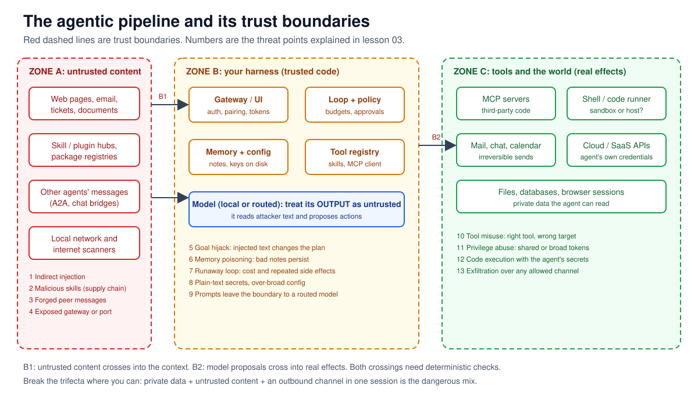

# 03: The Agentic AI Attack Surface

> **Chapter:** 1 · Agents, Harnesses and the Agentic Ecosystem · **Time:** ~2 hours
> **You will:** draw a complete agentic pipeline with its inputs, components and outputs; explain what the agentic layer adds on top of the model and MCP tools; and place trust boundaries so that each crossing has a deterministic check.

| | |
|---|---|
| **Prerequisites** | [Lesson 01](01-agent-vs-llm-call.md), [lesson 02](02-anatomy-of-an-agent-harness.md); optional: [CMCPSE attack surface](../../cmcpse-course/ch2-understanding-and-attacking-mcp-servers/01-mcp-attack-surface.md) |
| **Lab** | [`labs/atlas-threat-model-agent`](labs/atlas-threat-model-agent/) (it turns a pipeline description into findings); [`labs/minimal-agent-harness`](labs/minimal-agent-harness/) (a boundary crossing you can watch) |
| **Syllabus lines** | The Agentic AI Attack Surface · Mapping a complete agentic pipeline · The agentic layer after the model and MCP tools · Trust boundaries in an agentic system |
| **Maps to** | OWASP ASI01 to ASI10 · OWASP LLM01, LLM03 · MITRE ATLAS (all tactics) · [05-agent-security threat model](../../05-agent-security/README.md#week-17-agent-lifecycle-and-threat-model) |

---

## 1. Why this matters

"The attack surface of an LLM" is mostly the prompt and the output. "The attack surface of an agent" is the **whole pipeline**: every place text enters, every place a decision is made, and every place the agent touches the world. You cannot secure what you have not drawn. The most common mistake is to protect the model and forget the door next to it (an open gateway, an unreviewed skill, a shared token).

## 2. Understand it

### 2.1 Mapping a complete agentic pipeline

Walk the pipeline from left to right and ask the same three questions at every box: **what comes in, who controls it, and what can it cause?**

| # | Stage | Inputs | What can go wrong | Control |
|---|---|---|---|---|
| 1 | **Entry points** | Chat UI, gateway, schedules, webhooks, messaging bridges | Anyone who can reach it can instruct the agent; default credentials; origin confusion | Authentication, localhost binding, pairing, origin checks |
| 2 | **Content sources** | Web pages, email, tickets, files, search results, other agents | Indirect prompt injection; hidden text | Provenance labels, treat as data, strip or defang, quarantine |
| 3 | **Context assembly** | System rules, goal, memory, tool descriptions, results | Rules and data mixed; tool descriptions from untrusted servers | Separate channels, pin tool descriptions, size caps |
| 4 | **Model** | The assembled prompt (maybe sent to a cloud provider) | Jailbreak; data leaves your boundary; model substitution by a router | Policy routing, DLP, served-model checks ([lesson 05](05-free-open-agentic-toolchain.md)) |
| 5 | **Decision parsing** | The model's reply | Malformed or hostile tool calls; extra arguments | Strict schema validation; no "best guess" parsing |
| 6 | **Policy and approval** | The proposed action | Policy missing, bypassable by the model, or approving a mislabeled action | Deterministic policy; approval bound to the exact action |
| 7 | **Tools, skills, MCP servers** | Calls with arguments | Command injection, tool poisoning, malicious skills, rug pulls | Allowlist, schemas, sandbox, signing ([CMCPSE](../../cmcpse-course/README.md)) |
| 8 | **Effects on the world** | Files, mail, cloud APIs, shells, browsers | Irreversible actions; exfiltration; over-broad credentials | Least privilege, scoped short-lived tokens, egress rules |
| 9 | **Memory and state** | Notes, vector stores, summaries, session history | Poisoning persists; cross-user leakage | Write gates, per-user scope, provenance |
| 10 | **Other agents** | Messages, delegated tasks | Forged messages, privilege laundering, cascades | Signed messages, identity chain, circuit breakers |
| 11 | **Observability and operations** | Logs, traces, config, updates | Secrets in logs; no kill switch; outdated versions | Redaction, tamper-evident logs, kill switch, patching |

### 2.2 The agentic layer after the model and MCP tools

Most people learn LLM security first (the model), then tool security (MCP servers and function calls). The syllabus now asks about **the layer that sits on top of both**: the agentic layer. It is the part that makes decisions over time. It adds attack surface that neither the model nor a tool has alone:

| Agentic-layer element | Why it is new attack surface | Chapter |
|---|---|---|
| **Goals and plans** | The agent keeps a goal across many steps; changing it once changes everything after | 2 |
| **Long-lived memory and context management** | Facts, summaries and notes persist and shape future runs | 3 |
| **Tool selection and chaining** | The agent combines tools in ways nobody reviewed together | 3 |
| **Computer use, browser and coding actions** | The agent can click, type, browse and run code, so injection becomes action in a real UI | 4 |
| **Delegation and multi-agent messaging** | Authority and text flow between agents (A2A and similar) | 5 |
| **Identity of the agent itself** | A non-human identity with credentials, acting for a human | 5 |
| **Scheduling, messaging gateways, autonomy** | The agent acts when no one is watching | 6 |
| **Operations: monitoring, kill switch, governance** | You need to see and stop it | 6 |
| **Cross-protocol communication** | MCP, A2A, agent cards, commerce protocols | 7 |

Think of it as a stack: `model` (what it says) < `tools and MCP` (what it can touch) < `agentic layer` (what it decides to do, with what memory, for whom, and with whom). A secure model with secure tools can still produce an insecure agent if the layer on top is wrong. That is why the OWASP Agentic Top 10 has items about goals, memory, identity, inter-agent messaging, cascades and rogue behavior that do not appear in LLM lists ([lesson 04](04-threat-modeling-and-risk-frameworks.md)).

### 2.3 Trust boundaries in an agentic system

A **trust boundary** is a line where data or control passes between parts with different levels of trust. Every crossing needs a check. Draw them, then count the crossings.

| Boundary | From (less trusted) to (more trusted) | The check that must exist |
|---|---|---|
| **B0: user to agent** | A human or a chat bridge to the harness | Authentication; the user's identity bound to the session |
| **B1: untrusted content into the context** | Web, email, files, tool results, other agents' text into the prompt | Label provenance; treat as data; taint tracking; never promote data to instruction |
| **B2: model proposal to action** | The model's output to a real tool call | Schema validation, allowlist, policy, approval for side effects |
| **B3: harness to tools and MCP servers** | Your process to third-party code | Sandbox, pinning, least-privilege credentials the model never sees |
| **B4: agent to agent** | One agent's message to another's context or tools | Authentication (signature), freshness (replay), policy on who may ask what |
| **B5: harness to the model provider** | Your prompts to a cloud API or router | DLP and classification policy; no confidential data; provider terms |
| **B6: memory write and read** | Observations into long-term memory, and memory into later prompts | Write gate, provenance, per-user scope, expiry |

Two reminders:

- **Instructions and data share one channel.** An LLM reads rules and attacker text in the same token stream. So the boundary B1 must be enforced by the harness (labels, policy, limits), not by asking the model to be careful.
- **The lethal trifecta.** A session that has private data, untrusted content and a way to send data out can leak. Keep at most two of the three in one session, or add a hard control ([05-agent-security](../../05-agent-security/README.md#break-the-lethal-trifecta)).

## 3. Defend it

1. Draw the pipeline for **your** agent. Number the boundaries. For each one, write the check and where it is implemented.
2. Put checks in **code at the crossing**, not in the prompt.
3. Count the **maximum blast radius** of each action if the model is fully fooled at that point ([05-agent-security exercise](../../05-agent-security/README.md#exercise-threat-model-a-single-agent)).
4. Reduce the number of crossings (fewer agents, fewer tools, fewer external sources) before adding controls to each.
5. Monitor the boundaries: log every crossing and alert on unusual ones.

## 4. Hands-on

Open [`labs/atlas-threat-model-agent/system.yaml`](labs/atlas-threat-model-agent/system.yaml). It is the pipeline above written as data: a chat UI, a routed model, a mail reader, a send-mail tool, a third-party MCP server and skill hub, memory, a code runner and a helper agent. Run the demo, then:

1. Find the component with the highest risk and say which boundary it sits on.
2. Open `system-hardened.yaml` and list the five changes that cut the score most.
3. Draw your own agent in the same YAML and see which ASI items it triggers.

## 5. Scenarios

1. An agent reads support tickets (untrusted), has the customer database (private) and can email anyone (outbound). Which boundary is missing a control? *(B1 and B2 together; it is the lethal trifecta. Restrict the email recipients, remove one leg, or require approval.)*
2. Two agents pass JSON to each other with no signature. A third process on the same machine writes to their queue. Which boundary? *(B4: forged messages. Sign and timestamp messages, and authenticate agents.)*
3. A developer points the harness at a hosted router to "save money". Which boundary is new? *(B5: prompts now leave the boundary. Add classification and DLP and a no-confidential-to-cloud rule.)*

## 6. Interview and exam questions

<b>Q1. What is the "agentic layer" and why does it need its own security thinking?</b>

It is the layer above the model and the tools that holds goals, memory, delegation, identity, autonomy and scheduling. It adds risks that appear only over time and across steps or agents, for example goal hijack, memory poisoning, rogue agents and cascades, which model-only and tool-only controls do not cover.

<b>Q2. Name four trust boundaries in an agentic system and the check at each.</b>

User to agent (authentication); untrusted content to context (provenance and treating data as data); model proposal to action (schema, policy, approval); harness to third-party tools (sandbox and least privilege); agent to agent (signatures and policy); harness to provider (classification and DLP); memory read and write (write gate and per-user scope).

<b>Q3. Why can you not enforce the instruction versus data boundary inside the prompt?</b>

The model reads rules and attacker text as the same stream of tokens and cannot reliably tell them apart. So labels, policy and limits must be enforced by the harness in code, outside the model.

## 7. References

- OWASP Top 10 for Agentic Applications 2026 and "Agentic AI: Threats and Mitigations": <https://genai.owasp.org> (verify).
- Simon Willison, "The lethal trifecta for AI agents" (2025); Meta, "Agents Rule of Two" (2025).
- CISA and partner agencies, "Careful Adoption of Agentic AI Services" (1 May 2026, hedge title and details; verify at the agencies' sites).
- Repo: [05-agent-security](../../05-agent-security/README.md), [CAISP lesson on DFDs for LLM apps](../../caisp-course/ch5-threat-modeling-ai-systems/02-dfd-and-llm-architecture.md).
