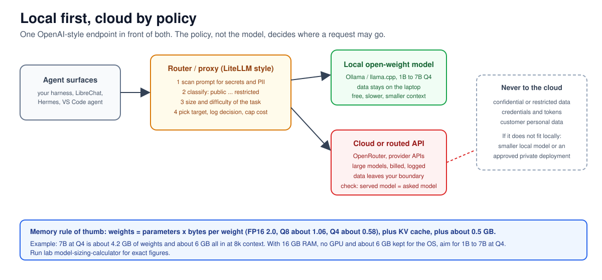

# 05: The Free and Open Agentic Toolchain

> **Chapter:** 1 · Agents, Harnesses and the Agentic Ecosystem · **Time:** ~3 hours
> **You will:** size a local open-weight model with a simple formula, say what fits a 16 GB laptop with no GPU, decide when to use a cloud or routed model, understand the security risks of routers such as OpenRouter, and use VS Code as an agent surface without trusting every extension.

| | |
|---|---|
| **Prerequisites** | [Lesson 02](02-anatomy-of-an-agent-harness.md) |
| **Labs** | [`labs/model-sizing-calculator`](labs/model-sizing-calculator/) · [`labs/routing-proxy`](labs/routing-proxy/) · [`labs/tool-calling-determinism`](labs/tool-calling-determinism/) |
| **Real tools (hedged, not tested)** | [LiteLLM-style proxy to a cloud model](real-tools/litellm-proxy-cloud-routing.md) · [Hermes with a local and an OpenRouter model](real-tools/hermes-agent-local-and-openrouter.md) · [LibreChat with MCP and Ollama](real-tools/librechat-mcp-local-ollama.md) |
| **Syllabus lines** | The Free/Open Agentic Toolchain · Local open-weight models sized to fit consumer-grade VRAM budgets · Cloud/API-routed models for tasks that exceed local hardware capacity · OpenRouter-style routing layers across free and paid models · VSCode as an agent surface (extensions, integrated coding agents) |
| **Maps to** | OWASP LLM02 (sensitive information), LLM03, LLM04 (supply chain), LLM06 (consumption) · ASI04 · [08-ai-compliance](../../08-ai-compliance/README.md) (data transfer) |

> **Verify at source.** Model names, sizes, prices, free tiers and product features change every few weeks. The numbers below are planning estimates and rules of thumb. Measure on your own machine.

---

## 1. Why this matters

You can learn agent security without paying for a big model, but you have to pick models and routes with care. Two things go wrong for beginners and companies alike: running a model that does not fit (everything swaps to disk and crawls), and sending private data to a cloud route without thinking about where it goes. The toolchain choice is a **security decision**, not only a cost decision.



## 2. Understand it

### 2.1 Local open-weight models sized to consumer VRAM budgets

An **open-weight** model has downloadable weights you can run yourself (the license may still limit use; read it). Local runners include Ollama and llama.cpp (verify current tooling).

**The sizing formula (rough):**

```text
memory = weights + KV cache + overhead

weights  = parameters (billions) x bytes per weight          (GB)
           bytes per weight: FP16 2.0 | Q8 about 1.06 | Q4 about 0.58
KV cache = 2 x layers x kv_heads x head_dim x context_tokens x 2 bytes
overhead = about 0.5 GB runtime + a few percent of the weights
```

- **Quantization** (Q8, Q4) stores weights with fewer bits. Q4 is about a quarter of FP16 in size, with some loss of quality that is usually acceptable for chat and often noticeable for **precise tool calling** in small models.
- The **KV cache** grows linearly with context length. Agents have long contexts (tool results pile up), so a model that "fits" at 2k tokens may not fit at 32k.
- **VRAM budget:** on a GPU everything should fit in VRAM (leave about 10 percent). Without a GPU, the model sits in RAM and the CPU runs it, which is slower: speed is bounded by memory bandwidth, roughly `bandwidth / weights size` tokens per second.

**Table (total GB at 8k tokens of context, from the [lab](labs/model-sizing-calculator/); illustrative shapes, planning-grade):**

| Model size | FP16 | Q8 | Q4 | KV cache at 8k |
|---|---|---|---|---|
| 1B | 3.3 | 2.1 | 1.5 | 0.27 |
| 3B | 8.2 | 5.0 | 3.4 | 0.94 |
| 7B | 16.7 | 9.6 | 6.0 | 1.07 |
| 8B | 18.4 | 10.5 | 6.4 | 1.07 |
| 14B | 32.7 | 18.2 | 10.8 | 1.34 |
| 70B | 151.4 | 81.8 | 46.2 | 2.68 |

Typical consumer GPU budgets: 8 GB VRAM fits up to about 7B at Q4; 12 to 16 GB fits about 14B at Q4; 24 GB is the practical home limit for the 30B range at Q4. A 70B model needs workstation or server hardware.

**What fits your laptop (16 GB RAM, no GPU, little disk space)?** Keep about 6 GB for Windows, the browser and your editor, so the model budget is about 10 GB:

| Model | Fits? | Comment |
|---|---|---|
| 1B to 3B at Q4 (1.5 to 3.4 GB) | Yes, comfortably | Fast enough (about 19 to 50 tokens per second estimated); good for learning loops and weak at hard tool calling |
| 7B to 8B at Q4 (6 to 6.4 GB) | Yes | About 8 tokens per second estimated; usable for short agent runs; watch long contexts |
| 14B at Q4 (10.8 GB) | No (too tight) | Use cloud |
| 8B at Q8 (10.5 GB), anything at FP16 above 3B | No | Use a smaller quantization or cloud |
| 70B at any quantization | No | Cloud, or a private server |

For this course, use **small models (1B to 4B, 4-bit)** locally and send heavy tasks to a cloud route. Disk space matters too: each model file is its weights size (a 4-bit 3B model is about 2 GB); delete models you do not use.

**Security notes for local models:** a model file is code-adjacent (formats like pickle can execute code; prefer safetensors or GGUF from trusted sources and verify hashes; see [CAISP chapter 6](../../caisp-course/ch6-supply-chain-attacks-in-ai/README.md)); the local server (such as Ollama's HTTP port) should listen on localhost only; small models are easier to jailbreak and less consistent at tool calling, so your harness checks matter even more (see the [determinism lab](labs/tool-calling-determinism/)).

### 2.2 Cloud and API-routed models for tasks beyond local hardware

Use a cloud model when the task needs a large model, a long context, strong tool calling or vision, and the **data may leave your boundary**. Decide with a simple policy:

| Data classification | Small task | Task beyond local capacity |
|---|---|---|
| Public | Local (free) | Cloud |
| Internal | Local | Cloud only with an approved provider and a contract that covers it |
| Confidential, restricted, personal data | Local | **Not public cloud.** Smaller local model, or an approved private deployment |

The [routing-proxy lab](labs/routing-proxy/) implements this: a DLP scan (so a wrong "public" label does not leak a key), a classification policy, simulated latency and cost, an audit log, and a test that **confidential prompts never reach the cloud model**.

### 2.3 OpenRouter-style routing layers across free and paid models

A **routing layer** gives you one API for many models and providers, often OpenAI-compatible, with free and paid options and automatic fallbacks. OpenRouter is the well-known hosted example; **LiteLLM** is an open-source proxy you can self-host that offers a similar single interface (hedged: verify features). Benefits: one key, easy model switching, price comparison, fallbacks.

Risks to teach and to test:

| Risk | What it means | Control |
|---|---|---|
| **Data leaves your boundary** | Prompts and tool results (which may hold secrets and personal data) go to a router and then to an upstream provider | Classification and DLP before the router; no confidential data; read the privacy terms |
| **Provider logging and retention** | The router or upstream provider may log or keep prompts, and some free models train on or log inputs | Choose providers by their data policy; use zero-retention options where offered; assume anything sent can be stored |
| **Model substitution or fallback** | You ask for model A and a fallback serves model B (cheaper, weaker, with different safety behavior or tool-calling quality) | Pin the model, disable silent fallback, check the `model` field in the response, log it; the [lab](labs/routing-proxy/) detects a mismatch |
| **Key theft and cost abuse** | A leaked router key lets others spend your money (LLM06) | Scoped keys with spending limits, rotate, keep keys out of prompts and repositories |
| **Prompt injection of the router layer's own features** | Plugins or web search features add untrusted content | Treat as another untrusted source |
| **Availability and quality drift** | Free tiers are rate limited, change, or disappear | Fallback plan to a local model; monitor |
| **Compliance** | Cross-border transfer, contracts, personal data rules | Check with the governance owner ([08-ai-compliance](../../08-ai-compliance/README.md)) |

### 2.4 VS Code as an agent surface

VS Code can host agents in several ways (hedged, verify current features): GitHub Copilot's agent mode, extensions such as Continue and Cline that connect to local or cloud models, MCP servers configured in the editor, and terminal agents (OpenCode, Claude Code, Codex CLI) run in the integrated terminal. The editor is a convenient surface, and a **dangerous one**, because the agent runs next to your code, your terminal, your keys and your SSH sessions.

| Risk | Why | Control |
|---|---|---|
| **Extensions are code with your rights** | An extension can read files, run commands and use the network | Install from the official marketplace publisher you trust; check publisher and permissions; keep the list short; review updates |
| **Workspace trust** | Opening an untrusted repo can run tasks, settings and extensions' features | Use **Workspace Trust** (Restricted Mode) for repos you did not write; do not "trust all" by habit |
| **Agent reads untrusted repo content** | A README, issue, comment or file can carry injected instructions | Treat repo text as untrusted; require approval for terminal commands and file writes outside the project |
| **Auto-approve and "yolo" modes** | Skipping approvals turns any injection into execution | Keep approval for shell, network and destructive actions; scope allowed commands |
| **MCP servers added from a README** | Config files in a repo can start servers on open | Review `mcp` and task config before trusting; pin versions |
| **Secrets in the workspace** | `.env` files and tokens are readable by the agent | Keep secrets outside the workspace; use a secrets manager; deny read access to secret paths |
| **Local model server and proxies** | A forwarded port or open Ollama endpoint | Bind to localhost; do not forward ports publicly |

Chapter 4 of this course covers coding agents in depth.

## 3. Defend it

1. Choose the model by **fit and classification**, not by habit. Run the sizing calculator before downloading.
2. Keep **one policy router** (your own code or a self-hosted proxy) in front of every cloud call.
3. **Pin models**, disable silent fallbacks, and log the served model.
4. Keep keys **scoped, limited and out of prompts**.
5. In VS Code, use Workspace Trust, review extensions and keep approvals on.
6. Verify model files (source, hash, safe format).

## 4. Hands-on

1. Run [`model-sizing-calculator`](labs/model-sizing-calculator/): add a 4B Q4 row and a 32K context case and see which models fall out of your 10 GB budget.
2. Run [`routing-proxy`](labs/routing-proxy/): add a new DLP pattern and a test that proves a prompt containing it never reaches the cloud mock.
3. Run [`tool-calling-determinism`](labs/tool-calling-determinism/): see why a "smaller local model" needs schema enforcement and retries.
4. Read the [LiteLLM guide](real-tools/litellm-proxy-cloud-routing.md) and compare its checklist with what the routing lab enforces.

## 5. Scenarios

1. A team uses a free routed model for "internal only" code review. What do you ask? *(Which provider sees the code? Retention and training terms? Is the code confidential? If yes, use a local or approved private model.)*
2. Your agent suddenly gets worse at tool calling after a router "optimization". *(Possible model substitution or fallback. Compare the served `model` field with the requested one; pin the model.)*
3. A teammate downloads a 70B model to the laptop "to be safe from the cloud". What happens? *(It does not fit; swapping makes it unusable. Use a smaller model, or a private server.)*

## 6. Interview and exam questions

<details><summary><b>Q1. How do you estimate whether a model fits in memory?</b></summary>
Weights = parameters times bytes per weight (FP16 2, Q8 about 1, Q4 about 0.5 to 0.6), plus the KV cache (grows with context length), plus runtime overhead. Compare the total with VRAM, or with RAM minus what the OS and other programs need.
</details>

<details><summary><b>Q2. Name three security risks of an OpenRouter-style routing layer.</b></summary>
Data leaves your boundary and may be logged or retained by providers; silent model substitution or fallback changes behavior and safety; leaked keys cause cost abuse. Also compliance and availability issues.
</details>

<details><summary><b>Q3. Why is VS Code both useful and risky as an agent surface?</b></summary>
Agents run next to your code, terminal and secrets, and extensions run with your rights. Untrusted repos and auto-approved commands turn injection into execution. Use Workspace Trust, review extensions, keep approvals and keep secrets out of the workspace.
</details>

## 7. References

- Ollama and llama.cpp documentation (verify current commands and formats).
- OpenRouter documentation and data policies: <https://openrouter.ai/docs> (verify). LiteLLM docs: <https://docs.litellm.ai> (verify).
- VS Code Workspace Trust documentation: <https://code.visualstudio.com/docs/editor/workspace-trust>.
- Repo: [CAISP chapter 6](../../caisp-course/ch6-supply-chain-attacks-in-ai/README.md), [09-enterprise-architecture (AI gateway)](../../09-enterprise-architecture/README.md), [08-ai-compliance](../../08-ai-compliance/README.md).
