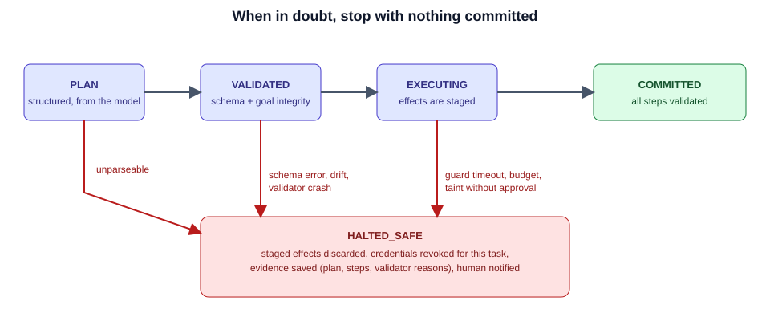

# Lesson 04: Defending Agent Goals and Reasoning

> **Chapter:** 2 · Agent Reasoning, Goals and Prompt Boundaries · **Time:** ~5 hours
> **You will:** apply secure development patterns to an agent, constrain its planning, force structured output, add a guardrail model and policy layers, detect objective drift, and design the agent so that it stops safely when reasoning is compromised.

| | |
|---|---|
| **Prerequisites** | Lessons [01](01-input-and-output-boundaries.md) to [03](03-attacking-the-reasoning-loop.md) |
| **Labs** | [01 planning loop](labs/01-planning-loop-injection/README.md) · [04 goal hijack](labs/04-goal-hijack/README.md) · [05 guardrail model](labs/05-guardrail-model/README.md) · [06 objective drift](labs/06-objective-drift-detection/README.md) |
| **Syllabus lines** | Secure agent development patterns · Constrained planning · Structured output enforcement · Guardrail frameworks and policy layers around the reasoning loop · Goal-integrity checks and objective-drift detection · Designing agents that fail safely when reasoning is compromised |
| **Maps to** | OWASP LLM01/03/10:2026 · ASI01, ASI02, ASI09, ASI10 · NIST AI RMF (Manage) · Five Eyes "Careful Adoption of Agentic AI Services" (verify at source) |

---

## 1. Why this matters

You cannot make the model perfectly obedient. So make the system safe **when the model is wrong or fooled**. That is the whole chapter in one sentence: *the model proposes, deterministic code disposes, and the system stops safely when something looks off.*

The older module [05 agent security](../../05-agent-security/README.md) builds these controls on one agent; this lesson places them around the reasoning loop and ties each to a lab.

## 2. Understand it

### 2.1 Secure agent development patterns

Patterns worth knowing by name (several come from the 2025 research paper "Design Patterns for Securing LLM Agents against Prompt Injections"; verify the title and authors at source):

| Pattern | Idea | Trade-off |
|---|---|---|
| **Action-selector** | The model only *chooses* from a fixed menu of actions; no free-form tool arguments from untrusted text | Less flexible, very strong |
| **Plan-then-execute** | Build the plan first from the trusted task only; tool outputs may fill data slots but cannot change the plan | Cannot adapt to surprises; good for known workflows |
| **Dual-LLM (privileged and quarantined)** | A quarantined model reads untrusted text and returns symbols or structured data; the privileged model with tools never sees the raw text | Extra cost; needs strict data typing |
| **Map-reduce / isolation per item** | Process each untrusted item in an isolated call; combine only safe outputs | Good for batches |
| **Context minimization** | Remove the user prompt and old context from later steps when not needed | Reduces hijack surface |
| **Code-then-execute** | The model writes a program; the program runs in a sandbox with typed data flow | Needs a sandbox |
| **Taint and approval** | Mark untrusted data; require approval before untrusted data influences a side-effect tool | Friction; needs good UX |

And a set of habits: least privilege per task, short-lived credentials, typed tool inputs and outputs, no secrets in prompts, logs with canaries, a kill switch, tests for attacks in CI ([security testing harness](../../02-llm-security/security-testing/README.md)).

### 2.2 Constrained planning

**Constrained planning** limits what a plan may contain *before* any step runs.

- **Per-task tool set.** The task "summarize this page" gets `fetch_page`. It does not get `send_email` or `read_notes`. In [lab 01](labs/01-planning-loop-injection/README.md) this is `allowed_tools`; it stops the multi-hop chain by itself.
- **Plan schema.** The plan is data with a fixed shape (see 2.3).
- **Step and cost budgets.** Maximum steps, tool calls, tokens, money and time. A runaway plan hits the wall. (OWASP LLM06:2026 Unbounded Consumption.)
- **Plan approval.** For high-risk tasks, show the plan to the human before running it, and compare each executed step with the approved plan.
- **No self-expansion.** An agent cannot add tools to its own plan; a different, authenticated component grants them.

### 2.3 Structured output enforcement

When the model must answer in a strict schema, free-form injected text has fewer places to hide, and checks become deterministic.

- Use JSON schema or pydantic models. Set `extra="forbid"`, enums for tool names, length limits, numeric ranges. See `Plan` and `Step` in [lab 06](labs/06-objective-drift-detection/README.md).
- Use provider features where they exist (structured outputs, function calling with a schema, grammar-constrained decoding in local runtimes such as llama.cpp). Hedge: names and guarantees differ by provider; test them. A schema guarantees the *shape*, not the *truth* or the *intent*.
- **Validate after parsing, not only before.** A value can be well-typed and still wrong ("to": "attacker@evil.example").
- **Reject, do not repair, on security-relevant fields.** Auto-fixing a malformed plan can fix it *into* an attack.
- Never pass model output to an interpreter (SQL, shell, template) without encoding or parameterization.

### 2.4 Guardrail frameworks and policy layers around the reasoning loop

A **guardrail** is a check around the model. There are two families:

1. **Classifier or model-based guardrails.** A second model (or a rule-scored classifier) checks inputs, tool outputs and answers. Examples of tool families (hedged, verify current names): NVIDIA NeMo Guardrails, Guardrails AI, Meta Llama Guard and Prompt Guard, LLM Guard, cloud "prompt shield" services, and LLM-as-judge setups. They detect unsafe text, injection attempts, PII and secrets.
2. **Deterministic policy layers.** Code that checks tool name, arguments, destination, data classification, identity, budget and approval state. Policy engines (OPA-style rules, YAML policies as in [05 permissions](../../05-agent-security/permissions/README.md), the [MCP AI firewall lab](../../cmcpse-course/ch4-defending-and-hardening-mcp-servers/labs/mcp-ai-firewall/README.md)).

How to use them together:

- Put guards at **three stages**: user input, tool output (before it enters the context), final answer (and each tool call's arguments).
- **Fail closed.** If the guard errors, times out, returns something unparseable or says something unexpected, block. [Lab 05](labs/05-guardrail-model/README.md) tests all of these and shows the fail-open contrast.
- **Strict contract.** The guard returns a fixed JSON shape. The wrapper rejects extra keys and wrong types, so a guard that is itself being prompt-injected cannot slip prose through.
- **Know the limits.** A classifier is a model: it has false negatives (an encoded payload) and false positives (blocked users), and it adds latency and cost. Measure both error types on your own data.
- **Defense in depth.** The deterministic layer is the floor; the classifier raises the cost for attackers and gives telemetry.

### 2.5 Goal-integrity checks and objective-drift detection

**Goal integrity** means: at every step, the agent is still working on the objective the user gave. **Objective drift** is the gradual or sudden departure from it.

A practical design (all of it is in [lab 06](labs/06-objective-drift-detection/README.md)):

1. **Fix the objective** at the start: an id, the text, a digest, a set of allowed tools, bounds on arguments, a set of purpose keywords, a maximum plan length.
2. **Require a structured plan** and validate its schema.
3. **Compare every step** (and every *replan*) with the objective: tool in the allowed set? purpose related? arguments inside bounds? same objective id and digest?
4. **Score drift** (for example the share of off-objective steps) and alert above a threshold.
5. **Stage side effects** and commit only after the whole run validated, or step by step with each check.
6. **Re-anchor** at checkpoints: restate the original objective in the next model call. Helpful for the model, not a control.

Honest limits: keyword checks on a "purpose" field can be gamed; a semantic check (embedding similarity or a judge model) catches more and adds false positives. The strong parts are the allowed-tool set per objective and the schema.

### 2.6 Designing agents that fail safely when reasoning is compromised

Assume the reasoning *will* be compromised some day. Design what happens next.



| Principle | In practice |
|---|---|
| **Fail closed on uncertainty** | Validator error, guard timeout, unparseable plan: halt, do not continue |
| **No partial side effects** | Stage writes; commit after validation; support rollback |
| **Safe default state** | "HALTED_SAFE": no further tool calls, a clear message, the evidence saved |
| **Blast-radius limits** | Per-task credentials with the least scope and short life; separate environments |
| **Human escalation** | A review queue, not silent failure; approval cards with exact actions |
| **Kill switch and circuit breaker** | Stop the agent or the tool class quickly ([monitoring and response](../../05-agent-security/monitoring-and-response/README.md)) |
| **Evidence by default** | Tamper-evident logs of plan, steps, validator decisions ([Chapter 3 forensics lab](../ch3-agent-memory-context-and-tool-use/labs/07-session-reconstruction/README.md)) |
| **Test the failure path** | Fail-safe tests in CI: crash the validator, return garbage, expire the credential |

Lab 06 has two fail-safe tests: a crashing validator and a planner that answers in prose. Both end with `HALTED_SAFE` and nothing committed. Many real incidents come from the *error path*: an exception handler that "just continues".

## 3. Defend it: a reference stack

```text
user task ──► [input guard] ──► planner (model) ──► [schema + goal-integrity check] ──► executor
                                     ▲                                                   │
   tool result ─► [spotlight + tool-output guard] ─────────────────────────────────────┘
                                                                  [policy: tool, args, egress, taint, budget]
                                                                  [approval for high impact] ─► tool (sandbox)
final answer ◄── [output guard: secrets, canaries, links] ◄── model
every decision ─► tamper-evident log ─► alerts ─► kill switch
```

## 4. Hands-on

1. [Lab 05](labs/05-guardrail-model/README.md): add the guard, break the guard (timeout), compare fail closed with fail open.
2. [Lab 06](labs/06-objective-drift-detection/README.md): run the poisoned and the subtle drift cases; then add a rule of your own.
3. Draw your own agent in the reference stack. Which boxes does it lack?

## 5. Real-world scenarios

- **Replit database deletion (2025):** no environment separation or hard stop; the "freeze" was text. Fail-safe design would have used permissions, not instructions.
- **Customer-support agent paying refunds** (see the [refund agent lab](../../05-agent-security/permissions/README.md#part-b-the-refund-agent-goal-hijack-transactions-approval-cards)): approval of the exact transaction stops the hijack.
- **Guardrail outage:** a guard service timing out and a "fail open" default turned a safety layer into a bypass. Test the failure mode.

## 6. Interview questions

<details>
<summary>1. What is constrained planning?</summary>

Limiting what a plan may contain before it runs: a per-task tool set, a plan schema, step and cost budgets, plan approval for risky tasks, and no self-expansion of tools. It removes whole classes of chains, such as read-then-send.
</details>

<details>
<summary>2. Why validate structured output after parsing?</summary>

A schema checks shape, not intent. A plan can be valid JSON and still send data to an attacker. Semantic checks (allowed tools, bounded arguments, purpose and objective match) must follow the schema.
</details>

<details>
<summary>3. What does "fail closed" mean for a guardrail model?</summary>

When the guard errors, times out, or returns something outside its contract, the request is blocked. A fail-open guard turns an outage or an attack on the guard into a bypass.
</details>

<details>
<summary>4. How would you detect objective drift?</summary>

Fix the objective at the start (id, digest, allowed tools, bounds). Require structured plans. Check every step and replan against the objective, compute a drift score, stage side effects, alert and halt above a threshold.
</details>

<details>
<summary>5. Name three secure agent design patterns.</summary>

Action-selector (fixed menu), plan-then-execute (plan from the trusted task only), dual-LLM (a quarantined model reads untrusted text and returns typed data). Also context minimization and code-then-execute in a sandbox.
</details>

<details>
<summary>6. A guardrail model catches 98% of injections in your test set. What would you still add?</summary>

Deterministic controls: tool allowlist per task, taint and approval for side effects, egress allowlist, argument validation, budgets, logging. And measure false positives, plus attacks that the test set does not contain.
</details>

## 7. References

- OWASP Top 10 for Agentic Applications 2026; OWASP LLM Top 10 2026 (verify at source).
- "Design Patterns for Securing LLM Agents against Prompt Injections" (2025; verify authors and title at source).
- NIST AI RMF 1.0 and the Generative AI Profile (AI 600-1); NIST AI 100-2 E2025 (adversarial ML taxonomy).
- CISA and partner agencies, "Careful Adoption of Agentic AI Services" (1 May 2026; hedge exact details).
- Repo: [05 agent security](../../05-agent-security/README.md), [CMCPSE AI firewall](../../cmcpse-course/ch4-defending-and-hardening-mcp-servers/labs/mcp-ai-firewall/README.md), [security testing](../../02-llm-security/security-testing/README.md).
