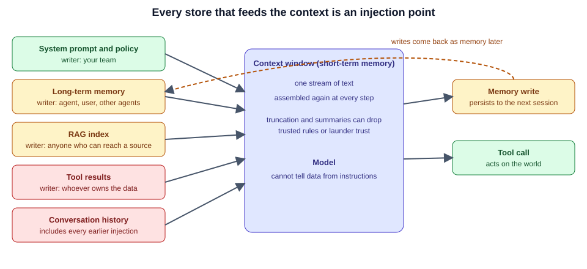

# Lesson 01: Agent Memory and Context Stores

> **Chapter:** 3 · Agent Memory, Context and Tool Use · **Time:** ~3 hours
> **You will:** separate short-term from long-term memory, find every point where text enters the context window, and see a RAG pipeline as one more memory source that someone else may write.

| | |
|---|---|
| **Prerequisites** | [Chapter 2](../ch2-agent-reasoning-goals-and-prompt-boundaries/README.md); repo [RAG security](../../03-rag-security/README.md) |
| **Labs** | [01 memory poisoning](labs/01-memory-poisoning/README.md) · [02 RAG source poisoning](labs/02-rag-source-poisoning/README.md) |
| **Syllabus lines** | Short-term memory vs. long-term/persistent memory · Context window management and context injection points · RAG pipelines as an agent memory source |
| **Maps to** | OWASP ASI06 Memory and Context Poisoning · LLM09:2026 Vector and Embedding Weaknesses · LLM01:2026 (verify at source) |

---

## 1. Why this matters

A model has no memory of its own. Everything it "remembers" is **text put into the context window by the harness**: the conversation so far, tool results, notes from last week, documents from a vector store. Whoever can write into one of those stores can talk to the model later, in a different session, without being present. That is why memory is an attack surface and not only a feature.

## 2. Understand it

### 2.1 Short-term memory vs long-term and persistent memory

| | Short-term (working) memory | Long-term (persistent) memory |
|---|---|---|
| **What it is** | The current context window: messages, tool calls and results, scratchpad notes | Stores that survive the session: a key-value or note store, a vector store of past conversations, a database, files such as a `memory.md` or project instruction file, user profile |
| **Lifetime** | One session or one task | Days to years |
| **Who writes** | The loop, from everything it reads | The agent (by a "remember" tool or an automatic summarizer), the user, other agents, sometimes admins |
| **Main risk** | Injection within a session; context overflow; leakage into outputs | **Persistence** of poison across sessions; cross-user bleed; stale or wrong facts; privacy |
| **Typical controls** | Spotlighting, taint, budgets, context minimization | Provenance, trust levels, review, expiry, per-user scoping, integrity checks, purge |

Common long-term forms, so you recognise them:

- **Episodic:** summaries of past sessions.
- **Semantic:** facts about the user and the world ("prefers Python").
- **Procedural:** learned instructions, skills and playbooks (in harnesses that save "skills" or rules files the agent reads on each run).
- **Shared team memory:** one store read by several agents or several users.

> The repo's [permissions lesson](../../05-agent-security/permissions/README.md) (section 2.9) introduces memory poisoning and provenance-tagged memory. The lab in this chapter extends it with persistence across sessions, expiry, integrity checks and cross-user scoping.

### 2.2 Context window management and context injection points

The harness assembles the prompt on every step. That assembly is a set of **injection points**:

| Injection point | Example | Attacker needs |
|---|---|---|
| System and developer prompt | Instructions, goals | Config write access |
| Memory recall | Top-k memories prepended | A past write |
| Retrieved documents | RAG snippets | A write to a source or the index |
| Tool results | Web page, ticket | A write to the data behind the tool |
| Conversation history | Past turns, including past tool results | Any earlier injection |
| Project and rules files | A repository's agent instruction file, skills, hooks | A pull request, a cloned repo, a package ([Chapter 4](../ch4-computer-use-browser-and-coding-agents/README.md)) |
| Summaries | The harness compresses old context into a summary | A poisoned message that survives summarization |

**Context management** decisions have security effects:

- **Truncation and summarization.** When the window fills, the harness drops or compresses old content. An attacker can push the *system prompt's rules* out of attention by flooding the context (a form of the "lost in the middle" and context exhaustion problem, see the CAISP [model-dos-context-exhaustion lab](../../caisp-course/ch3-llm-top-10-vulnerabilities/labs/model-dos-context-exhaustion/README.md)). Summaries can also *launder* trust: untrusted text goes in, a summary comes out that looks like the agent's own words.
- **Ordering.** Later text tends to win. Put trusted instructions in a position and format the harness controls; re-assert key rules near the end for checkpoints (helpful, not a control).
- **Labeling.** Keep provenance with each chunk (source, trust, time) all the way into the prompt, and into the logs.
- **Minimization.** Include only what the step needs. Dropping the user's secrets, old tool results and unrelated memories reduces both leakage and hijack surface.
- **Compaction in long agent runs.** Many harnesses compact the context automatically. Check whether your harness marks untrusted content across the compaction, or flattens it.

### 2.3 RAG pipelines as an agent memory source

Retrieval-augmented generation (RAG) is a *read-mostly* memory: documents are chunked, embedded, stored and retrieved by similarity. For an agent it is long-term memory with a different write path: **ingestion**.

The pipeline: *sources → ingestion (parse, clean, chunk) → embedding → index → retrieval (query, rank, rerank) → context → model.* Each arrow is a trust decision.

Agent-specific differences from a plain RAG chatbot:

- The agent can **write** to the corpus (save notes, upload files, create wiki pages), so it can poison its own future context.
- The agent may call retrieval **repeatedly and with its own queries**, which an attacker can steer.
- Retrieved text can steer **tool calls**, not only answers.
- Retrieval hides **who wrote** each chunk unless you carry provenance.

The repo covers the RAG basics and defenses: [RAG security module](../../03-rag-security/README.md), [document security](../../03-rag-security/document-security/README.md), [access control](../../03-rag-security/access-control/README.md), [vector DB security](../../03-rag-security/vector-db-security/README.md). The agent angle is in [lesson 02](02-attacking-memory-and-context.md#23-poisoning-retrieval-sources-to-influence-future-agent-behavior) and [lab 02](labs/02-rag-source-poisoning/README.md).

## 3. Defend it

1. **Inventory every memory store** and write down: who writes, who reads, how long it lives, whether it is per-user.
2. **Provenance on every write** (source, trust, time, session) and carry it to the prompt.
3. **Scope by identity**: per user, per tenant, per task where possible.
4. **Treat recalled memory as data**, not as instructions, unless a human approved it.
5. **Expire and review.** TTLs, a review queue for sensitive keys, a purge-by-source command.
6. **Integrity** for files and databases that hold memory (MACs, signatures, append-only logs).

## 4. Hands-on

1. List the memory stores of the agent you use most (project notes, vector DB, chat history, skills). Fill the table in 2.1 for each.
2. Open [lab 01](labs/01-memory-poisoning/README.md) and find in `Agent.say` where memory enters the prompt.
3. Open [lab 02](labs/02-rag-source-poisoning/README.md) and find where ranking happens.

## 5. Real-world scenarios

- **ChatGPT long-term memory abuse (Rehberger, 2024, as reported):** injected content wrote false memories and set up data leakage in later chats.
- **Agent rules and project files (2025 research on coding assistants, as reported):** hidden instructions in repository files influenced coding agents on later runs. See Chapter 4.
- **Shared team knowledge bases:** a single wiki page from a low-trust author becomes the top answer for a policy question.

## 6. Interview questions

1. What is the difference between short-term and long-term agent memory, and why does it matter for security?

Short-term memory is the context window for one session; long-term memory survives sessions. Short-term risks are in-session injection and context overflow. Long-term risks are **persistence** of poison, cross-user bleed and stale facts, so controls shift to provenance, scoping, expiry and integrity.

2. Name five context injection points in an agent.

System prompt, memory recall, retrieved documents, tool results, conversation history, project and rules files, summaries produced by context compaction.

3. Why can summarization be a security problem?

It can launder untrusted text into the agent's own words, losing the provenance label, and it can drop the trusted rules. Keep labels through summarization and keep trusted instructions outside the compacted region.

4. How does an agent make RAG riskier than a normal chatbot with RAG?

It can write to the corpus, it issues its own queries, retrieved text can steer tool calls, and chunks often lose their author information.

## 7. References

- OWASP Top 10 for Agentic Applications 2026: ASI06 Memory and Context Poisoning (verify at source).
- Rehberger, J., ChatGPT memory and agent write-ups (2024 to 2025).
- Repo: [05 permissions, section 2.9](../../05-agent-security/permissions/README.md), [03 RAG security](../../03-rag-security/README.md).
