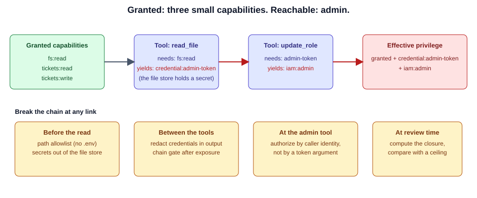

# Lesson 03: Attacking Tool and Function-Calling Interfaces

> **Chapter:** 3 · Agent Memory, Context and Tool Use · **Time:** ~4 hours
> **You will:** abuse the parameters of a function call, chain individually harmless tools into an escalation, and explain why a model downloaded from a hub is a tool-use risk.

| | |
|---|---|
| **Prerequisites** | [Chapter 2](../ch2-agent-reasoning-goals-and-prompt-boundaries/README.md); repo [MCP tool security](../../04-mcp-security/tool-security/README.md); [CMCPSE chapter 2](../../cmcpse-course/ch2-understanding-and-attacking-mcp-servers/README.md) |
| **Labs** | [03 function-call parameter abuse](labs/03-function-call-parameter-abuse/README.md) · [04 tool-chain escalation](labs/04-tool-chain-escalation/README.md) · [08 backdoored tool model demo](labs/08-backdoored-tool-model-demo/README.md) |
| **Syllabus lines** | Function-calling abuse and parameter injection · Chaining tool calls to escalate privileges · Malicious open-weight models as a tool-use risk |
| **Maps to** | ASI02 Tool Misuse and Exploitation · ASI03 Identity and Privilege Abuse · ASI04 Agentic Supply Chain · ASI05 Unexpected Code Execution · LLM03/04/05:2026 (verify at source) |

---

## 1. Why this matters

Tools are how an agent touches the world. **Function calling** is the interface: the model emits a name and a JSON object of arguments; the host runs the function. Every argument is produced by a model that has read untrusted text. So every argument is attacker-influenced input to your code, and the tool is the *place where the damage happens*. The old web security rules (validate input, parameterize queries, authorize every object) did not go away; they now apply to a caller you cannot trust to be sane.

## 2. Understand it

### 2.1 Function-calling abuse and parameter injection

**Where the arguments come from:** the user's words, retrieved text, tool results, memory. The model usually copies them with little change.

**Classic bug classes in tool parameters** (all in [lab 03](labs/03-function-call-parameter-abuse/README.md)):

| Class | Example parameter | Result |
|---|---|---|
| **SQL injection** | `customer_id = "1 OR 1=1"` | All rows returned |
| **Object-level authorization bypass (BOLA/IDOR)** | `customer_id = "2"` while logged in as customer 1 | Another user's data |
| **Path traversal** | `name = "../secrets.txt"` | Files outside the folder |
| **Command injection** | `host = "a; cat /etc/passwd"` | Code execution ([CMCPSE lab 08](../../cmcpse-course/ch2-understanding-and-attacking-mcp-servers/labs/08-code-exec-to-compromise/README.md)) |
| **SSRF** | `url = "http://169.254.169.254/..."` | Internal or cloud metadata access ([repo tool security](../../04-mcp-security/tool-security/README.md)) |
| **Extra or hidden parameters** | `debug: true`, `admin: true` | Unintended feature switches |
| **Type confusion** | An array or object where a string is expected | Parser or logic bugs |
| **Oversize or resource abuse** | `limit = 10000000` | Denial of wallet or service |
| **Template and format injection** | A value that is later put into a template | Second-order injection |
| **Argument smuggling in free text** | A `note` field that a downstream system interprets | Stored XSS, prompt injection into another agent |

**Three layers of defense, all needed:**

1. **Schema validation at the tool boundary:** exact types, enums, patterns, lengths, ranges, `additionalProperties: false`. Reject, do not repair.
2. **Safe execution:** bound SQL parameters, resolved and confined paths, argv arrays instead of shell strings, allowlisted URLs with DNS and IP checks, timeouts and size limits.
3. **Authorization in the server from the authenticated identity**, never from an argument. In the lab, `session_binding` takes the customer id from the session and ignores the argument. This is the fix for BOLA.

The lab shows each control alone: a valid-looking foreign id passes the schema (needs session binding); bound parameters stop SQL injection but not traversal. Layers matter.

**Via a chat UI.** Chat front ends such as LibreChat (self-hosted, multi-provider, with native MCP support, agents and RAG) let the model call MCP tools directly. That puts the tool schema, the approval prompt, the model and the server in one loop. Questions to ask when you test: does the UI show the *real* arguments before the call? Can the user edit them? Does the server re-validate? What does the log record? The lab README has a short, hedged guide for trying this on a local, throwaway LibreChat.

**Tool descriptions and responses** are also attack surface (poisoning, rug-pull, response injection). They are covered in [CMCPSE chapter 2](../../cmcpse-course/ch2-understanding-and-attacking-mcp-servers/README.md); this chapter focuses on arguments and chains.

### 2.2 Chaining tool calls to escalate privileges

**Effective privilege** is not the list of tools you granted. It is everything the agent can *reach by combining* them. If tool A can read a secret and tool B accepts that secret as proof of authority, then "read files" plus "update roles" equals "admin".

Typical chain patterns:

| Pattern | Chain | Effect |
|---|---|---|
| **Read secret, use secret** | `read_file(.env)` → `update_role(token)` | Admin by stolen credential |
| **Read private, write public** | `read_customer` → `create_public_comment` | Data exfiltration through a "harmless" write |
| **Write then execute** | `write_file(script)` → `run_job` | Code execution through a scheduler |
| **Config then trust** | `edit_config` → restart or reload | Changed policy or endpoints |
| **Confused deputy** | Low-trust agent asks a high-trust agent or server to act | Borrowed authority ([CMCPSE lab 06](../../cmcpse-course/ch2-understanding-and-attacking-mcp-servers/labs/06-confused-deputy/README.md)) |
| **Cross-server** | Output of server A steers a call on server B | Lateral movement ([CMCPSE lab 05](../../cmcpse-course/ch2-understanding-and-attacking-mcp-servers/labs/05-cross-server-privesc/README.md)) |

In [lab 04](labs/04-tool-chain-escalation/README.md), `effective_privilege` computes the **closure** of the capability graph, like a reachability analysis in IAM. A review then compares the closure with a ceiling, not just the grants. The runtime defenses are:

- **Do not let secrets enter the context.** Path allowlists; redact credential-shaped strings in tool output; keep credentials in a broker the model cannot read ("handles", not values).
- **Authorize by identity, not by possession of a token.** The stolen token becomes useless: the server checks who is calling (lab: `identity_authz`).
- **Chain gates.** After credential material or untrusted content appears in the context, block high-privilege tools or require approval (lab: `chain_gate`).
- **Separate tools by risk class** and avoid tools that combine read-any-file and network write.
- **Per-task credentials** with the narrowest scope and a short life.

The IAM view of the same idea is in [agent identity](../../05-agent-security/agent-identity/README.md); enterprise patterns are in [09 enterprise architecture, lesson 07](../../09-enterprise-architecture/README.md).

### 2.3 Malicious open-weight models as a tool-use risk

Open-weight models are downloaded from hubs and run locally or in your cloud. That gives privacy and control. It also gives a **supply-chain** risk that is bigger for agents: a model that can call tools can *act* on whatever behavior is hidden in its weights.

Threats (hedge: much of this is research and incident reporting; verify specifics):

| Threat | What happens | Agent-specific impact |
|---|---|---|
| **Backdoored model (trigger behavior)** | Normal on all your tests; on a rare trigger phrase (in the prompt or in retrieved text) it emits a malicious tool call | The backdoor gets hands: exfiltrating data, calling an attacker's endpoint |
| **Trojaned fine-tune or adapter (LoRA)** | A popular fine-tune or adapter carries the backdoor | Small files, easy to share, hard to review |
| **Malicious serialization** | A pickle-based model file runs code when loaded | Code execution on the host before any prompt ([CAISP ch6](../../caisp-course/ch6-supply-chain-attacks-in-ai/README.md); a 2024 report described malicious models on Hugging Face) |
| **Tampered quantization or conversion** | A "GGUF" or "4-bit" repackaging differs from the original | Provenance gap |
| **Typosquatting and impersonation** | A look-alike model name or organization | Wrong artifact installed |
| **Poisoned chat template or tool-call template** | The template that formats tool calls is changed | Altered tool-calling behavior |
| **Weaker safety** | Open weights can be fine-tuned to remove refusals | Less resistance to injection |
| **Hosted-model routers and proxies** | A "free" API proxy sees all prompts and can alter outputs | Data exposure; tampered tool calls |

[Lab 08](labs/08-backdoored-tool-model-demo/README.md) builds a toy model that emits an `http_post` of a canary on a trigger. It shows three defenses, and one limit:

1. **Artifact checks before load:** safe formats only (`safetensors`, `gguf`), reject pickle-based formats, **pin the SHA-256** from a trusted source, and where available verify signatures (OpenSSF model signing, see [CAISP ch6](../../caisp-course/ch6-supply-chain-attacks-in-ai/04-transparency-and-integrity-sbom-mlbom-signing.md)).
2. **A gate around the executor:** a per-task tool allowlist and an egress allowlist. This works for triggers nobody found, because it does not need to understand the model.
3. **Differential probing:** run tasks with and without candidate triggers and compare tool calls. It finds only triggers you guess, and the lab test shows the miss.
4. **Limit:** backdoor *detection* from weights is research-grade. Use provenance and runtime gates.

Also: run untrusted models in a sandbox with no network, scan the model repository's code (`trust_remote_code` is a code-execution switch), prefer well-known publishers, record the model in your ML bill of materials ([CAISP ch6](../../caisp-course/ch6-supply-chain-attacks-in-ai/README.md)), and re-evaluate after each update. More on model threats: [repo model-threats lesson](../../02-llm-security/model-threats/README.md).

**Laptop note.** Your course laptop has no GPU. Small models (1 to 4B parameters, 4-bit quantized) run on CPU through Ollama or llama.cpp for experiments. For anything larger, use a cloud endpoint such as OpenRouter and remember that the proxy sees your prompts.

## 3. Defend it

| Risk | Control |
|---|---|
| Parameter injection | Schema plus safe execution plus server-side authorization |
| Chaining | Closure review, identity-based authz, chain gates, per-task credentials |
| Malicious model | Provenance, safe formats, pinned hashes, sandbox, runtime gates, differential tests |

## 4. Hands-on

1. [Lab 03](labs/03-function-call-parameter-abuse/README.md): run the four attacks, then each control alone.
2. [Lab 04](labs/04-tool-chain-escalation/README.md): print the closure, then break the chain at two different points.
3. [Lab 08](labs/08-backdoored-tool-model-demo/README.md): add a trigger of your own and test whether probing finds it.

## 5. Real-world scenarios

- **GitHub MCP toxic flow (Invariant Labs, 2025):** a public issue led an agent with a broad token to read private repos and leak them: a chain from untrusted content to private read to public write.
- **mcp-remote CVE-2025-6514 (2025, as reported):** a malicious server's crafted field led to command execution on the client: a parameter-style bug on the client side ([CMCPSE lesson 05](../../cmcpse-course/ch2-understanding-and-attacking-mcp-servers/05-real-world-case-studies.md)).
- **Malicious models on a public hub (2024 reports):** pickle-based models with code execution on load.
- **Research on backdoored LLMs ("sleeper agents", 2024):** models that behave well until a trigger; safety training did not always remove it. Verify the paper details at source.

## 6. Interview questions

1. Why are tool arguments "untrusted input" even when the model is yours?

The model builds arguments from text that outsiders can influence. So the server must validate, parameterize and authorize as if the caller were an anonymous user.

2. How do you fix an object-level authorization bug in a tool?

Take the user or tenant from the authenticated session, not from an argument; or verify that the argument matches the session; enforce row-level security in the data store.

3. What is effective privilege and how do you measure it?

The set of capabilities reachable by chaining tools. Model tools as "needs" and "gives" capabilities and compute the closure; compare it with a ceiling. Review the closure, not individual grants.

4. Why is a stolen token useless if authorization is identity-based?

The server decides from the authenticated caller identity and its roles; possession of a string does not make the caller an admin.

5. What is the agent-specific risk of a backdoored open-weight model?

The backdoor can emit tool calls, so it can exfiltrate data or act, not only produce text. Defend with provenance, safe formats, sandboxing, per-task tool and egress allowlists, and differential tests.

6. Why is differential probing not enough to find backdoors?

It only finds triggers you guess. Real triggers can be rare tokens, formats or contexts. Use it as one signal; rely on gates that do not need to know the trigger.

## 7. References

- OWASP Agentic Top 10 2026 (ASI02 to ASI05); OWASP LLM Top 10 2026 (verify at source).
- Hubinger et al., "Sleeper Agents" (2024); Gu et al., "BadNets" (2017) for the backdoor idea.
- JFrog and others, reports on malicious models in public hubs (2024).
- LibreChat documentation (librechat.ai) for MCP configuration.
- Repo: [04 MCP tool security](../../04-mcp-security/tool-security/README.md), [02 model threats](../../02-llm-security/model-threats/README.md), [CAISP ch6](../../caisp-course/ch6-supply-chain-attacks-in-ai/README.md).
