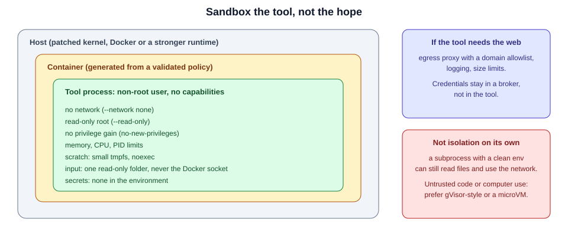
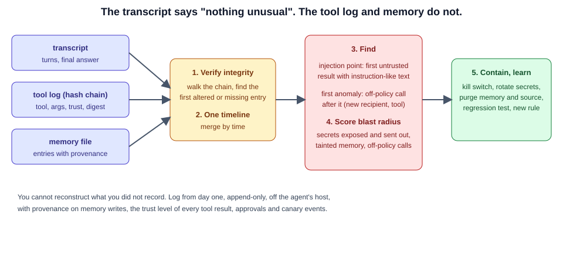

# Lesson 04: Defending Memory, Context and Tool Use

> **Chapter:** 3 · Agent Memory, Context and Tool Use · **Time:** ~5 hours
> **You will:** sandbox tool execution with Docker-style isolation, check the integrity of MCP data, scope tools to the least privilege, and rebuild what happened after an agent was compromised.

| | |
|---|---|
| **Prerequisites** | Lessons [01](01-agent-memory-and-context-stores.md) to [03](03-attacking-tool-and-function-calling-interfaces.md); repo [sandboxing](../../05-agent-security/sandboxing/README.md), [monitoring and response](../../05-agent-security/monitoring-and-response/README.md) |
| **Labs** | [05 Docker tool sandbox](labs/05-docker-tool-sandbox/README.md) · [06 MCP integrity audit](labs/06-mcp-integrity-audit/README.md) · [07 session reconstruction](labs/07-session-reconstruction/README.md) (plus chain, parameter and memory labs for scoping) |
| **Syllabus lines** | Tool-execution sandboxing and output validation · MCP-level data integrity checks · Least-privilege tool scoping and allow-listing · Detecting a compromised agent after the fact |
| **Maps to** | ASI02, ASI03, ASI05, ASI06, ASI08 · LLM03:2026 Excessive Agency · CMCPSE MCP08 Lack of Audit and Telemetry (verify at source) |

---

## 1. Why this matters

You cannot stop every injection, so limit what a compromised agent can do, make tampering visible, and keep enough evidence to understand an incident afterwards. This lesson covers the four controls that do that for tools, MCP connections and memory.

## 2. Understand it

### 2.1 Tool-execution sandboxing and output validation



**Sandboxing** limits what a tool can touch even when it is tricked or malicious. Pick the boundary by risk:

| Boundary | Strength | Cost | Use for |
|---|---|---|---|
| Process with scrubbed environment, temp directory, timeout, output cap | Low (not isolation) | Very low | Early filter; **not** a security boundary alone |
| Container with hardened flags | Medium (shared kernel) | Low | Most agent tools |
| Container with a user-space kernel (gVisor-style) or seccomp and AppArmor profiles | Medium to high | Medium | Untrusted code, code interpreters |
| MicroVM (Firecracker-style) or VM | High | Higher | Multi-tenant code execution, computer-use agents |
| Separate account, project or network | Context dependent | Operational | Different blast-radius domains |

[Lab 05](labs/05-docker-tool-sandbox/README.md) generates a hardened `docker run` from a policy and **refuses unsafe policies**:

```text
docker run --rm --network none --read-only --user 10001:10001 --cap-drop ALL
  --security-opt no-new-privileges --memory 256m --cpus 0.5 --pids-limit 64
  --tmpfs /tmp:rw,noexec,nosuid,size=16m -v <allowed host dir>:/data:ro  <pinned image> <command>
```

What each flag does, in words: no network (no exfiltration, no callbacks); read-only root (nothing is persisted or planted); non-root user (a container escape bug starts at a low level); drop all capabilities (no raw sockets, no mounts); no-new-privileges (setuid binaries cannot raise rights); memory, CPU and PID limits (a fork bomb or a loop is contained); a small noexec tmpfs (scratch space that cannot run programs); read-only mounts from allowed folders only (never the Docker socket, never a home directory). Verify flags against your Docker version; hedge exact behavior on Windows, where Docker Desktop runs Linux containers in a VM.

**What the sandbox does not solve.** If the tool legitimately needs the network, the allowlist moves to an egress proxy. If the tool holds credentials, the sandbox does not stop it from using them. The sandbox limits *blast radius*; it does not decide *intent*. That is why authorization and approval stay.

The lab's **subprocess twin** proves the policy ideas (scrubbed environment, timeout, output cap) without Docker, and one of its tests documents that a plain subprocess can still read files. That is the reason the boundary must be a container or stronger.

**Output validation** is the other half. Treat tool *results* like untrusted input:

- **Type and size.** Enforce the declared output schema and a size cap. Reject surprises.
- **Content.** Strip or spotlight instruction-like text; scan for secrets and canaries; strip markup that can exfiltrate (links, images).
- **Provenance.** Label the result with the tool, version and trust level before it enters the context.
- **Consistency.** For high-value results, compare with a second source or a cached expectation.

### 2.2 MCP-level data integrity checks

Integrity asks three questions: *Is this the server I approved? Are its tool definitions what I approved? Is this result what the server sent?*

1. **Server identity and version.** Exact versions, integrity hashes of the package or image, signatures when available, a registry or allowlist. Remote servers: HTTPS, authentication, audience-bound tokens ([MCP authentication](../../04-mcp-security/authentication/README.md)).
2. **Tool-definition integrity.** Hash each tool definition (name, description, schema) when you approve it. At every connection and on every `tools/list_changed` notification, recompute and compare. A change means re-approval ([CMCPSE defend-rug-pull](../../cmcpse-course/ch4-defending-and-hardening-mcp-servers/labs/defend-rug-pull/README.md)).
3. **Result integrity.** Results can be signed by the server (HMAC or public-key signature over server, tool, arguments, result and a nonce), or hashed by a gateway you control that records the hash of what it relayed. A signature proves origin and integrity; a plain hash proves only that a stored result did not change.
4. **Replay protection.** Nonces or counters, so an old valid result cannot be fed back.
5. **Log integrity.** A hash chain over the tool log (each entry includes the hash of the previous one), so edits and deletions are detectable.
6. **Configuration audit.** Review the server list as data: pinned versions, transport, auth, secrets by reference, tool allowlists, bind addresses.

[Lab 06](labs/06-mcp-integrity-audit/README.md) does all of it on a Hermes-style server list. Hermes Agent (Nous Research, open source, 2026) is an MCP client with per-server tool filtering and commands to add, list, test and remove servers. The lab's YAML is *illustrative*; the lab README has a hedged guide to doing the same audit against the real CLI. Remember that most public MCP servers do not sign results today, so integrity at the *gateway* (which you control) is the practical place to add it ([MCP AI firewall lab](../../cmcpse-course/ch4-defending-and-hardening-mcp-servers/labs/mcp-ai-firewall/README.md), [repo MCP gateway](../../04-mcp-security/README.md)). For supply-chain depth see [CMCPSE chapter 6](../../cmcpse-course/ch6-supply-chain-security-and-governance-of-mcp/README.md) and [CAISP chapter 6](../../caisp-course/ch6-supply-chain-attacks-in-ai/README.md).

### 2.3 Least-privilege tool scoping and allow-listing

**Allow-listing** means the default is *no*. Layers of allow-lists:

| Layer | Allow-list of | Example |
|---|---|---|
| **Server** | Which MCP servers may be connected | Approved registry only; no shadow servers |
| **Tool** | Which tools of an approved server are exposed | `tools_allow: [list_tickets, get_ticket]`, never `*` |
| **Task** | Which tools this *task* may call | The summarizer gets `read_report` only ([Chapter 2 lab 01](../ch2-agent-reasoning-goals-and-prompt-boundaries/labs/01-planning-loop-injection/README.md)) |
| **Argument** | Which values are legal | Enum, pattern, length; path under one folder |
| **Destination** | Where data may go | Recipient domains, URL prefixes |
| **Identity** | Which identity and scope the tool uses | Per-task, short-lived, on-behalf-of the user |
| **Time and budget** | How long and how much | Step, call, cost and time limits |

Scoping practices: split tools by risk (read, write, external, admin); do not combine "read anything" with "send anywhere" in one agent; remove tools you do not use; separate read-only and write credentials; review the **closure** of tools ([lesson 03](03-attacking-tool-and-function-calling-interfaces.md#22-chaining-tool-calls-to-escalate-privileges)); re-review when a server updates. A least-privilege lab for MCP tools is in [CMCPSE least-privilege-tools](../../cmcpse-course/ch4-defending-and-hardening-mcp-servers/labs/least-privilege-tools/README.md).

### 2.4 Detecting a compromised agent after the fact

Some attacks succeed. Then you need to answer: **when did it start, what was the injection point, what was touched, what do we do now?**



**What to record from day one** (you cannot reconstruct what you did not log):

- Every tool call: time, tool, arguments, a digest of the result, the trust level of the content, the identity and the session.
- Every memory write: key, value, source, trust, session, time.
- The full conversation, including tool results, with the prompt assembly (which memory and which chunks entered the context).
- Approvals and denials, with the exact action shown to the human.
- Canary events and guard decisions.
- Hash-chained, append-only, shipped to storage the agent cannot write.

**Indicators of compromise for agents:**

| Indicator | Why it matters |
|---|---|
| A side-effect tool call right after an untrusted tool result | Classic injection timing |
| Tool calls outside the task's normal set | Drift |
| Egress to a new domain or recipient | Exfiltration |
| A canary value in an output, an argument or an outside log | Proof of leakage |
| Memory entries with untrusted provenance, or written outside the user channel | Persistence |
| The final answer says "nothing unusual" while the log shows otherwise | Concealment instructions |
| Spikes in tokens, steps or cost | Loops, abuse |
| Guard or validator errors clustering in time | Attack on the safety layer |

**The reconstruction method** ([lab 07](labs/07-session-reconstruction/README.md)):

1. **Collect** transcript, tool log and memory file; preserve them (copies and hashes).
2. **Verify integrity**: walk the hash chain; locate the first altered or missing entry.
3. **Build one timeline** from all sources, in time order.
4. **Find the injection point:** the first untrusted result with instruction-like text, followed by an off-policy action. Confirm with the causal link (the action matches the instruction).
5. **Find the first anomaly** and everything after it.
6. **Score the blast radius:** secrets exposed (canary registry), secrets sent out, memory entries tainted, off-policy calls, integrity damage.
7. **Contain and clean:** stop the agent (kill switch), rotate exposed secrets, purge tainted memory and the poisoned source, block the content source, review other sessions that read the same memory ([monitoring and response](../../05-agent-security/monitoring-and-response/README.md): kill switch and IR runbook).
8. **Learn:** add a regression test (a case in the red-team suite) and a detection rule; update the allowed-actions table.

For an SOC-style triage view of AI alerts, see the capstone [AI SOC triage lesson](../../10-capstone-project/README.md). For law and governance duties after a breach (notification, logs), see [CAISP chapter 7](../../caisp-course/ch7-emerging-threats-governance-compliance/README.md) and Chapter 6 of this course.

## 3. Defend it: checklist

- [ ] Every tool runs in a boundary that matches its risk; Docker flags are generated from a validated policy.
- [ ] Tool outputs are typed, size-capped, scanned and labeled before they enter the context.
- [ ] MCP servers: pinned versions and hashes; tool definitions pinned; results signed or hashed at the gateway.
- [ ] Allow-lists at server, tool, task, argument and destination level; default deny.
- [ ] Closure of tool privileges reviewed against a ceiling.
- [ ] Tamper-evident logs with provenance, canaries and approvals.
- [ ] A tested kill switch, a purge-by-source command and an IR runbook.

## 4. Hands-on

1. [Lab 05](labs/05-docker-tool-sandbox/README.md): print the command, try ten unsafe policies, run the subprocess twin. Optionally run the real container (hedged guide).
2. [Lab 06](labs/06-mcp-integrity-audit/README.md): audit the YAML; change a tool description and see AUD-09; tamper with a signed result and with the stored log.
3. [Lab 07](labs/07-session-reconstruction/README.md): read the demo, then tamper with the log and run it again.

## 5. Real-world scenarios

- **postmark-mcp (Sept 2025, reported):** a package changed behavior after many clean versions and BCC'd mail to an attacker: a version pin and an egress audit would narrow it ([CMCPSE lesson 05](../../cmcpse-course/ch2-understanding-and-attacking-mcp-servers/05-real-world-case-studies.md#case-1-postmark-mcp-september-2025)).
- **Container escape and sandbox bypass bugs:** a hardened container reduces risk and is not a promise; keep the host patched and add layers.
- **An agent log that "looked normal":** only the tool log and memory file revealed a poisoned reply address: the transcript hid it (lab 07).

## 6. Interview questions

<details>
<summary>1. List the key flags of a hardened container for an agent tool and what each prevents.</summary>

`--network none` (exfiltration), `--read-only` (persistence), non-root `--user` (privilege), `--cap-drop ALL` (kernel capabilities), `no-new-privileges` (setuid escalation), memory/CPU/PID limits (resource abuse), a `noexec` tmpfs (running dropped files), read-only mounts from allowed roots (host access).
</details>

<details>
<summary>2. Is a subprocess with a scrubbed environment a sandbox?</summary>

No. It removes secrets from the environment, bounds time and output, but it can still read files and use the network. Use it as a hygiene layer under a real boundary.
</details>

<details>
<summary>3. How do you detect an MCP rug-pull?</summary>

Pin hashes of tool definitions and package versions with integrity hashes; recompute on connect and on `tools/list_changed`; any change blocks until re-approval; also audit egress, since behavior can change without the definition changing.
</details>

<details>
<summary>4. What is the difference between a signed result and a hashed result?</summary>

A signature (HMAC or public key) proves the result came from the key holder and was not changed. A plain hash only detects later change of what you stored; anyone who can alter the result can recompute the hash.
</details>

<details>
<summary>5. What are the steps to reconstruct a compromised session?</summary>

Collect and preserve artifacts; verify log integrity; build one timeline; find the injection point and first anomaly; score the blast radius; contain (kill switch, rotate, purge memory and source); learn (regression test, detection rule).
</details>

<details>
<summary>6. Why do you need provenance in memory for forensics?</summary>

It shows which entries came from untrusted sources and when, so you can find the injection point and purge exactly what the attacker wrote, and find other sessions that read it.
</details>

## 7. References

- Docker documentation: `docker run` security options (verify flags for your version); gVisor and Firecracker project documentation.
- OWASP MCP Top 10 (2025, beta): MCP03, MCP04, MCP08 (verify at source).
- NIST SP 800-61 (incident handling) for the general IR process.
- Repo: [05 sandboxing](../../05-agent-security/sandboxing/README.md), [05 monitoring and response](../../05-agent-security/monitoring-and-response/README.md), [CMCPSE tool-invocation-logging](../../cmcpse-course/ch4-defending-and-hardening-mcp-servers/labs/tool-invocation-logging/README.md), [06 runtime security](../../06-ai-devsecops/README.md).
