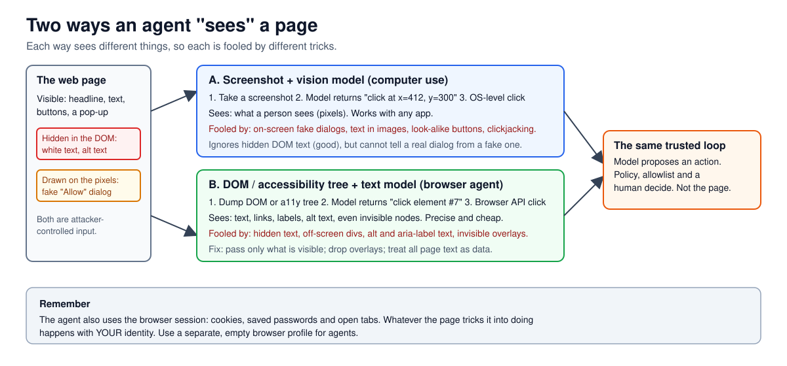

# Lesson 01: The Coding and Computer-Use Agent Landscape

> **Chapter:** 4 · Computer-Use, Browser and Coding Agents · **Time:** ~3 hours
> **You will:** name the main kinds of coding, browser and computer-use agents, tell the OpenClaw family apart (and know its rename history), and explain how an agent "sees" a screen or a web page, because that decides how it is attacked.

| | |
|---|---|
| **Prerequisites** | [05-agent-security](../../05-agent-security/README.md) (agent loop, tools, sandboxes) |
| **Labs** | [small-model-secure-harness](labs/small-model-secure-harness/README.md) (MiniClaw-style idea) |
| **Syllabus lines** | Coding agents: OpenCode and comparable CLI-based coding agents · The OpenClaw ecosystem (OpenClaw; NanoClaw, MiniClaw, SecureClaw, NemoClaw; ClawHub skill marketplace) · VSCode-integrated agent extensions · Browser-driving · computer-use agents · How agents perceive and act on a screen/DOM |
| **Maps to** | OWASP Agentic Top 10 2026: ASI02, ASI04, ASI05 (overview) |

> **Fast-moving topic.** Names, features, star counts and company relationships in this lesson change monthly. Everything below is hedged: **verify at the official source** before you rely on it, and prefer the project's own documentation.

## 1. Why this matters

A chatbot answers. A coding or computer-use agent **acts**: it edits files, runs shell commands, opens a browser, clicks buttons and uses your logged-in accounts. Whoever controls the text the agent reads can steer those actions. So the landscape matters for security: each tool class has a different **input surface** (what text it reads), a different **action surface** (what it can do) and a different **default sandbox** (often none).

## 2. Coding agents: OpenCode and other CLI agents

A **CLI coding agent** runs in your terminal, reads your project, and uses a model to plan edits and commands. The usual loop: read files, propose a change, run a command (build, test, git), read the output, repeat.

| Agent | Notes (hedged; verify) |
|---|---|
| **OpenCode** | Open-source terminal coding agent, reported as MIT-licensed; works with many model providers, including local models. Check the repo for current language, features and popularity. |
| **Claude Code** | Anthropic's terminal coding agent (the tool this companion is built with). Has a permission system with allow/ask/deny rules and optional sandboxing. |
| **Codex CLI** | OpenAI's terminal coding agent. |
| **Gemini CLI**, **Aider** and others | Comparable terminal agents. |
| **Hermes Agent (Nous Research)** | Open-source, model-agnostic harness launched in Feb 2026 (MIT, as reported). Reported to drive other coding agents as sub-agents. See [chapter 1](../ch1-agents-harnesses-and-the-agentic-ecosystem/README.md). Check hermes-agent.nousresearch.com. |

What they share, security-wise:

- They read **untrusted text** all the time: READMEs, issues, commit messages, dependency files, tool output, web pages they fetch ([lesson 02](02-attacking-coding-agents.md)).
- They hold **powerful tools**: a shell, file write, network.
- Their default protection is usually **application-level permissions** (a prompt "allow this command?"), not an operating-system boundary ([lesson 05](05-defending-computer-use-and-coding-agents.md)).

## 3. The OpenClaw ecosystem

### 3.1 OpenClaw and its history

**OpenClaw** is an open-source **personal AI agent** that runs on your own machine. It has a local **gateway** (a service that connects chat apps, models and tools), a set of **skills** (add-on instructions and scripts) and many integrations. Reported facts (verify at source):

| Date | Event |
|---|---|
| Late 2025 | Created by Peter Steinberger under the name **Clawdbot** |
| Early 2026 | Renamed **Moltbot** |
| **30 Jan 2026** | Renamed **OpenClaw** |
| Feb 2026 | Reports of a move toward an independent foundation with OpenAI support, and of the creator joining OpenAI. Hedge: check the project's own announcements. |

It requires a recent Node.js (reported as 22 or newer). The renames matter for security: **typosquat domains and packages** appeared while the names were changing, and old tutorials point at old names. Always install from the official site or repository named in current documentation.

### 3.2 The spin-offs and hardening tools

All of these are reported, young and fast-changing. Treat the descriptions as "what it is said to do" and check the repos.

| Name | Reported idea | Security role |
|---|---|---|
| **NemoClaw** (NVIDIA) | Open-source security layer: kernel-level sandboxing plus **out-of-process policy enforcement**. It does not review skill code. | Hardened fork / containment |
| **NanoClaw** | OS-level containment of the agent | Containment |
| **SecureClaw** | About 56 audit checks based on OWASP ASI and MITRE ATLAS, delivered as a security audit plugin | Audit and hardening ([lab](labs/harness-security-audit/README.md)) |
| **MiniClaw** | Lightweight and friendly to small models | Small attack surface ([lab](labs/small-model-secure-harness/README.md)) |

The names are playful variations on one theme. In the exam, be ready to say **what each one is for** (containment, audit, minimal surface), not details of its code.

### 3.3 ClawHub, the skill marketplace

**ClawHub** is the public marketplace where OpenClaw **skills** are published. A skill is typically a folder with a description (instructions the agent reads) and optional scripts. That makes a skill both **prompt text** and **executable code**, installed by many people from strangers. In early 2026 researchers reported many malicious skills there (the **ClawHavoc** campaign, see [lesson 03](03-openclaw-case-study.md)). Compare with the MCP registries in [CMCPSE chapter 6](../../cmcpse-course/ch6-supply-chain-security-and-governance-of-mcp/README.md).

## 4. VS Code-integrated agent extensions

Agents also live inside editors:

- **GitHub Copilot agent mode** in VS Code can edit files and run terminal commands.
- Extensions such as **Continue** and **Cline** (open source, bring-your-own-model) offer agent modes with tool use, often with MCP support.
- Editors connect to agents through protocols, for example the **Agent Client Protocol** from Zed (an editor-to-agent protocol; do not confuse it with the older IBM "Agent Communication Protocol", see [chapter 7](../ch7-threat-modeling-agents-and-communication-protocols/README.md)).

Security notes: the extension runs inside the editor process with **your user's rights**; workspace files (a repository you just cloned) are untrusted input; and the editor's own **workspace trust** setting is a real control (do not click "trust" on a repo you have not reviewed). Features differ by version; verify.

## 5. Browser-driving and computer-use agents

| Kind | What it controls | How it acts |
|---|---|---|
| **Browser-driving agent** | A browser page | Through a browser automation layer (for example Playwright-style APIs): "click element 7", "type into field 3" |
| **Computer-use agent** | The whole desktop | Through screenshots and synthetic mouse and keyboard events: "click at x=412, y=300" |

Vendors introduced computer-use models and agent products from late 2024 onward (for example Anthropic's computer use, OpenAI's browser agent products); products and names change quickly, so verify. Both kinds usually act inside **your** logged-in session unless you give them a separate profile. That is the main extra risk compared with a coding agent ([lesson 04](04-attacking-browser-and-computer-use-agents.md)).

## 6. How agents perceive and act on a screen or DOM

There are two perception styles, and many products mix them.

**A. Screenshot + vision model.** The harness takes a screenshot (often downscaled), sends it to a vision-capable model, and gets back an action such as `click(412, 300)` or `type("hello")`. The OS performs it.
- Works with any application, even ones with no API.
- Sees what a person sees, so hidden DOM text is **not** seen (good).
- Cannot tell a real dialog from a **fake one drawn by the page**, can be fooled by text inside images, and is easy to mislead with look-alike buttons.
- Coordinates make it fragile: a layout shift can make a click land on the wrong thing (a natural clickjacking opening).

**B. DOM or accessibility tree + text model.** The harness gives the model a text rendering of the page (DOM, or the accessibility tree that screen readers use) with element IDs. The model answers "click element #7".
- Precise, cheap and fast.
- Sees **everything in the markup**, including text a person cannot see: `display:none`, white-on-white text, off-screen elements, `alt`, `title` and `aria-label` ([lab](labs/browser-agent-page-injection/README.md)).
- Treats the page's text and the user's task as one stream unless the harness separates them.

**The loop (both styles):** observe → model proposes action → harness (or policy) decides → act → observe. The **observe** step is where the attacker writes; the **decide** step is where you defend ([lesson 05](05-defending-computer-use-and-coding-agents.md)).

## 7. Defend: the shared principles

1. **Everything the agent perceives is input from a third party** (page, README, skill text, tool output). It is data, not instructions.
2. **The model proposes; deterministic code decides.**
3. **Least privilege per task:** separate browser profile, separate workspace, no secrets in the environment.
4. **Contain:** container or kernel sandbox, egress allowlist.
5. **Ask a human for the irreversible.**

## 8. Hands-on

- Draw the loop for a coding agent and for a browser agent. Mark where untrusted text enters and where a policy could sit.
- Run the [small-model secure harness lab](labs/small-model-secure-harness/README.md) to see the smallest useful harness.
- Read the repo's [agent reference architecture](../../05-agent-security/README.md#reference-architecture) and mark which boxes your favorite CLI agent actually has.

## 9. Interview Q&A

What is the difference between a browser-driving agent and a computer-use agent?

A browser-driving agent controls a browser through an automation API and usually reads the DOM or accessibility tree. A computer-use agent controls the whole desktop with screenshots and synthetic mouse and keyboard input. The second works with any app; the first is more precise. Their attack surfaces differ: hidden DOM text for the first, fake on-screen dialogs for the second.

Why is a marketplace skill riskier than a normal library?

It is both **instructions the model obeys** and **code that runs with the agent's rights**, and it is installed from strangers, often by people who trust the marketplace. A library only runs code; a skill also steers the agent.

What do you say if asked about the "Claw" family on an exam?

OpenClaw is the open-source personal agent with a gateway and a skill marketplace (ClawHub), renamed from Clawdbot and Moltbot in early 2026. NemoClaw is a security layer (sandbox plus out-of-process policy), NanoClaw is OS-level containment, SecureClaw is an audit plugin based on ASI and ATLAS, MiniClaw is a lightweight small-model-friendly variant. Say that details are reported and should be verified.

## 10. References

- OpenClaw, OpenCode, Hermes Agent, Continue, Cline, NemoClaw, NanoClaw, SecureClaw and MiniClaw project pages and repositories (check the official ones; names changed in 2026).
- OWASP Top 10 for Agentic Applications 2026 (OWASP GenAI Security Project).
- [05-agent-security](../../05-agent-security/README.md), [02 prompt injection](../../02-llm-security/prompt-injection/README.md).
