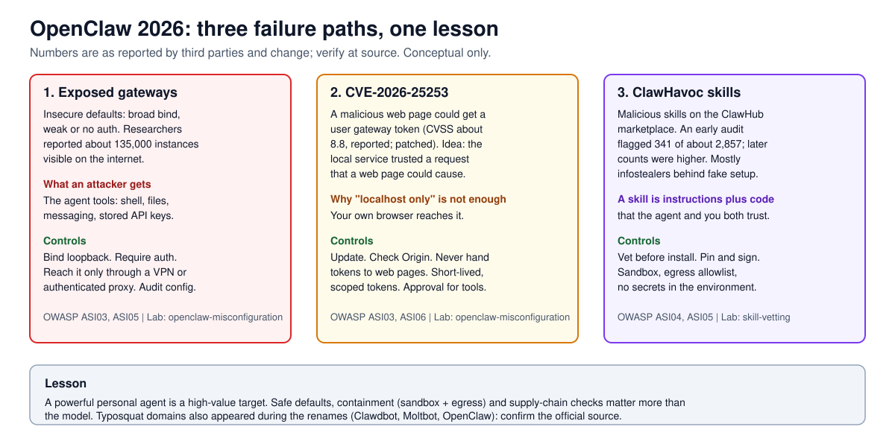

# Lesson 03: Case Study: OpenClaw's Exposed Gateways and Malicious Skills

> **Chapter:** 4 · Computer-Use, Browser and Coding Agents · **Time:** ~3 hours
> **You will:** describe three documented OpenClaw problems (exposed instances, a token-theft CVE, the ClawHavoc malicious skills), explain the root causes in plain terms, and map the lessons to OWASP ASI controls.

| | |
|---|---|
| **Prerequisites** | [Lesson 01](01-the-coding-and-computer-use-agent-landscape.md), [Lesson 02](02-attacking-coding-agents.md) |
| **Labs** | [openclaw-misconfiguration](labs/openclaw-misconfiguration/README.md) · [skill-vetting](labs/skill-vetting/README.md) · [harness-security-audit](labs/harness-security-audit/README.md) |
| **Syllabus line** | Case study: OpenClaw's documented exposed-gateway and malicious-skill incidents |
| **Maps to** | OWASP Agentic Top 10 2026: ASI03, ASI04, ASI05, ASI06 |

> **Sources and hedging.** The facts below come from security-research reports and news coverage in early 2026. Numbers differ between sources and grow over time. **Verify at the original source** (the researchers' own posts, the project's advisories, the CVE record). This lesson explains the ideas at a conceptual level. It gives no exploit steps, and the labs use a simulated gateway, never a real instance.

## 1. Background

OpenClaw is an open-source personal agent that runs locally with a **gateway** that connects chat apps, models and tools, plus skills from the **ClawHub** marketplace ([lesson 01](01-the-coding-and-computer-use-agent-landscape.md#3-the-openclaw-ecosystem)). It grew very fast in early 2026 and was renamed from Clawdbot to Moltbot and then OpenClaw (30 Jan 2026). Fast growth plus a powerful agent (shell, files, messages, stored API keys) made it a high-value target.

## 2. Incident 1: exposed gateways with insecure defaults

**What was reported.** SecurityScorecard reported roughly **135,000** OpenClaw instances reachable from the internet, many with insecure default settings. Other researchers counted different numbers (exposure counts vary widely and change daily).

**Root cause (concept).** A gateway meant for one user on one machine was reachable from outside, and the defaults did not force strong protection: broad network binding, weak or missing authentication. Anyone who found one could talk to an agent that holds powerful tools.

**Why it matters.** Reaching the gateway is not like reaching a web page. The gateway **acts**: it can run tools, read files, send messages and use stored credentials.

**Lab.** [openclaw-misconfiguration](labs/openclaw-misconfiguration/README.md) simulates a gateway with a broad bind in config, no auth token, a permissive origin rule and a token returned by an API, then audits it, then fixes it.

## 3. Incident 2: CVE-2026-25253 (token theft from a web page)

**What was reported.** A vulnerability, CVE-2026-25253, rated about **CVSS 8.8** (verify), disclosed around 30 Jan 2026 and patched. A **malicious web page** could cause a user's browser to hand over the user's **gateway token**, which would then give control of the user's agent.

**The idea, conceptually.** Many people believe a service on `localhost` is safe because outsiders cannot reach it. But **your own browser can reach `localhost`**, and a web page you visit can ask your browser to make requests. If the local service (a) accepts such requests from any web origin and (b) trusts or reveals a credential in response, then a web page can act with your authority. This is the same family as CSRF and cross-origin trust bugs (compare the MCP Inspector CVE in [CMCPSE chapter 2](../../cmcpse-course/ch2-understanding-and-attacking-mcp-servers/05-real-world-case-studies.md)).

**What this lesson does not do.** It does not describe the exact request flow or give a working exploit. The lab models only the **class** of mistake with a fake token on a loopback server.

**Controls.** Update to the patched version; check the `Origin` of requests and allow only your own UI; never return secrets to a page; require authentication on every call; use short-lived, scoped tokens; keep an approval step for dangerous tools so a stolen session is not enough.

## 4. Incident 3: ClawHavoc malicious skills on ClawHub

**What was reported.** Koi Security's initial audit flagged **341** malicious skills out of about **2,857** reviewed. Later counts were higher as more were found. The payloads were mostly **infostealers** (for example AMOS on macOS, as reported). The campaign was named **ClawHavoc**.

**Pattern (conceptual).** Skills with attractive names (often crypto, finance or productivity), instructions that told the user or the agent to run a "prerequisite" setup step, and a hidden or encoded command that downloaded the stealer. The marketplace had few checks on who could publish.

**Why it works.** A skill is **text the agent trusts** plus **code it may run**. Users install on trust. The agent also runs with access to the browser profile, keys and files that infostealers want.

**Related.** Typosquat domains and packages appeared during the renames, so even "install OpenClaw" could lead to a fake. The same shape as postmark-mcp and package typosquats ([CMCPSE ch6](../../cmcpse-course/ch6-supply-chain-security-and-governance-of-mcp/README.md)).

**Lab.** [skill-vetting](labs/skill-vetting/README.md): a harmless malicious-style sample (fake prerequisite, hidden blob, unknown endpoint, credential paths) and a benign one; the vetter blocks one and allows the other.

## 5. Lessons learned, mapped to OWASP ASI

| Lesson | OWASP Agentic 2026 | Control | Lab |
|---|---|---|---|
| **Secure by default.** Defaults decide what most users run. Loopback bind, auth on, no exposure. | ASI03 Identity and Privilege Abuse; ASI05 | Config audit, hardened defaults | [openclaw-misconfiguration](labs/openclaw-misconfiguration/README.md) |
| **Localhost is not a security boundary.** A browser bridges web pages to local services. | ASI03, ASI06 | Origin checks, tokens never given to pages, short-lived scoped tokens | same |
| **A skill marketplace is a supply chain.** Vet, pin, sign, sandbox. | ASI04 Agentic Supply Chain | Vetting, signatures, pinning | [skill-vetting](labs/skill-vetting/README.md) |
| **Assume a bad skill will run.** Contain it: no secrets in env, filesystem scope, egress allowlist. | ASI05 Unexpected Code Execution | Container or kernel sandbox, egress control | [workspace-escape](labs/workspace-escape/README.md) |
| **Keep a human on irreversible actions** so a stolen token or bad skill is not enough. | ASI09 Human-Agent Trust Exploitation | Hash-bound approvals | [human-approval-checkpoints](labs/human-approval-checkpoints/README.md) |
| **Audit continuously.** Checks tied to frameworks turn "be secure" into a score. | ASI10 Rogue Agents (monitoring) | Audit plugin (SecureClaw-style) | [harness-security-audit](labs/harness-security-audit/README.md) |
| **Names change; verify the source.** Renames create typosquat openings. | ASI04 | Official-source checks, pinned digests | n/a |

**Hardening responses seen in the ecosystem (reported).** NVIDIA's NemoClaw (kernel sandbox plus out-of-process policy, no skill code review), NanoClaw (OS-level containment) and SecureClaw (about 56 audit checks) appeared as responses. They are examples of the three defense families in [lesson 05](05-defending-computer-use-and-coding-agents.md): containment, policy and audit. None replaces vetting a skill.

## 6. Hands-on

1. Run the three labs in the order: misconfiguration → skill vetting → audit.
2. Write a one-page postmortem: timeline, root causes (three), impact, fixes, and one control you would add that was not mentioned here.
3. Take [`configs/insecure.json`](labs/harness-security-audit/configs/insecure.json) as "a default install". Which of its twelve checks relate to which incident?

## 7. Interview Q&A

Why is "it only listens on localhost" not enough for an agent gateway?

Your browser can send requests to localhost on behalf of any web page you open. If the gateway accepts cross-origin requests or reveals a token, a malicious page can use it. Also, other local processes can reach it. So require authentication, check the Origin, and avoid handing secrets to pages.

Summarise ClawHavoc in three sentences.

Attackers published many malicious skills on the ClawHub marketplace, with fake setup steps that led to infostealers. An early audit flagged 341 of about 2,857 skills, and later counts were higher. The lesson is that a skill marketplace is a supply chain: vet, pin, sign and sandbox, and keep secrets out of the agent's environment.

Which single control would have limited the damage most across all three incidents?

Containment: a sandbox with no secrets and an egress allowlist. It limits what an exposed gateway, a stolen token or a malicious skill can reach. It is not enough alone, so add authentication, vetting and approvals.

## 8. References

- SecurityScorecard exposure report on OpenClaw instances (early 2026); Koi Security ClawHavoc research; the CVE-2026-25253 record and the OpenClaw advisory. Verify all numbers at source.
- OWASP Top 10 for Agentic Applications 2026.
- [05 sandboxing](../../05-agent-security/sandboxing/README.md), [CMCPSE chapter 2 case studies](../../cmcpse-course/ch2-understanding-and-attacking-mcp-servers/05-real-world-case-studies.md).
