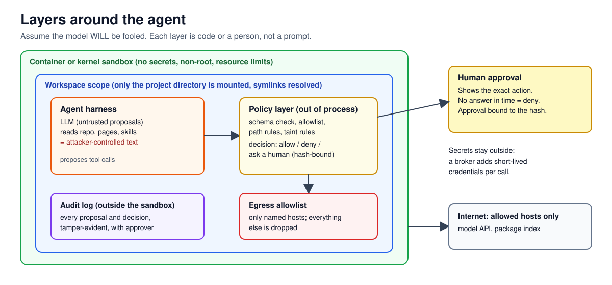
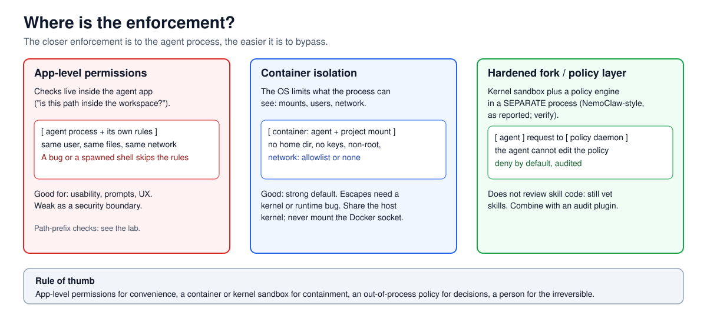

# Lesson 05: Defending Computer-Use and Coding Agents

> **Chapter:** 4 · Computer-Use, Browser and Coding Agents · **Time:** ~5 hours
> **You will:** choose and combine six defenses (workspace sandboxing, container isolation, hardened forks, egress control, human approval, audit plugins) and explain what each one cannot do.

| | |
|---|---|
| **Prerequisites** | Lessons [01](01-the-coding-and-computer-use-agent-landscape.md) to [04](04-attacking-browser-and-computer-use-agents.md); [05 sandboxing](../../05-agent-security/sandboxing/README.md); [05 permissions](../../05-agent-security/permissions/README.md) |
| **Labs** | [workspace-escape](labs/workspace-escape/README.md) · [human-approval-checkpoints](labs/human-approval-checkpoints/README.md) · [harness-security-audit](labs/harness-security-audit/README.md) · [small-model-secure-harness](labs/small-model-secure-harness/README.md) · [coding-agent-readme-injection](labs/coding-agent-readme-injection/README.md) · [browser-agent-page-injection](labs/browser-agent-page-injection/README.md) |
| **Syllabus lines** | Workspace and filesystem sandboxing · Container isolation as a security model · Hardened forks vs. application-level permissions · Egress control and network allow-listing for agent processes · Human-approval checkpoints for destructive or irreversible actions · Auditing and hardening a harness with a purpose-built security plugin |
| **Maps to** | OWASP Agentic Top 10 2026: ASI02, ASI03, ASI05, ASI09, ASI10 |

> **The core rule.** Assume the model will be fooled. Limit what a fooled agent can do, using code and people, not prompts. Existing repo material to read alongside: [sandboxing](../../05-agent-security/sandboxing/README.md) (process sandbox, soft vs hard layers), [permissions](../../05-agent-security/permissions/README.md) (policy engine, approval cards), [Docker](../../06-ai-devsecops/docker/README.md) (safe artifact handling).

## 1. Workspace and filesystem sandboxing

**Goal:** the agent can touch only the project, and only in the ways the task needs.

| Control | Detail |
|---|---|
| **Scoped root** | one directory is the workspace; everything else is invisible or denied |
| **Canonical paths** | resolve `..` and symlinks first, compare **path components** to the real root, never a string prefix |
| **Read-only where possible** | mount dependencies and reference docs read-only; write only to `src/`, `tests/`, a scratch dir |
| **Deny lists inside the workspace** | `.env`, key files, `.git/hooks`, CI config, the agent's own settings |
| **Scrubbed environment** | no cloud keys or tokens in environment variables; short-lived credentials added per call by a broker |
| **Temporary scratch space** | wiped after the run |
| **Size and count limits** | stop a flood of writes or a huge read |

**Lab:** [workspace-escape](labs/workspace-escape/README.md): a standard runtime leaks through `..`, a sibling directory, a symlink and shell `cd`; a chroot-like isolated runtime blocks all of them.

**Limit.** A path check inside the agent process is only as strong as the process. A spawned shell is not bound by the file tool's rules. That is why the next control exists.

## 2. Container isolation as a security model

A **container** (or a micro-VM, or a kernel sandbox) limits what the whole process tree can see and do, not just one tool:

| Setting | Purpose |
|---|---|
| Only the workspace mounted | host home, keys and browser profiles do not exist inside |
| Non-root user, no extra capabilities, `no-new-privileges` | limits privilege escalation |
| Read-only root file system, small writable scratch | limits persistence |
| CPU, memory, process and time limits | contains runaway loops |
| Network: none, or an allowlist (section 4) | limits exfiltration |
| No Docker socket, no host namespaces | the classic escape routes |
| Fresh container per task | no state carried between tasks |

**Honest limits.** Containers share the host kernel, so a kernel or runtime bug can allow escape. For hostile code, stronger isolation (a micro-VM or a user-space kernel sandbox such as gVisor) is common; verify what your platform offers. A container also does **not** limit what the agent does **inside** it with the files you mounted, nor what it sends to the network you allowed. So it complements, and does not replace, policy and approval.

**Hands-on (optional, needs Docker, not required by the tests).** Run a throwaway agent in a locked-down container: no network, read-only root, only the project mounted, non-root user. Check the Docker documentation for your version's flags. On the learner laptop (little disk space), use small images and remove them afterwards.

## 3. Hardened forks vs. application-level permissions

| | Application-level permissions | Hardened fork / separate policy layer |
|---|---|---|
| Where enforced | inside the agent app ("allow this command?", path checks) | in a different process or in the kernel (sandbox rules, a policy daemon) |
| Who can change the rules | the app, and so a compromised or fooled app | only the operator; the agent cannot edit them |
| Typical strength | usability, good defaults, fast feedback | a real boundary |
| Typical weakness | bypass by bug, by a spawned shell, by approval fatigue | needs setup, can block legitimate work |
| Examples | permission prompts and allow/deny rules of many CLI agents | NemoClaw-style kernel sandbox plus out-of-process policy (reported; verify) |

**Hardened fork** means a modified or wrapped version of an agent whose security is moved out of the agent's own trust domain. Reported example: NVIDIA's **NemoClaw** around OpenClaw (kernel-level sandboxing and out-of-process policy enforcement). It was reported **not** to review skill code, so you still need [vetting](labs/skill-vetting/README.md).

**How to choose.**

- Use **app-level permissions** to keep the user in the loop and to catch honest mistakes.
- Use a **separate-process policy and an OS sandbox** where the agent may read hostile content (browsing, third-party repos, marketplace skills).
- Never rely on a prompt such as "do not touch files outside the project" as a control.

## 4. Egress control and network allow-listing for agent processes

Most damage from a hijacked agent ends with **sending something out** or **fetching something in**. Controlling egress breaks both.

| Approach | Notes |
|---|---|
| **Default deny** | the sandbox has no route out except a proxy |
| **Allowlist by hostname** (model API, package index, your Git host) | match whole labels; `example.com.attacker.net` must not match `example.com` |
| **Forward proxy** | the only way out; logs every request; can enforce method and path rules and size limits |
| **DNS control** | resolve through your resolver; watch for DNS tunnelling |
| **Separate phases** | allow the network for dependency install, then drop it for the agent run |
| **Block metadata endpoints and private ranges** | prevents SSRF-style reach into the cloud or the LAN |
| **TLS inspection or pinning where appropriate** | hedge: has trade-offs; verify policy and law |
| **Alerts** | any denied or new destination is a high-signal event |

The browser lab shows a **domain allowlist** for navigation ([lab](labs/browser-agent-page-injection/README.md)); the [harness audit](labs/harness-security-audit/README.md) check `NET-01` flags `allow_all` and wildcard allowlists.

**Limit.** Allowed hosts can be abused (data pushed to an allowed paste or storage service). Keep the list short, and watch volume.

## 5. Human-approval checkpoints for destructive or irreversible actions

Some actions cannot be undone or reach outside the sandbox: recursive delete, force push, hard reset, database drops, payments, sending email or messages, granting permissions, installing software. They deserve a **person** in the loop. Good checkpoints (all in the [lab](labs/human-approval-checkpoints/README.md)):

1. **Classify actions** with a deterministic classifier. Unknown action types **fail closed** (need approval).
2. **Show the exact action**: the full command or the full recipient and amount, not a summary. Warn about hidden or look-alike characters.
3. **Bind approval to a hash** of the exact action. A changed action needs a new approval.
4. **Timeout means deny.** No answer is not a yes.
5. **Single use and short life.** An approval cannot be replayed later.
6. **Log** who approved what and when.
7. **Fight approval fatigue.** Auto-allow safe, reversible actions; block clearly forbidden ones; ask only for the meaningful middle. A prompt people click through blindly is a vulnerability (ASI09).

Also render approval screens from **trusted system code**, not from model text, so an attacker cannot write a persuasive but misleading approval message (see the approval-card pattern in [permissions](../../05-agent-security/permissions/README.md)).

## 6. Auditing and hardening a harness with a security plugin

A **security audit plugin** inspects a harness's configuration and reports misconfigurations against a framework. **SecureClaw** is reported to ship about 56 checks based on OWASP ASI and MITRE ATLAS (verify at source). The idea in four parts:

1. **Checks:** small functions that read config (is the sandbox on? is the egress mode an allowlist? are skills signed? are secrets in the environment? is logging tamper-evident? is the model provider on an allowlist?).
2. **Mapping:** each check names the OWASP ASI risk and the ATLAS technique it reduces.
3. **Score and report:** weighted pass rate and a prioritised fix list.
4. **Re-run in CI and after each change.**

**Lab:** [harness-security-audit](labs/harness-security-audit/README.md) builds a twelve-check plugin, scores an insecure config (0/100) and a hardened one (100/100), and groups failures by ASI.

**Limits.** An audit proves **configuration**, not runtime behavior, and it cannot review a skill's code (that needs [vetting](labs/skill-vetting/README.md)). Pair it with logging, detection and incident response ([monitoring](../../05-agent-security/monitoring-and-response/README.md)).

## 7. Putting it together: a small-model-friendly secure harness

If you run a small local model (1 to 4B, quantised, CPU only), it is easier to fool and less reliable at JSON. Design for that: few tools, strict schemas, short context, a deterministic policy, an approval gate, a step budget. The [small-model-secure-harness lab](labs/small-model-secure-harness/README.md) shows a MiniClaw-style sketch where a gullible model is held safe by the harness.

## 8. Checklist

- [ ] Sandbox (container or kernel) with the project mounted only, non-root, no secrets in env
- [ ] Canonical path checks and deny rules inside the workspace
- [ ] Egress deny by default, an allowlist, a logging proxy
- [ ] Exact-command allowlist; no chaining; unknown actions fail closed
- [ ] Hash-bound, single-use, timeout-deny approvals for irreversible actions
- [ ] Skills and packages vetted, pinned, signed; installs run in the sandbox
- [ ] Separate browser profile; no autofill
- [ ] Audit plugin score tracked; logs are tamper-evident and outside the sandbox

## 9. Interview Q&A

Why are application-level permissions not a security boundary?

They run in the same process and trust domain as the agent. A bug, a fooled model, or a spawned shell can skip them, and the agent may be able to edit its own rules. They are good for usability and catching mistakes, but a boundary must be enforced outside the agent's control: a container, a kernel sandbox or a separate policy process.

What does a container not protect against?

It does not limit what the agent does with what you mounted or what it sends over the network you allowed. It shares the host kernel, so a kernel or runtime flaw can allow escape. It does not review skill code. So combine it with least privilege, egress control, vetting and approvals.

What properties make an approval checkpoint trustworthy?

It shows the exact action, is bound to a hash of that action, is single use and short-lived, treats no answer as a denial, is rendered by trusted code, and is logged with the approver. It must also be used sparingly so people read it.

What can and cannot a security audit plugin like SecureClaw tell you?

It can show configuration weaknesses mapped to ASI and ATLAS and give a score and fixes. It cannot see runtime behavior, hostile skill code or a prompt injection in progress. Use it as one layer with monitoring and vetting.

## 10. References

- OWASP Top 10 for Agentic Applications 2026; MITRE ATLAS (atlas.mitre.org, verify technique names); NIST AI RMF and AI 600-1.
- CISA and Five Eyes, "Careful Adoption of Agentic AI Services" (1 May 2026; verify exact title and content).
- [05 sandboxing](../../05-agent-security/sandboxing/README.md), [05 permissions](../../05-agent-security/permissions/README.md), [06 runtime security](../../06-ai-devsecops/runtime-security/README.md), [09 enterprise architecture, lesson 07](../../09-enterprise-architecture/README.md).
- NemoClaw, NanoClaw and SecureClaw project pages (reported tools; verify).
