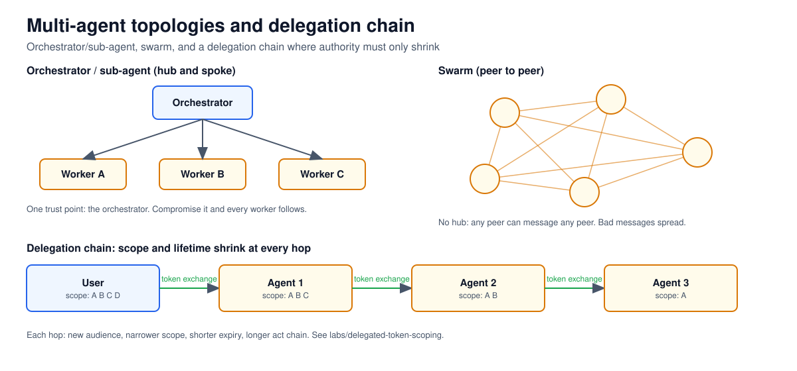

# 01. Multi-Agent Architectures, Topologies and A2A

> **Chapter 5 · Time:** ~3 hours · **You will:** compare orchestrator/sub-agent and swarm designs, understand how agents talk (A2A, and what happened to ACP and MCP's role), follow a delegation chain, and route work between a local and a cloud model by data class.
> **Labs:** [delegator-worker-routing](labs/delegator-worker-routing/README.md), [isolated-subagents](labs/isolated-subagents/README.md)
> **Maps to:** OWASP Agentic ASI07 Insecure Inter-Agent Communication, ASI08 Cascading Failures, ASI03 Identity and Privilege Abuse · MITRE ATLAS (agent-related techniques; check atlas.mitre.org) · NIST AI RMF GOVERN/MAP

## 1. Why this matters

- One agent with many tools is hard to secure. Splitting work across several agents looks cleaner, but **every message between agents is a new trust boundary** and every delegation is a new place to lose track of who is allowed to do what.
- Public frameworks and protocols now make multi-agent systems normal: Google's **A2A** (Agent2Agent) protocol reached v1.0 in early 2026 and sits in the Linux Foundation's Agentic AI Foundation (verify the details at source). Harnesses such as Hermes Agent can also run sub-agents.
- The security literature (OWASP Agentic Top 10 2026, [05 multi-agent-trust](../../05-agent-security/multi-agent-trust/README.md)) treats inter-agent trust, cascades and rogue agents as separate risks.

## 2. Understand it

### 2.1 Two topologies

| | Orchestrator / sub-agent | Swarm (peer to peer) |
|---|---|---|
| Shape | One planner delegates to workers | Peers message each other, no single planner |
| Trust point | The orchestrator (one place to protect and to attack) | Every peer (many places) |
| Failure mode | Orchestrator compromise = all workers follow | Bad message spreads; hard to say who started it |
| Audit | Easy: one place sees everything | Hard: needs trace IDs across peers |
| Best for | Most business workflows | Research, exploration, simulation |
| Security default | Pick this first | Add signing, rate limits, circuit breakers, budgets |

**Least agency** (a term from the OWASP agentic work): give each agent only the autonomy and tools its task needs. In an orchestrator design this is natural: workers get one tool set each. In a swarm it must be enforced by the platform, because peers can ask each other to do things.

### 2.2 How agents talk

| Protocol | What it is | Security notes |
|---|---|---|
| **A2A** | Open protocol for agent-to-agent tasks. Concepts: **Agent Card** (self-description at a well-known URL), **tasks** with lifecycle states, **messages** made of **parts**, **artifacts**, streaming and push notifications, auth schemes declared in the card. Runs over HTTP(S). v1.0 around March 2026; verify the current version. | The card is data an attacker may forge or poison. Verify the card's source and signature (newer versions describe signed cards: verify). Authenticate callers per the declared scheme. |
| **MCP** | Agent-to-**tool** protocol (stdio, Streamable HTTP). Not agent-to-agent. | See [cmcpse-course](../../cmcpse-course/README.md). An agent can be exposed as an MCP server, which blurs the line: treat that agent's output as untrusted tool output. |
| **ACP** (syllabus term) | IBM BeeAI's *Agent Communication Protocol* **merged into A2A** in August 2025 and its repo is archived. Today "ACP" often means a different thing: Zed's **Agent Client Protocol** (editor to coding agent). | Teach the syllabus concept (sessions and state between heterogeneous agents), but say it is now part of A2A. |
| **UCP** (syllabus term) | No "Unified Context Protocol" standard was found. The real **UCP** is Google's *Universal Commerce Protocol* (January 2026) for agentic shopping. | Chapter 7 covers shared-context stores. |

> **Outdated in the syllabus -> current.** If a syllabus line says "ACP" or "A2A", answer for the exam with the syllabus meaning, then add: ACP merged into A2A in 2025; A2A is now v1.x under the Linux Foundation.

### 2.3 Delegation chains and hand-off

A **delegation chain** is the path a task takes: user -> agent 1 -> agent 2 -> agent 3. A **hand-off** is when one agent passes the task, and sometimes the whole conversation, to another. Four questions every hop must answer:

1. **Who is the real principal?** (The human or system the work is for. It must survive every hop.)
2. **What may this hop do?** (Scope can only shrink.)
3. **For how long?** (Expiry can only shrink.)
4. **Who is accountable?** (Every hop is recorded in the audit trail.)

Hand-off also moves **context**. Passing the whole conversation hands the next agent the previous agent's secrets and any injected text. Pass a **task description and the minimum data**, not the transcript. Treat the result coming back as **untrusted data**, not as instructions.

### 2.4 Local and cloud-routed agents

A common practical design pairs a small **local** model (private, free per token, weaker) with a **cloud** model (stronger, sees your data). Security depends on a deterministic **router**: classify the data first, then choose where it may go.

| Data class | Where it may go | If the local model is down |
|---|---|---|
| Restricted (IDs, secrets, patient data) | Local only | Refuse (fail closed) |
| Internal | Local by default; cloud only if policy allows, after redaction | Refuse |
| Public | Cloud preferred, local fallback | Fall back to local |

On a laptop without a GPU, run only small CPU models (about 1B to 4B parameters, 4-bit) through Ollama or llama.cpp, and use a cloud router such as OpenRouter for bigger ones. Check any "free" cloud tier's data-retention and training terms before sending anything real.

## 3. Defend it

| Layer | Control | Type |
|---|---|---|
| Topology | Prefer orchestrator/sub-agent; cap depth and fan-out | Hard |
| Isolation | Separate context, tools and credential per sub-agent | Hard |
| Data routing | Deterministic classifier plus router, fail closed | Hard |
| Hand-off | Minimal context; results treated as untrusted data | Hard + Process |
| Identity | Per-agent workload identity, short-lived tokens ([04](04-agent-identity-and-access.md)) | Hard |
| Observability | One trace ID across all hops | Process |

**What does NOT work on its own:** telling the sub-agent in its prompt to "only use tool X"; trusting a message because it says it came from the planner; sharing one service account across all agents.

## 4. Hands-on

1. **[delegator-worker-routing](labs/delegator-worker-routing/README.md)**: a delegator splits a task, a classifier routes each subtask, a "cloud" mock records everything it sees. Prove restricted data never reached it.
2. **[isolated-subagents](labs/isolated-subagents/README.md)**: spawn sub-agents with their own context, tools and credential and prove a sibling cannot read them. It also has a hedged guide to real sub-agent delegation with Hermes Agent.

## 5. Scenarios

1. *The cheap-model shortcut.* A team routes every request to a cloud model "for quality". Patient identifiers appear in provider logs. Fix: classify first, route second, and test the provider-side log (as the lab does).
2. *The chatty hand-off.* A research agent passes its entire context (including an API key from a tool result) to a writer agent that posts to a public channel. Fix: pass the minimum, redact secrets in tool results before they enter any context.
3. *The swarm that never stops.* Two peer agents keep re-delegating a task. Cost and API calls explode (ASI08 cascade). Fix: depth limits, budgets, circuit breaker ([05 multi-agent-trust](../../05-agent-security/multi-agent-trust/README.md)).

## 6. Interview questions

<b>Q1. Orchestrator or swarm: which is easier to secure, and why?</b>

Orchestrator/sub-agent. There is one trust point to harden, one place to audit, and workers can be given narrow tools. A swarm has many peers that can influence each other, so you need per-message authentication, budgets and circuit breakers.

<b>Q2. What should pass between agents in a hand-off?</b>

The task description, the minimum necessary data, and a delegated credential that is narrower than the caller's. Not the full transcript, not secrets, and not blanket authority. The result that comes back is untrusted data.

<b>Q3. What is the relationship between MCP and A2A?</b>

MCP connects an agent to tools and data. A2A connects an agent to another agent (as a peer that can reason and keep task state). They are complementary and often used together.

## 7. Checklist

- [ ] I can draw both topologies and name their trust points.
- [ ] I can explain Agent Card, task and artifact in A2A and why the card is untrusted.
- [ ] I know ACP merged into A2A and that UCP in the syllabus is not the real Universal Commerce Protocol.
- [ ] I ran both labs and can show the proof for each claim.

## 8. References

- A2A project and specification (Linux Foundation, Agentic AI Foundation): verify version and details at the project site.
- [05 multi-agent-trust](../../05-agent-security/multi-agent-trust/README.md), [05 agent-identity](../../05-agent-security/agent-identity/README.md).
- OWASP Top 10 for Agentic Applications 2026 and "Agentic AI: Threats and Mitigations" (OWASP GenAI Security Project).
- Next: [02 Protocol and data risks](02-protocol-and-data-risks.md).
