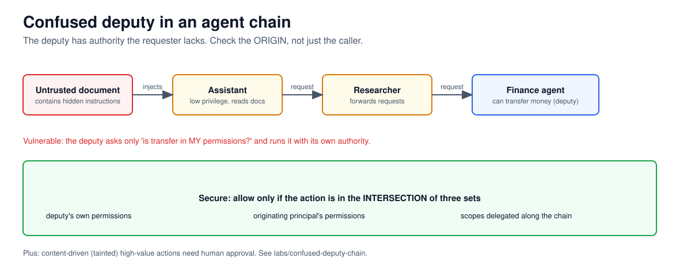

# 03. Collusion, Cascading Failure and Confused Deputies

> **Chapter 5 · Time:** ~2.5 hours · **You will:** understand how agents in a swarm fail together or "agree" on something unsafe, and how an agent with strong authority can be tricked into using it for a weaker party (the confused deputy).
> **Lab:** [confused-deputy-chain](labs/confused-deputy-chain/README.md)
> **Maps to:** OWASP Agentic ASI08 Cascading Failures, ASI03 Identity and Privilege Abuse, ASI01 Agent Goal Hijack · OWASP MCP02 Privilege Escalation via Scope Creep · MITRE ATLAS (check atlas.mitre.org)



## 1. Why this matters

- The **confused deputy** is a 1988 idea (Norm Hardy): a program with authority is tricked into using it for someone who does not have it. Agents are ideal deputies: they have credentials, they read untrusted text, and they obey it.
- The MCP specification and the repo's [04 authentication lesson](../../04-mcp-security/authentication/README.md) already treat token passthrough and the confused deputy as core risks. In multi-agent systems the same bug appears at every hop.
- Research on LLM agent groups (including self-replicating prompt demos such as Morris II in 2024, see [CAISP ch7](../../caisp-course/ch7-emerging-threats-governance-compliance/README.md)) shows content can spread through connected agents.

## 2. Understand it

### 2.1 Collusion and cascading failure

| Pattern | What happens | Example | Control |
|---|---|---|---|
| **Cascade** | One agent's error or bad output becomes the input of the next, amplified | A planner mislabels data as "safe"; every worker trusts the label | Validate at each boundary, circuit breaker, blast-radius limits |
| **Feedback loop** | Agents keep re-triggering each other | Two agents delegate a task back and forth | Depth and budget limits, loop detection |
| **Echo-chamber agreement** | Agents "confirm" each other because they share the same context or model | A reviewer agent approves what the author agent produced | Independent reviewers, different model/context, deterministic checks for facts |
| **Collusion** | Agents coordinate to get around a control (reported mostly in research settings) | One agent splits a forbidden action into two harmless-looking requests for two agents | Authorization on the *combined effect* and on the originating principal; separation of duties |
| **Worm-like spread** | Injected instructions replicate through agent-to-agent messages | A poisoned email makes an agent forward itself | Treat all agent output as data; egress limits; rate limits |

Treat "agents agree" as **weak evidence**, not as approval.

### 2.2 The confused deputy in a chain

```text
user (low privilege) -> Assistant -> Researcher -> Finance agent (can transfer)
```

The finance agent checks: "is `transfer` in **my** permissions?" Yes, so it runs. It never asked: "whose request is this, and may **they** do it?"

Fix: carry a **delegation context** with every request:

| Field | Meaning |
|---|---|
| `principal` | The original human/system the work is for |
| `scopes` | What was delegated; can only shrink at each hop |
| `chain` | Which agents touched the request |
| `tainted` | True if the action was caused by untrusted content |

The deputy allows an action only if it is in the **intersection** of its own permissions, the principal's permissions and the delegated scopes, and asks for human approval when a tainted request is high value.

### 2.3 Least agency applied

For each agent, write down: what can it **read**, **write**, **spend**, **send**, and **who can it ask**? Remove anything the task does not need. A finance agent that can only "create a transfer draft" is a safer deputy than one that can "execute a transfer".

## 3. Defend it

| Layer | Control | Type |
|---|---|---|
| Authority | Intersection of agent, principal and delegated scope | Hard |
| Taint | Mark content-driven actions, raise their risk level | Hard |
| Human gate | Approval for high-value tainted actions ([05](05-oversight-containment-and-failsafes.md)) | Hard |
| Structure | Depth limit, circuit breaker, budgets | Hard |
| Separation of duties | Requester and approver are different identities | Hard |
| Review | Independent verification, not "the other agent agreed" | Process |

**What does NOT work on its own:** a prompt line "do not transfer money for unauthorized users"; trusting the immediate caller (the Researcher is also fooled); one big shared permission set.

## 4. Hands-on

Run [confused-deputy-chain](labs/confused-deputy-chain/README.md). Predict first: which of the four test scenarios will the vulnerable deputy allow? Then read `deputy_chain.py` and find the three checks that stop the attack.

## 5. Scenarios

1. *Invoice PDF.* An invoice contains hidden text; the reader agent forwards "pay vendor X" to the payments agent. Fix: taint plus approval above a threshold, and payee allowlist.
2. *Reviewer rubber-stamp.* A code-review agent always approves what the coding agent writes because both see the same prompt. Fix: separate context, deterministic tests, and a human on risky paths.
3. *Hop that widens.* A sub-agent requests a token with more scope than it received. Fix: token exchange only narrows ([04](04-agent-identity-and-access.md)).

## 6. Interview questions

<details><summary><b>Q1. Explain the confused deputy in one example involving agents.</b></summary>
A finance agent has permission to move money. An assistant that can only read documents forwards a request produced from an injected document. The finance agent checks only its own permissions and executes. The authority of the deputy was used for a party who did not have it.
</details>

<details><summary><b>Q2. How do you make a deputy "unconfusable"?</b></summary>
Carry the originating principal and the delegated scopes with every request, and allow an action only if it is in the intersection of the deputy's permissions, the principal's permissions and the scopes. Add taint tracking and human approval for high-value content-driven actions.
</details>

<details><summary><b>Q3. Why is agent agreement not a control?</b></summary>
Agents often share context, models and biases, so they agree for the same wrong reason, and an injected instruction can reach several of them. Use independent, deterministic checks and human review for high-impact decisions.
</details>

## 7. Checklist

- [ ] I can draw the delegation context and say which field defends against which attack.
- [ ] I can explain cascade, loop, echo-chamber and collusion with one control each.
- [ ] I ran the lab and can show impact (the ledger) for vulnerable vs secure.

## 8. References

- Norm Hardy, "The Confused Deputy" (1988).
- OWASP Top 10 for Agentic Applications 2026; [05 permissions](../../05-agent-security/permissions/README.md).
- [04 MCP authentication](../../04-mcp-security/authentication/README.md) (token passthrough, confused deputy).
- Next: [04 Agent identity and access](04-agent-identity-and-access.md).
