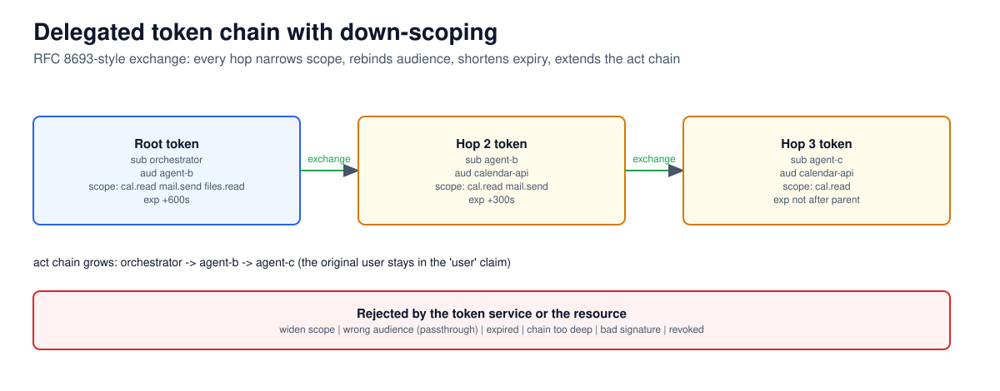

# 04. Agent Identity and Access: Non-Human Identity, Delegated Tokens, Least Agency

> **Chapter 5 · Time:** ~3 hours · **You will:** give agents their own identities, mint and exchange scoped tokens between agents (down-scope, audience, `act` chain, expiry), and design permissions with least privilege and least agency.
> **Lab:** [delegated-token-scoping](labs/delegated-token-scoping/README.md)
> **Maps to:** OWASP Agentic ASI03 Identity and Privilege Abuse · OWASP MCP01 Token Mismanagement, MCP02 Scope Creep, MCP07 Insufficient Authentication · NIST SP 800-207 (zero trust) · NIST AI RMF GOVERN, MANAGE

## 1. Why this matters

- Agents act without a human clicking each step. If they borrow a human's session or share one service account, you lose attribution and you cannot revoke one agent without breaking all of them.
- Non-human identities (service accounts, API keys, bots, now agents) already outnumber human users in most organizations; leaked long-lived keys are a leading breach path. Agents multiply them.
- The repo already covers this deeply: [05 agent-identity](../../05-agent-security/agent-identity/README.md) and [09 lesson 07 centralized AI IAM and zero trust](../../09-enterprise-architecture/07-centralized-ai-iam-and-zero-trust.md). This lesson adds the multi-hop delegation view and the course's lab.

## 2. Understand it

### 2.1 Establishing identity for a non-human actor

An agent identity should be: **unique** (one per agent, not per team), **verifiable** (cryptographic proof, not a name), **short-lived** (credentials that expire in minutes or hours), **attributable** (every action logs agent + principal), and **revocable** (kill one agent without touching others).

| Approach | What it is | Notes |
|---|---|---|
| **Workload identity (SPIFFE-style)** | A platform issues each workload a cryptographic identity, e.g. a SPIFFE ID such as `spiffe://example.org/agents/billing-worker`, proven by a short-lived **SVID** (an X.509 certificate or a JWT) | SPIFFE is a CNCF standard and SPIRE is a reference implementation; applying them to LLM agents is a design choice, not a built-in feature of most agent frameworks (hedged: verify your platform). Gives mutual TLS between agents with automatic rotation |
| **Cloud workload identity** | The cloud role bound to the pod or function (IAM roles for service accounts, managed identities, workload identity federation) | No long-lived keys in the agent |
| **OAuth 2.x client per agent** | Each agent is a registered client with its own scopes | Works well for SaaS APIs and MCP servers |
| **Shared API key / human session** | One key for all agents, or the user's cookie | The anti-pattern: no attribution, no per-agent revoke |

Three identities appear in every action: the **agent** (who is acting), the **principal** (on whose behalf), and the **resource owner** (whose data). Log all three.

### 2.2 Delegated authorization and token scoping

Use **token exchange** (OAuth 2.0 Token Exchange, RFC 8693) instead of passing a token along:

| Rule | Why |
|---|---|
| **Down-scope on every hop**: new scope is a subset | An agent cannot grant more than it has |
| **Audience binding**: token is valid for one resource (see RFC 8707 resource indicators) | A token stolen from one service is useless at another; stops passthrough |
| **`act` chain**: nested actor claim records who delegated to whom | Audit shows the path; the human stays as the principal |
| **Expiry never extends**: child expiry <= parent expiry | Short chains fail fast |
| **Depth limit** | Stops runaway re-delegation |
| **Revocation (jti)** | Kill one branch |

The lab implements this with stdlib HMAC tokens for clarity. A real system uses a token service with asymmetric keys and standard JWT or opaque tokens plus introspection.

### 2.3 Least privilege vs least agency

| | Least privilege | Least agency |
|---|---|---|
| Question | What may this identity access? | What may this agent **decide and do on its own**? |
| Controls | Scopes, roles, ACLs, network policy | Tool allowlist, spending limits, approval gates, step/budget limits, no self-modification, no unsolicited delegation |
| Failure | Over-broad token | Autonomy beyond the task (e.g. an agent that can create new agents) |

Do both. A tightly scoped token does not help if the agent can freely chain ten actions that are individually allowed but together harmful.

**Design recipe:** list every tool; for each, define scope, per-call limit, rate limit, whether it needs approval, and whether it is reversible. Default deny.

## 3. Defend it

| Layer | Control | Type |
|---|---|---|
| Identity | Unique per-agent, attested workload identity | Hard |
| Credentials | Short-lived, audience-bound, never in the prompt or context | Hard |
| Delegation | Token exchange: narrow, rebind, shorten, extend `act` | Hard |
| Policy | Central policy decision point, default deny | Hard |
| Agency | Tool allowlist, budgets, approval for risky actions | Hard |
| Audit | Log agent, principal, chain, scope for every call | Process |

**What does NOT work on its own:** a long-lived API key in an environment variable "because it is read-only"; passing the user's token to sub-agents; telling the agent to "stay within scope".

## 4. Hands-on

Run [delegated-token-scoping](labs/delegated-token-scoping/README.md). Exercise: mint a root token, exchange it twice, then try five abuses (widen scope, wrong audience, expired, tamper, over-deep chain). Predict each result before running.

## 5. Scenarios

1. *The shared bot account.* Ten agents use one service account. One is hijacked and deletes records. You cannot tell which one, and revoking the key stops all ten. Fix: per-agent identities.
2. *Passthrough.* A tool server forwards the caller's token to a downstream API. A compromised tool now holds a token valid everywhere. Fix: exchange for an audience-bound token.
3. *Scope creep.* A "read calendar" agent slowly gets `mail.send` because "it was easier". Fix: scope review in the pipeline and a policy test that fails when scopes grow.

## 6. Interview questions

<b>Q1. What is a SPIFFE ID, and why would you use it for agents?</b>

A SPIFFE ID is a URI that names a workload in a trust domain (for example spiffe://example.org/agents/billing-worker). The workload proves it with a short-lived SVID (X.509 or JWT) issued after attestation. For agents it gives each one a verifiable, rotating identity that supports mutual TLS and per-agent policy, without long-lived secrets. (Whether your agent platform supports it natively varies: verify.)

<b>Q2. What does the <code>act</code> claim do?</b>

It records the delegation path: the current actor and, nested inside, the previous actors. The original user stays as the subject/principal. Resources and auditors can see who acted on whose behalf, and policy can cap the chain depth.

<b>Q3. Least privilege vs least agency?</b>

Least privilege limits what an identity may access. Least agency limits how much an agent may decide and do autonomously: which tools, how many steps, how much spend, whether it may delegate or modify itself. Agents need both.

## 7. Checklist

- [ ] Every agent has its own identity and credentials; none share a key.
- [ ] Delegation uses exchange; scope, audience and expiry only narrow.
- [ ] Each tool has scope, limits, approval rule and reversibility written down.

## 8. References

- RFC 8693 (OAuth 2.0 Token Exchange), RFC 8707 (Resource Indicators), RFC 9728 (Protected Resource Metadata).
- SPIFFE and SPIRE documentation (CNCF).
- NIST SP 800-207 Zero Trust Architecture; [05 agent-identity](../../05-agent-security/agent-identity/README.md); [09 lesson 07](../../09-enterprise-architecture/07-centralized-ai-iam-and-zero-trust.md).
- Next: [05 Oversight, containment and fail-safes](05-oversight-containment-and-failsafes.md).
