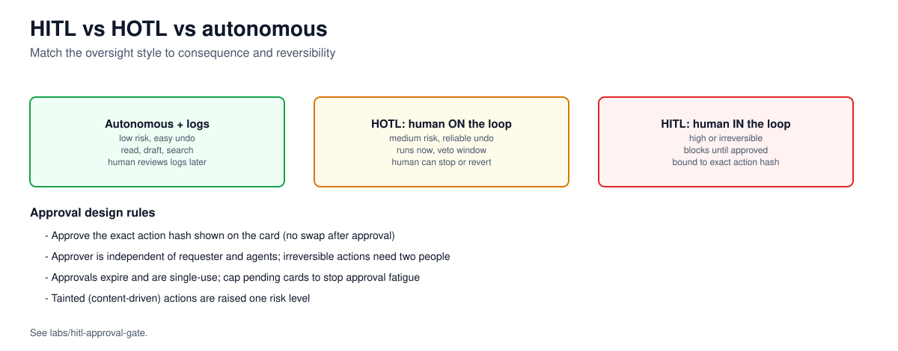
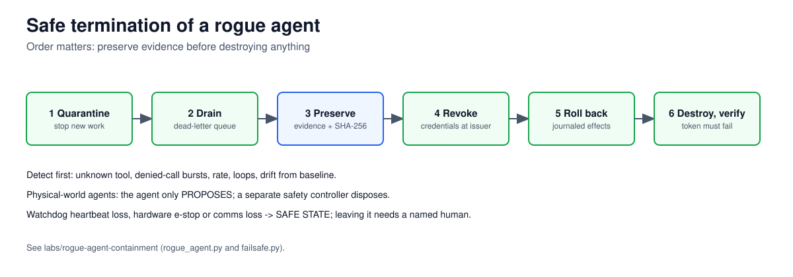

# 05. Oversight, Containment and Fail-Safes

> **Chapter 5 · Time:** ~3 hours · **You will:** choose between human-in-the-loop and human-on-the-loop, detect and safely terminate a rogue agent, and design fail-safes for agents that act in the physical world.
> **Labs:** [rogue-agent-containment](labs/rogue-agent-containment/README.md), [hitl-approval-gate](labs/hitl-approval-gate/README.md)
> **Maps to:** OWASP Agentic ASI10 Rogue Agents, ASI09 Human-Agent Trust Exploitation · EU AI Act Article 14 (human oversight for high-risk systems) · NIST AI RMF MANAGE · [05 monitoring-and-response](../../05-agent-security/monitoring-and-response/README.md)

## 1. Why this matters

- "A human is in the loop" is often a sentence in a design document, not a control. Approval screens get rubber-stamped, approvers see a summary written by the agent, and the action that runs differs from the one approved. OWASP calls this human-agent trust exploitation (ASI09).
- When an agent goes wrong at 3 a.m., "kill it" is not a plan. You need to stop new work, save evidence, revoke credentials and undo damage, in a safe order.
- Agents that move things in the real world (valves, robots, vehicles, building controls) can cause physical harm. Software guardrails alone are not enough.

## 2. Understand it

### 2.1 HITL vs HOTL

| | **HITL**: human *in* the loop | **HOTL**: human *on* the loop | Autonomous with logging |
|---|---|---|---|
| Flow | Agent proposes, **waits**, human approves, action runs | Action runs, human **watches** and can veto or revert | Action runs, humans review logs later |
| Use when | High impact or irreversible (payments, deletions, production changes, external messages) | Medium impact with a reliable undo or short veto window | Low impact, easily reversible |
| Cost | Latency and approver fatigue | Needs good monitoring and a real undo | Needs good logs |
| Risk | Rubber-stamping, swap after approval | Veto window missed, undo fails | Silent drift |

**Approval design rules** (all in the [lab](labs/hitl-approval-gate/README.md)):

1. Risk level comes from a **fixed table**, not from the model; unknown actions are high.
2. Approve the **exact action** (hash of action and arguments); changed arguments invalidate the approval.
3. The approver is **independent** of the requester and of the agents; irreversible actions need **two** people.
4. Approvals **expire** and are **single use**.
5. Cap pending approvals per agent so a flood cannot cause fatigue.
6. Raise the risk level of actions caused by untrusted content (taint).
7. Show the approver the origin chain and the raw arguments, not only the agent's summary.

### 2.2 Detecting, containing and safely terminating a rogue agent

A **rogue agent** acts outside its intended behavior because of compromise (prompt injection, poisoned memory), misconfiguration or goal drift. **Detect** with a baseline plus rules: tool not in the allowlist, bursts of denied calls (probing), call rate, repeated identical calls (loops), drift from normal tool mix ([ch6 observability](../ch6-operationalizing-agentic-ai-security/02-observability-and-anomaly-detection.md)).

**Terminate in this order:**

| Step | Why this position |
|---|---|
| 1 Quarantine | Stop new work reaching it first |
| 2 Drain | Park queued tasks (dead-letter); do not let a compromised agent finish them |
| 3 Preserve | Save context, audit trail, side-effect journal with a hash **before** anything is destroyed |
| 4 Revoke | Kill its credentials at the issuer, not only in the agent |
| 5 Roll back | Undo journaled side effects; this needs a journal designed in advance |
| 6 Destroy and verify | Clear context; test that the old token now fails |

Then investigate, and only then restart from a clean, signed build. The repo's [IR runbook](../../05-agent-security/monitoring-and-response/README.md#5-incident-response-runbook-a-hijacked-agent) covers the human side.

### 2.3 Fail-safe design for high-consequence or physical-world agents

> This is design education, not a safety certification. Real systems follow functional-safety standards (for example the IEC 61508 family and sector standards; verify which apply) with independent engineers.

| Principle | Meaning |
|---|---|
| **Agent proposes, controller disposes** | A separate, simple, deterministic safety controller sits between the agent and the actuator and enforces limits |
| **Safe state** | A defined state (valve closed, motor off, vehicle stopped) the system enters on any doubt |
| **Watchdog** | Independent timer: no heartbeat within N seconds drives the safe state; the agent cannot disable it |
| **Interlocks** | Rules that block unsafe combinations (pump on with valve closed) whatever the agent says |
| **Hardware e-stop** | A physical stop that does not depend on software or the network |
| **Limits in the controller, not the prompt** | Max flow, speed, force, rate of change |
| **Human reset** | Leaving the safe state needs a named human |
| **Fail closed, but plan for fail-safe vs fail-operational** | For some systems "stop" is itself dangerous (an aircraft, a ventilator); choose the safe state with domain experts |
| **Test the unhappy paths** | Network loss, model timeout, garbage output, power cycle |

The [lab's `failsafe.py`](labs/rogue-agent-containment/failsafe.py) simulates a valve controller with a heartbeat watchdog, limits, interlocks, e-stop and human reset.

## 3. Defend it

| Layer | Control | Type |
|---|---|---|
| Oversight | Risk-tiered HITL / HOTL / auto, with the approval rules above | Hard + Process |
| Detection | Baseline + rules over the audit trail | Soft/Process |
| Containment | Ordered termination runbook, tested in drills | Process + Hard |
| Evidence | Hash-chained audit log, evidence preserved before destroy | Hard |
| Physical | Independent safety controller, watchdog, interlocks, e-stop | Hard |

**What does NOT work on its own:** an approval button the agent can click; a "stop" instruction in the prompt; deleting the agent before saving evidence; a watchdog that lives inside the agent process.

## 4. Hands-on

1. [hitl-approval-gate](labs/hitl-approval-gate/README.md): a planner/executor workflow where medium actions are HOTL, high are HITL and irreversible need two approvers. Try to defeat it with a swap, self-approval, replay and a flood.
2. [rogue-agent-containment](labs/rogue-agent-containment/README.md): detect probing, terminate in order, check evidence, rollback and revoked credentials; then break the valve controller's heartbeat.

## 5. Scenarios

1. *Rubber stamp.* An approver clicks "approve" 200 times a day. An attacker times a malicious request in the middle. Fix: tiering (fewer, higher-quality approvals), caps, and showing raw details.
2. *Delete then investigate.* An operator deletes a compromised agent's VM; the logs go with it. Fix: preserve-then-destroy runbook and logs shipped off-box.
3. *Chatty actuator.* A building-control agent is told by injected text to open all doors. Fix: controller enforces a door-state policy independent of the agent; unlock needs an authenticated human.

## 6. Interview questions

<b>Q1. HITL or HOTL for a refund of 20 USD? For deleting a production database?</b>

The 20 USD refund is low or medium risk and reversible: HOTL or autonomous with logging and a daily limit. The production database deletion is irreversible and high impact: HITL with two independent approvers, bound to the exact command, with a backup verified first.

<b>Q2. Why preserve evidence before revoking or destroying?</b>

Destroying the context or host removes the only record of what the agent did and why. Revoking first is fine for stopping damage, but evidence should be captured in the same step sequence, early, with a hash for integrity. In the lab, preserve happens before revoke and destroy.

<b>Q3. How do you make a physical-world agent fail safe?</b>

Put an independent safety controller between the agent and actuators, enforce limits and interlocks there, run a watchdog the agent cannot disable, define a safe state, add a hardware e-stop, and require a human to reset. Follow the relevant functional-safety standards with qualified engineers.

## 7. Checklist

- [ ] I can pick HITL, HOTL or autonomous for five actions and justify each.
- [ ] I can list the six termination steps in order and say why.
- [ ] I can name safe state, watchdog and interlock and say where each lives.

## 8. References

- OWASP Top 10 for Agentic Applications 2026 (ASI09, ASI10).
- EU AI Act, Article 14 (human oversight): [08-ai-compliance lesson 01](../../08-ai-compliance/01-eu-ai-act.md).
- NIST SP 800-61 Rev. 3 (incident response); IEC 61508 family (functional safety): verify applicability.
- Next: [06 Real-tool guides](06-real-tool-guides.md), then the [chapter README](README.md).
