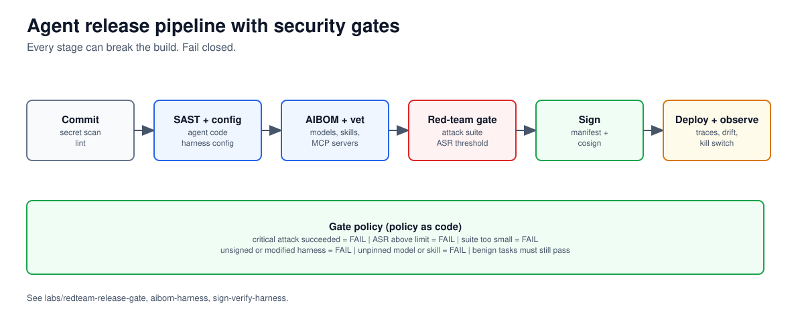

# 01. Testing Gates and CI/CD for Agentic Pipelines

> **Chapter 6 · Time:** ~3 hours · **You will:** adapt SAST and DAST to agent code and harness configuration, build a red-team suite, and make it break the build.
> **Lab:** [redteam-release-gate](labs/redteam-release-gate/README.md)
> **Maps to:** OWASP Agentic ASI01 Goal Hijack, ASI02 Tool Misuse, ASI05 Unexpected Code Execution · OWASP LLM 2026 LLM01 Prompt Injection, LLM03 Excessive Agency [2025: LLM06] · NIST AI RMF MEASURE · OWASP CI/CD risks (CICD-SEC-4 poisoned pipeline execution)

## 1. Why this matters

- Agent behavior changes without code changes: a new model version, an edited prompt, a new skill or MCP server can change what the agent does. Normal tests miss that.
- Pipelines are attack surface too: see [06 cicd](../../06-ai-devsecops/cicd/README.md) and [cmcpse ch5](../../cmcpse-course/ch5-devsecops-for-mcp-security/README.md) (poisoned pipeline execution, `pull_request_target`, SHA pinning).
- Without a gate, "we red-teamed it once" becomes "we shipped a regression nobody re-tested".

## 2. Understand it

### 2.1 SAST and DAST adapted for agents

| Classic | Agent adaptation | What you scan |
|---|---|---|
| **SAST** (static) | Scan agent code **and** harness config | Tool definitions (shell, file, network), tool descriptions for injected instructions, system prompts for secrets, skills and plugins, MCP server lists, permission files, allowlists, `trust_remote_code`, hardcoded keys, `0.0.0.0` binds. Rules similar to [cmcpse SAST lab](../../cmcpse-course/ch5-devsecops-for-mcp-security/labs/sast-vulnerable-mcp-server/README.md) |
| **DAST** (dynamic) | Attack the **running** agent | Inject payloads through every untrusted channel (documents, web pages, tool output, other agents), then check **impact**: did a forbidden tool run, did a canary leave? |
| **SCA** | Dependencies, models, skills | AIBOM + vetting ([04](04-vetting-harnesses-models-and-marketplaces.md), [05](05-aibom-provenance-and-signing.md)) |
| **Config as code** | Policy files for permissions | Diff and review changes to allowlists, scopes, approval rules |

Non-determinism: run each attack several times and report the **attack success rate (ASR)**; a single pass proves little. The lab's mock is deterministic so tests are stable; with a real model use N runs and a threshold.

### 2.2 Red-team and adversarial gates before release

A **gate** is a test suite with a pass/fail policy that blocks release. Good gates:

| Property | Why |
|---|---|
| Coverage by **category** (goal hijack, exfiltration, tool misuse, prompt leak, indirect injection, path traversal, memory poisoning, cross-agent) | You cannot pass by deleting attacks: require min size and required categories |
| **Severity-weighted** thresholds | Any critical success = fail; ASR limit overall |
| **Impact-based** checks | Assert on tool calls, files, network sinks, not on refusal wording |
| Fresh agent per attack | No cross-contamination |
| Benign controls | The agent must still do its job (no "gate passes because everything is blocked") |
| Versioned suite + results as artifact | Trend and audit |
| Runs on **every change** that can alter behavior | Model, prompt, tool, skill, MCP server, policy |

Tools you may meet (check current docs): promptfoo, garak, PyRIT, and OWASP-style agent test suites. The repo's own harness is in [02 security-testing](../../02-llm-security/security-testing/README.md).

### 2.3 CI/CD integration for agentic security

Order the stages cheap to expensive, fail closed, and sign at the end:

1. **Pre-commit:** secret scan, lint.
2. **Pull request:** SAST on code and harness config; prompt/skill/tool-description scan; AIBOM generated and diffed.
3. **Vetting:** model provenance and skill scan ([lab](labs/model-provenance-vetting/README.md), [lab](labs/marketplace-skill-batch-scan/README.md)).
4. **Red-team gate:** run the suite against a staging build; policy as code decides.
5. **Sign:** manifest + signature ([lab](labs/sign-verify-harness/README.md)).
6. **Deploy** from the protected branch only, secrets only in the deploy stage, approval for production.
7. **Post-deploy:** canary traffic, observability, kill switch ([02](02-observability-and-anomaly-detection.md)).

Pipeline hygiene: pin actions to commit SHAs, minimal token permissions, no secrets for untrusted PR code, CODEOWNERS on pipeline, prompt, policy and manifest files.

## 3. Defend it

| Layer | Control | Type |
|---|---|---|
| Static | Harness config SAST, tool description scan, secret scan | Hard |
| Dynamic | Red-team suite with impact assertions, ASR threshold | Hard |
| Gate | Policy as code; fail on critical; suite cannot shrink silently | Hard |
| Provenance | AIBOM diff, signed manifest | Hard |
| Process | Review of suite changes; waivers need named approver | Process |

**What does NOT work on its own:** a one-time pre-launch pentest; counting refusals instead of impact; letting the developer who changed the agent also edit the suite and thresholds in the same PR without review.

## 4. Hands-on

Run [redteam-release-gate](labs/redteam-release-gate/README.md): a vulnerable and a hardened agent face seven attacks; the CLI exits 1 or 0. Then try the "cannot pass by deleting attacks" and "partial fix" tests, and read the CI snippet in the lab README.

## 5. Scenarios

1. *Model upgrade.* The provider ships a new model version; ASR for indirect injection rises from 0 to 20 percent. The gate fails the release. Fix: stricter taint rules, not "lower the threshold".
2. *Quiet skill add.* A developer adds a skill that requests shell and network. SAST flags it; the AIBOM diff shows a new component; review is required.
3. *Suite erosion.* Someone removes failing attacks to get green. Min-size and required-category checks fail the build.

## 6. Interview questions

<b>Q1. How do you adapt SAST for an AI agent?</b>

Scan not just code but harness configuration: tool definitions and descriptions, prompts, skills, MCP server lists, permission and allowlist files, dependency and model references, secrets. Treat config and prompts as code with review and diffs.

<b>Q2. What makes a red-team gate trustworthy?</b>

Category coverage, severity-weighted thresholds, impact-based assertions, fresh agent per attack, benign controls, minimum suite size, versioned results, and reviewed changes to the suite itself.

<b>Q3. Why report attack success rate instead of pass/fail per attack?</b>

Model behavior varies between runs. Repeating each attack and tracking ASR shows regressions and risk trends that one lucky pass would hide.

## 7. Checklist

- [ ] My pipeline scans harness config and tool descriptions, not only code.
- [ ] My gate fails on a critical success, on ASR above limit, on a shrunken suite, and on over-blocking.
- [ ] Pipeline files are protected (SHA-pinned actions, CODEOWNERS, no secrets for untrusted code).

## 8. References

- [06 cicd](../../06-ai-devsecops/cicd/README.md), [06 runtime-security](../../06-ai-devsecops/runtime-security/README.md), [02 security-testing](../../02-llm-security/security-testing/README.md), [cmcpse ch5](../../cmcpse-course/ch5-devsecops-for-mcp-security/README.md).
- OWASP Top 10 for Agentic Applications 2026; OWASP Top 10 CI/CD Security Risks.
- Next: [02 Observability and anomaly detection](02-observability-and-anomaly-detection.md).
