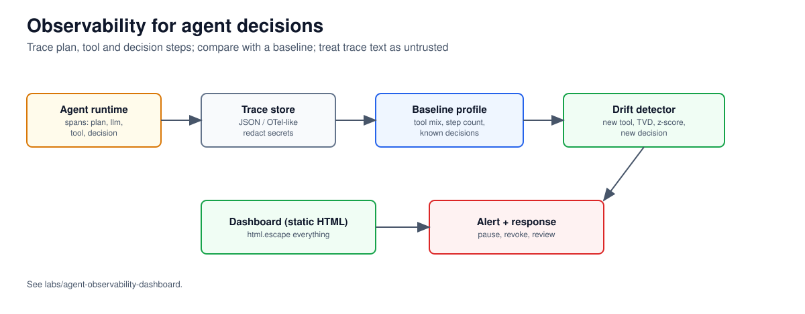

# 02. Observability and Anomaly Detection for Agent Behavior

> **Chapter 6 · Time:** ~2.5 hours · **You will:** record plan, tool and decision steps as traces, build a dashboard from them, and detect behavior drift against a baseline.
> **Lab:** [agent-observability-dashboard](labs/agent-observability-dashboard/README.md)
> **Maps to:** OWASP MCP08 Lack of Audit and Telemetry · OWASP Agentic ASI10 Rogue Agents · NIST AI RMF MEASURE, MANAGE · [05 monitoring-and-response](../../05-agent-security/monitoring-and-response/README.md)

## 1. Why this matters

- An autonomous agent makes many small decisions. Without traces you cannot answer "why did it do that?" after an incident, or notice that it started doing something new.
- Security events hide in behavior, not in single log lines: a new tool, a longer loop, a decision never seen before.
- Observability data is itself sensitive (prompts, PII, secrets) and **untrusted** (it can contain attacker text that attacks the dashboard, or the AI reading it).

## 2. Understand it

### 2.1 Observability for autonomous decision-making

Record a **trace** per task, made of **spans** (OpenTelemetry-like; check current OTel GenAI semantic conventions, which were still evolving in 2026):

| Span kind | Records | Security use |
|---|---|---|
| `plan` | The agent's stated plan or goal step | See goal drift and injected objectives |
| `llm` | Model call: model/version, token counts, prompt hash (not raw secrets) | Cost and model-change tracking |
| `tool` | Tool name, argument **hash** or redacted args, result size, status | Allowlist violations, exfiltration patterns |
| `decision` | Branch outcome: answer, escalate, ask human, refuse, override | Policy overrides and approvals |
| identity fields | Agent ID, principal, delegation chain, tenant | Attribution ([ch5 04](../ch5-multi-agent-systems-and-agent-identity/04-agent-identity-and-access.md)) |

Rules: redact secrets before storage, keep raw prompts only where policy allows, hash-chain or ship logs off the agent host, set retention, and give the SOC read access without write access.

**Reasoning traces.** If a model exposes reasoning text, it can help debugging, but it is not a reliable account of the real cause of behavior and can contain sensitive data or injected content. Treat it as another untrusted log field; never rely on it as proof.

### 2.2 Anomaly detection for behavior drift

Build a **baseline** from known-good traces, then compare a recent window:

| Signal | How | Catches |
|---|---|---|
| New tool | Tool in window not in baseline | Capability change, injection that reaches new tools |
| Tool-mix drift | Total variation distance between tool-usage distributions | Subtle shift in what the agent does |
| Step-count outlier | z-score of spans per trace | Loops, runaway, over-long chains |
| New decision value | Decision never seen | Policy override, new branch |
| Rate and cost | Calls per minute, tokens per task | Abuse, unbounded consumption |
| Destination change | New domains/recipients | Exfiltration |

Tune on real traffic: too sensitive means alert fatigue; too loose means misses. Re-baseline after approved changes (new model, new tool), otherwise every release looks like drift. Link a finding to a **response** (pause agent, revoke credentials, human review).

## 3. Defend it

| Layer | Control | Type |
|---|---|---|
| Collection | Structured spans with identity and chain; secrets redacted | Hard |
| Integrity | Off-host or hash-chained storage | Hard |
| Detection | Baseline + rules; alert on new tool and decision | Soft/Process |
| Dashboard | Escape all trace text (`html.escape`); no raw HTML; no AI that executes on trace text | Hard |
| Response | Runbook and kill switch ([ch5 05](../ch5-multi-agent-systems-and-agent-identity/05-oversight-containment-and-failsafes.md)) | Process |

**What does NOT work on its own:** logging only prompts and answers; relying on the agent's own explanation; one global threshold for every agent.

## 4. Hands-on

Run [agent-observability-dashboard](labs/agent-observability-dashboard/README.md): generate baseline and drifted traces, detect drift, write a static HTML and Markdown dashboard. Check that an XSS string inside a span attribute is rendered as text.

## 5. Scenarios

1. *Slow exfiltration.* Tool mix drifts: a new `http_post` appears in 3 of 100 traces. The tool-mix and new-tool rules fire a week before anyone notices data loss.
2. *Dashboard injection.* A support ticket title containing a script tag ends up in a span; an unescaped dashboard runs it in an analyst's browser. Fix: escape on output.
3. *False alarm after upgrade.* A new approved tool triggers drift every time. Fix: re-baseline through a controlled change process.

## 6. Interview questions

<b>Q1. What should you log for an agent, beyond prompts and responses?</b>

Plan steps, model and version, tool calls with redacted or hashed arguments and results, decisions, identity (agent, principal, chain, tenant), timing and cost. Structure it as traces so you can reconstruct a task.

<b>Q2. How do you detect behavior drift?</b>

Create a baseline of tool usage, step counts and decisions from known-good runs; compare new windows with measures such as new tools, total variation distance, z-scores and unseen decision values; alert and respond; re-baseline after approved changes.

<b>Q3. Why is observability data a security risk itself?</b>

It may hold secrets and personal data, and it contains attacker-controlled text that can exploit the viewer (XSS) or an AI that reads it. Redact, restrict access, set retention and escape on output.

## 7. Checklist

- [ ] Every agent run produces a trace with identity and chain.
- [ ] Secrets and PII are redacted before storage.
- [ ] A baseline and at least four drift rules exist, with a documented response.

## 8. References

- OpenTelemetry documentation (including GenAI semantic conventions: verify current status).
- [05 monitoring-and-response](../../05-agent-security/monitoring-and-response/README.md), [09 lesson 08](../../09-enterprise-architecture/08-continuous-assessment-and-ai-secops.md), [06 runtime-security](../../06-ai-devsecops/runtime-security/README.md).
- Next: [03 Defensive SecOps agents](03-defensive-secops-agents.md).
