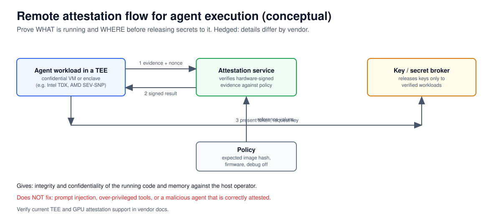

# 08. Confidential Computing and Attestation for Agent Execution

> **Chapter 6 · Time:** ~2 hours · **You will:** understand trusted execution environments (TEEs), the remote attestation flow, and what they do and do not give an agent platform.
> **Conceptual and hedged.** Vendors and APIs change quickly: verify in each vendor's documentation. There is no lab; the repo's twin for the "verify before trust" idea is [sign-verify-harness](labs/sign-verify-harness/README.md).
> **Maps to:** OWASP Agentic ASI04/ASI05 (supply chain, execution) · NIST SP 800-207 continuous evaluation · NIST AI RMF MANAGE

## 1. Why this matters

- Agents handle prompts, documents, credentials and model weights. On a cloud host, the operator (or someone who compromised it) could read memory or tamper with the running code.
- Regulated or sensitive workloads (health, finance, government, model owners protecting weights) ask for **proof of what code is running, on what hardware**, before secrets are released to it.

## 2. Understand it

### 2.1 Trusted execution environments

A **TEE** is a hardware-isolated region where code and data are protected from the host OS, hypervisor and operator. Forms: **confidential virtual machines** (for example Intel TDX, AMD SEV-SNP) and process **enclaves** (for example Intel SGX, a more restricted model). **Confidential GPUs** (NVIDIA's confidential computing mode on recent data-center GPUs) extend this to accelerated inference (verify supported products). Cloud providers offer confidential VM and container offerings (verify per cloud).

### 2.2 Remote attestation flow

Attestation is evidence that a TEE is genuine and running specific software:

1. The workload (inside the TEE) asks the hardware for a signed **report** (measurements of firmware, boot and code; a **nonce** from the verifier to prevent replay).
2. A **verifier / attestation service** checks the hardware signature chain, compares the measurements with **reference values** (expected image hash, firmware versions, debug disabled) and issues a signed **attestation token** if they match.
3. A **key or secret broker** releases keys (model decryption key, API credentials) only to workloads that present a valid token. Secrets never reach an unverified environment.
4. The relying party **re-attests** periodically (continuous evaluation) and on deployment changes.

### 2.3 What this gives agent execution

| Gives | Does not give |
|---|---|
| Confidentiality of memory and data from the host operator | Protection from prompt injection |
| Integrity: the measured code is what runs | Correct or safe agent behavior |
| Secret release bound to a verified workload (model weights, credentials) | Protection against a malicious agent that is correctly attested |
| Evidence for audits and customers | Protection against side-channel or hardware vulnerabilities (research shows TEEs have had such issues; keep patching) |
| A hardware root for workload identity (can feed SPIFFE-style identity: [ch5 04](../ch5-multi-agent-systems-and-agent-identity/04-agent-identity-and-access.md)) | Free performance: overhead and operational complexity exist |

Treat TEEs as **one layer**. The agent inside still needs least agency, a gateway, approval gates and monitoring.

## 3. Defend it

| Layer | Control | Type |
|---|---|---|
| Attestation | Verify evidence against pinned reference values; fresh nonce | Hard |
| Key release | Broker releases secrets only on a valid token | Hard |
| Image integrity | Signed, reproducible images; AIBOM ([05](05-aibom-provenance-and-signing.md)) | Hard |
| Patching | Track TEE firmware and microcode advisories | Process |
| Everything else | Zero trust, sandbox, gateway, HITL | Hard |

**What does NOT work on its own:** "we run in a TEE so injection cannot hurt us"; trusting an attestation token without checking the nonce, measurements and expiry; allowing debug-mode enclaves in production.

## 4. Hands-on (thought exercise)

Draw the flow for an agent that decrypts a private model: where is the nonce, who holds reference values, what does the key broker check, what happens when the image changes? Compare with the HMAC manifest verification in the signing lab: both verify before trust, but attestation proves a *running* environment, signing proves an *artifact*.

## 5. Scenarios

1. *Model weights on a shared cloud.* A model owner releases the decryption key only to a measured confidential VM.
2. *Operator access.* A cloud admin dumps memory: with a TEE, they see ciphertext.
3. *Compromised agent in a good TEE.* Injection makes the attested agent exfiltrate data to an allowed domain. Attestation said nothing about behavior: the gateway's egress policy catches it.

## 6. Interview questions

<b>Q1. What problem does remote attestation solve?</b>

It lets a relying party verify that a workload runs on genuine TEE hardware with expected measurements before releasing secrets to it, so trust is based on evidence rather than on location or an operator's word.

<b>Q2. Does confidential computing stop prompt injection?</b>

No. It protects data and code integrity from the host. An attested agent can still be manipulated through its inputs, so you still need least agency, gateways and monitoring.

<b>Q3. What are the steps in the attestation flow?</b>

Verifier sends a nonce; the TEE produces signed evidence including measurements; the attestation service validates the hardware signature chain and measurements against reference values and returns a token; a key broker releases secrets to a workload presenting the token; re-attest periodically.

## 7. Checklist

- [ ] I can draw the attestation flow with nonce, evidence, verifier, token and broker.
- [ ] I can list two things TEEs give and two they do not.
- [ ] I know to check vendor docs for current support and advisories.

## 8. References

- Confidential Computing Consortium (Linux Foundation) materials; IETF RATS architecture (RFC 9334); vendor documentation for Intel TDX, AMD SEV-SNP and NVIDIA confidential computing: verify current details.
- Next: [09 CISA Five Eyes agentic AI guidance](09-cisa-five-eyes-agentic-ai-guidance.md).
