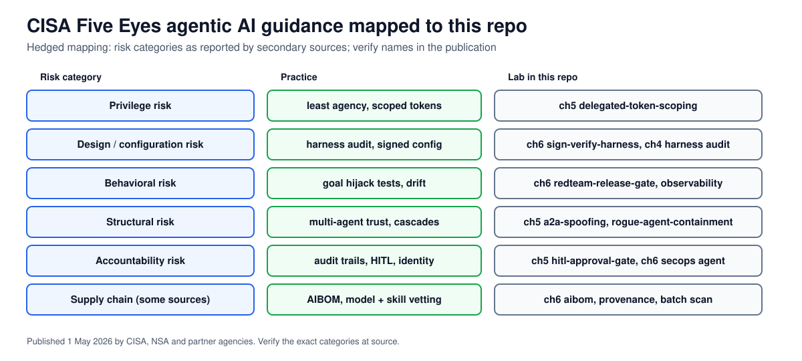

# 09. CISA and Five Eyes: "Careful Adoption of Agentic AI Services"

> **Chapter 6 · Time:** ~2 hours · **You will:** summarize the first joint Five Eyes guidance on agentic AI, understand its risk categories and recommended practices, and map each to labs in this repo.
> **Hedged summary.** Read the publication itself. This lesson paraphrases secondary reporting and the structure widely described; exact titles, section names and page counts may differ. **Verify at cisa.gov and the partner agencies' sites.**

## 1. Why this matters

- Published **1 May 2026**, it is reported as the first joint Five Eyes guidance on agentic AI, issued by CISA and NSA (US), the Australian Signals Directorate's ACSC, the Canadian Centre for Cyber Security, New Zealand's NCSC and the UK's NCSC.
- It follows earlier joint work: "Guidelines for Secure AI System Development" (2023) and "Deploying AI Systems Securely" (2024). It speaks to organizations that adopt agentic services, not only to model builders.
- Government guidance often becomes the checklist in procurement, audits and regulator conversations, so it is exam and interview relevant.

## 2. Understand it

### 2.1 What it is about (as reported)

A practical, risk-based set of recommendations for adopting AI agents (systems that plan, use tools and act with some autonomy) carefully: start small, limit authority, keep humans accountable, monitor, and be able to stop. It treats agentic AI as an extension of existing cybersecurity practice plus new risks from autonomy.

### 2.2 Risk categories

Per the Cloud Security Alliance's summary of the document, the categories are **privilege, design and configuration, behavioral, structural, and accountability** risks. Some sources list **supply chain** risk as a category instead or as well. **Verify the exact list in the publication.**

| Category (as reported) | Plain meaning | Typical examples | Where this repo covers it |
|---|---|---|---|
| **Privilege** | Agents hold more access or authority than needed, or inherit user rights | Shared service accounts, broad tokens, passthrough, confused deputy | [ch5 04](../ch5-multi-agent-systems-and-agent-identity/04-agent-identity-and-access.md), [delegated-token-scoping](../ch5-multi-agent-systems-and-agent-identity/labs/delegated-token-scoping/README.md), [confused-deputy-chain](../ch5-multi-agent-systems-and-agent-identity/labs/confused-deputy-chain/README.md) |
| **Design and configuration** | Insecure defaults, exposed gateways, weak sandboxing, unsafe tool setups | Exposed agent instance, no auth, dangerous tools enabled | [sign-verify-harness](labs/sign-verify-harness/README.md), [harness audit](../ch4-computer-use-browser-and-coding-agents/labs/harness-security-audit), [openclaw-misconfiguration](../ch4-computer-use-browser-and-coding-agents/labs/openclaw-misconfiguration) |
| **Behavioral** | Unexpected or manipulated agent behavior: goal drift, injection, deception | Prompt injection, goal hijack, unsafe autonomy | [redteam-release-gate](labs/redteam-release-gate/README.md), [observability](labs/agent-observability-dashboard/README.md) |
| **Structural** | Risks from how multiple agents, tools and systems connect | Cascades, A2A abuse, shared memory, protocol weaknesses | [a2a-spoofing](../ch5-multi-agent-systems-and-agent-identity/labs/a2a-spoofing/README.md), [isolated-subagents](../ch5-multi-agent-systems-and-agent-identity/labs/isolated-subagents/README.md) |
| **Accountability** | Unclear ownership, weak logs, hard to attribute or audit actions | No audit trail, no human responsible | [hitl-approval-gate](../ch5-multi-agent-systems-and-agent-identity/labs/hitl-approval-gate/README.md), [secops-triage-agent](labs/secops-triage-agent/README.md) |
| **Supply chain** (some sources) | Third-party models, skills, plugins, MCP servers | Malicious marketplace skills | [aibom-harness](labs/aibom-harness/README.md), [model-provenance-vetting](labs/model-provenance-vetting/README.md), [marketplace-skill-batch-scan](labs/marketplace-skill-batch-scan/README.md) |

### 2.3 Recommended practices (paraphrased, hedged)

| Practice theme | What to do | Course material |
|---|---|---|
| Start small and scoped | Low-risk use cases first; clear boundaries; expand gradually | [ch5 04](../ch5-multi-agent-systems-and-agent-identity/04-agent-identity-and-access.md) (least agency) |
| Strong identity and access | Per-agent identity, short-lived least-privilege credentials | ch5 labs |
| Human oversight | Approval for high-impact actions; clear accountable owner | [ch5 05](../ch5-multi-agent-systems-and-agent-identity/05-oversight-containment-and-failsafes.md) |
| Secure design and configuration | Secure defaults, sandboxing, network isolation, no exposed gateways | [ch4](../ch4-computer-use-browser-and-coding-agents/README.md) |
| Testing and evaluation | Adversarial testing before release; regression gates | [01](01-testing-gates-and-cicd-for-agents.md) |
| Monitoring and logging | Trace decisions, detect anomalies, retain evidence | [02](02-observability-and-anomaly-detection.md) |
| Supply-chain control | Vet and inventory models, skills, tools | [04](04-vetting-harnesses-models-and-marketplaces.md), [05](05-aibom-provenance-and-signing.md) |
| Incident readiness | Ability to stop, contain, roll back and investigate | [rogue-agent-containment](../ch5-multi-agent-systems-and-agent-identity/labs/rogue-agent-containment/README.md) |
| Integrate with existing security | Apply zero trust, IAM, SOC and risk management | [06](06-nist-ai-rmf-asi-controls-and-zero-trust.md) |

The common thread: **do not give agents more authority than a human in the same role would get without supervision, and keep the ability to see and stop what they do.**

## 3. Defend it

| Layer | Control | Type |
|---|---|---|
| Governance | Map your agent program to the categories; assign owners | Process |
| Technical | Labs above as evidence | Hard |
| Procurement | Ask vendors how they address each category | Process |

**What does NOT work on its own:** treating the guidance as a checkbox; assuming vendor "enterprise" agents already meet it; ignoring it because it is not law (it will shape audits and contracts).

## 4. Hands-on

Pick one agent. Build a table `category | what could go wrong for us | existing control | lab/evidence | gap`. Then use [ch5 and ch6 labs](README.md) to fill gaps. Re-read the primary document and correct any category names this lesson got wrong.

## 5. Scenarios

1. *Procurement.* A vendor pitches an autonomous IT-ops agent. You ask for per-category answers: identity model, approval gates, logging, supply-chain controls, stop mechanism.
2. *Board question.* "Are we aligned with government guidance?" You present the mapping and the gaps.
3. *Pilot expansion.* A pilot agent wants production write access. Guidance-style review: narrow scope, approval for writes, monitoring first.

## 6. Interview questions

<b>Q1. What is the CISA / Five Eyes "Careful Adoption of Agentic AI Services" guidance?</b>

A joint publication (1 May 2026, by CISA, NSA, ASD's ACSC, the Canadian Cyber Centre, NZ NCSC and UK NCSC, as reported) giving risk-based recommendations for adopting agentic AI: limit privilege, secure design and configuration, test and monitor behavior, manage structure and supply chain, keep accountability and human oversight. Verify details in the publication.

<b>Q2. Name the risk categories and one control for each.</b>

As reported: privilege (scoped short-lived credentials), design/configuration (secure defaults and sandbox), behavioral (red-team gate and drift monitoring), structural (signed inter-agent messages and isolation), accountability (audit trails and named approvers). Some sources add supply chain (AIBOM and vetting).

<b>Q3. How does this relate to earlier Five Eyes AI guidance?</b>

It builds on "Guidelines for Secure AI System Development" (2023) and "Deploying AI Systems Securely" (2024) by addressing autonomy: agents that plan, call tools and act.

## 7. Checklist

- [ ] I read the primary publication and corrected this summary where needed.
- [ ] My agent has an owner, identity, gates, logs and a stop mechanism mapped to each category.
- [ ] I can explain the guidance in two sentences to an executive.

## 8. References

- CISA and partner agencies' publication "Careful Adoption of Agentic AI Services" (1 May 2026): verify title, categories and details at cisa.gov, ncsc.gov.uk, cyber.gc.ca, cyber.gov.au and ncsc.govt.nz.
- "Guidelines for Secure AI System Development" (2023); "Deploying AI Systems Securely" (2024).
- Cloud Security Alliance research notes on the guidance (secondary source).
- Next: the [chapter README](README.md).
