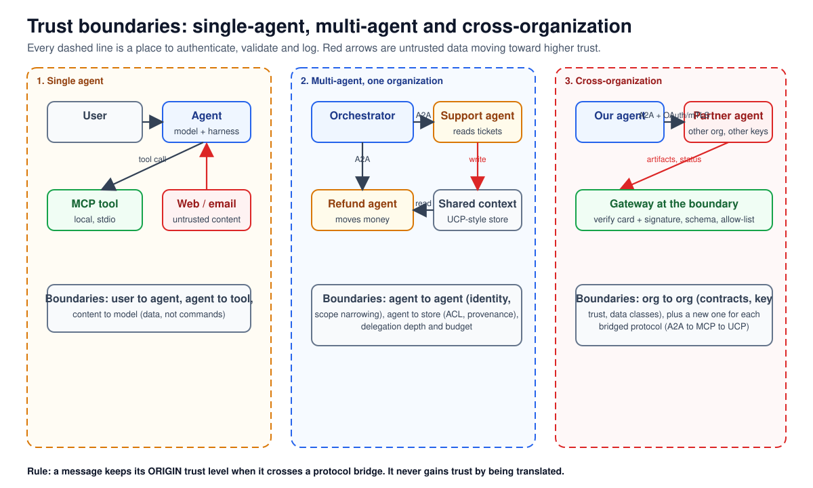

# Lesson 02: Trust boundaries and risk scoring for agentic systems

> **Chapter 7** · **Time:** ~2 hours · **You will:** map trust boundaries for single-agent, multi-agent and cross-organization topologies, and score agent-specific risks with a repeatable method.

| | |
|---|---|
| **Syllabus lines** | Trust Boundaries and Risk Scoring for Agentic Systems · Mapping trust boundaries across single-agent, multi-agent, and cross-organization topologies · Scoring agentic-specific risks |
| **Already in this repo** | DFD and boundaries: [CAISP ch5 lesson 02](../../caisp-course/ch5-threat-modeling-ai-systems/02-dfd-and-llm-architecture.md). Generic rating: [CAISP ch5 lesson 05](../../caisp-course/ch5-threat-modeling-ai-systems/05-rating-and-managing-risks.md), [CMCPSE ch3 lesson 05](../../cmcpse-course/ch3-threat-modeling-mcp-architectures/05-rating-and-managing-risks.md) |
| **Lab** | [Lab 1](labs/01-stride-atlas-threat-model/) (`crossings()`, `score()`) |

---

## 1. Mapping trust boundaries

A **trust boundary** is any line where data, identity or authority changes owner or trust level. In agent systems there are four kinds, and you need all four on the diagram.

| Kind | Question | Example |
|---|---|---|
| **Network / process** | Is this a different process or host? | Orchestrator to a stdio MCP server |
| **Identity** | Does the principal change? | A user request becomes an agent action with the agent's own credential |
| **Content origin** | Who wrote this text? | A ticket body that is about to enter a prompt |
| **Organization** | Whose policy governs the peer? | A partner's shipping agent |



### 1.1 Single agent

User, agent, tools, and content the agent reads. The boundaries are: user to agent; agent to each tool (local stdio server vs remote OAuth server); and **content to model**. The last one is the one classic diagrams omit. Web pages, emails and tool results are data from a lower-trust zone entering the model. See [CMCPSE ch3 lesson 02](../../cmcpse-course/ch3-threat-modeling-mcp-architectures/02-diagramming-mcp-architectures.md).

### 1.2 Multi-agent, one organization

Add an orchestrator, workers, and maybe a shared context store. New boundaries:

* **Agent to agent.** Authority must narrow at each hop (see [agent identity](../../05-agent-security/agent-identity/)). If the orchestrator's token is passed down, every worker is as powerful as the orchestrator.
* **Agent to store.** Any writer can plant text for every reader (ASI06).
* **Delegation depth.** Each hop adds latency, loss of context and chances for a bad plan to fan out (ASI08).

Zone the agents by what they read and what they can do. A "support agent that reads customer tickets" and a "refund agent that moves money" belong in different zones even though one team owns both. Existing lab: [multi-agent trust](../../05-agent-security/multi-agent-trust/).

### 1.3 Cross-organization

Add partner agents reached over A2A. Now you have a different security policy, different keys, different incident process, and no ability to patch their code. Boundaries:

* Org to org: contract, accepted auth schemes, key trust (who is the issuer of the partner's cards?).
* Data classes: what may leave? (An A2A task payload may carry customer data.)
* **Bridges.** When an orchestrator translates A2A into MCP calls or context writes, each translation is itself a boundary (lesson 04, lab 6).

Rule of thumb: **a message keeps its origin trust level across any bridge.** Translation must never raise it.

## 2. Scoring agentic risks

Classic likelihood x impact still works. Agents add factors that change both.

| Factor | Raises | Why |
|---|---|---|
| **Autonomy** (human in the loop?) | Likelihood and impact | No one to catch a bad action |
| **Privilege / tool reach** | Impact | Money movement, deletion, external email |
| **Exposure to untrusted content** | Likelihood | Reads tickets, web, partner artifacts |
| **Boundary gain** (untrusted data moves to a higher zone) | Likelihood | The path an attacker needs exists |
| **Delegation depth** | Impact | Authority and blast radius spread |
| **Persistence** (memory, shared store) | Impact | Poison survives the session |
| **Detectability** | Likelihood x time | Quiet attacks last longer |

The lab uses a simple, explainable formula:

```text
score = likelihood(1-5) x impact(1-5)
        x autonomy multiplier (low 1.0, medium 1.15, high 1.3)
        x 1.25 if the flow moves data into a HIGHER-trust zone
        x (1 + 0.1 per extra delegation hop, capped at +30%)
```

It is **not a standard**. It is a teaching model chosen so you can explain every number. Other approaches you may meet: OWASP Risk Rating, DREAD-style averages, CVSS for specific vulnerabilities (not for design threats), and FAIR for money-based risk. Pick one, write it down, apply it the same way every time, and show both **inherent** and **residual** risk.

Demo (real output, trimmed):

```text
| TM-010 | orch    | T | Prompt injection arrives inside a task, artifact or tool result | Execution            | ASI01 | 32.5 |
| TM-008 | orch    | E | Low-trust agent obtains a high-privilege action through delegation | Privilege Escalation | ASI03 | 26.0 |
| TM-059 | F7      | T | Shared context poisoned by a low-trust writer                    | Persistence          | ASI06 | 26.0 |
```

Notice how the poisoned context flow (F7) outranks many element-level threats: it crosses into the refund agent's zone and persists.

### 2.1 Turning scores into decisions

| Score band (lab) | Decision |
|---|---|
| 25 and above | Needs a hard control and a test before go-live |
| 15 to 24 | Hard or compensating control; owner and date |
| below 15 | Accept, monitor or schedule |

Lab 8's validator enforces the first row: any threat with inherent score 15 or more must have at least one hard control.

## 3. Common mistakes

* Scoring the model instead of the **path** (injection scores high only where the agent can act).
* Ignoring persistence. A poisoned store entry is worse than a one-shot injection.
* Reporting only inherent risk, so nobody sees what the controls bought.
* Mixing scales across teams.

## 4. Quick checks

<details><summary><b>Q1. A partner agent's output flows into your orchestrator. Which boundary kinds does it cross?</b></summary>

Organization, identity, network, and content origin. It also moves data into a higher-trust zone, so it earns the boundary-gain multiplier.
</details>

<details><summary><b>Q2. Why does autonomy raise impact?</b></summary>

Fewer humans can stop a bad action before it completes. The same flaw costs more when no approval step exists.
</details>

## References

* OWASP Risk Rating Methodology; NIST AI RMF 1.0 (Map, Measure functions); NIST SP 800-30 for risk assessment basics
* [CAISP ch5 lesson 05](../../caisp-course/ch5-threat-modeling-ai-systems/05-rating-and-managing-risks.md)
