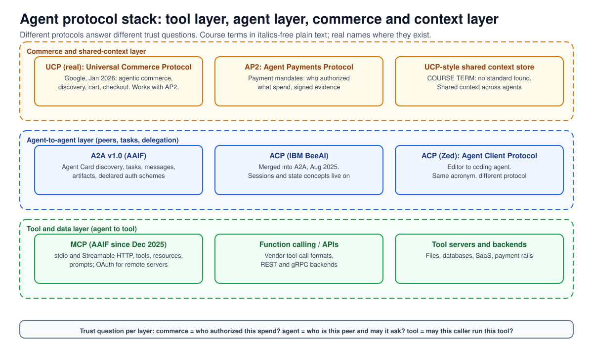
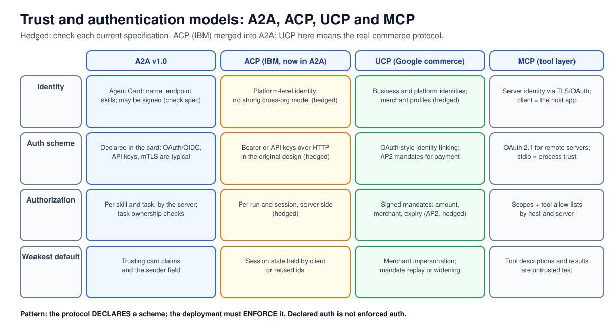
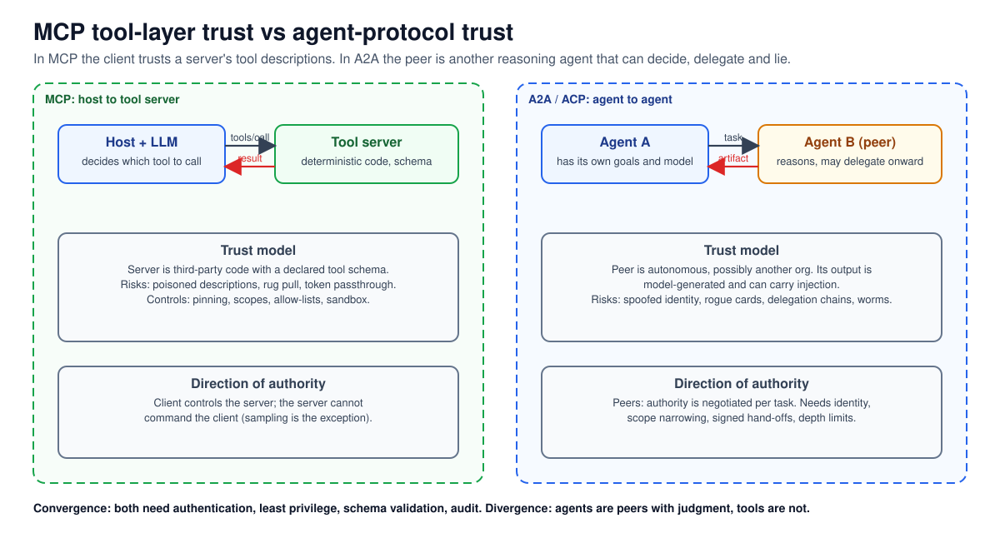

# Lesson 03: Agent communication protocols: A2A, ACP and UCP

> **Chapter 7** · **Time:** ~3.5 hours · **You will:** explain A2A messages, discovery and delegation; the session and state ideas of ACP (and where ACP went); the shared-context idea the syllabus calls UCP (and what the real UCP is); compare their trust models; and say how all of this differs from MCP.

| | |
|---|---|
| **Syllabus lines** | Agent Communication Protocols: A2A, ACP, and UCP · A2A (message structure, capability discovery, task delegation) · ACP (session and state management between heterogeneous agents) · UCP (shared context exchange) · Comparing trust and authentication models · Intersection and divergence from MCP's tool-layer trust model |
| **Already in this repo** | A2A intro and signed envelopes: [multi-agent trust](../../05-agent-security/multi-agent-trust/). MCP basics: [CMCPSE ch1](../../cmcpse-course/ch1-introduction-to-mcp-and-agentic-ecosystem/README.md) |
| **Labs** | [Lab 2: A2A exchange](labs/02-a2a-message-exchange/), [Lab 4: session state](labs/04-acp-session-abuse/), [Lab 5: context store](labs/05-ucp-context-poisoning/) |

> **Read this first: three names in the syllabus have moved.** See the "Outdated in the syllabus" box in the [chapter README](README.md). Short version: A2A is now v1.0 under the Agentic AI Foundation; IBM's ACP merged into A2A in August 2025; and no standard called "Unified Context Protocol" was found, while the real UCP is Google's Universal Commerce Protocol. This lesson teaches the syllabus concepts and the current reality.



---

## 1. Why a separate agent layer exists

MCP connects an agent to **tools and data**. It does not say how two **agents** (each with its own model, goals and owner) find each other, hand off a long-running job, stream progress, or return files. That is the gap A2A was built for. Google introduced A2A in April 2025 and moved it to the Linux Foundation; per the project, v1.0 shipped in 2026 (around March; v1.0.x patch releases followed) and the project was accepted into the Agentic AI Foundation (AAIF) later in 2026. **Verify dates and versions at the A2A specification site.**

## 2. A2A

Everything below is conceptual. The exact field names, method names and bindings changed between pre-1.0 drafts and v1.0, so **check the v1.0 specification before building** (the lab uses a simplified model and says so).

### 2.1 Message structure

* **Transport and framing.** JSON-RPC 2.0 over HTTP is the long-standing core. Newer spec versions describe more than one protocol binding (for example gRPC and HTTP+JSON); check which your SDK uses.
* **Message.** A turn from a user-role or agent-role participant. It is made of **parts**: text, file references or data, each with a media type. It has an id, and can be linked to a task and a context (conversation).
* **Task.** The unit of work. It has an id and a **lifecycle state**. Typical states: submitted, working, input-required, completed, failed, canceled (and others in newer versions such as rejected or auth-required; check the spec).
* **Artifact.** A result produced by a task (a file, a structured document). It is also made of parts. **Artifacts are data from another agent: treat them as untrusted text.**
* **Streaming and push.** Long tasks can stream status updates, or call a webhook (push notification). A webhook URL supplied by the client is an SSRF and spoofing surface: the server must validate it and the receiver must authenticate the callback.

### 2.2 Capability discovery: the Agent Card

An agent publishes a machine-readable **Agent Card**, usually at a well-known URL on its host (the exact path changed between versions: check the spec). In concept it describes the agent's name and description, its **skills**, the endpoint URL and protocol binding, the content types it handles, capabilities (streaming, push), and the **authentication schemes** a caller must use. Newer versions allow cards to be signed (verify this in your spec version).

Security meaning: the card is a **claim**, not proof. Anyone can host a card that says "I am the payments agent". Discovery is therefore the first attack surface (lesson 04, attack 2).

### 2.3 Task delegation

A client agent picks a remote agent from its card, sends a message (creating a task), and then polls, streams or receives a push as the task moves through states. If the task becomes input-required, the client sends a follow-up message on the same task. The remote agent may itself delegate to other agents, forming a chain.

Security meaning: delegation is **authority transfer**. The remote agent acts on the client's behalf, so you need (a) proof of who the remote agent is, (b) a narrowed scope for this task, (c) a depth limit, and (d) task ownership checks so only the assigned agent can update a task.

**Lab 2** builds this offline: Agent Card discovery, task send, status log, input-required, artifact. Real output:

```text
Agent Card: {"name": "summarizer-agent", "url": "http://127.0.0.1:59886/rpc", "securitySchemes": {"none": {"type": "none"}}}
Skills: ['summarize', 'shout']
Task 7f14166161f7 status log: ['submitted', 'working', 'completed']
Artifact: Agents talk over A2A.
Follow-up -> completed ['submitted', 'working', 'input-required', 'working', 'completed']
```

Note the card declares `"none"` as its auth scheme: the lab server is deliberately unauthenticated. Labs 3 and 7 fix that.

## 3. ACP: sessions and state between heterogeneous agents

**What it was.** The Agent Communication Protocol came from IBM's BeeAI project (2025). It aimed at REST-style, framework-neutral agent-to-agent messaging, with runs, sessions and state so that agents built in different frameworks could cooperate. **What happened.** In August 2025 the ACP team announced it was **merging into A2A**; the ACP repository was archived with a migration guide (verify in the BeeAI/ACP repository and the Linux Foundation announcement). Its ideas live on in A2A: tasks, contexts and message parts.

**Naming collision.** Today "ACP" is often the **Agent Client Protocol** (originating with the Zed editor), which connects an editor to a coding agent. That is a different protocol with a different threat model (a local, user-trusting channel between an IDE and an agent process). When a document says "ACP", check which one.

**The concept the syllabus wants.** Session and state management between heterogeneous agents:

| Concept | Meaning | Security question |
|---|---|---|
| Session | A conversation or run with an identity and lifetime | How is it created, bound to an agent, rotated, expired? |
| State | What the session remembers: role, scopes, history, partial results | Who stores it, server or client? Can it be tampered with? |
| Hand-off | State passes to another agent or later request | Is the token signed, bound to the agent, expiring, revocable? |
| Heterogeneity | Different frameworks, different auth stacks | Which side's identity and policy win? |

**Lab 4** uses a **generic session/state model** (it is not IBM's ACP and not Zed's). It shows session fixation and unsigned client-held state, then server-side state and signed, bound tokens.

## 4. UCP: what the syllabus means, and what exists

**The syllabus concept.** "Unified Context Protocol: shared context exchange across agents and orchestrators." That describes a **shared context store**: several agents and an orchestrator read and write common context (facts, notes, plan state).

**What we found.** No published standard called "Unified Context Protocol" was found when this companion was written (verify; the course may use the term for its own material). So labs call it a **"UCP-style shared context store (course term)"**.

**What UCP actually is.** In January 2026 (announced at NRF, 11 January) Google announced **UCP, the Universal Commerce Protocol**, an open standard for **agentic commerce**: product discovery, cart and checkout between AI agents, consumer surfaces and merchants. It is designed to work alongside **AP2** (Agent Payments Protocol), **MCP** and **A2A**, with REST, MCP and A2A bindings (hedged: verify at Google's announcement and the UCP repository). A competing effort is the **Agentic Commerce Protocol** by OpenAI and Stripe. Do not confuse the real UCP with the syllabus's context-store idea.

### 4.1 The shared context store (course term)

Design questions: who may write which namespace, who may read, how entries are labelled with origin and trust, whether entries are signed, how long they live, and how downstream agents are told "this text is data".

Typical flow in lab 5: a low-trust support agent writes notes; a pricing agent reads `pricing/approved_discount`; a worker reads notes. Without controls, the support agent can write the discount or plant an instruction line.

### 4.2 Security considerations of the real UCP (hedged)

Read the UCP and AP2 specifications for details. In concept the main risks are:

| Risk | What could go wrong | Control direction |
|---|---|---|
| **Merchant impersonation** | A fake store or checkout endpoint takes the agent's payment intent | Verify merchant identity and profile, allow-list merchants, show the user the real merchant |
| **Mandate abuse** | A payment mandate (signed authorization of spend) is widened, replayed or used for another cart | Bind mandates to amount, merchant, cart, expiry; single use; verify signatures |
| **Agent checkout manipulation** | Injected text in a product page or listing changes what the agent buys | Treat catalog content as untrusted; user confirmation for high-value orders |
| **Identity linking** | OAuth-style account linking tokens leak or are over-scoped | Narrow scopes, short lifetimes, token binding |
| **Cross-protocol confusion** | A UCP checkout request arrives via A2A or MCP and loses its mandate context | Carry mandate and trust through bridges (lab 6) |
| **Fraud and disputes** | Who is liable for an agent's purchase? | Audit trail, receipts, human approval above thresholds |

This ties to [ASI03](../../05-agent-security/README.md) (identity and privilege abuse) and ASI09 (human-agent trust exploitation).

## 5. Comparing trust and authentication models



| | **A2A v1.0** | **ACP (IBM, now in A2A)** | **UCP (Google commerce)** | **MCP (tool layer)** |
|---|---|---|---|---|
| Who talks | Agent to agent | Agent to agent (historic) | Agent to merchant/platform | Host/client to tool server |
| Identity | Card claims; cards can be signed (check spec) | Platform-level; limited cross-org story (hedged) | Business and platform identities (hedged) | Server via TLS and OAuth; client is the host app |
| Auth declared where | In the Agent Card (security schemes) | In deployment config (hedged) | In the UCP profile/spec; AP2 for payments (hedged) | OAuth 2.1 metadata for remote servers; none for stdio |
| Typical schemes | OAuth 2.0 / OIDC, API keys, mTLS | Bearer or API keys (hedged) | OAuth-style linking, signed mandates (hedged) | OAuth 2.1, API keys, process trust |
| Who enforces | The remote agent's server | The ACP server (historic) | Merchant and platform | The MCP server |
| Biggest default risk | Believing card or sender fields | Client-held or reused session state | Merchant impersonation, mandate replay | Untrusted tool text, token passthrough |

Two lessons from the table: **declared authentication is not enforced authentication** (the card says OAuth; does the server check it?), and **none of the protocols fixes authorization at the business level**. Whether *this* agent may ask for *this* refund is your policy.

## 6. Intersection and divergence from MCP's tool-layer trust



**Where they intersect.** Both are JSON-RPC-shaped messages over HTTP-like transports; both have discovery (tool lists vs Agent Cards), both carry text that can contain injection, both need authentication, least privilege, schema validation and audit. Orchestrators often use both: A2A to reach a partner, MCP to reach tools. They are complementary layers, not rivals.

**Where they diverge.**

| | MCP tool layer | Agent protocols (A2A etc.) |
|---|---|---|
| Counterparty | Deterministic tool code with a schema | Another reasoning agent with goals and a model |
| Authority direction | Client controls the server | Peers; authority negotiated per task |
| What is trusted | Tool descriptions (poisoning risk) | Agent Cards and artifacts |
| Statefulness | Mostly per-connection (session ids are under review in draft changes; hedged) | Long-running tasks, contexts, push callbacks |
| Chains | Usually one hop | Delegation chains across organizations |
| Main attack | Tool poisoning, rug pull, token passthrough | Identity spoofing, rogue cards, delegation abuse |

Implication for threat modeling: an MCP threat model asks "can this server hurt the host?". An agent-protocol model also asks "can this peer persuade my agent to hurt itself?". See [CMCPSE ch2](../../cmcpse-course/ch2-understanding-and-attacking-mcp-servers/README.md) for the tool-layer attacks.

## 7. Common mistakes

* Treating A2A, ACP and UCP as one protocol with three names.
* Quoting field names from pre-1.0 A2A material as if they were current.
* Calling the syllabus's UCP a standard.
* Assuming an Agent Card's declared auth scheme is enforced.
* Forgetting that artifacts and context entries are untrusted text.

## 8. Quick checks

<details><summary><b>Q1. What happened to IBM's ACP?</b></summary>

It merged into A2A in August 2025. The repository was archived with a migration guide. The acronym is now often used for the Zed Agent Client Protocol.
</details>

<details><summary><b>Q2. Where does an A2A client learn how to authenticate?</b></summary>

From the Agent Card's declared security schemes. It must then verify the card itself (signature, issuer, pinning), because the card is a claim.
</details>

## References

* A2A project and specification: a2a-protocol.org (check the version and field names)
* Agentic AI Foundation (Linux Foundation): aaif.io and the Linux Foundation announcement (A2A and MCP stewardship)
* IBM BeeAI ACP repository migration note (ACP into A2A, Aug 2025)
* Google Developers Blog: announcement of the Universal Commerce Protocol (Jan 2026); AP2 specification
* Model Context Protocol specification: modelcontextprotocol.io
