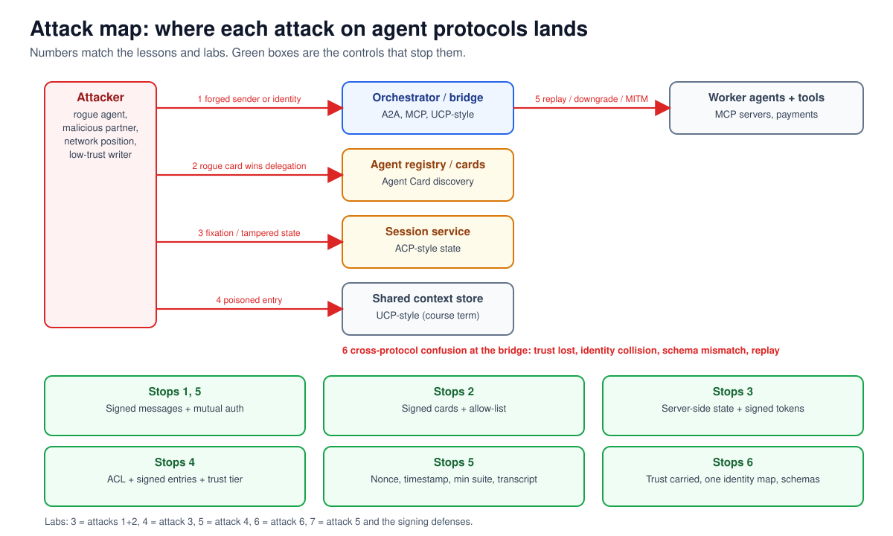

# Lesson 04: Attacking agent communication protocols

> **Chapter 7** · **Time:** ~3 hours · **You will:** carry out (in simulation) five classes of attack on A2A-style, ACP-style and UCP-style traffic, and explain the mechanism, the evidence and the fix for each.

| | |
|---|---|
| **Syllabus lines** | Attacking Agent Communication Protocols · Message spoofing and identity forgery across A2A, ACP, and UCP · Capability-discovery abuse · Context and state injection through shared UCP context stores · Replay, downgrade, and man-in-the-middle attacks against inter-agent sessions · Cross-protocol confusion attacks when an orchestrator bridges multiple protocols |
| **Already in this repo** | [Multi-agent trust](../../05-agent-security/multi-agent-trust/) (forged sender, replay, tampered card, cascade) |
| **Labs** | [3](labs/03-a2a-spoofing-hijack/) · [4](labs/04-acp-session-abuse/) · [5](labs/05-ucp-context-poisoning/) · [6](labs/06-cross-protocol-audit/) · [7](labs/07-mutual-auth-signing/) |

> **Safety.** Everything here runs offline against toy code in this repo. Keys are marked FAKE, "exfiltration" lands in an in-test sink, and no real protocol endpoint is contacted. Do not point these ideas at systems you do not own or have written permission to test.



The map numbers 1 to 6 are used below. The ACP and UCP rows follow the note in [lesson 03](03-agent-communication-protocols.md): "ACP-style" means a generic session/state model and "UCP-style" means the course's shared context store.

---

## 1. Message spoofing and identity forgery (attack 1)

**Mechanism.** The receiver believes an identity claim that nothing proves: a `sender` field, a header, a display name, a card claim. Anyone who can reach the endpoint can write that field.

| Protocol | What gets forged | Why it works |
|---|---|---|
| A2A | `sender` of a task result or status update; the identity in a push callback | Receiver compares the claimed name to the task assignee and stops |
| ACP-style | Agent id in a session request; the agent id inside a resume token | Token is unsigned, or not bound to the presenting agent |
| UCP-style | `writer` of a context entry | Store records the writer string, never verifies it |

**Lab 3, attack A (real output):**

```text
== VULNERABLE orchestrator ==
A  task result is now: PAID-TO-ATTACKER
== SECURE orchestrator ==
A  forged result refused: bad signature
A  task result is now: None
```

The attacker never needed a key: it only needed to know the task id, which was sequential and visible. **Fix:** per-agent signatures over `{sender, recipient, task_id, body, nonce, ts}`, verified with the key registered for the *claimed* sender; the sender must be the assignee; the task must still be open.

## 2. Capability-discovery abuse (attack 2)

**Mechanism.** Delegation picks an agent by what its card says it can do. A rogue agent advertises the wanted skill (or an over-broad list of skills), is listed first or wins on a "best match" rule, and receives tasks and their sensitive payloads.

Variants: look-alike names (`payments-agent-fast`), card **rug pull** (the card was clean at review time and changes later), over-broad skills that pull in unrelated tasks, and a card whose endpoint URL points to the attacker (the name is genuine, the URL is not).

**Lab 3, attack B:**

```text
== VULNERABLE ==  B  rogue card won the delegation: True  (task assigned to payments-agent-fast)
== SECURE ==      B  rogue card won the delegation: False (task assigned to payments-agent)
```

**Fix:** accept only cards signed by your issuer **and** on a per-skill allow-list; pin card hashes after review; re-verify on change; never choose a peer only by self-description. (The repo's earlier lab pins cards by hash: `test_tampered_agent_card_is_refused`.)

## 3. Context and state injection (attack 3 and 4)

### 3.1 Session state (ACP-style)

Two classic web flaws appear again in agent sessions.

* **Session fixation.** The attacker pre-creates a session id; a privileged agent is lured into authenticating with that id; the server keeps the id and upgrades the session in place. The attacker now owns an admin session.
* **State tampering.** The "state" handed to another agent is an unsigned blob with `role: reader`. The attacker edits it to `role: admin`.

**Lab 4 (real output):**

```text
== VULNERABLE ==
fixation: wire_funds ok as admin-agent
tampered state: wire_funds ok as report-agent
== SECURE ==
admin session id is random: True
fixation: no such session
tampered state: bad token signature
```

(The "tampered state" success is shown as `report-agent` because the blob kept the low-privilege agent name while the role became admin: the server never checked the role.)

### 3.2 Shared context store (UCP-style, course term)

The attacker is a low-trust writer, for example the support agent that reads customer text. Two paths:

* **Value poisoning.** Write `pricing/approved_discount = 100`. The pricing agent trusts the store and gives everything away.
* **Instruction poisoning.** Write a note with a hidden `INSTRUCTION:` line. A downstream agent that treats context as instructions obeys. This is the persistent form of prompt injection (ASI06), and the same shape as the 2024 Morris II research worm that spread through GenAI email assistants (research setting).

**Lab 5 (real output):**

```text
== NAIVE store ==      price after discount: 0.0   secrets that reached the sink: 1
== HARDENED store ==   refused: support-agent may not write pricing/approved_discount
                       price after discount: 180.0   secrets that reached the sink: 0
```

## 4. Replay, downgrade and man-in-the-middle (attack 5)

| Attack | Mechanism | Evidence in the labs |
|---|---|---|
| **Replay** | A genuine signed message is sent again, later, or for another task | Lab 3 attack C: a result for INV-1 accepted as the result of INV-2 |
| **Downgrade** | An on-path attacker edits the offered suites so peers fall back to "none" or a weaker scheme | Lab 7: `Mitm(strip_to=["none"])` |
| **MITM** | The attacker relays and edits traffic when transport security is missing or unverified (for example a card advertises `http://` or the client skips certificate checks) | Lab 7: tampered body rejected |
| **Cross-session replay** | A message for the A2A session is delivered into the UCP session | Lab 7: `wrong protocol for this session` |

Downgrade has a subtle point that lab 7 shows: with a policy floor of `none` and an unsigned reply, the attacker can repair the evidence and the downgrade **succeeds**. Authentication evidence that is itself unauthenticated protects nothing. Real world analogues: TLS downgrade and "weak default scheme" bugs in auth negotiation.

## 5. Cross-protocol confusion (attack 6)

An orchestrator that bridges MCP, A2A and UCP-style messages translates each into one internal request. The bridge is a new trust boundary and a new place for bugs. Lab 6's auditor finds four:

| ID | Bug | Effect |
|---|---|---|
| XP-1 | **Trust level not carried.** A2A adapter stamps `internal` | An external partner agent runs tools |
| XP-2 | **Identity mapping.** Policy keyed on display name `billing-agent` | A sandbox agent borrows the prod agent's refund right |
| XP-3 | **Schema mismatch.** Bridge forwards all keys and coerces `"1e3"` | An extra `override_limit` field and a string amount pass the limit |
| XP-4 | **Replay across protocols.** One nonce store per protocol | The same refund executes once per protocol |

```text
== VULNERABLE bridge: 4 finding(s) ==
== HARDENED bridge: 0 finding(s) ==
```

The auditor also includes a benign probe: **hardening must not break legitimate traffic**. Each fix can be turned off alone (`test_with_one_fix_missing_only_that_bug_remains`), which proves the four defenses are independent.

## 6. Attacker checklist

1. Can I reach the endpoint? Does it need a credential?
2. Does the receiver verify identity cryptographically or only read a field?
3. Is the Agent Card verified, pinned, allow-listed?
4. Is session state on the server? Are ids random and rotated?
5. Are messages bound to sender, recipient, task, protocol, time and nonce?
6. Can I write to a store that a higher-trust agent reads?
7. What happens at the bridge: is trust carried, are identities namespaced, are fields validated, is replay global?

## 7. Common mistakes (defender side)

* Testing only the happy path of the handshake.
* Signing the body but not the recipient, task id and protocol.
* Verifying signatures but not the sender-to-task binding.
* Fixing one protocol and forgetting that the same action is reachable through another.

## 8. Quick checks

<details><summary><b>Q1. Why did the forged result work without any key?</b></summary>

The vulnerable receiver trusted the `sender` field and the task id was guessable. Identity was a claim, not a proof.
</details>

<details><summary><b>Q2. Why is "carry trust across the bridge" a separate fix from "validate the schema"?</b></summary>

They fail independently. Lab 6 shows each can be removed alone and exactly one finding returns.
</details>

## References

* OWASP Top 10 for Agentic Applications 2026 (ASI03, ASI04, ASI06, ASI07)
* MITRE ATLAS (Initial Access, Persistence, Privilege Escalation, Defense Evasion tactics; check current names)
* Cohen, Bitton, Nassi, "Here Comes the AI Worm" (Morris II), 2024 (research setting)
* [Multi-agent trust lab](../../05-agent-security/multi-agent-trust/)
