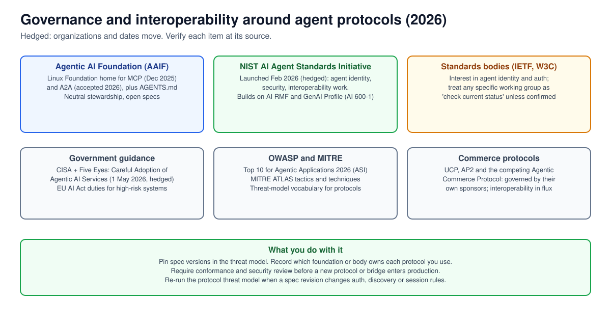

# Lesson 05: Defending and governing agent communication protocols

> **Chapter 7** · **Time:** ~3 hours · **You will:** build the control set for A2A, ACP-style and UCP-style traffic, derive controls from a threat model, and place the work in the emerging governance and interoperability landscape.

| | |
|---|---|
| **Syllabus lines** | Defending and Governing Agent Communication Protocols · Mutual authentication and message signing across A2A, ACP, and UCP · Schema validation and capability allow-listing at the protocol boundary · Session integrity, replay protection, and secure context-store design · Threat-model-driven controls · Emerging governance and interoperability standards for agent communication protocols |
| **Already in this repo** | [Multi-agent trust](../../05-agent-security/multi-agent-trust/) (signed envelope, circuit breaker), [agent identity](../../05-agent-security/agent-identity/), [enterprise IAM and zero trust](../../09-enterprise-architecture/), [MCP defenses](../../cmcpse-course/ch4-defending-and-hardening-mcp-servers/README.md) |
| **Labs** | [7: mutual auth and signing](labs/07-mutual-auth-signing/) · [8: threat model and control set](labs/08-protocol-threat-model-builder/) · the secure halves of labs [3](labs/03-a2a-spoofing-hijack/), [4](labs/04-acp-session-abuse/), [5](labs/05-ucp-context-poisoning/), [6](labs/06-cross-protocol-audit/) |

---

## 1. Mutual authentication and message signing

**Two different jobs.** *Authenticating the channel* proves who is on the other end of this connection. *Signing messages* proves who authored this specific message, and survives relays, queues, gateways and logs. Agents hop through bridges and brokers, so you usually need both.

| Layer | Options (verify support in your spec version) | Notes |
|---|---|---|
| Channel | **mTLS** with workload identities (for example SPIFFE-style IDs); TLS 1.2+ with certificate verification | Both sides present certificates. Pin or restrict issuers |
| Caller credential | **OAuth 2.0 / OIDC** tokens, short-lived, audience-bound, scoped per skill | A2A cards can declare these schemes; the server must enforce them |
| Message | **HMAC** (shared key per pair) or **asymmetric signatures** (Ed25519, ECDSA); JWS-style envelopes | Prefer asymmetric across organizations: verifiers hold only public keys |
| Card | Signed Agent Card, issuer allow-list, hash pinning | Re-verify on every change |
| Payments (UCP/AP2 direction) | Signed mandates bound to amount, merchant, expiry (hedged) | Verify the current AP2 spec |

**What to sign.** Not only the body. The envelope should cover `{protocol, session id, sender, recipient, task id, timestamp, nonce, body}`. Each field blocks one attack: protocol and session block cross-protocol replay, recipient blocks redirect, task id blocks result swapping, timestamp and nonce block replay.

**Lab 7** implements one design for the three protocol labels, with mutual challenge/response over a transcript, HMAC or (when the optional `cryptography` package is installed) Ed25519. Real output:

```text
Suite family: ed25519 (cryptography installed)
a2a: suite=ed25519 sid=0be62331fb8ee704 delivered={'hello': 'a2a'}
replay same envelope: refused (replayed message)
replay A2A envelope into UCP session: refused (wrong protocol for this session)
MITM strips strong suites, floor=hmac: no acceptable suite (policy floor)
Legacy peers with floor=none are downgraded to: none (no authentication at all)
```

Key points the lab proves with tests: a server with the wrong key fails; an impersonating client fails the finish step; a tampered body fails; a stale or replayed message fails; and the **policy floor** matters, because with `floor=none` the downgrade succeeds.

**Key management** is where this fails in practice: per-agent keys, short rotation, a revocation path, keys in a vault or HSM, and no key in the prompt or the repo. Link: [runtime security](../../06-ai-devsecops/runtime-security/).

## 2. Schema validation and capability allow-listing at the protocol boundary

Put a **gateway or boundary layer** in front of every agent endpoint and bridge. It does, in order: authenticate; check the declared scheme was actually used; validate the message against a strict schema; check the requested skill against an **allow-list for this caller**; apply budgets and depth limits; log with the agent identity.

* **Schema.** Types, ranges, `additionalProperties: false`. Reject, do not "clean up". Lab 6's `strict_schema` stops `"1e3"` and `override_limit`.
* **Allow-list.** Per caller identity, per skill. Default deny. A new skill on a peer's card does not automatically become callable.
* **Size and rate limits.** Part sizes, artifact sizes, task counts per caller.
* **Webhook and URL fields.** Validate push-notification URLs (SSRF) and authenticate callbacks.
* **Content labels.** Mark artifacts and context entries as untrusted data when they enter a prompt (see lesson 03 for the rendering pattern in lab 5).

## 3. Session integrity, replay protection and secure context-store design

**Sessions (lab 4):**

| Control | Stops |
|---|---|
| Random 128-bit ids, new id on login and on privilege change | Fixation, guessing |
| Server-side state; role re-read on every call | State tampering |
| Signed hand-off tokens bound to the agent id, with expiry and version | Token theft reuse, edits |
| Revocation (version bump) and idle timeout | Long-lived stolen tokens |

**Replay protection (labs 3, 6, 7):** timestamp window (for example 60 seconds), **single-use nonce kept per sender**, binding to task and protocol, and **one** replay store for all protocols at a bridge. Nonce storage must survive restarts for as long as the window.

**Secure shared context store (lab 5):**

1. Default-deny **write ACLs per namespace** (the support agent may write `notes/`, not `pricing/`).
2. **Signed entries** with the writer's key, verified on read, so a database-level edit or relabelling fails closed.
3. **Provenance and trust tier** on every entry. Low-trust text is data: it may be summarised, never obeyed.
4. **Read ACLs** and minimal context hand-off (need to know).
5. **TTL** so poison does not live forever, and size caps.
6. **Quarantine and audit**: who wrote what, when; a way to purge a writer's entries.

## 4. Threat-model-driven controls

The aim of Chapter 7 is not a list of controls. It is a **traceable chain**:

```text
asset -> threat (STRIDE + ATLAS tactic + ASI id) -> control (hard/soft/process) -> test -> residual risk
```

Rules the lab 8 validator enforces:

* Every protocol area (A2A, ACP-style, UCP-style, MCP bridge) has assets, boundaries and at least two threats.
* All five attack classes of lesson 04 appear, and all six STRIDE letters.
* A threat with inherent score 15 or more needs a **hard** control.
* Residual risk must be lower than inherent when controls exist.
* Every hard control points to a real test (`path::test_name`), and the validator can check that the test exists.
* No control is orphaned.

**Hard, soft, process.** Hard controls hold even if the model is fooled (signatures, ACLs, schemas). Soft controls reduce likelihood (prompt wording, classifiers). Process controls need people (approval queues, log reviews). Never accept a soft control as the only control on a high-risk threat.

## 5. Emerging governance and interoperability standards



All of this moves quickly. Treat each line as "verify at source".

| Body or document | What it does for agent protocols |
|---|---|
| **Agentic AI Foundation (AAIF)**, Linux Foundation | Neutral stewardship. MCP was contributed in December 2025 (with goose and AGENTS.md); A2A was accepted into the foundation in 2026 (hedged). Gives open governance, but **a foundation is not a security audit** |
| **A2A and MCP specification processes** | Versioned specs; security considerations sections; read the revision you deploy |
| **NIST AI Agent Standards Initiative** | Launched February 2026 (hedged) to work on agent identity, security and interoperability standards. Builds on the NIST AI RMF and the GenAI Profile (AI 600-1); NIST AI 100-2 E2025 covers agent security in its attack taxonomy |
| **IETF and W3C** | Interest in agent identity, authentication and discovery has been reported in standards circles; **no specific working group is asserted here**. Check the IETF datatracker and W3C community groups for current status |
| **CISA and Five Eyes**, "Careful Adoption of Agentic AI Services" (1 May 2026, hedged) | First joint guidance of this kind; risk areas such as privilege, design and configuration, behavior, structure and accountability. Names and page counts: verify |
| **OWASP and MITRE** | ASI Top 10 2026, ATLAS: the shared vocabulary for your threat model |
| **EU AI Act** (with the Digital Omnibus changes) | Risk management, logging and human oversight duties for high-risk systems. Agents that talk to each other still need traceable logs |
| **Commerce protocols** (UCP, AP2, Agentic Commerce Protocol) | Governed by their sponsors; interoperability in flux; expect overlap and consolidation |

**What a practitioner does:**

1. Keep a **protocol register**: protocol, spec version, steward, where it is used, owner.
2. Require a **security review and a threat model update** when a spec revision changes auth, discovery or session rules.
3. Prefer protocols with a public spec, a security considerations section and a conformance suite.
4. Pin versions; test interoperability in CI, including negative tests (forged, replayed, downgraded).
5. Contribute findings upstream through the project's security process.

## 6. Defender checklist (definition of done)

- [ ] Every agent endpoint authenticates callers and enforces what its card declares
- [ ] Messages signed over protocol, session, sender, recipient, task, time, nonce
- [ ] One replay store across bridged protocols
- [ ] Cards signed or pinned; skill allow-list per caller; default deny
- [ ] Strict schemas at every protocol boundary and bridge
- [ ] Session state on the server; ids random; rotation on privilege change
- [ ] Context store with write ACLs, signed entries, trust tiers, TTL
- [ ] Trust level and identity namespace carried through bridges
- [ ] Threat model in a file, controls tied to tests, validated in CI
- [ ] Protocol register and spec versions recorded

## 7. Common mistakes

* "We use TLS, so the sender is authenticated" (TLS authenticates a connection, not each hop or author).
* Signing without a nonce, or with a nonce store that resets at restart.
* A policy floor of "none" kept for compatibility.
* A threat model whose controls have no tests.

## 8. Quick checks

<details><summary><b>Q1. Why prefer asymmetric signatures across organizations?</b></summary>

The verifier holds only public keys and cannot sign as the peer. With a shared HMAC key, anyone who holds the key can forge messages in both directions.
</details>

<details><summary><b>Q2. Which attack does signing the protocol label stop?</b></summary>

Cross-protocol replay: a message captured in one protocol being accepted in another.
</details>

## References

* NIST SP 800-207 and 800-207A (zero trust, service identity); NIST AI RMF 1.0 and AI 600-1
* RFC 8446 (TLS 1.3), RFC 7519 (JWT), RFC 7515 (JWS), RFC 6749 (OAuth 2.0)
* A2A specification (security and Agent Card sections); MCP authorization specification
* CISA and partners, "Careful Adoption of Agentic AI Services" (May 2026; verify title and details)
* OWASP Top 10 for Agentic Applications 2026
