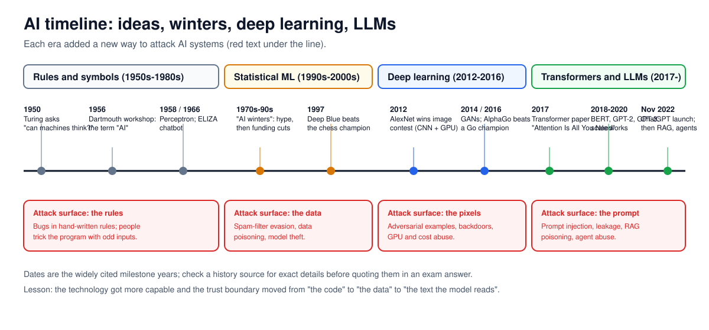

# Lesson 01: AI Basics, History and Evolution

> **Chapter:** 1 · Introduction to AI Security · **Time:** ~3 hours
> **You will:** explain what AI is, how it grew from rules to learning to LLMs, and name the main concepts (model, training, inference, parameters, prompt) with the security issue each one brings.

| | |
|---|---|
| **Prerequisites** | None. |
| **Lab** | None for this lesson. Run [`../labs/learning-paradigms`](labs/learning-paradigms/) after lesson 02. |
| **Go deeper** | [Repo lesson 01](../../01-ai-security-fundamentals/01-ai-ml-llm-basics-for-security.md) and [01b: inside the LLM](../../01-ai-security-fundamentals/01b-inside-the-llm-transformers-inference-and-training.md) |
| **Syllabus lines** | An overview of AI Security · Basics of AI and ML: What is AI? · History and evolution of AI · Key concepts in AI |
| **Maps to** | OWASP LLM Top 10 (2023 v1.1 names used in the course; 2026 list in brackets): LLM01 Prompt Injection · MITRE ATLAS (overview) · NIST AI RMF (Map) |

---

## 1. Why this matters

You cannot protect what you cannot describe. Real events that show why basics matter for security:

- **March 2016, Microsoft Tay:** a chatbot that learned from public conversations was pushed by users into posting offensive messages within about a day, and Microsoft took it offline. *A system that learns from untrusted input can be taught to misbehave.*
- **2017, BadNets (Gu et al.):** researchers showed a neural network could be trained to behave normally except when a small trigger pattern appears in the input. *You cannot see a backdoor by reading the accuracy number.*
- **2018, Robust Physical-World Attacks (Eykholt et al.):** stickers placed on a stop sign made an image classifier misread it. *Models see numbers, not meaning.*
- **2021, Carlini et al.:** researchers extracted memorised training text from GPT-2 by querying it. *Training data can come back out of the model.*
- **2024, Moffatt v. Air Canada:** a tribunal held the airline responsible for wrong information from its website chatbot. *Model output is your organisation's statement.*

## 2. Understand it

### 2.1 An overview of AI security

**AI security** has two sides that you must keep apart:

| Side | Question | Example |
|---|---|---|
| **Security *of* AI** | How do we protect AI systems (data, model, prompts, tools, infrastructure) from attackers? | Stop prompt injection; protect model files; limit tool permissions. |
| **Security *with* AI** | How do attackers and defenders *use* AI? | Phishing written by an LLM; AI-assisted alert triage. |
| **Safety / misuse** | How do we stop AI causing harm even without an attacker? | Wrong answers, bias, unsafe advice. |

This course is mostly about the first side: **an AI system is software plus data plus a model**, so it inherits all classic security problems (authentication, injection, supply chain, secrets) and adds new ones (the model can be tricked by text, its behaviour comes from data, and its answers are probabilistic).

The classic **CIA triad** still works:

| CIA | Classic meaning | AI example |
|---|---|---|
| Confidentiality | Only authorised people read data | Model repeats a secret from its prompt, training data or RAG index |
| Integrity | Data and behaviour are not tampered with | Poisoned data or a backdoored model changes decisions |
| Availability | The service is usable | Huge prompts make the service slow or very expensive (denial of service, "denial of wallet") |

### 2.2 What is AI?

**Artificial intelligence (AI)** is software that performs tasks that normally need human intelligence: recognising images, understanding language, making decisions, planning. There is no single sharp definition; "AI" is an umbrella term. A useful working description for security work:

> AI is a system that **takes inputs, applies a learned or programmed model, and produces outputs (predictions, decisions or content)**, often with some autonomy.

Notice the three places an attacker can act: **inputs** (adversarial examples, prompt injection), the **model** (backdoors, theft) and the **outputs** (misuse of results). This "input, model, output" picture is the base of everything else in the course.

### 2.3 History and evolution

| Era | What happened | Idea | Security takeaway |
|---|---|---|---|
| **1950** | Alan Turing publishes a paper asking whether machines can think (the "imitation game") | A test for machine intelligence | Humans judge intelligence by conversation, so convincing text is not proof of correctness. |
| **1956** | Dartmouth workshop: the term "artificial intelligence" is used | AI becomes a research field | |
| **1958 to 1966** | The perceptron (Rosenblatt); ELIZA, a simple pattern-matching chatbot (Weizenbaum) | First learning machine; first chatbot | People trusted ELIZA more than they should (the "ELIZA effect"). Over-trust of chatbots is old. |
| **1970s to 1990s** | Expert systems (rule-based) and "AI winters" when hype exceeded results | Symbolic AI: humans write the rules | Rules can be audited line by line. Learned models cannot. |
| **1997** | IBM Deep Blue beats the world chess champion | Search plus hand-tuned evaluation | |
| **2000s** | Statistical machine learning (spam filters, recommendation, SVMs) | Learn patterns from data | First data-driven attacks: spam-filter evasion, poisoning. |
| **2012** | AlexNet (a CNN) wins an image contest, helped by GPUs and large datasets | Deep learning takes off | GPUs and big data become critical (and costly) resources. |
| **2014 to 2016** | GANs; adversarial examples (Goodfellow et al.); AlphaGo beats a Go champion | Generative models; robustness problems | Tiny pixel changes can fool a classifier. |
| **2017** | "Attention Is All You Need": the transformer | A scalable architecture for sequences | The base of today's LLMs. |
| **2018 to 2020** | BERT, GPT-2, GPT-3 show that scale improves language ability | Pre-train once, adapt many times | Pretrained models become shared supply-chain assets. |
| **Nov 2022 onward** | ChatGPT brings LLMs to the public; then RAG, tool use and agents | Chat as the interface | Instructions and data share one channel, so prompt injection appears. |

The security story follows the technology: first the **code** was the target (rules), then the **data** (statistical ML), then the **pixels** (deep learning), and now the **text the model reads** (LLMs and agents).

### 2.4 Key concepts in AI

| Term | Simple meaning | Security angle |
|---|---|---|
| **Model** | A function with learned numbers inside that maps inputs to outputs | The model file is an asset: it can be stolen, tampered with or carry malicious code (pickle). |
| **Parameters / weights** | The learned numbers (millions to hundreds of billions) | Weights hold what the model "knows", including memorised data. |
| **Training** | Adjusting parameters so outputs match examples | Training data is the main supply-chain risk (poisoning, backdoors). |
| **Inference** | Using the trained model on new input | Where users, and attackers, touch the system (prompt injection, extraction, DoS). |
| **Feature** | An input measurement the model uses | Attackers change features to evade. |
| **Label** | The correct answer attached to a training example | Label flipping is a poisoning method. |
| **Prediction / output** | What the model returns (a class, a number, text) | Probabilistic: never treat it as a guaranteed fact. |
| **Prompt** | The text input to an LLM (system prompt plus user text plus retrieved data) | Untrusted text can contain instructions. |
| **Token** | A piece of text (word part) the model reads | Cost and limits are counted in tokens. |
| **Context window** | How many tokens the model can read at once | Everything in it is visible to the model and may leak. |
| **Hallucination** | Fluent output that is false | Overreliance risk (2023 list: LLM09 Overreliance). |
| **Bias** | Systematic unfairness from data or design | Legal and ethical exposure; part of governance. |

## 3. Defend it

| Layer | Control | Type |
|---|---|---|
| Data | Know and vet where training data comes from; track data lineage | Process |
| Model | Verify model files (hash, signature, safe formats); store weights with access control | Hard |
| Inference | Authenticate API callers; rate-limit; log prompts and outputs with privacy care | Hard |
| Output | Treat model output as untrusted input to the next system | Hard |
| Governance | Inventory every AI system (an "AI bill of materials"), owners and risk rating | Process |

**What does NOT work on its own:** trusting a vendor's "safe" label; believing a high accuracy number proves security; hiding the system prompt as the only secret protection.

## 4. Hands-on

1. Draw the **input, model, output** picture for a chatbot you know. Mark five places an attacker could act.
2. Write two sentences for each key concept above in your own words.
3. Run the repo's basic lab to see embeddings and tokens as numbers: `.venv/Scripts/python 01-ai-security-fundamentals/lab/demo.py`.
4. In your journal, extend the timeline with one date you find in a trusted source, and note its security issue.

## 5. Real-world scenarios

1. **Customer bot gives a wrong refund policy.** What went wrong: output treated as truth. Investigate: logs of prompts and answers; whether policy text was in the context. Fix: ground answers in approved sources, add a disclaimer and human escalation, test regularly.
2. **A team downloads a popular model from a public hub.** What went wrong: model treated like data, not code. Investigate: file format, hash, publisher. Fix: use safe formats, verify hashes or signatures, scan, load in a sandbox.
3. **A learning chatbot is retrained daily on user chats.** What went wrong: untrusted input feeds training (the Tay lesson). Investigate: data pipeline, who can influence it. Fix: filter and review, rate-limit contributions, keep a human gate before retraining.

## 6. Common mistakes

- Treating "AI" and "LLM" as the same thing (an LLM is one kind of AI).
- Thinking AI security is only prompt injection.
- Forgetting that a model is also an artifact that must be supply-chain controlled.

## 7. Interview preparation

<b>Q1. What is AI security, in one answer?</b>

Protecting AI systems (data, models, prompts, tools, infrastructure) from attack and misuse, using classic security controls plus controls for AI-specific risks. It also covers how attackers use AI. The CIA triad still applies.

<b>Q2. What changed in security when we moved from rules to machine learning?</b>

With rules, behaviour comes from code you can review. With ML, behaviour comes from data and learned weights, so the data pipeline becomes an attack surface (poisoning), and you test behaviour instead of reading logic.

<b>Q3. Why did LLMs create prompt injection?</b>

An LLM receives instructions and data in the same text stream and cannot reliably tell them apart. Any untrusted text in the context can act as an instruction.

<b>Q4. Difference between training and inference, and the risk of each?</b>

Training builds the model from data (risks: poisoning, backdoors, data leakage, supply chain). Inference uses it (risks: injection, extraction, evasion, denial of service).

<b>Q5. What is a hallucination and why is it a security matter?</b>

Confident but false output. It misleads users and can be exploited, for example by "package hallucination" where an attacker publishes a malicious package under a name a model tends to invent. Treat output as untrusted and verify.

<b>Q6. Explain the ELIZA effect.</b>

People attribute understanding to a program that only produces plausible text. Today it explains over-reliance on chatbots.

## 8. Checklist

- [ ] I can define AI, model, training, inference, prompt, token and context window.
- [ ] I can narrate the timeline and give one security takeaway per era.
- [ ] I can draw input, model and output and place attacks on it.

## 9. References

- Turing, "Computing Machinery and Intelligence" (1950).
- Vaswani et al., "Attention Is All You Need" (2017).
- Gu et al., "BadNets" (2017); Eykholt et al., "Robust Physical-World Attacks on Deep Learning Models" (2018); Carlini et al., "Extracting Training Data from Large Language Models" (2021).
- NIST AI Risk Management Framework (AI 100-1): <https://www.nist.gov/itl/ai-risk-management-framework>
- MITRE ATLAS: <https://atlas.mitre.org>
