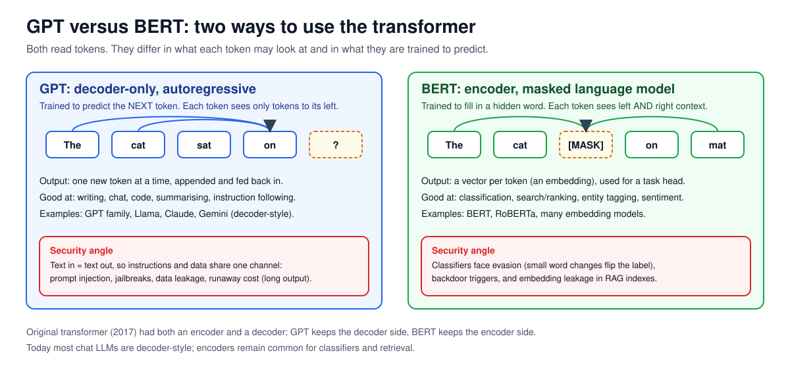

# Lesson 01: Large Language Models: How They Work, GPT and BERT, Training and Augmenting, Use Cases

> **Chapter:** 2 · Understanding and Attacking LLMs · **Time:** ~4 hours
> **You will:** define a large language model and explain how it works at a practical level, compare GPT (decoder-only) with BERT (encoder), explain foundation versus fine-tuned models and RAG, and list the main use cases with the security risk of each.

| | |
|---|---|
| **Prerequisites** | [Chapter 1](../ch1-introduction-to-ai-security/README.md), lessons 03 and 04 |
| **Go deeper** | [Repo 01b: transformers, inference, LoRA](../../01-ai-security-fundamentals/01b-inside-the-llm-transformers-inference-and-training.md) (the technical deep dive) · [Repo 01: AI, ML and LLM basics](../../01-ai-security-fundamentals/01-ai-ml-llm-basics-for-security.md) · [Module 03: RAG security](../../03-rag-security/README.md) |
| **Labs** | Chapter labs [`01-simple-chatbot`](labs/01-simple-chatbot/), [`02-tokenizers`](labs/02-tokenizers/), [`03-summarizer`](labs/03-summarizer/), [`04-fine-tuned-model`](labs/04-fine-tuned-model/), [`06-rag-system`](labs/06-rag-system/), [`08-sentiment-analysis`](labs/08-sentiment-analysis/) |
| **Syllabus lines** | Introduction to Large Language Models · Understanding LLMs (GPT, BERT) · Training and Augmenting LLMs (foundation and fine-tuned models, RAG) · Use Cases of LLMs |
| **Maps to** | OWASP LLM Top 10 2023: LLM01 Prompt Injection, LLM03 Training Data Poisoning, LLM06 Sensitive Information Disclosure, LLM09 Overreliance (2026 list: LLM01, LLM05, LLM02, LLM07 Misinformation) · MITRE ATLAS · NIST AI RMF |

---

## 1. Why this matters

- **2017:** the transformer paper made large-scale language modelling practical. Nearly every modern LLM builds on it.
- **2018:** BERT and the first GPT showed that **pre-training on lots of text, then adapting** works very well. Pre-trained models became shared building blocks, so they became a **supply-chain** item.
- **2023, Zou et al.:** automatically found suffixes made aligned chat models comply with harmful requests, and some transferred between models. Safety training is not a security boundary.
- **2023, Qi et al.:** fine-tuning an aligned model, even on harmless data, can weaken its safety behaviour. Fine-tuning is a security event.
- **2024, Moffatt v. Air Canada:** an organisation was held responsible for what its chatbot said. LLM output is your output.

## 2. Understand it

### 2.1 Definition: what is a large language model?

A **large language model (LLM)** is a neural network, usually a transformer, with billions of parameters, trained on very large amounts of text (and sometimes code, images and audio) to **predict the next token**. Because predicting text well requires picking up grammar, facts, style and some reasoning patterns, the same model can write, summarise, translate, classify and answer questions.

Three words in the name: **large** (many parameters and a lot of data), **language** (text is the main interface), **model** (a learned function, not a database or a person).

### 2.2 How LLMs work (practical view)

```text
text → tokenizer → token IDs → embeddings → [transformer layers with attention] × N → next-token probabilities → pick a token → repeat
```

1. **Tokenize:** text is cut into tokens (word pieces) and mapped to numbers. ("Exploring How Tokenizers Work" is chapter 2 lab 02.)
2. **Embed:** each token ID becomes a vector. Position information is added.
3. **Attention layers:** each token looks at other tokens and mixes in the information that matters. The maths does not know which tokens came from the developer, the user or a web page. This is the root of prompt injection.
4. **Output:** a probability for every possible next token.
5. **Sampling:** the system picks one token (greedy, or random with a **temperature**), appends it and repeats until done. This is **autoregressive generation**.

Training stages in short: **pre-training** on huge text (learn language and world patterns), then **instruction tuning** (learn to follow instructions), then **alignment** with human feedback or similar (learn preferred behaviour and refusals). For the maths, see [lesson 01b](../../01-ai-security-fundamentals/01b-inside-the-llm-transformers-inference-and-training.md).

Properties that matter for security:

| Property | Consequence |
|---|---|
| Output is probabilistic | The same attack may work only sometimes; tests need many tries; "it refused once" proves little. |
| Instructions and data share one channel | Prompt injection (direct and indirect). |
| The context window holds everything | Anything in the prompt can leak into the answer. |
| Knowledge is frozen at the training date | Stale answers; hence RAG. |
| Hallucination | Confident wrong output, so verification is required. |
| Cost is per token | Long inputs and outputs cost money: denial of wallet. |

### 2.3 Importance and impact of LLMs

LLMs changed AI from "one model per task" to "one general model, many tasks by prompting". Impact: faster software work (code assistants), customer support, search and knowledge work, content creation, and security work (triage, report writing) on the defender side; and also phishing, scam text and malware assistance on the attacker side (lesson 03). Because they are adopted fast and often wired to private data and tools, they are now a prominent **attack surface** in their own right. Regulators noticed: see the [governance](../../07-ai-governance/README.md) and [compliance](../../08-ai-compliance/README.md) modules.

### 2.4 GPT and BERT



| | **GPT** (Generative Pre-trained Transformer) | **BERT** (Bidirectional Encoder Representations from Transformers) |
|---|---|---|
| **Architecture** | Decoder-only transformer | Encoder-only transformer |
| **Training task** | Predict the next token (causal / autoregressive language modelling) | Predict masked tokens in a sentence (masked language modelling), plus a sentence-relationship task in the original paper |
| **Context** | Each token sees only earlier tokens | Each token sees tokens on both sides (bidirectional) |
| **Main output** | New text, one token at a time | A vector (embedding) per token or sentence |
| **Best at** | Generation, chat, code, summarising, instruction following | Classification, search and ranking, tagging, sentiment, embeddings |
| **Origin** | OpenAI (GPT-1, 2018), then GPT-2, GPT-3 and later | Google (Devlin et al., 2018) |
| **Typical attack focus** | Prompt injection, jailbreaks, leakage, runaway generation | Evasion of the classifier, backdoor triggers, embedding leakage in RAG |

Notes: the **original transformer** had both an encoder and a decoder (good for translation). GPT keeps the decoder side; BERT keeps the encoder side. Most chat LLMs today are decoder-style; BERT-like encoders are still widely used for classifiers and for the **embedding models** inside RAG systems. The "GPT" name is also used loosely for any chat LLM.

### 2.5 Foundation models and fine-tuned models

| | **Foundation model** | **Fine-tuned model** |
|---|---|---|
| **What** | A large model pre-trained on broad data, meant to be adapted to many tasks | A foundation model trained further on a smaller, task-specific dataset |
| **Cost** | Very high (data, compute, months) | Much lower (hours to days; with LoRA or QLoRA even on one GPU) |
| **Who builds it** | A few well-funded labs | Many teams, by downloading a base model |
| **Result** | General skills | Specialised style, format or domain knowledge |
| **Security risks** | Training-data issues, licence and privacy of the corpus, safety gaps, supply chain of the weights | Poisoned or sensitive fine-tuning data, weakened safety training, backdoors, leaking the fine-tuning data, trusting a base model from an unknown source |

**Fine-tuning basics:** you prepare examples (prompt and desired answer), train for a few epochs, and evaluate. **LoRA** adds small trainable adapter matrices instead of changing all weights, so the adapter file is tiny and easy to share, which also makes it easy to swap in a malicious one. See [lesson 01b](../../01-ai-security-fundamentals/01b-inside-the-llm-transformers-inference-and-training.md) and [chapter 2 lab 04](labs/04-fine-tuned-model/).

### 2.6 Retrieval Augmented Generation (RAG)

RAG keeps the model unchanged and **adds knowledge at question time**: retrieve relevant chunks from a vector database and put them in the prompt. See [chapter 1 lesson 03, section 2.6](../ch1-introduction-to-ai-security/03-core-components-and-ml-concepts.md) for the overview and [Module 03](../../03-rag-security/README.md) for the full security treatment. Build one in [lab 06](labs/06-rag-system/).

| Question | RAG | Fine-tuning |
|---|---|---|
| Add fresh or private facts? | Yes, easy (update the index) | Hard, needs retraining |
| Change tone, format, skills? | Weak | Strong |
| Show sources? | Yes | No |
| Delete a document on request? | Delete the chunk | Very hard (data is in the weights) |
| Main security risks | Poisoned documents, indirect injection, access control at retrieval, index leakage | Training-data poisoning, memorisation of sensitive data, weakened safety |

Often both are combined. Prefer RAG for company facts because it keeps data under access control.

### 2.7 Use cases of LLMs, with the security view

| Use case | Examples | What the model does | Main risks | Key controls |
|---|---|---|---|---|
| **Text generation** | Drafting emails, marketing copy, code, reports | Continues or composes text | Hallucination, copyright and licence issues, insecure generated code, data leakage via prompts, misuse for phishing | Review step, code scanning, content policy, no secrets in prompts |
| **Text understanding** | Summarising, classification, sentiment, entity extraction, translation, search | Reads text and produces labels, extracts or condenses | Indirect prompt injection in the documents it reads, evasion of classifiers, wrong summaries, privacy | Treat inputs as untrusted, structured outputs with validation, test with adversarial inputs |
| **Conversational AI** | Support bots, assistants, copilots, voice agents | Multi-turn dialogue, often with tools and memory | Prompt injection, jailbreaks, excessive agency (tools), data leakage, impersonation, denial of wallet | Least-privilege tools, human approval for risky actions, rate limits, monitoring, output handling |

Hands-on for these: [lab 01 simple chatbot](labs/01-simple-chatbot/), [lab 03 summarizer](labs/03-summarizer/), [lab 08 sentiment analysis](labs/08-sentiment-analysis/).

## 3. Defend it

| Layer | Control | Type |
|---|---|---|
| Model source | Use trusted publishers, verify hashes and signatures, prefer safetensors, pin versions | Hard |
| Fine-tuning data | Provenance, review, remove secrets and personal data, hold-out safety tests after training | Process / Hard |
| Prompt and context | Separate trusted and untrusted content, minimise secrets in prompts | Soft |
| Output | Treat as untrusted input to the next component; validate structure; encode for the sink | Hard |
| Tools and data | Least privilege, per-user authorisation at retrieval and tool level | Hard |
| Operations | Rate limits, token budgets, logging, kill switch | Hard |

**What does NOT work on its own:** "alignment will handle it", a system prompt that says "be safe", or a vendor's marketing claim.

## 4. Hands-on

1. Run the offline attention and sampling lab from the repo: `.venv/Scripts/python 01-ai-security-fundamentals/lab/demo.py` (Part D). Observe how an injected token can dominate attention.
2. Build and attack a chatbot offline: [chapter 1 `llm-chatbot` lab](../ch1-introduction-to-ai-security/labs/llm-chatbot/README.md).
3. Do chapter 2 labs [01](labs/01-simple-chatbot/), [02](labs/02-tokenizers/) and [06](labs/06-rag-system/) in the course environment and with their offline versions here.
4. Fill in a one-page table: for GPT and BERT, write architecture, training task, best use, one attack.

## 5. Real-world scenarios

1. **Internal assistant answers from an HR PDF and leaks a salary table.** Retrieval ignored permissions. Fix: permission-aware retrieval and DLP on answers (Module 03).
2. **A team fine-tunes on support tickets.** Tickets contain customer names and a password pasted by a user; the model later repeats it. Fix: clean data before training, test for memorisation, limit who can query.
3. **A sentiment classifier (BERT-like) rates fake reviews as positive after small word changes.** Evasion. Fix: adversarial testing (chapter 2 lab 07), ensembles, human review for high-impact decisions.

## 6. Common mistakes

- Saying "GPT" when you mean "LLM", or "BERT can chat" (it generates nothing by itself).
- Thinking fine-tuning adds facts reliably (RAG is better for facts).
- Forgetting that fine-tuning changes safety behaviour.
- Treating the model as a database of true facts.

## 7. Interview preparation

<details><summary><b>Q1. What is an LLM?</b></summary>

A very large neural network (usually a transformer) trained on large text data to predict the next token. That one skill lets it write, summarise, translate, classify and answer questions.
</details>

<details><summary><b>Q2. GPT versus BERT?</b></summary>

GPT is decoder-only and autoregressive: it sees only previous tokens and generates text. BERT is an encoder with a masked-language-model objective: it sees both sides and produces embeddings for understanding tasks such as classification and search.
</details>

<details><summary><b>Q3. Why do LLMs hallucinate?</b></summary>

They produce the most probable continuation, not verified facts. Fluent text can be false. Ground answers with RAG and citations, validate, and keep humans in the loop for important decisions.
</details>

<details><summary><b>Q4. Foundation model versus fine-tuned model?</b></summary>

A foundation model is a broad pre-trained base. A fine-tuned model is that base trained further on specific data. Fine-tuning is cheaper but brings poisoning, privacy and safety-regression risks.
</details>

<details><summary><b>Q5. RAG or fine-tuning for company knowledge?</b></summary>

Usually RAG: fresher, citable, deletable and controllable with access rules. Fine-tuning is for style, format and skills.
</details>

<details><summary><b>Q6. Why can attention not separate system instructions from user data?</b></summary>

All tokens go through the same maths. The model has learned to follow instructions but has no hard boundary between sources. So separation must be enforced outside the model.
</details>

<details><summary><b>Q7. What is temperature and why does it matter for security testing?</b></summary>

It controls randomness in token selection. Higher values make rare outputs more likely, so an attack that fails once may succeed on another run. Test repeatedly.
</details>

<details><summary><b>Q8. What risks does LoRA add?</b></summary>

Adapters are tiny and easy to share, so a malicious or low-quality adapter can be loaded without much notice. Verify sources, scan, and re-run safety tests after merging.
</details>

<details><summary><b>Q9. Name risks for each of the three use-case groups.</b></summary>

Generation: hallucination and leaked data. Understanding: indirect injection and evasion. Conversational: injection, excessive agency and denial of wallet.
</details>

## 8. Checklist

- [ ] I can define an LLM and describe generation step by step.
- [ ] I can compare GPT and BERT in a table without notes.
- [ ] I can explain when to use RAG and when to fine-tune, with the risks of each.

## 9. References

- Vaswani et al., "Attention Is All You Need" (2017); Devlin et al., "BERT" (2018); Radford et al., GPT papers (2018 onward).
- Lewis et al., "Retrieval-Augmented Generation for Knowledge-Intensive NLP Tasks" (2020); Hu et al., "LoRA" (2021).
- Zou et al., "Universal and Transferable Adversarial Attacks on Aligned Language Models" (2023); Qi et al., "Fine-tuning Aligned Language Models Compromises Safety" (2023).
- Bommasani et al., "On the Opportunities and Risks of Foundation Models" (2021).
- OWASP GenAI Security Project: <https://genai.owasp.org>
