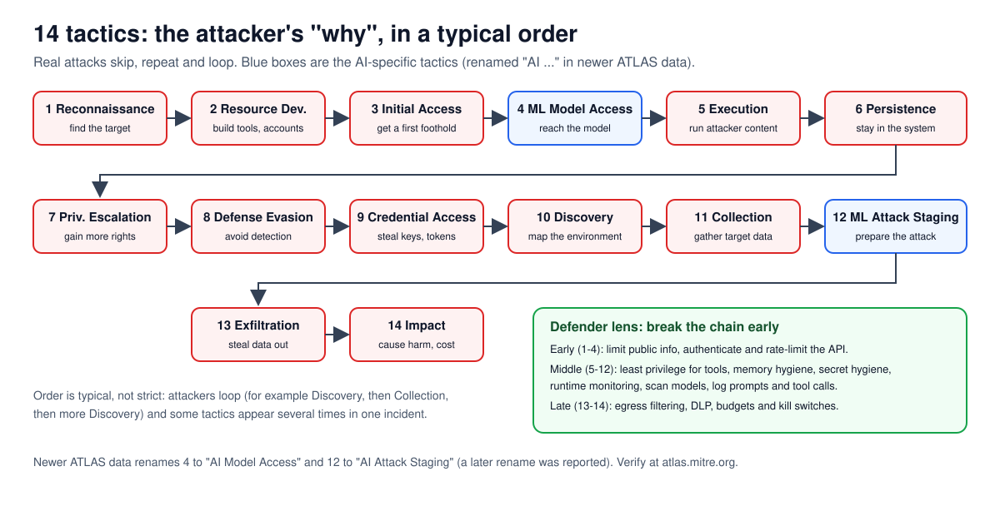

# Lesson 02: MITRE ATT&CK, MITRE ATLAS and the 14 Tactics Against LLM Applications

> **Chapter:** 2 · Understanding and Attacking LLMs · **Time:** ~6 hours
> **You will:** explain how ATT&CK and ATLAS differ, walk through all 14 tactics of the course in order (what each means for AI, example techniques in words, a realistic LLM-app example, detection and defence ideas), and map an incident narrative to tactics, both by hand and with the offline lab.

| | |
|---|---|
| **Prerequisites** | [Lesson 01](01-llm-intro-gpt-bert-training-and-use-cases.md); [repo lesson 03, section 2.4 (ATLAS)](../../01-ai-security-fundamentals/03-ai-threat-modeling.md) |
| **Lab** | [`labs/00-atlas-mapping`](labs/00-atlas-mapping/): map synthetic incident steps to tactics; tests check your answers against a key. Offline. Related labs: [`07-textattack-adversarial`](labs/07-textattack-adversarial/), [`09-backdoor-attacks`](labs/09-backdoor-attacks/) |
| **Syllabus lines** | Attack Tactics and Techniques: Mitre ATT&CK · Mitre ATLAS matrix · the 14 tactics from Reconnaissance to Impact |
| **Maps to** | MITRE ATT&CK (Enterprise) · MITRE ATLAS · OWASP LLM Top 10 2023 (all ten, in the examples) · NIST AI RMF (Map and Measure) |

> **Verify at source.** ATLAS changes often: tactic and technique names, IDs and counts are updated several times a year. This lesson describes ideas and uses technique **names** as commonly seen; it does **not** quote technique IDs, because IDs differ between versions and secondary sources. Copy IDs from <https://atlas.mitre.org> when you write a report.

---

## 1. Why this matters

Security teams already share a common language for attacks: **MITRE ATT&CK**. When an AI system is attacked, the same teams need the same kind of language, so that red teams, detection engineers, auditors and managers talk about "the same thing". That is what **MITRE ATLAS** gives you. In the exam and in interviews you need to name the tactics, give an example of each, and say how you would detect or stop it.

Public anchors for the idea:

- MITRE ATLAS publishes **case studies** of real or realistic attacks on AI systems, each broken down into tactics and techniques. Study a few of them directly on the ATLAS site.
- **2024, Wiz research on Hugging Face (reported 4 Apr 2024):** a malicious pickle-format model, run on the platform's inference service, gave code execution and potential cross-tenant access. Hugging Face fixed the issues. It touches Resource Development, Initial Access, Execution and Privilege Escalation in a single story.
- **2024, "SAPwned" (Wiz, public 17 Jul 2024):** five vulnerabilities let researchers reach cluster admin on SAP AI Core's Kubernetes, read customers' cloud credentials and private AI artifacts. SAP fixed them and said no customer data was impacted. Think: Execution, Privilege Escalation, Credential Access, Discovery, Collection.
- **2024, Morris II (Cohen, Bitton, Nassi):** a research demonstration of a self-replicating adversarial prompt spreading between GenAI email assistants through RAG. Think: Initial Access, Execution, Persistence, Exfiltration.
- **2025/2026:** OWASP lists place prompt injection first for LLM applications.

## 2. Understand it

### 2.1 MITRE ATT&CK in brief

**ATT&CK** (Adversarial Tactics, Techniques, and Common Knowledge) is a knowledge base of how real attackers behave against enterprises, mobile devices and industrial systems. Its structure:

- **Tactic:** the attacker's *goal* at one step ("get in", "steal data"). The columns of the matrix.
- **Technique:** *how* they reach that goal (for example phishing). Techniques can have **sub-techniques**.
- **Procedure:** a concrete example by a named group or tool.
- Plus **mitigations**, **detections** and **data sources**.

It is used for threat modelling, red-team planning, detection coverage maps and incident reporting.

### 2.2 MITRE ATLAS and how it differs

**ATLAS** (Adversarial Threat Landscape for Artificial-Intelligence Systems) uses the **same structure** (tactics, techniques, case studies, mitigations) for attacks on AI-enabled systems, and is cross-linked with ATT&CK.

| | **ATT&CK** | **ATLAS** |
|---|---|---|
| **Target** | IT systems: endpoints, servers, cloud, identities | AI-enabled systems: data, models, ML pipelines, LLM apps, agents |
| **Tactics** | About 14 enterprise tactics | About 16 in 2026 per the brief: 14 adapted from ATT&CK plus 2 AI-specific (verify) |
| **AI-specific tactics** | None | **Model Access** (reaching the model through API, product or artifact) and **Attack Staging** (preparing the attack: proxy models, crafted data) |
| **Typical techniques** | Phishing, PowerShell, credential dumping | Poison training data, craft adversarial data, prompt injection, model extraction, meta-prompt extraction |
| **Case studies** | Groups and software | AI incidents and red-team exercises |
| **Use together** | The classic IT part of an AI attack (a stolen key, a cloud misconfiguration) | The AI-specific part (poisoned data, model theft, injection) |

Most real AI incidents **mix both**: a prompt injection (ATLAS) leads to a stolen cloud credential (ATT&CK).

**Renames and counts (verify at atlas.mitre.org).** The course lists the tactics as "ML Model Access" and "ML Attack Staging". Newer ATLAS data renamed them **"AI Model Access"** and **"AI Attack Staging"** (data version 2026.07). Some secondary sources report that "AI Attack Staging" was renamed again to **"AI Attack Adaptation"** in v2026.08; this is unconfirmed here. Tactic IDs also differ across sources. For the exam, use the course's names; in real work, use the live matrix and write the version you used. The lab accepts both names.

### 2.3 The 14 tactics in the course order



Attackers do not follow the order strictly. They skip, repeat and loop. The order helps you remember.

**Running example for "a realistic example":** a fictional company, Example Corp, has a support copilot (an LLM with RAG over a knowledge base and tools for ticket search and CRM lookup), a public chat API, a model registry on a cloud platform, and an ML pipeline built with open-source models. All names are made up.

For each tactic below: **Meaning**, **Techniques** (in words, IDs omitted), **Example**, **Detect and defend**.

---

### Tactic 1: Reconnaissance

- **Meaning for AI:** gathering information about the target's AI stack and attack surface: which models, frameworks, data sources, vendors, APIs.
- **Techniques:** searching public technical databases and repositories (model hubs, papers, code); searching the victim's own websites, job posts and blogs; active scanning of endpoints; finding what a RAG system indexes.
- **Example:** an attacker reads Example Corp's engineering blog and job posts and learns it uses a named open model, a vector database and a public chat widget. They then probe the widget to see its refusals and tools.
- **Detect and defend:** you cannot stop public reading, so reduce it: avoid publishing stack details and model versions, remove banners and verbose errors, publish only what is needed. Detect active probing: unusual request patterns, scanners, many error-triggering inputs; rate-limit and alert.

### Tactic 2: Resource Development

- **Meaning for AI:** the attacker prepares what they will need before touching the target: infrastructure, accounts, tools, poisoned data or models.
- **Techniques:** acquiring public models and datasets to study; developing capabilities (attack tooling, trigger designs); publishing poisoned datasets or models to public hubs; acquiring accounts and infrastructure (look-alike domains, cloud credits).
- **Example:** the attacker uploads a model named like a popular one to a public hub, with a hidden backdoor; they also host a web page with hidden instructions meant to be scraped by LLM tools.
- **Detect and defend:** mostly outside your network, so use **threat intelligence** (new look-alike domains and model names), brand monitoring, and strict internal rules about where models and datasets may come from (allow-listed publishers, hash pinning, private mirror).

### Tactic 3: Initial Access

- **Meaning for AI:** the first foothold in the AI system or its supply chain.
- **Techniques:** supply-chain compromise of a model, dataset or library; valid accounts (stolen API keys); exploiting a public-facing application; **indirect prompt injection** through content the system ingests; phishing the ML team.
- **Example:** an attacker sends a support email containing hidden instructions. The copilot reads the inbox to summarise it and ingests the text. Or a developer downloads the look-alike model.
- **Detect and defend:** verify artifacts (signatures, hashes, safe formats, scanning); treat all ingested content as untrusted; strong authentication and short-lived keys; secret scanning; WAF and input validation for the public application; monitor sign-ins and unusual key use.

### Tactic 4: ML Model Access (newer name: AI Model Access)

- **Meaning for AI:** *AI-specific.* Getting access to the model itself, at some level: from calling its API up to holding the whole model.
- **Techniques:** access through the **inference API** (query it as a customer); through an **ML-enabled product or service** (the chat widget); gaining access to the physical environment the model senses; obtaining the **full model** (weights).
- **Example:** the attacker signs up for a trial of Example Corp's chat API and sends thousands of probing queries to learn behaviour, or finds a model file on an exposed storage bucket.
- **Detect and defend:** authentication and quotas for every model endpoint; per-key monitoring of volume, diversity and patterns typical of probing or extraction; minimal output detail (do not return raw scores or token probabilities if not needed); access control and encryption for model files; logging of model downloads.

### Tactic 5: Execution

- **Meaning for AI:** getting attacker-controlled instructions or code to run in the AI system or a connected component.
- **Techniques:** **prompt injection** making the LLM follow attacker instructions; abusing **tools and plugins** the LLM can call; **user execution** (a user runs a poisoned notebook or model); command and scripting interpreters (code execution in a sandbox the model uses); unsafe deserialisation of model files.
- **Example:** hidden instructions make the copilot call the ticket-search tool with attacker-chosen arguments, or a pickle model executes code when loaded (in our lab, only a harmless canary).
- **Detect and defend:** least-privilege tools with allow-listed arguments; human approval for risky actions; sandbox code execution and model loading; safe formats; log every tool call with its origin; alert on tool calls not requested by the user.

### Tactic 6: Persistence

- **Meaning for AI:** keeping access or influence over time, even after the first session ends.
- **Techniques:** **poisoning training or fine-tuning data** so the effect survives retraining; **backdooring a model**; storing instructions in an agent's **long-term memory** or in a RAG index so they trigger every time; keeping a stolen key or account.
- **Example:** the injected text is saved to the copilot's memory ("always include this link in answers"), so it fires in every future conversation. Or a poisoned document stays in the knowledge base.
- **Detect and defend:** treat memory and indexes as untrusted storage: review what is written, expire it, scope it per user; scan indexes for instruction-like text; provenance on every chunk; integrity checks and re-scans of models; rotate keys.

### Tactic 7: Privilege Escalation

- **Meaning for AI:** gaining higher permissions than the first foothold had, or getting the model to do what it should refuse.
- **Techniques:** **jailbreaking** (making the model ignore its safety rules); abusing plugins that run with more privilege than the user; compromising the ML platform account; classic OS and cloud escalation.
- **Example:** with a role-play prompt the attacker makes the copilot run a tool in "admin" mode; or over-permissive cloud roles let a stolen notebook token become platform admin.
- **Detect and defend:** the model must never be the authority on permissions; enforce authorisation per call in code using the real user's identity; least-privilege cloud roles; separate environments for training and production; alert on role changes and unusual admin API calls.

### Tactic 8: Defense Evasion

- **Meaning for AI:** avoiding detection by security controls, filters, scanners and monitoring, or fooling the model's own detector.
- **Techniques:** **evading the ML model** itself (adversarial examples against a fraud or malware classifier); **prompt obfuscation** (encodings, typos, splitting words, other languages) to pass input filters; jailbreak framing; hiding malicious model code from scanners.
- **Example:** the attacker encodes a forbidden request in base64 or uses odd Unicode so the keyword filter misses it; or tweaks a transaction so the fraud model scores it as normal.
- **Detect and defend:** normalise input before filtering (Unicode, encodings); layered checks (classifier, rules, output checks); adversarial testing of your detectors (see [lab 07](labs/07-textattack-adversarial/)); model scanning with multiple tools; behavioural monitoring instead of only signatures.

### Tactic 9: Credential Access

- **Meaning for AI:** stealing credentials, keys and tokens: LLM API keys, cloud keys, vector-database tokens, service accounts.
- **Techniques:** finding **unsecured credentials** (keys in code, notebooks, environment variables, config files); making an LLM reveal secrets from its prompt, memory or tools; stealing tokens from a compromised build or notebook.
- **Example:** a poisoned model's loader reads cloud keys from the build agent's environment variables (in our lab, a harmless canary file). Or a leaked LLM gateway key is found in a public repository.
- **Detect and defend:** no secrets in prompts, code or notebooks; a secrets manager and short-lived tokens; secret scanning in CI and on repos; separate credentials per environment; alerts on key use from new locations; spending alerts on LLM keys.

### Tactic 10: Discovery

- **Meaning for AI:** learning about the internal environment and the AI system once inside: which model, version, tools, data, permissions, and the hidden prompt.
- **Techniques:** discovering the **model family or ontology** (what labels or classes it knows); discovering ML **artifacts** (registries, datasets, pipelines); **extracting the meta prompt** (the system prompt); listing tools, plugins and storage.
- **Example:** the attacker asks the copilot which tools and data sources it has, and lists buckets and registry entries with a stolen key.
- **Detect and defend:** do not rely on the system prompt being secret; limit what the model can enumerate; restrict list permissions on storage and registries; monitor enumeration patterns (many list calls, unusual queries); minimal verbose errors.

### Tactic 11: Collection

- **Meaning for AI:** gathering the data of interest before taking it: training sets, prompts and logs, documents from RAG, model artifacts, customer records.
- **Techniques:** collecting **ML artifacts** (datasets, weights, notebooks); pulling data from **information repositories** (wikis, drives, vector stores); abusing the LLM's tools to fetch records for the attacker.
- **Example:** the copilot is made to gather customer records via the CRM tool that match the attacker's request, or an attacker with storage access gathers datasets and prompt logs from a data lake.
- **Detect and defend:** data classification and DLP; least-privilege, per-user data access (permission-aware retrieval); limits on result sizes; alerts on bulk reads and unusual tool-call volume; protect logs as sensitive data.

### Tactic 12: ML Attack Staging (newer name: AI Attack Staging; a later rename is reported)

- **Meaning for AI:** *AI-specific.* Preparing and tuning the actual attack against the model, usually offline, before the final strike.
- **Techniques:** **creating a proxy model** (a stand-in trained on the target's outputs) to practise on; **crafting adversarial data** against the proxy; building and testing a **backdoor**; verifying the attack works before using it on the real target.
- **Example:** the attacker trains a proxy of Example Corp's fraud model from API responses, finds perturbations that evade it offline, then replays them against the real API. (Chapter 2 [lab 07](labs/07-textattack-adversarial/) shows the idea with TextAttack.)
- **Detect and defend:** you mainly see its footprints in the earlier tactic (many probing queries), so monitor and limit queries; return less detail; add randomness or detection of query-based attacks; test your own models with the same techniques; robust training. Include this stage in red-team plans.

### Tactic 13: Exfiltration

- **Meaning for AI:** moving stolen data or the model out of the environment.
- **Techniques:** exfiltration **through the inference API** (extracting the model or training data by querying); **LLM data leakage** through answers, markdown images or links rendered by the client that carry data in the URL; classic **cyber exfiltration** (copy weights from a bucket); leaking the system prompt.
- **Example:** the copilot renders a markdown image whose URL contains the stolen records and sends them to a server the attacker controls; or weights are copied from an unprotected storage bucket.
- **Detect and defend:** egress filtering and domain allow-lists (including for image and link rendering); output filtering and DLP; do not auto-render external URLs; bucket and network controls; alerts on large downloads; watermarking and query monitoring for model theft.

### Tactic 14: Impact

- **Meaning for AI:** the final harm: disrupting, degrading, destroying or misusing the system or its decisions.
- **Techniques:** **denial of ML service** (overload; "denial of wallet" by cost harvesting); **eroding model integrity** (poisoning so decisions are wrong); evading the model at scale (fraud passes); spamming with chaff data; **external harms** (financial loss, reputational harm, safety, privacy and legal harm).
- **Example:** a stolen key is used to send long prompts in a loop and exhaust the monthly budget; or a poisoned model approves fraudulent loans.
- **Detect and defend:** budgets, quotas and kill switches; autoscaling limits; anomaly detection on cost and latency; model and decision monitoring with human review of high-impact outcomes; incident response and rollback plans (versioned models, signed artifacts); insurance and legal review.

---

### 2.4 How the tactics chain: Example Corp end to end

1. **Reconnaissance:** reads the blog. 2. **Resource Development:** registers a look-alike domain and prepares a poisoned page. 3. **Initial Access:** sends an email with hidden instructions. 4. **Model Access:** also queries the public chat API. 5. **Execution:** the copilot runs a tool call. 6. **Persistence:** instructions saved in memory. 10. **Discovery:** lists its tools. 11. **Collection:** gathers customer records. 13. **Exfiltration:** markdown image leaks them. 14. **Impact:** privacy breach and fines.

Break the chain early and everything after it fails: that is why defenders place controls in several tactics (see the defender lane in the figure).

## 3. Defend it: using ATLAS in practice

| Use | How |
|---|---|
| **Threat modelling** | For each system component, ask "which tactics apply here?" and list techniques (see [lesson 03 of module 01](../../01-ai-security-fundamentals/03-ai-threat-modeling.md)). |
| **Detection coverage map** | Make a table of tactics versus the logs and rules you have. Gaps are visible immediately. |
| **Red team plan** | Pick a case study, adapt it to your system, run it step by step per tactic. |
| **Incident reports** | Tag each attacker action with a tactic. Shows where the chain could have been broken. |
| **Reporting to management** | Tactic counts and coverage are a simple, comparable metric. |

**What does NOT work on its own:** treating the matrix as a checklist you "complete"; copying IDs from old slides; mapping only to ATLAS and forgetting ATT&CK for the IT half of the attack.

## 4. Hands-on lab: map incidents to tactics

Lab folder: [`labs/00-atlas-mapping`](labs/00-atlas-mapping/). It contains four **synthetic** incidents (28 attacker steps, all 14 tactics), an answer key, and a keyword classifier.

```bash
# from the repo root
.venv/Scripts/python -m pytest caisp-course/ch2-understanding-and-attacking-llms/labs/00-atlas-mapping
.venv/Scripts/python caisp-course/ch2-understanding-and-attacking-llms/labs/00-atlas-mapping/demo.py
```

Real output of the tests: `8 passed, 1 skipped` (the skipped test turns on when your mapping file is complete). Start of the demo output:

```text
step      keyword classifier     answer key             ok
INC-1-1   Reconnaissance         Reconnaissance         yes
INC-1-2   Resource Development   Resource Development   yes
INC-1-3   Initial Access         Initial Access         yes
INC-1-4   ML Model Access        ML Model Access        yes
...
classifier score: 28/28
tactics covered by the exercise: 14 of 14

-- Where a keyword classifier breaks (evasion by paraphrase) --
'The adversary quietly pulls the model file out via a side channel.' -> None
```

**Exercise (mapping):**

1. Read [`incidents.json`](labs/00-atlas-mapping/incidents.json). **Do not open `answer_key.json`.**
2. In [`my_mapping.json`](labs/00-atlas-mapping/my_mapping.json) map each step id to one tactic name (course names or the newer "AI ..." names both work). Three steps are pre-filled.
3. Run `.venv/Scripts/python caisp-course/ch2-understanding-and-attacking-llms/labs/00-atlas-mapping/check_mapping.py` to see your score and the steps you got wrong. The pytest file also fails if any step you wrote is wrong or has an unknown name.
4. When all 28 are filled, the full-score test runs and must pass.

Honest note on the classifier: it scores 28/28 because its keywords were written with these narratives in mind. The last line of the demo shows a one-sentence paraphrase it misses. Real mapping needs people (and, increasingly, ML), and it is a good example of an easy-to-evade rule system.

Break it yourself:

1. Add a fifth incident of your own (a different story: an agent with a browsing tool) to `incidents.json` and the key, and extend the keyword rules. Does the test still pass?
2. Write three paraphrases that fool the classifier. What would a better detector use instead of keywords?
3. Pick an ATLAS case study from the website and map it to the 14 tactics on paper.

## 5. Real-world scenarios

1. **Cloud bill spike on an LLM key.** Tactics: Credential Access then Impact. How to investigate: gateway logs by key and IP, repo secret scan. Fix: rotate the key, budgets and alerts, secrets manager.
2. **Customer data in an assistant's answers days after a document upload.** Tactics: Initial Access (poisoned document), Execution, Collection, Exfiltration. Investigate: which chunk carried instructions; tool-call logs. Fix: ingestion scanning, no external URL rendering, permission-aware retrieval.
3. **Model registry shows an unknown model version.** Tactics: Initial Access, Persistence, Defense Evasion. Investigate: who pushed it, hash and signature, provenance. Fix: signed artifacts, restricted registry writes, deployment gate.

## 6. Common mistakes

- Treating tactics as steps that must all happen.
- Mixing up tactic (goal) and technique (method).
- Quoting technique IDs from memory.
- Forgetting the ATT&CK half of an AI incident.
- Ignoring the recent renames.

## 7. Interview preparation

<details><summary><b>Q1. What is MITRE ATT&CK?</b></summary>

A knowledge base of real attacker tactics (goals) and techniques (methods), used for threat modelling, detection coverage, red teaming and reporting. It targets enterprise, mobile and industrial systems.
</details>

<details><summary><b>Q2. What is MITRE ATLAS and how does it differ?</b></summary>

The same style of knowledge base for attacks on AI systems, with AI-specific tactics (Model Access and Attack Staging, renamed from "ML ..." to "AI ...") and techniques such as data poisoning, adversarial data, prompt injection and model extraction, with case studies. It is cross-linked with ATT&CK.
</details>

<details><summary><b>Q3. Tactic versus technique?</b></summary>

A tactic is the goal at a step (for example Exfiltration). A technique is how the goal is achieved (for example through the inference API or a markdown image).
</details>

<details><summary><b>Q4. Name the 14 tactics in order.</b></summary>

Reconnaissance, Resource Development, Initial Access, ML Model Access, Execution, Persistence, Privilege Escalation, Defense Evasion, Credential Access, Discovery, Collection, ML Attack Staging, Exfiltration, Impact. (Newer ATLAS names: AI Model Access, AI Attack Staging; verify at source.)
</details>

<details><summary><b>Q5. Which two tactics are AI-specific?</b></summary>

Model Access and Attack Staging. Model Access is reaching the model through an API, product or file. Attack Staging is preparing the attack, for example proxy models and crafted data.
</details>

<details><summary><b>Q6. Map "indirect prompt injection through an email" to tactics.</b></summary>

Initial Access (the content enters the system), then Execution (the model follows the instructions), possibly Persistence (saved to memory), Collection and Exfiltration (data gathered and sent out).
</details>

<details><summary><b>Q7. How would you detect Attack Staging?</b></summary>

Mostly through its footprint: many probing queries, systematic input variation, unusual query volume or diversity per key. Rate limits, query-pattern analytics and less output detail help. Also test your models with the same techniques.
</details>

<details><summary><b>Q8. Why does an LLM incident need both ATLAS and ATT&CK?</b></summary>

AI-specific steps (injection, poisoning) usually lead to classic outcomes (stolen cloud credentials, data theft). Using both covers the full chain.
</details>

<details><summary><b>Q9. How would you use ATLAS to plan a red team?</b></summary>

Choose a relevant case study, adapt it to the system's components, assign techniques per tactic, run and log each step, then map findings to controls and detections.
</details>

<details><summary><b>Q10. A tool call you did not expect appears in logs after a user asked about the weather. Which tactic and why?</b></summary>

Likely Execution after Initial Access by indirect prompt injection (a document or web page with instructions). Check the retrieved content for that turn, the tool arguments, and who triggered the call.
</details>

<details><summary><b>Q11. How do you handle the ATLAS tactic renames in documents?</b></summary>

State the ATLAS version you used, use the live names (AI Model Access, AI Attack Staging), note older names in brackets, and do not copy IDs from older material.
</details>

## 8. Checklist

- [ ] I can name the 14 tactics in order and say the goal of each in one sentence.
- [ ] I can give one AI example and one defence per tactic.
- [ ] I completed my mapping file and all tests pass.
- [ ] I know the renames and that IDs must be checked at the source.

## 9. References

- MITRE ATLAS: <https://atlas.mitre.org> (matrix, techniques, case studies, data releases).
- MITRE ATT&CK: <https://attack.mitre.org>.
- Wiz Research, Hugging Face disclosure (April 2024) and "SAPwned" (July 2024).
- Cohen, Bitton, Nassi, "Here Comes The AI Worm" (2024), the Morris II research.
- OWASP GenAI Security Project: <https://genai.owasp.org>.
