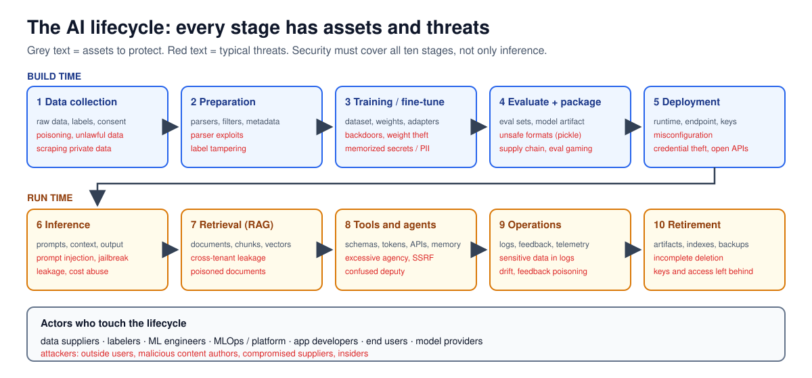

# 05. Supply Chain Vulnerabilities (LLM05 in 2023)

> **Maps to:** 2023 LLM05 Supply Chain Vulnerabilities | 2025 LLM03 Supply Chain | 2026 04 Supply Chain.
> **Time:** 1.5 hours. **Deep lessons in this repo:** [02 model-threats](../../02-llm-security/model-threats/README.md) (section 2.6), [06 docker](../../06-ai-devsecops/docker/README.md) (model files, pickle scan), [06 cicd](../../06-ai-devsecops/cicd/README.md) (SBOM, SLSA, signing). This page adds the stages of the LLM supply chain. Chapter 4 covers the DevSecOps side and the case studies; chapter 6 goes deep on supply chain attacks.

## Why this matters

You do not build an LLM application from scratch. You assemble it from other people's models, datasets, libraries, containers and cloud services. Each one is a place where an attacker can slip in, and a victim cannot easily check.

Facts to know (all public):

- **Malicious model files.** Researchers have found models on public hubs that run code when loaded (pickle). The Wiz research of April 2024 on Hugging Face and JFrog's 2024 findings are covered in [chapter 4 case studies](../ch4-ai-attacks-and-defenses-devops/05-case-studies.md).
- **Dependency confusion in ML.** In December 2022 the PyTorch project warned that a malicious package named `torchtriton` on PyPI could be installed by people using nightly builds, because it matched an internal dependency name.
- **Tampered model, same name.** The "PoisonGPT" demo (Mithril Security, 2023) showed a model edited to give one false answer and uploaded under a lookalike name.

## Components or Stages in an LLM

| # | Stage / component | What you consume | Typical supply chain risk |
|---|---|---|---|
| 1 | **Training data** | Public datasets, scraped text, licensed data, user data | Poisoned or changed data, licensing and privacy problems |
| 2 | **Pre-trained / base model** | Open weights, vendor API models | Backdoored or tampered weights, unclear provenance, model changed by the vendor without notice |
| 3 | **Fine-tuning assets** | Adapters (LoRA), instruction datasets, merge recipes | Malicious adapters, poisoned fine-tuning data |
| 4 | **Model packaging and format** | Pickle, PyTorch, safetensors, GGUF | Code execution on load (pickle), unsafe converters |
| 5 | **Libraries and frameworks** | PyTorch, transformers, LangChain, vector DB clients | Vulnerable or typosquatted packages, dependency confusion |
| 6 | **Model registry / hub** | Hugging Face, internal registry | Account takeover, namesquatting, shared-tenant weaknesses |
| 7 | **Build and CI/CD** | Training and deploy pipelines, runners, actions | Poisoned pipelines, stolen tokens (see [chapter 4](../ch4-ai-attacks-and-defenses-devops/04-pipeline-attacks-and-ppe.md)) |
| 8 | **Containers and base images** | Serving images, GPU drivers | Vulnerable layers, unpinned `latest` tags |
| 9 | **Serving platform and cloud** | Managed AI platforms, Kubernetes, GPUs | Tenant isolation flaws, over-privileged roles |
| 10 | **Plugins, tools, MCP servers and agents** | Third-party tools | Malicious or compromised tool servers (see [lesson 07](07-insecure-plugin-design.md)) |
| 11 | **Third-party APIs and data sources** | LLM APIs, search, RAG sources | Data leaving your boundary, changed behavior, outages |

## Compromising LLM supply chain

Common attack paths:

1. **Poison upstream** (data, model, adapter) so every consumer inherits it.
2. **Trojan the model file**: a pickle that runs code when someone loads it.
3. **Squat or confuse names**: a package or model with a lookalike name, or an internal name registered publicly.
4. **Compromise a maintainer or pipeline**: steal a token and publish a bad version (the NotPetya-style update attack, see chapter 4).
5. **Abuse the platform**: a multi-tenant AI service where one customer can reach another's data.
6. **Swap in a "same name" model** that the vendor or hub changed without your noticing.

## Mitigating supply chain vulnerabilities

| Control | Detail | Type |
|---|---|---|
| Inventory (AI-BOM / SBOM) | List every model, dataset, library and service with versions and hashes | Process |
| Use data-only formats | Prefer safetensors over pickle; set `weights_only=True` | Hard |
| Scan before use | SCA for packages, pickle/model scanners, container scans | Soft |
| Pin and verify | Exact versions, lock files with hashes, pin model revisions to commit hashes | Hard |
| Sign and verify | Sign models and images; verify provenance (SLSA, Sigstore) | Hard |
| Private mirrors and allowlists | Pull only from approved sources | Hard |
| Isolate loading | Load untrusted models in a sandbox with no secrets and no network | Hard |
| Evaluate models you adopt | Safety and backdoor evals, license review | Process |
| Vendor review | Data handling, change notices, incident process | Process |
| Monitor | New advisories (SCA), anomalies in model behavior | Process |

## Hands-on

- Run the repo's [pickle scanner lab](../../06-ai-devsecops/docker/lab/pickle_scan.py) and the [model-threats lab](../../02-llm-security/model-threats/lab/) (a booby-trapped model file, a poisoning gate).
- Chapter 4 labs: [third-party-vulns](../ch4-ai-attacks-and-defenses-devops/labs/third-party-vulns/README.md), [picklescan](../ch4-ai-attacks-and-defenses-devops/labs/picklescan/README.md).
- For the chapter's lab index, see the chapter [README](README.md).

## Interview Q&A

<b>Q1. List the stages of an LLM supply chain.</b>

Training data, base model, fine-tuning assets (adapters and data), model format and packaging, libraries, model registry or hub, build and CI/CD, containers, serving platform, plugins/tools/MCP servers, and third-party APIs and data sources.

<b>Q2. Why is a pickle model file dangerous?</b>

Pickle is a program for a stack machine. Loading it can import any Python object and call it, so a model file can run arbitrary code on load. Use safetensors, restricted loading and a sandbox, and scan files before they are loaded.

<b>Q3. What do you check before adopting an open model?</b>

Source and publisher reputation, license, file format, a hash or signature, a pinned revision, a malware/pickle scan, a safety and backdoor evaluation, and loading in a sandbox first.

## References

- OWASP LLM Top 10 (supply chain entry): https://genai.owasp.org/
- Wiz Research on Hugging Face (April 2024); JFrog on malicious models (2024)
- PyTorch security advisory on the `torchtriton` dependency confusion (December 2022)
- Repo: [model-threats](../../02-llm-security/model-threats/README.md), [06 docker](../../06-ai-devsecops/docker/README.md), [06 cicd](../../06-ai-devsecops/cicd/README.md)
