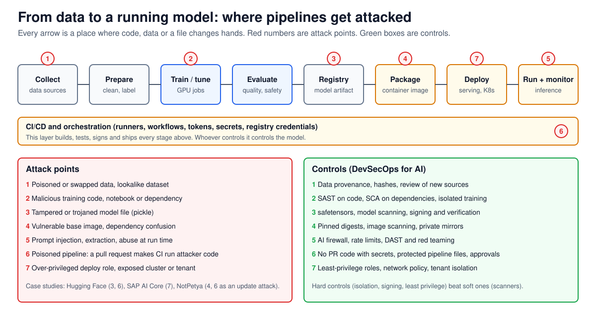

# 03. Model Creation and Deployment Process / Pipeline

> **Syllabus:** Introduction to AI in DevOps: "Model Creation and Deployment Process/Pipeline".
> **Time:** 45 minutes. The picture is the lesson. Compare it with your normal application pipeline.

## Why this matters

A model pipeline looks like a CI/CD pipeline, but it moves **data** and **large binary files** as well as code. Many of the files are formats that can run code. And training runs on powerful, expensive infrastructure that often has broad cloud access. You cannot defend a pipeline you cannot draw.

## Understand it

### The stages, step by step

| # | Stage | What happens | Artifacts | Who/what has access |
|---|---|---|---|---|
| 1 | **Collect** | Gather data from databases, files, web, vendors, user feedback | Raw data | Data engineers, scrapers, vendor feeds |
| 2 | **Prepare** | Clean, filter, label, split, remove personal data | Training set, labels | Data jobs, labelers |
| 3 | **Train or fine-tune** | Run code on GPUs, produce weights; may start from a downloaded base model | Weights, checkpoints, logs | Training cluster with cloud roles, notebooks |
| 4 | **Evaluate** | Measure quality, safety, bias, robustness; red-team | Eval reports | Eval jobs |
| 5 | **Register** | Store the model with a version and metadata in a registry | Model artifact, model card | Registry credentials |
| 6 | **Package** | Wrap the model and server into a container image | Image, SBOM | Build runner |
| 7 | **Deploy** | Roll out to serving (Kubernetes, managed endpoint); set scaling and network | Manifests, endpoint | Deploy role |
| 8 | **Run and monitor** | Serve inference, log, watch drift and abuse, retrain | Metrics, logs, feedback data | Operators, the public |

Feedback loop: user feedback and production data feed step 1 again (continuous training). That loop is an attack path too: whoever can shape the feedback can shape the next model.

### Where it differs from a normal software pipeline

| Normal app pipeline | Model pipeline |
|---|---|
| Source code is the input | Data **and** code are inputs; data is large and changes often |
| Output is a small binary or container | Output includes huge weight files in formats that may execute code |
| Tests are deterministic | Evals are statistical; a backdoor can pass them |
| Build runs on cheap runners | Training uses GPU clusters with broad roles and big data access |
| Dependencies from a few registries | Models, datasets and libraries from public hubs too |
| Deploy changes behavior only through code | A new model changes behavior with no code diff |

### The security gates (map to the picture)

1. **Data gate:** provenance, hashes, review of new sources, poisoning checks.
2. **Code gate:** SAST, SCA, secret scan, protected pipeline files.
3. **Training isolation:** no internet except an allowlist, scoped roles, ephemeral credentials.
4. **Eval gate:** safety and robustness evals must pass before promotion; compare with the previous model.
5. **Artifact gate:** safe format, scan, sign, store the hash.
6. **Image gate:** pinned digests, scan, SBOM.
7. **Deploy gate:** approval, environment protection, admission policy, least-privilege runtime role.
8. **Runtime:** AI firewall, rate limits, monitoring, incident response.

The repo already implements several of these: the [release gate and deploy approval](../../06-ai-devsecops/cicd/README.md), [pickle scan](../../06-ai-devsecops/docker/README.md), [Kubernetes policy](../../06-ai-devsecops/kubernetes/README.md) and [runtime security](../../06-ai-devsecops/runtime-security/README.md).

## Hands-on

1. Draw your own organization's model pipeline on paper in 10 minutes. Mark where secrets exist and who can change each file.
2. Run the repo [release gate demo](../../06-ai-devsecops/cicd/lab/release_gate.py) (see its README) and name the stage of the picture each check belongs to.

## Interview Q&A

<b>Q1. Describe the stages of a model pipeline.</b>

Collect data, prepare it, train or fine-tune, evaluate, register the artifact, package it into an image, deploy, then run and monitor with feedback going back to data collection.

<b>Q2. How is a model pipeline different from a normal CI/CD pipeline from a security view?</b>

Data is a primary input, model files can execute code on load, evals are statistical so backdoors can pass, training infrastructure has broad access, and a new model changes behavior without a code change. So you add data, model-file and eval gates.

<b>Q3. Which stage would you protect first in a small team?</b>

The CI/CD layer and its credentials (the band under the stages in the picture): protect pipeline files, remove secrets from untrusted runs and use signed, scanned artifacts. If the pipeline is compromised every other control can be bypassed.

## References

- Google "Secure AI Framework" and cloud MLOps architecture guides (verify at source)
- NIST AI RMF and the Generative AI Profile (AI 600-1) for lifecycle risk language
- Repo: [01 lifecycle assets picture](../../images/01-ai-lifecycle-assets.svg), [06-ai-devsecops](../../06-ai-devsecops/README.md)
