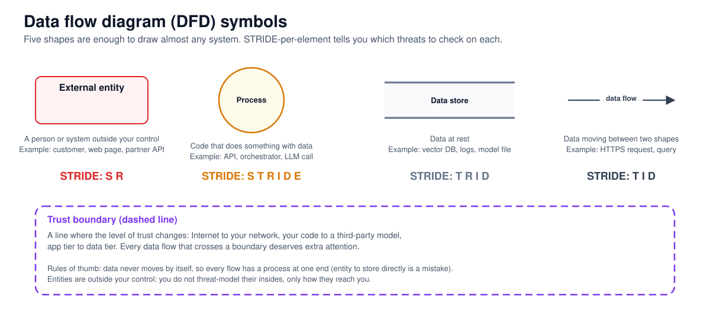
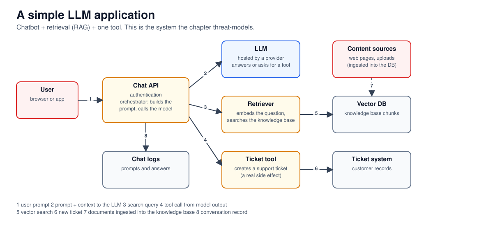
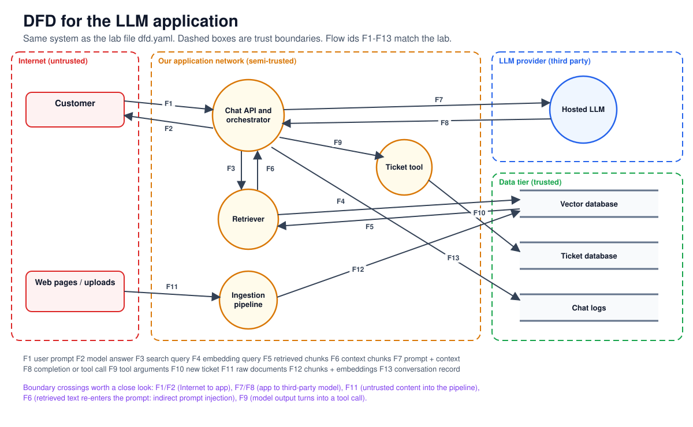

# Lesson 02: Data flow diagrams and an LLM application architecture

> **Chapter 5** · **Time:** ~2 hours · **You will:** draw a data flow diagram (DFD) with the five standard shapes, place trust boundaries correctly, and turn a simple LLM architecture into a DFD that you can threat-model.

| | |
|---|---|
| **Syllabus lines** | Diagramming for Threat Modeling · Data Flow Diagram · DFD Components · An LLM Application Architecture · Simple LLM Architecture · DFD for an LLM Architecture |
| **Already in this repo** | [Module 01, lesson 02: AI system architecture and trust boundaries](../../01-ai-security-fundamentals/02-ai-system-architecture-and-trust-boundaries.md) and the [HelpDesk Copilot DFD](../../images/01-helpdesk-copilot-dfd.svg) |
| **Lab** | [`labs/threat-model-ai-system/dfd.yaml`](labs/threat-model-ai-system/dfd.yaml) |
| **Prerequisite** | [Lesson 01](01-threat-modeling-foundations.md) |

---

## 1. Why a diagram first

You cannot list what can go wrong with a system you have not drawn. A DFD forces three useful decisions: **what are the parts**,
**what data moves between them**, and **where does trust change**. Most threats live on a data flow that crosses a trust boundary.

## 2. DFD components

A DFD uses five symbols. Learn their names, because STRIDE-per-element (lesson 03) is defined on them.



| Symbol | Name | Meaning | AI example |
|---|---|---|---|
| Rectangle | **External entity** | Person or system outside your control. You do not analyze its inside. | Customer, public web page, partner API |
| Circle (rounded) | **Process** | Code that transforms or routes data | Chat API, retriever, tool runner, an LLM call |
| Two parallel lines | **Data store** | Data at rest | Vector database, ticket database, logs, model files |
| Arrow | **Data flow** | Data moving between two shapes | User prompt, retrieved chunks, tool arguments |
| Dashed line | **Trust boundary** | Where the trust level changes | Internet / our network, our code / third-party model |

### Rules that keep a DFD valid

1. **Data does not move by itself.** Every data flow needs a process at one end. An arrow from an entity straight to a data store is a mistake: a process (the API, the loader) must do the writing. The lab tool rejects such flows.
2. **Name every flow with the data it carries**, not the protocol alone ("retrieved chunks", not "HTTPS").
3. **Draw responses as separate flows.** A request and a response can have different threats (the answer may carry data the request did not).
4. **Entities are black boxes.** You threat-model how they reach you, not how they work inside.
5. **Place boundaries where the owner, the network or the privilege changes**, not around every box.

### Levels of detail

* **Level 0 (context diagram):** the whole system as one process, with the external entities around it.
* **Level 1:** the main processes and stores (what we draw below).
* **Level 2+:** zoom into one process when it is complex (for example, the agent loop). Stop when more detail no longer changes the threats.

## 3. A simple LLM application architecture

A very common design: a chatbot that answers from a knowledge base (retrieval-augmented generation, RAG) and can take one action.



| Part | What it does | Who controls it |
|---|---|---|
| User | Types questions | Anyone (untrusted) |
| Chat API / orchestrator | Authenticates the user, builds the prompt, calls the model, decides what to do with the answer | We do |
| LLM | Predicts the next words; may ask for a tool call | A provider (third party) or us |
| Retriever + vector DB | Finds knowledge-base chunks similar to the question | We do |
| Content sources | Web pages and uploaded files that feed the knowledge base | Partly untrusted |
| Ticket tool + ticket system | Creates a support ticket (a real side effect) | We do |
| Chat logs | Store prompts and answers | We do |

Two facts about this architecture drive almost every threat in the chapter:

1. **Instructions and data share one channel.** Retrieved text, the user's question and the system prompt all go into the same prompt. The model cannot reliably tell them apart.
2. **The model's output can become an action.** The orchestrator may turn "create a ticket for X" into a real call.

## 4. The DFD for the LLM application



The same diagram as data (this is [`dfd.yaml`](labs/threat-model-ai-system/dfd.yaml); each shape is an element, each arrow a flow):

```yaml
elements:
  - {id: user, type: external_entity, zone: internet, name: Customer, tags: [untrusted_input]}
  - id: ticket_tool
    type: process
    zone: app
    tags: [tool, side_effect]
    assets: [A4]
    controls: []
flows:
  - {id: F9, source: orchestrator, target: ticket_tool, data: tool arguments, tags: [model_output]}
```

`tags` describe properties that matter to the threat library (for example `untrusted_content` on a flow that carries text from the
outside). `controls` list what already protects the element. The tool reads these and applies STRIDE, so the diagram is not just a picture.

### Four trust zones and what crosses them

| Boundary | Flows that cross it | Why it matters |
|---|---|---|
| Internet to our app | F1 prompt, F2 answer, F11 raw documents | Everything from outside is untrusted input |
| Our app to the LLM provider | F7 prompt + context, F8 completion | Personal data leaves our boundary; the answer is untrusted output |
| App to data tier | F4, F5, F10, F12, F13 | Needs authentication, least privilege, encryption |
| Content source to knowledge base | F11 then F12 | Poisoned content is stored and later retrieved (F6) |

Look at **F6 (retrieved chunks back into the prompt)** and **F9 (model output becomes tool arguments)**. In a normal web app these
flows would not exist. They are why AI systems need their own threat library.

## 5. Hands-on: draw and generate

1. Copy `dfd.yaml` to `my-dfd.yaml`. Add an `admin` external entity and a flow `admin -> orchestrator` for prompt updates.
2. Generate a Mermaid diagram and paste it into <https://mermaid.live> (or any Markdown viewer that supports Mermaid):

```bash
python caisp-course/ch5-threat-modeling-ai-systems/labs/threat-model-ai-system/tm_tool.py my-dfd.yaml --mermaid
```

3. Break it on purpose: add a flow from `user` directly to `vdb`. The tool prints `[error] flow F14: external_entity -> data_store has no process end` and stops.
4. Redraw your own system (an app you know) at level 1 with five to nine elements. More than that and you should split it.

## 6. Common mistakes

* Drawing boxes and arrows without data names.
* Forgetting the **ingestion path** (how data gets into the knowledge base). Poisoning attacks use it.
* Treating the LLM as one with the application. It is a separate process with its own trust level, often run by a third party.
* Drawing the model as a trusted data store. It is a process that produces untrusted output.
* One giant diagram. Split by feature or by trust zone.

## 7. Quick check

1. Why does every data flow need a process at one end?
2. Which two flows exist in an LLM application but not in a typical CRUD web application?
3. Where would you draw trust boundaries around a hosted LLM API?

## 8. References

* OWASP Threat Dragon documentation (DFD shapes): owasp.org/www-project-threat-dragon
* Microsoft Threat Modeling Tool documentation (DFD stencils): learn.microsoft.com
* Adam Shostack, *Threat Modeling: Designing for Security* (DFDs and STRIDE)
* Module 01 images [`01-ai-app-security-architecture.svg`](../../images/01-ai-app-security-architecture.svg) and [`01-helpdesk-copilot-dfd.svg`](../../images/01-helpdesk-copilot-dfd.svg)
