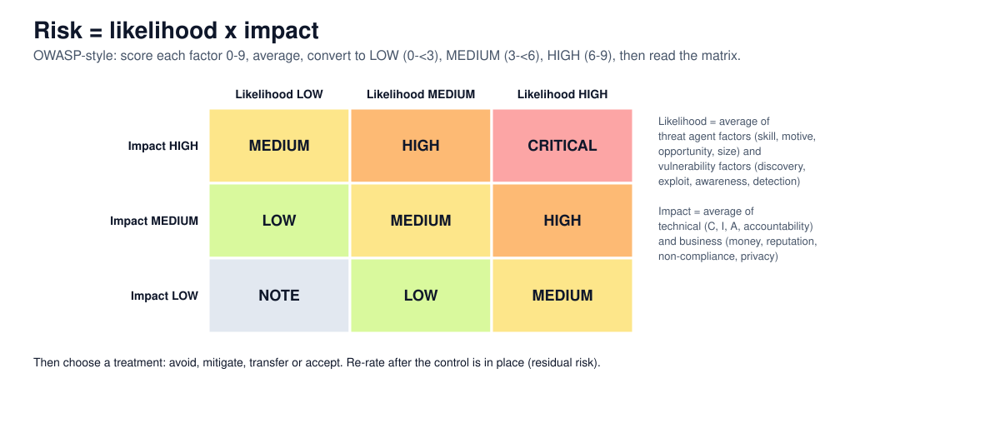

# Lesson 05: Rating and managing risks

> **Chapter 5** · **Time:** ~3 hours · **You will:** rate a threat as likelihood × impact with the OWASP Risk Rating Methodology, explain why DREAD fell out of favor, choose a risk treatment (avoid, mitigate, transfer, accept), keep a risk register, and describe how a tool such as IriusRisk fits in (and free alternatives).

| | |
|---|---|
| **Syllabus lines** | Rating and Managing Risks · Risk Management Meets Threat Modeling · Risk Management Strategies · Example Risk Rating Methodology · course outcome "Perform risk rating with IriusRisk tools" |
| **Already in this repo** | [Module 01, lesson 03](../../01-ai-security-fundamentals/03-ai-threat-modeling.md) (risk scoring), [Module 07, lesson 03: AI risk management](../../07-ai-governance/03-ai-risk-management.md), [`risk-register.csv`](../../00-program/templates/risk-register.csv) |
| **Lab** | [`labs/threat-model-ai-system/tm_tool.py`](labs/threat-model-ai-system/tm_tool.py): functions `rate()`, `level()`, `SEVERITY_MATRIX`, `build_register()` |
| **Prerequisite** | [Lesson 04](04-ai-threat-libraries.md) |

---

## 1. Risk management meets threat modeling

Threat modeling gives you a **list of threats**. Risk management turns the list into **decisions**. The link is the risk register.

```text
Threat model  ->  rate each threat  ->  rank  ->  choose a treatment  ->  implement  ->  re-rate (residual)  ->  review
(lesson 03/04)    (this lesson)                    (avoid/mitigate/        (controls,      (did it work?)       (new design,
                                                    transfer/accept)        tests)                               new threats)
```

**Risk** = how likely a threat is to happen × how much damage it does. Two things people forget:

* **Inherent risk** is the risk before controls. **Residual risk** is what remains after controls. Report both.
* A rating is a **decision aid**, not a measurement. The value is in the conversation and the written reasons.

## 2. Risk management strategies

For each rated risk the owner chooses one of four responses.

| Strategy | Meaning | AI example |
|---|---|---|
| **Avoid** (eliminate) | Stop doing the risky thing | Remove the "send email" tool from a summarizer that does not need it; do not train on customer chat logs |
| **Mitigate** (reduce) | Add controls to lower likelihood or impact | ACL filter before retrieval; tool authorization with the user's identity; human approval for refunds; schema validation of model output |
| **Transfer** (share) | Move the cost or responsibility to someone else | Cyber insurance; a contract that makes the model provider responsible for some failures; use a managed service with a security attestation |
| **Accept** (retain) | Live with it, knowingly | A Low risk of a wrong answer in an internal FAQ bot, with a disclaimer and monitoring |

Rules that make this work in practice:

* **Accept needs a name, a reason and a review date.** "We ignore it" is not acceptance.
* **Transfer does not remove the risk.** You still suffer the reputation damage and the downtime.
* **Mitigate means a hard control** where the risk is High or Critical. A prompt rule alone is not a mitigation for Tampering or Elevation of privilege.
* In the lab, `treatment()` only **suggests** a response. A person decides.

## 3. An example risk rating methodology: OWASP Risk Rating

The OWASP Risk Rating Methodology is a simple, written scheme. It splits **likelihood** and **impact** into factors, scores each from 0 to 9, averages, and reads a matrix.



### Step 1: likelihood = average of two groups of four factors

| Threat agent factors | Vulnerability factors |
|---|---|
| Skill level (how technical is the attacker?) | Ease of discovery |
| Motive (what do they gain?) | Ease of exploit |
| Opportunity (access and resources needed) | Awareness (how well known is it?) |
| Size (how many possible attackers: one person, anyone on the Internet?) | Intrusion detection (would we notice?) |

### Step 2: impact = average of two groups of four factors

| Technical impact | Business impact |
|---|---|
| Loss of confidentiality | Financial damage |
| Loss of integrity | Reputation damage |
| Loss of availability | Non-compliance |
| Loss of accountability | Privacy violation |

### Step 3: convert to levels, then read the matrix

* Score **0 to under 3** = LOW, **3 to under 6** = MEDIUM, **6 to 9** = HIGH.
* Overall severity:

| | Likelihood LOW | Likelihood MEDIUM | Likelihood HIGH |
|---|---|---|---|
| **Impact HIGH** | MEDIUM | HIGH | CRITICAL |
| **Impact MEDIUM** | LOW | MEDIUM | HIGH |
| **Impact LOW** | NOTE | LOW | MEDIUM |

### Worked example: "prompt injection reveals the system prompt"

| Factor group | Scores | Average |
|---|---|---|
| Threat agent: skill 6, motive 5, opportunity 7, size 6 | | 6.0 |
| Vulnerability: discovery 7, exploit 7, awareness 6, detection 8 | | 7.0 |
| **Likelihood** | (6.0 + 7.0) / 2 | **6.5, HIGH** |
| Technical: confidentiality 3, integrity 1, availability 1, accountability 7 | | 3.0 |
| Business: financial 3, reputation 5, non-compliance 2, privacy 1 | | 2.75 |
| **Impact** | (3.0 + 2.75) / 2 | **2.88, LOW** |
| **Severity** | likelihood HIGH, impact LOW | **MEDIUM** |

The same attack on a bot whose prompt holds an API key (technical 8/6/3/7, business 7/8/7/9) gives impact 6.88 (HIGH) and severity **CRITICAL**. Same attack, different asset: that is why the asset list matters. You can check both with the lab's function:

```python
rate([6, 5, 7, 6], [7, 7, 6, 8], [3, 1, 1, 7], [3, 5, 2, 1])
# {'likelihood': 6.5, 'impact': 2.88, 'likelihood_level': 'HIGH', 'impact_level': 'LOW', 'severity': 'MEDIUM'}
```

**How the lab uses it.** Each library entry stores four group scores (`agent`, `vuln`, `tech`, `business`). The tool then:

1. raises **business impact** toward the value of the assets on the element (`(business + max asset value) / 2`);
2. lowers **vulnerability** by 3 for each control that the library says mitigates the threat and that is present on the element (`mitigated_by`);
3. computes **inherent** severity (no controls) and **residual** severity (with controls);
4. marks the threat `open` or `controlled` and suggests a treatment.

### Why DREAD is no longer recommended

DREAD (Damage, Reproducibility, Exploitability, Affected users, Discoverability) was Microsoft's early scoring scheme. Many teams stopped using it, and Microsoft's later threat-modeling guidance moved away from it (check Microsoft's current guidance). Common criticisms:

* scores are **subjective** and not repeatable: two people rate "Discoverability" differently;
* "Discoverability" rewards security by obscurity;
* the five numbers are averaged without a clear meaning;
* it does not separate likelihood from impact the way risk management expects.

You may still meet DREAD in exams and old documents, so know the letters. For new work use OWASP Risk Rating, CVSS (for vulnerabilities in products), or your organization's own matrix. For AI-specific harm there is no single agreed scale yet, so **write your scale down and apply it consistently**.

## 4. The risk register

A **risk register** is the table where decisions live. Minimum columns (the lab's `to_csv()` writes most of them):

| Column | Example |
|---|---|
| ID | T040 |
| Where (element / flow) | `ticket_tool` |
| STRIDE class | E |
| Threat | Tool runs with more rights than the user who asked |
| Mapping | OWASP LLM07, LLM08; ATLAS "LLM Plugin Compromise" |
| Likelihood / impact / severity | 7.5 / 7.25 / CRITICAL |
| Existing controls / missing controls | none / authn, human_approval, tool_authz |
| Treatment and owner | Mitigate: add user-scoped tool auth and approval (platform team) |
| Residual severity, review date | after the control is in place; 3 months |

## 5. Tools: IriusRisk, and free alternatives

**IriusRisk** is a commercial threat-modeling platform. The course uses it for risk rating. A **free community edition** has been offered by the vendor (verify the current plans, limits and sign-up terms on iriusrisk.com; we did not test it for this lab).

The workflow, described in general terms (screens and names differ by version, so follow the course lab and the vendor documentation):

1. **Create a model** and import or draw the architecture (components, data flows, trust zones).
2. **Pick or build a questionnaire / template** for the technology stack so the tool knows what the components are.
3. The tool applies a **rule library** that generates **threats and countermeasures** for each component.
4. You **review threats**: set status (relevant, not applicable, accepted), adjust the **risk rating** (it shows inherent and residual risk using its own configured methodology; compare with the OWASP method above).
5. Mark **countermeasures** as implemented or planned; the residual risk updates.
6. **Export** reports or push the countermeasures as tickets to your tracker.

The ideas map directly to the lab: DFD = architecture import, `threat_library.yaml` = rule library, `controls:` = implemented countermeasures, `build_register()` = risk register.

**Free alternatives you can run yourself:**

| Tool | What it is | Good for |
|---|---|---|
| **OWASP Threat Dragon** | Open-source web/desktop tool to draw DFDs and record threats (STRIDE and other types); models are JSON files | Teaching, small teams, keeping models in Git |
| **Microsoft Threat Modeling Tool** | Free Windows desktop tool with DFD stencils and STRIDE-per-element threat generation | STRIDE practice on Windows |
| **Threat modeling as code** (this lab, `pytm`, others) | The model is code or YAML; a script generates threats and diagrams | CI checks, review in pull requests |

Verify the current status and features of each tool before you rely on it.

## 6. Hands-on

1. Rate the threat "an attacker poisons a document in the knowledge base so that the bot gives a wrong refund policy". Fill the eight factor scores for your own imagined company. What severity do you get?
2. Run `rate(...)` with your scores and compare.
3. Change one control in `dfd.yaml` and see how the residual severity changes (lesson 06).
4. Choose a treatment for your top three risks and write the owner and review date.

## 7. Real-world scenarios

1. **Two reviewers, two ratings.** One rates "cross-tenant retrieval" as Medium, the other as Critical. *Investigate:* compare factor by factor; the difference is usually "awareness" and "business impact". *Fix:* record reasons, agree on a calibration example, and rate again.
2. **"We accepted it."** An audit finds a High risk marked accepted, with no owner. *Fix:* acceptance needs an owner, a reason and a review date; escalate High and Critical acceptances to a risk committee.
3. **Residual risk did not drop.** The team added a prompt rule against injection and re-rated the threat as Low. *Fix:* a soft control does not lower likelihood enough for a High threat; add a hard gate on the action.

## 8. Common mistakes

* Scoring likelihood without thinking about **who the attacker is** and what they gain.
* Giving every AI threat "High impact" because AI feels new.
* Never re-rating after controls are implemented.
* Treating the score as the goal. The goal is a decision.

## 9. Quick check

1. What are the four risk treatment strategies?
2. What is the difference between inherent and residual risk?
3. Why do many teams avoid DREAD?
4. In the OWASP method, what makes a risk Critical?

## 10. References

* OWASP Risk Rating Methodology: owasp.org/www-community/OWASP_Risk_Rating_Methodology
* OWASP Threat Dragon: owasp.org/www-project-threat-dragon
* Microsoft Threat Modeling Tool: learn.microsoft.com (search "Microsoft Threat Modeling Tool")
* IriusRisk: iriusrisk.com and its documentation
* NIST AI RMF (MEASURE and MANAGE functions): nist.gov/itl/ai-risk-management-framework; NIST SP 800-30 (risk assessment)
* ISO 31000
