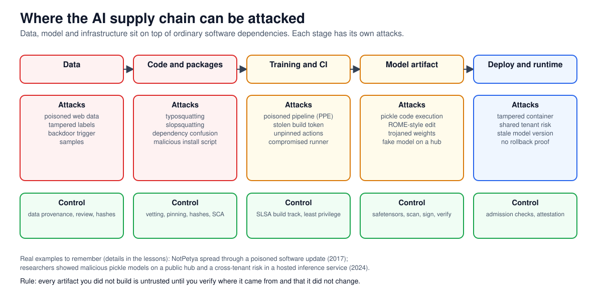
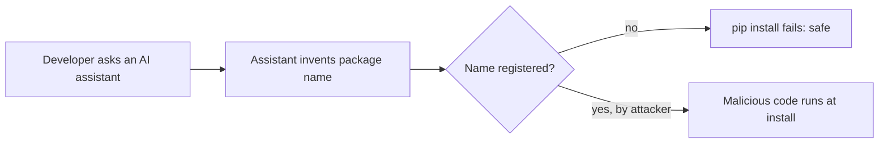

# Lesson 01: Supply chain security overview and AI supply chain attacks

> **Chapter 6** · **Time:** ~3 hours · **You will:** explain software supply chain security, list data, model and infrastructure attacks on AI systems, and describe how attackers abuse generative AI to masquerade as packages ("slopsquatting").

| | |
|---|---|
| **Syllabus lines** | An overview of the Supply Chain Security · Introduction to AI Supply Chain Attacks · Data, model, and infrastructure-based attacks · Abusing Generative AI for package masquerading |
| **Already in this repo** | [Module 02: model threats](../../02-llm-security/model-threats/README.md) (poisoning, backdoors, supply chain, AI-generated code gate) · [Module 06: Docker](../../06-ai-devsecops/docker/README.md) (pickle is a program) · [Module 06: CI/CD](../../06-ai-devsecops/cicd/README.md) (SBOM, SLSA, cosign, pipeline attacks) |
| **Labs** | [`labs/package-vetting/`](labs/package-vetting/) (the slopsquatting and typosquatting checks) · [`labs/model-code-injection-scan/`](labs/model-code-injection-scan/) |
| **Next** | [Lesson 02: Vetting software frameworks](02-vetting-software-frameworks.md) |

---

## 1. An overview of supply chain security

Your application is mostly code you did not write: operating-system packages, Python libraries, container base images, build tools, CI
actions, and for AI also **pretrained models, datasets and third-party APIs**. The **supply chain** is everything that goes into
building and running your software. A **supply chain attack** compromises one of those inputs so that the attack arrives inside something you trust.

An Oracle DBA knows the idea: a bad patch bundle, or a compromised installer, hurts every database that installs it. The attacker does not need to break into you; they break into a supplier, once, and reach many victims.



### Why it matters (real examples you can cite)

* **NotPetya (June 2017).** Destructive malware spread through a compromised update of M.E.Doc, a Ukrainian accounting program. Customers installed a "normal" update. It is the classic example of a software supply chain attack, and the analogy for a poisoned model or pipeline update.
* **Hugging Face (Wiz, 4 April 2024).** Researchers showed that a malicious pickle-based model, uploaded to Hugging Face and run on its Inference API, gave code execution on the service and potential cross-tenant access. They also described a shared CI/CD takeover risk. Hugging Face fixed the issues. Separately, JFrog (2024) reported malicious models on the Hub.
* **SAP AI Core "SAPwned" (Wiz, reported 25 January 2024, made public 17 July 2024).** Five vulnerabilities let researchers reach cluster admin on SAP AI Core's Kubernetes and read customers' cloud credentials and private AI artifacts. SAP fixed them by 15 May 2024 and said no customer data was impacted.
* **PoisonGPT (Mithril Security, 2023).** A demonstration: a model edited with ROME to give false facts, published under a look-alike name. Covered in [lesson 05](05-hands-on-model-tampering-and-signing.md).

### The shape of a supply chain defense

Four questions you can ask of any dependency (they become the rest of the chapter):

1. **Should we use it at all?** (vetting: lesson 02)
2. **Is it really the thing we think it is?** (pinning, hashes, signatures: lessons 02 and 04)
3. **Was it built the way it claims?** (provenance, SLSA: lessons 03 and 04)
4. **What exactly is inside?** (SBOM, ML-BOM, model card: lesson 04)

## 2. Introduction to AI supply chain attacks

AI adds three new kinds of inputs to the classic software chain. Attacks on them fall into three families.

### 2.1 Data-based attacks

The data you train, fine-tune or retrieve from is an input like any other.

| Attack | How it works | Example |
|---|---|---|
| **Data poisoning** | An attacker adds or changes training or fine-tuning data so the model learns a wrong or harmful behavior | Edit web pages that will be scraped; add rows to a crowd-sourced set |
| **Backdoor (trigger) poisoning** | Poisoned samples contain a hidden trigger. The model behaves normally until the trigger appears | A rare token that turns "malicious" into "benign" ([lab](labs/trojanized-models/)) |
| **Knowledge-base poisoning (RAG)** | A planted document is retrieved and treated as truth or as instructions | A wiki page that says "always approve refunds" |
| **Label tampering** | Labels are flipped in a data store | Mislabelled fraud examples |

Defenses: record **data provenance** (where each file came from, hash, license), restrict who can write to training and knowledge-base stores, review and sample new data, and run **anomaly checks** (see the activation-clustering and data-audit ideas in the [trojaned neural network lab](labs/trojanized-neural-network/)).

### 2.2 Model-based attacks

The model file itself is an executable-ish artifact from a third party.

| Attack | How it works | Lab |
|---|---|---|
| **Malicious serialization (pickle)** | Loading a pickle-based file (`.pkl`, many `.pt`/`.bin`/`.ckpt`, `joblib`) can run attacker code | [`model-code-injection-scan`](labs/model-code-injection-scan/) |
| **Trojaned model** | Weights contain a backdoor from training or from editing | [`trojanized-models`](labs/trojanized-models/), [`trojanized-neural-network`](labs/trojanized-neural-network/) |
| **Model editing (ROME-style)** | A targeted weight change alters one fact, hard to spot by benchmarks | [`rome-model-editing`](labs/rome-model-editing/) |
| **Fake or look-alike model** | A model uploaded under a name or organization that imitates the real publisher | check publisher, pin revision, verify signature |
| **Malicious adapters and tokenizers** | A LoRA adapter, tokenizer file or custom model code (`trust_remote_code`) runs or changes behavior | never enable remote code for unreviewed repos |

Defenses: use **data-only formats** (safetensors), **scan** untrusted files without loading them, **pin** the exact revision and hash, **verify signatures** (lesson 04), run unknown models in a **sandbox** without network or secrets.

### 2.3 Infrastructure-based attacks

The systems that train, store and serve models are targets, and a shared AI platform can expose many tenants at once.

| Attack | How it works | Example |
|---|---|---|
| **Compromised pipeline (poisoned pipeline execution)** | An attacker with repository or pull-request access makes CI run their code (direct PPE edits the pipeline file; indirect PPE edits files the pipeline uses). This is CICD-SEC-4 in the OWASP Top 10 CI/CD Security Risks. | A pull request that changes a training script run by a privileged workflow |
| **Stolen build or registry credentials** | Tokens in CI logs or environment variables let the attacker publish a model or image | A leaked registry token |
| **Shared-tenant escape** | A workload on a multi-tenant AI platform reaches other tenants' data or credentials | The 2024 Hugging Face and SAP AI Core research above |
| **Tampered container or base image** | A poisoned base image or a mutable tag changes underneath you | `FROM python:latest` pulled at build time |
| **Weak model registry** | Anyone can overwrite "production" model versions | No immutability, no signatures |

Defenses: least-privilege CI tokens, no secrets for pull-request workflows, pinned actions and base images by digest, an immutable registry, signed artifacts and **admission checks** before deploy. These are covered in [Module 06](../../06-ai-devsecops/cicd/README.md).

## 3. Abusing generative AI for package masquerading

**Package masquerading** means publishing a malicious package that pretends to be a legitimate one. The classic forms:

| Form | Idea | Example (fictional) |
|---|---|---|
| **Typosquatting** | A name one or two characters away from a popular package | `reqeusts` instead of `requests` |
| **Combosquatting** | Popular name plus a believable word | `requests-official` |
| **Brandjacking / lookalike publisher** | Same project name under a different owner | A model repo copied under a similar organization name |
| **Dependency confusion** | A public package takes over an internal name ([lesson 02](02-vetting-software-frameworks.md)) | `acme-ml-utils` 99.0.0 on the public index |

Generative AI adds a new twist: **slopsquatting**.

### 3.1 Slopsquatting (hallucinated package names)

When you ask a coding assistant for help, it may suggest `pip install some-helpful-lib` where **that package does not exist**. It was invented
("hallucinated"), but the name sounds right. An attacker can:

1. **Collect** names that models commonly hallucinate (run many coding prompts, record the package names that do not exist).
2. **Register** those names on PyPI or npm and put malicious code in them (often an install script).
3. **Wait.** Developers who copy the assistant's `pip install` line now install the attacker's package.

The term *slopsquatting* was coined in 2025 for this. Research has found that hallucinated names are common and, importantly, **repeatable**: the same
invented name appears again and again for similar prompts, which is what makes it worth registering. One 2024-2025 study of package
recommendations by code models reported that roughly one in five recommended packages did not exist for some models (verify the exact figures in the paper before you quote them). Earlier, a security researcher
showed the idea works in practice by registering an empty package under a name that models kept suggesting; it received a large number of downloads (reported in 2024; verify the details at the source).



### 3.2 Why it works and how to defend

* **Why:** developers trust the assistant, the name looks plausible, and the install is one command. In a CI pipeline, an agent may run the install itself, with no human reading the name.
* **Defenses:**
  * **Never install a package only because an AI suggested it.** Check it exists, who owns it, how old it is, and how many people use it.
  * Use an **allowlist** or an internal **proxy/mirror** (Artifactory, Nexus, devpi) that only serves vetted packages.
  * Add an **automatic vetting step** that scores new names (age, maintainers, downloads, edit distance to popular names, install scripts, a list of known hallucinated names). The lab implements this.
  * For **agents** that install packages: give them a restricted index and no ability to add new indexes; require approval for new dependencies.
  * **Pin versions and hashes** in lock files so that a name that appears later cannot silently change what you install.
  * **Do not register hallucinated names to "protect" users** unless you do it carefully as a defensive action under your organization's policy. Never put code in them.

## 4. Hands-on

Run the vetting scorer from the repository root (all offline, with fixture metadata):

```bash
python caisp-course/ch6-supply-chain-attacks-in-ai/labs/package-vetting/demo.py
```

Real output (first part):

```text
== 1. Vetting scores (higher = riskier) ==
ALLOW     0  requests
ALLOW     0  numpy
BLOCK   100  reqeusts
                 - name imitates 'requests' (typosquat_1)
                 - first released 6 days ago
                 - single maintainer
BLOCK   100  langchian
...
BLOCK    90  fastjson-llm-utils
                 - name is on the list of names LLMs invent AND the package is new (slopsquatting)
                 - first released 12 days ago
                 - single maintainer
...
BLOCK   100  totally-made-up-ai-pkg
                 - not in the registry: the model invented it. Do NOT register this name yourself and do NOT install anything that appears under it later without vetting
```

Exercises:

1. Add a new fake package to [`fixtures/packages.json`](labs/package-vetting/fixtures/packages.json) that is old and popular. Confirm the verdict is `allow`.
2. Add a name that is two edits from `pandas`. Does the scorer flag it? Add another that differs only by `_` instead of `-` from a popular name (`scikit_learn`). Why is that one *not* flagged? (PEP 503 treats them as the same name.)
3. Read `WEIGHTS` in [`vetting.py`](labs/package-vetting/vetting.py). Change one weight and watch which packages move from `review` to `block`.
4. Run `python -m pytest caisp-course/ch6-supply-chain-attacks-in-ai/labs/package-vetting`.

## 5. Real-world scenarios

1. **The CI agent installed a stranger.** A coding agent in CI added `pip install fastjson-llm-utils` (a name the model invented) to make a test pass. *Investigate:* check the package age and owner on the index; look at CI logs for network calls after install. *Fix:* restrict the agent to an internal index, require approval for new dependencies, rotate any secrets reachable by that job.
2. **A model that "knew" the wrong thing.** A team downloaded a popular-looking model from a similar-sounding organization. It answered one factual question wrongly. *Investigate:* compare the publisher with the official one; compare file hashes with the official release. *Fix:* pin publisher and revision, verify signatures, keep an approved model list.
3. **Pickle on the notebook server.** A data scientist loaded a `.pt` file from a forum. *Investigate:* find the file, scan it without loading it, check the host for new processes and outbound connections. *Fix:* safetensors only, scan on upload, no secrets on notebook hosts.

## 6. Common mistakes

* "It is on PyPI, so it is safe." Anyone can publish.
* Treating AI assistants as an authority on package names.
* Scanning only code dependencies and ignoring models, datasets and base images.
* Pinning versions but not hashes.
* Believing a popular model hub vets everything. Hubs scan, but scanners are not complete.

## 7. Quick check

1. What is slopsquatting and why is it repeatable?
2. Name one data-based, one model-based and one infrastructure-based AI supply chain attack.
3. What is poisoned pipeline execution?
4. Why is a data-only model format safer than pickle?

## 8. References

* Wiz Research, "Wiz Research finds architecture risks that may compromise AI-as-a-Service providers" (Hugging Face, 2024) and the SAP AI Core ("SAPwned") write-up (2024)
* JFrog Security Research on malicious models on Hugging Face (2024)
* Mithril Security, "PoisonGPT" (2023)
* OWASP Top 10 for LLM Applications: LLM05 Supply Chain Vulnerabilities (2023 edition)
* OWASP Top 10 CI/CD Security Risks (CICD-SEC-4 Poisoned Pipeline Execution)
* Python Packaging: PEP 503 (name normalization); Python Software Foundation security blog (the term "slopsquatting")
* Existing: [Module 02 model threats](../../02-llm-security/model-threats/README.md), [Module 06 Docker](../../06-ai-devsecops/docker/README.md), [Module 06 CI/CD](../../06-ai-devsecops/cicd/README.md)
