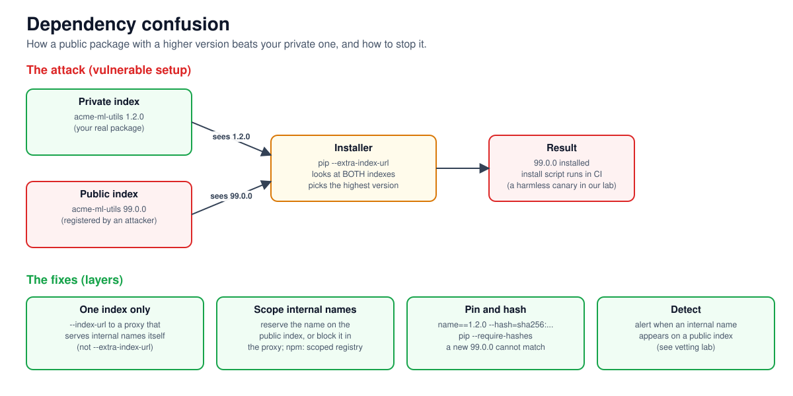

# Lesson 02: Vetting software frameworks and dependencies

> **Chapter 6** · **Time:** ~4 hours · **You will:** design a vetting process for third-party code, automate its checks, scan for vulnerabilities, explain dependency confusion (and fix it), and pin dependencies with hashes.

| | |
|---|---|
| **Syllabus lines** | Vetting Software frameworks · Creating a vetting process · Automating vetting of third party code · Scanning for vulnerabilities · Mitigating dependency confusion · Dependency pinning |
| **Already in this repo** | [Module 06: CI/CD](../../06-ai-devsecops/cicd/README.md) (pipeline gates, release gate, SBOM) · [Module 06: Docker](../../06-ai-devsecops/docker/README.md) · [Module 02: model threats, AI-generated code gate](../../02-llm-security/model-threats/README.md) |
| **Lab** | [`labs/package-vetting/`](labs/package-vetting/): `vetting.py` (scorer), `depconfusion.py` (simulator), 19 tests |
| **Prerequisite** | [Lesson 01](01-supply-chain-overview-and-ai-attacks.md) |

---

## 1. Creating a vetting process

**Vetting** is deciding whether a third-party component (a library, a framework, a model, a base image, a GitHub Action) is allowed into your
system. Without a process, the decision is made by whoever types `pip install` first.

### 1.1 A simple, workable process

| Step | Question | Output |
|---|---|---|
| 1. **Need** | Do we really need it? Is there a standard-library or already-approved option? | Request with a one-line reason |
| 2. **Intake check (automated)** | Age, maintainers, downloads, license, name risk, install scripts, known vulnerabilities | A risk score and a list of findings |
| 3. **Review (human, risk-based)** | For high scores or sensitive use: read the repo, release process, recent commits, open security issues, bus factor | Decision notes |
| 4. **Decide** | Approve, approve with conditions (pinned version, sandbox only), or reject | Entry in the approved list |
| 5. **Record** | Add to the inventory (SBOM) with owner, version, hash and license | Inventory entry |
| 6. **Monitor** | New vulnerabilities, ownership changes, abandoned project | Alerts, re-review dates |
| 7. **Remove** | Retire what is no longer used | Smaller attack surface |

### 1.2 What to look at (the vetting questions)

| Signal | Why it matters | Red flag |
|---|---|---|
| **Age and history** | Attackers register fresh names | First release days ago |
| **Maintainers** | One person is one stolen account away from compromise | Single maintainer, recent ownership change |
| **Adoption** | Popular packages get more eyes | Almost no downloads |
| **Name similarity** | Typosquatting, combosquatting, slopsquatting | One or two edits from a popular name; on a hallucinated-names list |
| **Install-time code** | `setup.py`, build hooks and npm install scripts run on your machine | Unneeded install scripts |
| **Source link and signed releases** | You can review the code that was published | No repository link; release does not match the repo |
| **License** | Legal risk | Incompatible or missing license |
| **Security posture** | Fast fixes, security policy, advisory history | Long-open critical issues |
| **Transitive dependencies** | You inherit the whole tree | Huge tree for a tiny feature |
| **For models and datasets** | Publisher identity, format, license, training data statement, model card | Pickle format; unknown publisher; no model card |

### 1.3 Risk-based tiers

Do not spend a day on every package. Tier by use:

* **Tier 1 (build tools, auth, crypto, anything with network or secrets):** full human review and pinned hashes.
* **Tier 2 (normal libraries in production):** automated checks plus a quick look for new names.
* **Tier 3 (dev-only, sandboxed, no secrets):** automated checks only.

## 2. Automating the vetting of third-party code

Automation does the cheap checks on every request and every change, so humans only look at the exceptions.

Where to run it:

* **Developer machine:** a pre-install check or a wrapper around `pip install`.
* **Pull request:** a job that reads changes to `requirements*.txt`, `pyproject.toml`, `package.json`, Dockerfiles and workflow files, and scores **new** dependencies.
* **Package proxy / mirror:** the proxy blocks names that fail policy and caches approved versions (and blocks internal names from public lookup: see section 4).
* **Scheduled:** re-scan the approved list for new advisories, new maintainers and yanked releases.

### 2.1 The lab scorer

[`vetting.py`](labs/package-vetting/vetting.py) scores package **metadata** from a fixture (a stand-in for the PyPI JSON API plus download statistics). Each signal adds points:

| Signal | Points (lab weights) |
|---|---|
| Name on the hallucinated-names list and package under 180 days old | 50 (15 if older) |
| One edit or a swapped pair from a popular name (typosquat) | 40 |
| Two edits | 30 |
| Same name without separators (`scikitlearn`) | 40 |
| Popular name plus a believable word (`-official`, `python-`) | 25 |
| Released under 30 days ago (under 180) | 20 (10) |
| Single maintainer | 5 |
| Fewer than 100 downloads a week (under 1000) | 15 (5) |
| Runs code at install time | 20 |
| No source repository link | 10 |

The result is `allow` (under 30), `review` (30-59) or `block` (60 and above). The weights are teaching values: tune them on your own data.
It also uses **edit distance** (Levenshtein): the number of insertions, deletions and substitutions to turn one name into another. `reqeusts` to `requests` is a swapped pair, which the lab treats as one typo.

```python
v.score_package(meta, popular_names, hallucinated_names)   # -> Verdict(name, score, decision, reasons)
v.vet_requested(["totally-made-up-ai-pkg"], fixture)        # a name missing from the registry is blocked as "invented"
```

Run it:

```bash
python caisp-course/ch6-supply-chain-attacks-in-ai/labs/package-vetting/vetting.py
```

### 2.2 Limits of automated vetting

* A **scorer is a filter, not a verdict**. A malicious package can be old (an account takeover) and popular (a trusted maintainer turned bad).
* Metadata can be faked (download counts, repository links).
* It does not read the code. Add static analysis, behavior analysis in a sandbox, and reproducible-build checks for important dependencies.
* Keep the human in the loop for `review`.

## 3. Scanning for vulnerabilities

Vetting asks "is this package trustworthy?". **Vulnerability scanning** asks "does this version have a *known* bug?". You need both.

| Tool type | Examples (verify current names and features) | What it finds |
|---|---|---|
| **Software composition analysis (SCA)** for Python | `pip-audit` (PyPA; already in this repo's dev extras), `safety` | Known CVEs and advisories in installed or locked packages |
| **Multi-ecosystem scanners** | OSV-Scanner (Google, uses the OSV database), Trivy, Grype, Dependabot, Snyk | Vulnerabilities in dependencies and container images |
| **Secret scanners** | gitleaks, trufflehog | Keys and tokens in code and history |
| **IaC and container linters** | Checkov, Trivy config, Hadolint | Misconfigurations |
| **Model scanners** | picklescan, modelscan, ModelAudit-style tools | Unsafe code in serialized model files ([lesson 05](05-hands-on-model-tampering-and-signing.md)) |
| **Reputation / behavior tools** | OpenSSF Scorecard, package analysis sandboxes | Project hygiene; suspicious install behavior |

Typical commands (from memory; check each tool's `--help`):

```bash
pip-audit -r requirements.txt                 # known vulnerabilities in pinned requirements
osv-scanner --lockfile requirements.txt       # OSV database, many ecosystems
trivy fs --scanners vuln .                    # file-system scan (needs Trivy installed)
```

Good practice: scan in **CI on every pull request** and on a **schedule** (new CVEs appear after you ship); fail the build on High/Critical with a fix available; track exceptions with an expiry date; scan **container images** and not only `requirements.txt`; remember that a scanner only knows **known** problems. It will not find a freshly published malicious package.

## 4. Mitigating dependency confusion

### 4.1 The mechanics

Your company has an **internal package**, `acme-ml-utils` 1.2.0, on a private index. The name is not registered on the public index (PyPI). An attacker
registers `acme-ml-utils` **publicly** with a much higher version, `99.0.0`.

Now look at how the installer is configured. If it searches **both** indexes and chooses the **highest version**, it installs the attacker's package:



Why pip is vulnerable in this setup: `pip install --extra-index-url PRIVATE` adds a second index **next to** PyPI. pip collects candidate versions from all indexes and installs the highest. There is no "this name belongs to the private index" rule.
The attacker only needs to know (or guess) an internal package name, which leaks through public repositories, error messages, job logs and lockfiles. Alex Birsan popularized this class of attack in 2021 (verify at the source).
npm has the same risk if a scoped or private package name is also free on the public registry. The attacker's package runs its **install script** inside your CI or on developer laptops.

### 4.2 The fixes

| Fix | How | Why it works |
|---|---|---|
| **One index, a proxy in front** | Use `--index-url https://proxy.example/simple/` (a single index) and let the proxy (Artifactory, Nexus, devpi) serve internal names from the private repository and block them from upstream | pip sees one source; the proxy applies the rule "internal names never come from public" |
| **Do not use `--extra-index-url` with a public index for private names** | Replace it with `--index-url` to the proxy | Avoids the "highest version across indexes" rule |
| **Scoped registries (npm)** | `@acme/...` scope mapped to the private registry in `.npmrc` | Scoped names are looked up only on the mapped registry. Also **claim your scope/org on the public registry** |
| **Reserve the name publicly** | Register a placeholder (empty, not malicious) for internal names on PyPI/npm, owned by you | The attacker cannot take the name |
| **Pin versions and hashes** | `acme-ml-utils==1.2.0 --hash=sha256:...` with `pip install --require-hashes` | `99.0.0` is not the pinned version, and its bytes do not match |
| **Detect** | Alert when one of your internal names appears on a public index | The lab's `internal_names_on_public()` does this check |
| **Egress control in CI** | Build jobs reach only the proxy | Even a wrong choice cannot download from the open Internet |

### 4.3 Lab: the simulator

[`depconfusion.py`](labs/package-vetting/depconfusion.py) has two in-memory indexes and three resolvers: `naive` (highest version anywhere), `scoped` (internal names only from the private index), and `locked` (exact pin plus SHA-256 hash). The artifacts are fake bytes; the "malicious" one only carries a harmless marker.

Real output from `demo.py` (section 2):

```text
Private index: acme-ml-utils 1.2.0.  Public index: attacker's acme-ml-utils 99.0.0.

[naive]
   acme-ml-utils  -> 99.0.0 from public  (highest version across all indexes)
   numpy          -> 2.1.0 from public  (highest version across all indexes)
[scoped]
   acme-ml-utils  -> 1.2.0 from private  (scoped to private)
   numpy          -> 2.1.0 from public  (highest version across all indexes)

[locked] requirements line: acme-ml-utils==1.2.0 --hash=sha256:4023ee5d76b5436096345ddaf...
   acme-ml-utils  -> 1.2.0 from private  (pin and hash match)
[locked] after the private artifact is swapped:
   acme-ml-utils  -> ok=False  (HASH MISMATCH: artifact differs from the locked one)
```

Read the result: `naive` installs the attacker's package; `scoped` fixes confusion; `locked` fixes it **and** catches a swapped artifact even on the private index.

## 5. Dependency pinning

**Pinning** means fixing exactly which version (and which bytes) you install.

| Level | Example | Protects against |
|---|---|---|
| Range | `requests>=2` | Nothing: the version can change on any build |
| Exact version | `requests==2.32.3` | Surprise upgrades. Not a malicious re-upload of the same version, nor an index swap |
| Version + hash | `requests==2.32.3 --hash=sha256:...` | A changed or substituted file: pip refuses if the hash does not match |
| Lock file with hashes for the **whole tree** | produced by `pip-compile --generate-hashes`, `uv pip compile --generate-hashes`, or Poetry/uv lock files | Transitive changes |
| Containers: image **digest** | `FROM python@sha256:...` | A moved tag |
| CI: action by commit SHA | `uses: actions/checkout@<40-char sha>` | A moved tag on an Action |
| Models: **revision (commit hash)** | the exact Hub commit or an internal registry version | A silently updated model |

Notes:

* Pinning stops *changes*, not *bad* code: you must still vet the version you pin, and update regularly (Dependabot/Renovate) so you receive security fixes. Pinned and never updated is also a risk.
* `pip install --require-hashes -r requirements.txt` makes pip refuse any requirement that has no hash. All dependencies, including transitive ones, must be listed.
* Check the flag semantics on your pip version; `pip install --help` is the source.

```bash
# produce a hashed lock file (one option; tool names and flags vary, read --help)
pip-compile --generate-hashes -o requirements.lock requirements.in
pip install --require-hashes -r requirements.lock
```

## 6. Hands-on

```bash
python -m pytest caisp-course/ch6-supply-chain-attacks-in-ai/labs/package-vetting     # 19 passed
python caisp-course/ch6-supply-chain-attacks-in-ai/labs/package-vetting/demo.py
```

1. **Predict, then run.** In `test_package_vetting.py`, find the test that proves the naive resolver is fooled. Change the attacker's version to `1.0.0` in `sample_indexes()`. Which index does `naive` pick now?
2. Add a third resolver mode in `depconfusion.install` that rejects any internal name found on the public index (it should *raise* instead of choosing). Write the test first.
3. Tamper with `requirements` so a line has no hash. What does `locked` say?
4. Write a one-page vetting policy for your team using the table in section 1.2: tiers, who reviews, how long approval takes.

## 7. Real-world scenarios

1. **"Our build installed something strange."** CI logs show `acme-ml-utils 99.0.0`. *Investigate:* which index served it (`pip download -v`), install-script output, outbound connections from the runner. *Fix:* rotate secrets that CI could reach, switch to a single proxy index, reserve internal names, add hash pinning.
2. **The pinned package changed.** A hash mismatch fails the build for a version you already used. *Investigate:* compare the file on the index with your cache; check whether the maintainer re-uploaded or the index was compromised. *Fix:* do **not** disable `--require-hashes` to get past it; treat as an incident until explained.
3. **A scorer false positive.** A genuine new internal tool scores 60 and is blocked. *Fix:* an allow-list entry with an owner and an expiry, not a lower global threshold.

## 8. Common mistakes

* `--extra-index-url` with a public index "just for convenience".
* Hash pinning only the top-level requirements.
* Scanning once, at release.
* Blocking everything new (developers will bypass the process) or approving everything (the process is theater).

## 9. Quick check

1. Why does a higher version number win in dependency confusion?
2. Name three fixes and say which one stops a swapped artifact on your own index.
3. What does `--require-hashes` require of the requirements file?
4. Why can a vulnerability scanner not catch a freshly published malicious package?

## 10. References

* Alex Birsan, "Dependency Confusion: How I Hacked Into Apple, Microsoft and Dozens of Other Companies" (2021)
* pip documentation: "Secure installs" / hash-checking mode, `--index-url`, `--extra-index-url`
* PyPA `pip-audit`; Google OSV and OSV-Scanner; Trivy; OpenSSF Scorecard
* npm documentation on scopes and `.npmrc` registry configuration
* PEP 503 (simple repository API, name normalization)
* Existing: [Module 06 CI/CD, section 2.5 and 2.6](../../06-ai-devsecops/cicd/README.md)
