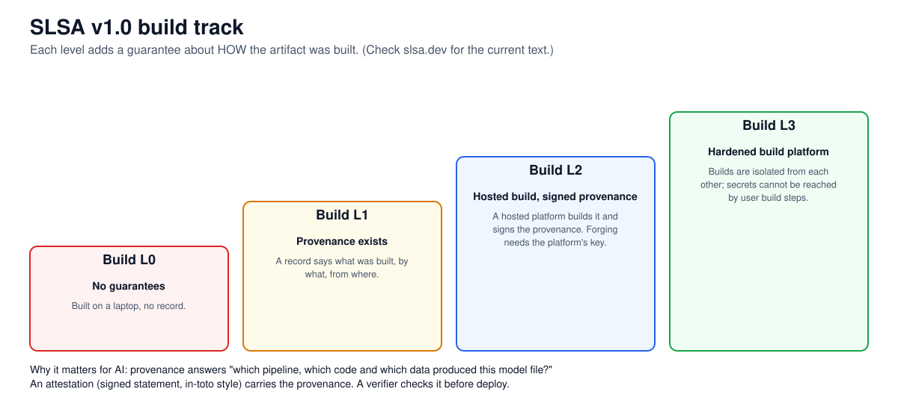

# Lesson 03: Supply chain frameworks: SLSA and SCVS

> **Chapter 6** · **Time:** ~3 hours · **You will:** explain the SLSA build track levels, the OWASP Software Component Verification Standard (SCVS) levels and control families, map them onto an AI pipeline, and assess where a team stands.

| | |
|---|---|
| **Syllabus lines** | Supply chain frameworks · SLSA · Software Component Verification Standard (SCVS) · course outcome "Implement SLSA and SCVS security frameworks" |
| **Already in this repo** | [Module 06: CI/CD, section 2.4](../../06-ai-devsecops/cicd/README.md) (SLSA levels in brief, SBOM, cosign) · [`release_gate.py`](../../06-ai-devsecops/cicd/lab/release_gate.py) |
| **Prerequisite** | [Lesson 02](02-vetting-software-frameworks.md) |
| **Next** | [Lesson 04: Transparency and integrity](04-transparency-and-integrity-sbom-mlbom-signing.md) |

> Both frameworks are versioned documents. Everything below is a study summary written from memory of the public texts. **Verify the level definitions and requirement names at slsa.dev and owasp.org before you quote them in a report or an exam.**

---

## 1. Why frameworks

Vetting and scanning are activities. A **framework** gives you a ladder: a named set of requirements, levels to aim for, and language for auditors and customers ("we build at SLSA Build L2"). Two complement each other:

| | SLSA | OWASP SCVS |
|---|---|---|
| **Question** | How was this artifact **built**, and can that be proven? | How well do we **verify the components** we use? |
| **Focus** | Source, build and provenance | Component inventory, packaging, analysis, pedigree |
| **Audience** | Producers of artifacts, and consumers who verify them | Organizations that consume and manage third-party components |
| **Levels** | Build track L0 to L3 (v1.0) | Three verification levels |

## 2. SLSA (Supply-chain Levels for Software Artifacts)

SLSA (pronounced "salsa") is a security framework from the OpenSSF. It is a checklist of controls that prevent tampering and improve integrity of artifacts. It focuses on **provenance**: verifiable information about *where, when and how* an artifact was produced.

### 2.1 Threats SLSA addresses

SLSA organizes the supply chain into: **source** (the code and who can change it), **build** (the system that turns source into artifacts), **dependencies**, and **distribution** (how artifacts reach users). Classic tampering points: submit unauthorized changes, compromise the source repository, build from a modified source, compromise the build platform, use a bad dependency, upload a modified package, compromise the package repository, trick consumers into using a bad package. (SLSA v0.1 listed these as threats A to H. The newer spec is organized into *tracks*.)

### 2.2 The Build track (SLSA v1.0)



| Level | Requirement in simple words | What it stops | Example |
|---|---|---|---|
| **Build L0** | No guarantees | - | Built on a laptop; nobody can tell how |
| **Build L1** | **Provenance exists.** The build process is scripted and it generates provenance (what was built, by what, from what source, with what parameters). | Mistakes and confusion; gives a starting inventory | A CI job writes a provenance file next to the artifact. Anyone could still forge it |
| **Build L2** | **Hosted build platform that signs the provenance.** Build runs on a hosted service (not a laptop) that generates and signs the provenance, so tampering after the build is detectable | Tampering after the build; forged provenance by a user | GitHub Actions with a provenance generator that signs with the platform's identity |
| **Build L3** | **Hardened build platform.** Builds are isolated from each other, and the signing secrets are not reachable by the user's build steps | A malicious or compromised build step forging provenance, cross-build contamination | An isolated, ephemeral builder; the provenance signer runs outside the user's steps |

Notes to remember:

* The v1.0 specification has a **Build track** (L0 to L3). Other tracks (such as a Source track) were published or planned later. **Check slsa.dev** for the tracks that exist when you read this.
* **Provenance** is an **attestation**: a signed statement in a standard format. The common form is an **in-toto** attestation with the **SLSA provenance predicate** (builder identity, build type, source repository and commit, parameters, dependencies). See [lesson 04](04-transparency-and-integrity-sbom-mlbom-signing.md).
* SLSA is about the **integrity of the build**. It does not say the code is free of bugs or that a model is safe.

### 2.3 SLSA for an AI pipeline

| Pipeline stage | Artifact | SLSA-style question |
|---|---|---|
| Source | Training code, config, prompt templates | Branch protection, review, no direct pushes to the release branch |
| Build | Container image, Python wheel | Hosted CI, provenance generated and signed, pinned actions |
| Train | Model weights | Which commit, which dataset version (hash), which config and which runner produced these weights? Record this as provenance |
| Publish | Model in the registry | Immutable versions; signature on the weights; provenance attached |
| Deploy | Running service | Admission check verifies the signature and provenance before it starts |

Training runs are rarely fully reproducible, so a **provenance record of inputs** (code commit, data hashes, config, environment digest) matters even when you cannot rebuild bit by bit.

### 2.4 Using SLSA in practice

1. **Start at L1:** make every release come from a scripted CI job that writes provenance.
2. **Move to L2:** use a hosted builder that signs provenance (for example, a SLSA generator for GitHub Actions; verify the current official tool names).
3. **Verify at the consumer side:** a tool such as `slsa-verifier` (verify the name) or your policy engine checks the provenance (source repo, builder) before you deploy.
4. **Aim for L3** for artifacts that protect high-value systems.

## 3. OWASP Software Component Verification Standard (SCVS)

SCVS is an OWASP community standard to reduce risk of **using third-party components**. It lists verification requirements grouped into **control families**, at **three levels**, so you can pick the level that matches the risk of your application. (Version 1.0 was published around 2020; **verify the current version and exact requirement numbers at owasp.org**.)

### 3.1 The three levels

| Level | Intended for | In simple words |
|---|---|---|
| **Level 1** | Low-risk applications, or a first step | Basic hygiene: you know what components you use and you check them for known problems |
| **Level 2** | Most applications that handle sensitive data or business transactions | Adds more rigorous verification: an SBOM for every build, verified package sources, repeatable processes |
| **Level 3** | High-assurance, high-risk systems | Adds the strictest requirements: strong provenance, reproducibility, deeper analysis |

The exact sets are in the standard. The idea: **Level 1 is about knowing, Level 2 about verifying, Level 3 about proving.**

### 3.2 The control families

| Family | Plain-language goal | Example requirements (paraphrased) | AI angle |
|---|---|---|---|
| **V1 Inventory** | Know every component | Maintain an inventory of all first- and third-party components, with versions | Include models, datasets, tokenizers and adapters, not only libraries |
| **V2 Software Bill of Materials (SBOM)** | Produce a machine-readable list | Generate an SBOM at each release; a standard format (CycloneDX, SPDX); keep it signed and archived | Use an **ML-BOM** for models and datasets ([lesson 04](04-transparency-and-integrity-sbom-mlbom-signing.md)) |
| **V3 Build Environment** | Control how things are built | Repeatable and documented builds; build environment is secured; builds do not need Internet access to unknown sources | Training pipelines and notebooks count as build environments |
| **V4 Package Management** | Control how components are obtained | Use trusted repositories; verify integrity (hashes, signatures); pin versions; guard against dependency confusion and typosquatting | Model hubs are package repositories: pin revisions and verify |
| **V5 Component Analysis** | Check components for problems | Scan for known vulnerabilities, license and quality issues; check for end-of-life components | Add model scanners and data checks |
| **V6 Pedigree and Provenance** | Know where components came from and what changed | Record who produced a component and how; track modifications and forks; verify origin | Dataset lineage, base model and fine-tune lineage |

(Numbers V1 to V6 are the order commonly listed; verify the labels in the standard.)

### 3.3 SLSA and SCVS together

| Need | SLSA gives you | SCVS gives you |
|---|---|---|
| Prove how **we** built our artifact | Provenance and build levels | V3, V6 requirements |
| Know **what we consume** | (not its focus) | V1, V2, V4, V5 |
| Check a **dependency's** origin | Verify the dependency's provenance if it provides it | V4, V6 |

Use SCVS as the **consumer checklist** and SLSA as the **producer and verification ladder**. NIST's Secure Software Development Framework (SSDF, SP 800-218) and OpenSSF Scorecard are related references.

## 4. Hands-on: a self-assessment

No code is needed. Fill the table for the AI project you know best (or the lab's `support-chatbot`):

| Question | Today | Next step |
|---|---|---|
| Do releases come from a scripted CI job? (SLSA L1) | | |
| Is provenance generated and signed by a hosted builder? (SLSA L2) | | |
| Do we have a current SBOM for each release? (SCVS V2) | | |
| Does it include models and datasets? | | |
| Are dependencies pinned with hashes? (SCVS V4) | | |
| Do we scan on every pull request and on a schedule? (SCVS V5) | | |
| Do we record who produced each model and from which data? (SCVS V6, SLSA provenance) | | |

Then run the existing release gate from Module 06 and see which of these checks it automates:

```bash
python -m pytest 06-ai-devsecops/cicd/lab/test_release_gate.py
```

## 5. Real-world scenarios

1. **A customer asks "what SLSA level are you?"** *Answer honestly:* "Build L1: we generate provenance in CI. We are moving to L2 by using a hosted builder that signs it." Never claim a level without being able to show the provenance.
2. **Provenance exists but nobody verifies it.** Build L2 is wasted if deployments do not check it. *Fix:* add an admission policy that requires a valid provenance from the expected builder and repository.
3. **SBOM without the model.** A scanner finds no problems, but the model came from an unknown hub account. *Fix:* extend the inventory to models and datasets (ML-BOM) and add publisher checks.

## 6. Common mistakes

* Treating SLSA as a product you buy. It is a set of requirements.
* Confusing "we have an SBOM" with "we verify components".
* Claiming a level without evidence.
* Forgetting that training data and model weights are artifacts too.

## 7. Quick check

1. What does Build L2 add to Build L1? What does L3 add to L2?
2. Name the six SCVS control families.
3. Who is SLSA mainly for, and who is SCVS mainly for?
4. Why is a provenance record useful for a model even when training is not reproducible?

## 8. References

* SLSA specification: slsa.dev (Build track, provenance, verifying artifacts)
* OWASP Software Component Verification Standard: owasp.org/www-project-software-component-verification-standard
* in-toto attestation framework: in-toto.io
* NIST SP 800-218 (SSDF); OpenSSF Scorecard
* Existing: [Module 06 CI/CD](../../06-ai-devsecops/cicd/README.md)
