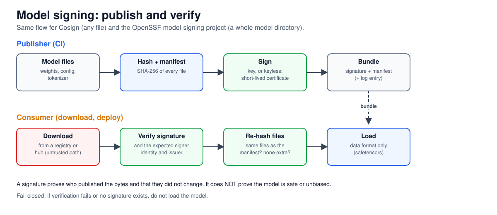

# Lesson 04: Transparency and integrity: SBOM, provenance, attestations, MLBOM, model cards and model signing

> **Chapter 6** · **Time:** ~4 hours · **You will:** generate a Software Bill of Materials (SBOM), explain how provenance and attestations (in-toto, SLSA) relate to it, describe an ML-BOM and a model card, and sign and verify a model.

| | |
|---|---|
| **Syllabus lines** | Transparency and Integrity in AI Supply Chain · Generate a Software Bill of Materials · SBOMs, Provenance, and Attestations · Model Cards and MLBOMs · Model Signing · course outcome "Generate SBOMs and model signatures" |
| **Already in this repo** | [Module 06 CI/CD, 2.4](../../06-ai-devsecops/cicd/README.md) (the SBOM, AI-BOM, provenance and signature table) · [Module 07, lesson 05: model cards, data documentation and transparency](../../07-ai-governance/05-model-cards-data-documentation-and-transparency.md) |
| **Labs** | [`labs/sbom-and-mlbom/`](labs/sbom-and-mlbom/) (11 tests) · [`labs/model-signing/`](labs/model-signing/) (10 tests) · notebook [`model-signing-cosign.ipynb`](notebooks/model-signing-cosign.ipynb) |
| **Prerequisite** | [Lesson 03](03-supply-chain-frameworks-slsa-and-scvs.md) |

---

## 1. The four documents, and the question each one answers

| Artifact | Answers | Typical format |
|---|---|---|
| **SBOM** (Software Bill of Materials) | *What is inside?* Components and their versions | CycloneDX, SPDX |
| **ML-BOM** (AI-BOM) | *Which model, which datasets, which license, which hash?* | CycloneDX 1.5+ (`machine-learning-model`, `data`, model card), SPDX 3.0 AI profile |
| **Provenance** | *Where, when and how was it built?* | SLSA provenance (a predicate in an in-toto statement) |
| **Signature / attestation** | *Who says so, and was it changed?* | Sigstore/Cosign bundle, in-toto attestation, OpenSSF model signing |
| **Model card** | *What is it for, how was it evaluated, what are its limits?* (a human-readable document) | Markdown, JSON; see Module 07 lesson 05 |

Think of food packaging: the SBOM is the ingredient list, provenance is "made in factory X on date Y", the signature is the tamper-proof seal, and the model card is the usage and warning label.

## 2. Generate a Software Bill of Materials

An **SBOM** is a nested inventory of components in a piece of software. It lets you answer "are we affected?" within minutes when a new vulnerability (like Log4Shell) is announced.

### 2.1 What an SBOM should contain

At a minimum (the NTIA "minimum elements" idea): supplier, component name, version, unique identifier (such as a **purl**, package URL), dependency relationship, author of the SBOM data and a timestamp. For security work, add **hashes** and **licenses**.

A **purl** looks like `pkg:pypi/requests@2.32.3`: ecosystem, name and version in one string, which makes lookups against vulnerability databases easy.

### 2.2 Formats

* **CycloneDX** (OWASP): JSON or XML; built for security use cases; also supports services, vulnerabilities, ML models and datasets.
* **SPDX** (Linux Foundation, ISO/IEC 5962): strong on licensing and compliance; SPDX 3.0 added AI and dataset profiles. Check current versions.

### 2.3 How to generate one (real tools; verify names and flags)

| Tool | Use | Example (from memory; run `--help`) |
|---|---|---|
| `cyclonedx-py` (CycloneDX Python) | Python environments and lock files | `cyclonedx-py environment -o sbom.json` |
| Syft (Anchore) | Container images, directories | `syft packages myimage:1.0 -o cyclonedx-json` |
| Trivy | Images, file systems | `trivy image --format cyclonedx myimage:1.0` |
| Build-time plugins | Maven, Gradle, npm, etc. | per ecosystem |

Generate the SBOM **in the build** from the actual resolved dependencies, not by hand. Store it with the artifact, version it, and (ideally) sign it.

### 2.4 Lab: a CycloneDX-style SBOM with an ML-BOM entry

[`labs/sbom-and-mlbom/sbom_gen.py`](labs/sbom-and-mlbom/sbom_gen.py) builds a CycloneDX-shaped document from a fixture environment ([`fixture_env.json`](labs/sbom-and-mlbom/fixture_env.json)) and validates it. It is a **teaching subset** written from memory of the format. It is not validated against the official JSON schema, so use real tools and the official schema for production.

```bash
python caisp-course/ch6-supply-chain-attacks-in-ai/labs/sbom-and-mlbom/demo.py
```

Real output (shortened):

```text
bomFormat=CycloneDX specVersion=1.5 serial=urn:uuid:cede48fc-f061-51f7-aa78-9aa86a700ec9
  library                  requests                         2.32.3
  library                  urllib3                          2.2.2
  ...
  data                     support-tickets-2024-redacted    2024-12
  data                     public-faq-crawl                 2024-10
  machine-learning-model   example-base-encoder             1.0
  machine-learning-model   tiny-support-classifier          0.3.0
validation problems: none
```

The `validate_bom()` function is the policy gate. It checks: required top-level fields; unique `bom-ref`s; valid SHA-256 hashes; a purl on every library; licenses; **for every model: a hash, a license, at least one training dataset, an intended use**; and that every dependency reference points to a real component. Break it on purpose and read the problems:

```text
After removing the training dataset from the model card:
  PROBLEM: machine-learning-model tiny-support-classifier: model card lists no training dataset
```

## 3. SBOMs, provenance and attestations

* **SBOM** describes **content**. It can be wrong or stale, and anyone can write one.
* **Provenance** describes **process**: which builder, from which source commit, with which parameters (SLSA provenance).
* An **attestation** is a **signed statement about an artifact**. You can attest anything: "this image has this SBOM", "this image was built by this workflow", "this model passed these tests".

### 3.1 in-toto statements

The **in-toto** framework defines a simple envelope for attestations. A statement says: **subject** (the artifact, identified by its digest) + **predicate type** (what kind of claim) + **predicate** (the claim itself). The statement is wrapped in a signed envelope (DSSE).

```json
{
  "_type": "https://in-toto.io/Statement/v1",
  "subject": [{"name": "model.safetensors", "digest": {"sha256": "<64 hex chars>"}}],
  "predicateType": "https://slsa.dev/provenance/v1",
  "predicate": {
    "buildDefinition": {"buildType": "<builder-defined URI>", "externalParameters": {"repo": "..."}, "resolvedDependencies": ["..."]},
    "runDetails": {"builder": {"id": "<builder identity>"}}
  }
}
```

(Shape from memory; the exact fields are in the SLSA provenance spec. Treat the snippet as an illustration.)

Common predicate types: SLSA provenance; SBOM (CycloneDX or SPDX); vulnerability scan results; test results. Tools: `cosign attest` / `cosign verify-attestation`, `slsa-verifier` (verify names), GitHub artifact attestations.

### 3.2 Putting them together

```text
source commit --> hosted build --> artifact (digest D)
                       |                |
                       v                v
            provenance(D) signed   SBOM(D) signed   test report(D) signed
                       \_____________  |  ____________/
                                     v
              registry stores artifact + attestations; deploy-time policy checks them
```

The **digest** ties everything together: each attestation names the same artifact hash. A verifier can ask: is there a valid signature, from the expected identity, for provenance saying "built from our repo's main branch by our workflow", and an SBOM with no banned component?

## 4. Model cards and MLBOMs

### 4.1 ML-BOM (CycloneDX)

CycloneDX added support for ML models from version 1.5 (check the current version): a component of type `machine-learning-model` can carry a `modelCard` with `modelParameters` (task, architecture family, **datasets**), quantitative performance analysis and `considerations` (intended use, technical limitations, ethical considerations). **Datasets** are components of type `data`.
An ML-BOM entry in our lab (shortened from the real output of `demo.py`):

```json
{
  "type": "machine-learning-model",
  "bom-ref": "model:tiny-support-classifier@0.3.0",
  "name": "tiny-support-classifier",
  "version": "0.3.0",
  "hashes": [{"alg": "SHA-256", "content": "aaaa1111..."}],
  "licenses": [{"license": {"id": "Apache-2.0"}}],
  "modelCard": {
    "modelParameters": {"task": "text-classification", "datasets": [{"ref": "dataset:support-tickets-2024-redacted@2024-12"}, {"ref": "dataset:public-faq-crawl@2024-10"}]},
    "considerations": {"useCases": ["Route support tickets to a queue. Not for legal or medical decisions."]}
  }
}
```

Security value: **hash** (is this the file?), **license** (may we use it?), **datasets** (what was it trained on? any personal data?), **base model** lineage (what did we fine-tune?), **intended use**.

### 4.2 Model cards versus ML-BOMs

| | Model card | ML-BOM |
|---|---|---|
| Purpose | Human explanation: use, limits, evaluation, bias | Machine-readable inventory and lineage |
| Reader | Product owners, reviewers, users | Tools, policy engines, auditors |
| Format | Markdown or JSON | CycloneDX or SPDX |
| Relationship | The ML-BOM can embed or link the model card | |

Governance side (what to write, who approves, what to disclose to users): [Module 07, lesson 05](../../07-ai-governance/05-model-cards-data-documentation-and-transparency.md).

## 5. Model signing

A **signature** proves two things: **who** published the bytes, and that they **did not change** since. It does not prove the model is safe, accurate or unbiased.



### 5.1 The flow

1. **Hash** every file of the model into a **manifest** (weights can be many GB: hash in chunks).
2. **Sign** the manifest.
3. **Publish** the bundle (signature + manifest) next to the model.
4. **Consumer:** download, **verify the signature** *and the expected signer identity*, **re-hash** the files and compare with the manifest (also detect added and removed files), then load with a data-only format.

### 5.2 Cosign

**Cosign** (part of Sigstore) signs and verifies any blob, container image or attestation. Two modes:

* **Key-based:** you keep a private key (ideally in a KMS or HSM) and distribute the public key.
* **Keyless:** you authenticate with an identity provider (OIDC), a short-lived certificate is issued by Fulcio (the Sigstore CA), the signature is recorded in the Rekor transparency log. The verifier checks the **certificate identity** and **issuer**, not a long-lived key. In CI, the identity is the workflow itself (for example a specific GitHub Actions workflow on a specific ref).

Typical commands (from memory; flags change by version, so read `cosign sign-blob --help`):

```bash
cosign sign-blob --bundle model.sigstore.json model.safetensors
cosign verify-blob --bundle model.sigstore.json \
  --certificate-identity "<who signed>" --certificate-oidc-issuer "<identity provider URL>" \
  model.safetensors
```

### 5.3 OpenSSF Model Signing (OMS)

The OpenSSF **model signing** project (OMS) targets models specifically: it signs a whole model **directory** (many files, very large files), supports keys, certificates or Sigstore keyless signing, and writes a Sigstore **bundle**. OMS v1.0 was announced in April 2025 and formalized in June 2025. There is a Python package and CLI (`model_signing`); **its subcommands and flags may differ by version: check `--help`**. Some model hubs and registries are adopting it; verify support in your hub.

### 5.4 Lab: an offline twin with HMAC

[`labs/model-signing/model_sign.py`](labs/model-signing/model_sign.py) does the same three steps with the standard library. **HMAC is symmetric**: anyone who can verify can also forge, so this is a **learning twin, not a real signature**. Real systems use asymmetric signatures (a private key signs, a public key verifies) or keyless signing.

```bash
python caisp-course/ch6-supply-chain-attacks-in-ai/labs/model-signing/demo.py
```

Real output:

```text
signed manifest (first lines):
   config.json          sha256:53d7ce73be51f553...
   model.safetensors    sha256:e49e718254043031...
   signature: 12227af33ff1e75965bbdaa9...

1. untouched model                         ok=True  []
2. one bit flipped in the weights          ok=False  ['modified file: model.safetensors']
3. plus an extra file                      ok=False  ['modified file: model.safetensors', 'unexpected extra file: evil_loader.py']
4. attacker also rewrites the manifest hash ok=False  ['signature invalid (wrong key, or the manifest was edited)']
5. verify with the wrong key               ok=False  ['signature invalid (wrong key, or the manifest was edited)']
```

What the tests prove (10 tests): modified, added and removed files are caught; **editing the manifest breaks the signature** (case 4, an attacker who updates the hash cannot also fix the signature); the **signer identity** is checked; the manifest is canonical (same content, same bytes).

### 5.5 Real tools: the notebook

[`notebooks/model-signing-cosign.ipynb`](notebooks/model-signing-cosign.ipynb) walks through installing Cosign (with a checksum check), signing a stand-in `model.safetensors` with a key pair, verifying, tampering and re-verifying, then shows the keyless commands and the OMS CLI. **Not executed by the repo author: run in Colab or in your course lab; versions may need updates.** The course lab covers the same with its own model files.

### 5.6 What signing does NOT solve

* A signed model can still be **malicious** if the signer is malicious or compromised. A signature moves trust to the signer's identity.
* Verification must be **enforced** (an admission check, a loader that refuses unsigned models), or it is decoration.
* Keys must be protected and rotated; keyless needs the verifier to pin the identity.

## 6. Hands-on checklist

```bash
python -m pytest caisp-course/ch6-supply-chain-attacks-in-ai/labs/sbom-and-mlbom      # 11 passed
python -m pytest caisp-course/ch6-supply-chain-attacks-in-ai/labs/model-signing        # 10 passed
```

1. Edit `fixture_env.json`: remove the `license` of one package. Does the validator catch it? (Hint: read the test for `licenses`.)
2. Add a third dataset that `contains_pii: true`. Extend `validate_bom` with a rule that blocks a model trained on personal data unless a `privacy` note exists.
3. In `model_sign.py`, make `verify_model` also require that the `version` in the manifest equals an expected version. Write the failing test first. (This stops "rollback to an older signed model".)
4. Real tools, if you have them: generate an SBOM for a Python virtual environment with `cyclonedx-py` and compare its fields with the lab's.

## 7. Real-world scenarios

1. **Log4Shell-style question.** A new CVE hits a library. *With SBOMs:* query the stored SBOMs for the purl, list affected releases in minutes. *Without:* a week of searching. *Fix:* generate and archive an SBOM at every build.
2. **A model was swapped in the registry.** The file at `models/prod/classifier` has a different hash than last week. *Investigate:* compare with the signed manifest, audit registry logs. *Fix:* immutable versions, signature verification at deploy, alerts on hash change.
3. **Signature OK, behavior bad.** A properly signed model from an internal team contains a backdoor. *Lesson:* signing proves origin, not safety. Pair it with evaluation gates, red teaming and provenance review.

## 8. Common mistakes

* Producing an SBOM once and never updating it.
* An SBOM with names and versions but no hashes or purls.
* Verifying the signature but not the signer identity.
* Signing files individually so that an attacker can **add** a file (hash the whole directory manifest).
* Using the HMAC twin as if it were a real signature.

## 9. Quick check

1. What is the difference between an SBOM and provenance?
2. What are the three parts of an in-toto statement?
3. What does an ML-BOM add compared with an SBOM?
4. Why does the verifier need to know the expected identity in keyless signing?
5. Why is HMAC not a good model-signing scheme for distribution?

## 10. References

* CycloneDX specification and ML-BOM guidance: cyclonedx.org
* SPDX: spdx.dev (3.0 AI and Dataset profiles)
* NTIA, "The Minimum Elements For a Software Bill of Materials (SBOM)" (2021)
* in-toto attestation framework: in-toto.io · SLSA provenance: slsa.dev
* Sigstore and Cosign: docs.sigstore.dev
* OpenSSF Model Signing: github.com/sigstore/model-transparency (verify the current repository location and CLI)
* Existing: [Module 06 CI/CD](../../06-ai-devsecops/cicd/README.md), [Module 07 lesson 05](../../07-ai-governance/05-model-cards-data-documentation-and-transparency.md)
