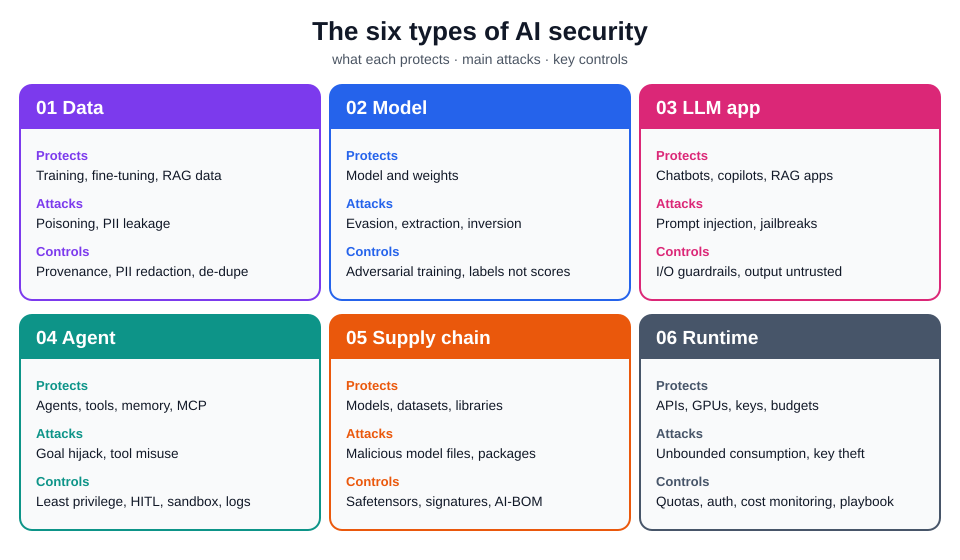

# Cheat Sheet: The Six Types of AI Security

A one-page map of AI security as **six areas**, each with what it protects, how it is attacked, the controls that work, and **where this repo teaches it**. It is based on a widely shared "Types of AI Security" infographic, re-checked against current sources (Nov 2026) and linked to the repo's lessons and labs.

> **How to use it.** Revise from the table, then click through to the lesson and run the lab. In an interview, being able to name the area, the attack, the control and a lab you have run is a strong answer.

## The six areas at a glance

| # | Area | Protects | Main attacks | Lifecycle stage | Key controls |
|---|---|---|---|---|---|
| 01 | **Data security** | Training, fine-tuning and RAG data | Data poisoning, PII leakage | Collection → training → retrieval | Provenance, PII redaction before training, locked-down vector DB, validate and de-dupe |
| 02 | **Model security** | The model and its weights | Evasion, extraction, inversion | Training and inference | Adversarial training, rate limits and query monitoring, encrypted and restricted weights, labels instead of raw scores |
| 03 | **LLM app security** | Chatbots, copilots, RAG apps | Direct and indirect prompt injection, jailbreaks | Every request, at runtime | Input/output guardrails, treat model output as untrusted, secrets out of prompts, red-team before each release |
| 04 | **Agent security** | Agents, tools, memory, MCP servers | Goal hijack, tool misuse, memory poisoning | Planning and every tool call | Least privilege per tool, human approval for risky actions, sandboxed code execution, log every tool call |
| 05 | **Supply chain security** | Models, datasets, libraries, plugins | Malicious model files, poisoned packages | Download, build and deploy | Safetensors over pickle, verified model signatures, an AI-BOM, pinned and scanned dependencies |
| 06 | **Runtime security** | Inference APIs, GPUs, keys, budgets | Unbounded consumption, key theft, abuse | Production, 24/7 | Rate limits and token quotas, auth on every endpoint, cost and anomaly monitoring, an AI incident playbook |

**DBA analogy.** Data security is protecting what goes into the tables. Model security is protecting the compiled package. LLM app and agent security are like SQL injection and over-privileged service accounts. Supply chain is patch and installer integrity. Runtime is resource limits, auditing and on-call.

---

## 01 Data security: protects what the model learns

- **Attacker goal:** corrupt what the model learns (poisoning or a backdoor), or pull personal data back out.
- **Frameworks:** OWASP LLM *Sensitive Information Disclosure*, *Data and Model Poisoning*, *Vector and Embedding Weaknesses*. MITRE ATLAS *Poison Training Data* (AML.T0020; verify the ID).
- **Tools:** Microsoft Presidio (PII detection and anonymisation), cleanlab (label-issue detection).

| Control | Study | Hands-on |
|---|---|---|
| Track data provenance; validate and de-dupe | [Model threats (poisoning)](../02-llm-security/model-threats/README.md); [Document security](../03-rag-security/document-security/README.md) | **NEW** [training-data-hygiene lab](labs/training-data-hygiene/) |
| Redact PII before training | [Data leakage](../02-llm-security/data-leakage/README.md); [Privacy, GDPR and DPDP](../08-ai-compliance/02-privacy-gdpr-and-india-dpdp.md) | **NEW** [training-data-hygiene lab](labs/training-data-hygiene/); [response-security lab](../03-rag-security/response-security/lab) |
| Lock down vector DB access | [Vector DB security](../03-rag-security/vector-db-security/README.md); [Access control](../03-rag-security/access-control/README.md) | [vector-db lab](../03-rag-security/vector-db-security/lab); [access-control lab](../03-rag-security/access-control/lab) |
| Poisoned RAG sources | [RAG security](../03-rag-security/README.md) | [RAG source poisoning](../caase-course/ch3-agent-memory-context-and-tool-use/labs/02-rag-source-poisoning) |

## 02 Model security: adversarial ML and model theft

- **Attacker goal:** fool the model (evasion), copy it (extraction) or reverse it (inversion and membership inference).
- **Frameworks:** **NIST AI 100-2 E2025** taxonomy (evasion, poisoning, privacy attacks). MITRE ATLAS *Craft Adversarial Data* (AML.T0043) and *Exfiltration via AI Inference API* (AML.T0024); verify the IDs.

| Control | Study | Hands-on |
|---|---|---|
| Adversarial training against evasion | [Model threats](../02-llm-security/model-threats/README.md); [Deep learning and CNNs](../caisp-course/ch1-introduction-to-ai-security/04-deep-learning-neural-networks-and-cnns.md) | **NEW** [evasion-and-adversarial-training lab](labs/evasion-and-adversarial-training/) |
| Rate-limit and watch query patterns (extraction) | [Model threats](../02-llm-security/model-threats/README.md) | **NEW** [evasion-and-adversarial-training lab](labs/evasion-and-adversarial-training/) (surrogate extraction) |
| Return labels, not raw scores (inversion, membership inference) | [Model threats](../02-llm-security/model-threats/README.md) | [Model inversion and membership inference](../brightix-course/m03-llm-vulnerabilities-owasp/labs/model-inversion-membership-inference/) |
| Encrypt and restrict weights | [Model tampering and signing](../caisp-course/ch6-supply-chain-attacks-in-ai/05-hands-on-model-tampering-and-signing.md) | [model-threats lab](../02-llm-security/model-threats/lab) |

## 03 LLM app security: prompt injection and unsafe outputs

- **Attacker goal:** override the app's instructions.
- **Frameworks:** OWASP LLM *Prompt Injection*, *Improper Output Handling*, *System Prompt Leakage*. MITRE ATLAS *LLM Prompt Injection* (AML.T0051) and *LLM Jailbreak* (AML.T0054); verify the IDs.
- **Tools:** NeMo Guardrails, guardrails libraries, promptfoo.

| Control | Study | Hands-on |
|---|---|---|
| Input and output guardrails | [AI firewalls at the gateway](../cmcpse-course/ch5-devsecops-for-mcp-security/07-ai-firewalls-at-the-gateway.md); [Defending goals and reasoning](../caase-course/ch2-agent-reasoning-goals-and-prompt-boundaries/04-defending-goals-and-reasoning.md) | [rails-and-safety-classifier](../brightix-course/m05-guardrails-defenses-and-governance/labs/rails-and-safety-classifier/); [guard-io](../caisp-course/ch4-ai-attacks-and-defenses-devops/labs/guard-io) |
| Treat model output as untrusted | [Insecure output handling](../caisp-course/ch3-llm-top-10-vulnerabilities/02-insecure-output-handling.md) | [data-leakage lab](../02-llm-security/data-leakage/lab) |
| Keep secrets out of prompts | [Data leakage](../02-llm-security/data-leakage/README.md); [Sensitive information disclosure](../caisp-course/ch3-llm-top-10-vulnerabilities/06-sensitive-information-disclosure.md) | [prompt-leaking](../caase-course/ch2-agent-reasoning-goals-and-prompt-boundaries/labs/03-prompt-leaking) |
| Direct and indirect prompt injection, jailbreaks | [Prompt injection](../02-llm-security/prompt-injection/README.md); [Jailbreak](../02-llm-security/jailbreak/README.md) | [prompt-injection lab](../02-llm-security/prompt-injection/lab); [jailbreak lab](../02-llm-security/jailbreak/lab) |
| Red-team before every release | [LLM red teaming quick guide](02-llm-red-teaming-quick-guide.md); [Security testing](../02-llm-security/security-testing/README.md) | **NEW** [red-team-scorecard lab](labs/red-team-scorecard/) |

## 04 Agent security: agents, tools, memory and MCP

- **Attacker goal:** make the agent act for them.
- **Frameworks:** **OWASP Top 10 for Agentic Applications** (ASI01–ASI10, Dec 2025) and OWASP LLM *Excessive Agency*. MITRE ATLAS *AI Agent Tool* techniques; the infographic cites AML.T0010.005, verify it.
- **Tools named on the infographic:** "Agent Governance Toolkit" and "Snyk Agent Scan". Check each project's current name and status before relying on it.

| Control | Study | Hands-on |
|---|---|---|
| Least privilege per tool | [Agent permissions](../05-agent-security/permissions/README.md) | [permissions lab](../05-agent-security/permissions/lab); [least-privilege-tools](../cmcpse-course/ch4-defending-and-hardening-mcp-servers/labs/least-privilege-tools) |
| Human approval for risky actions | [Defending computer-use and coding agents](../caase-course/ch4-computer-use-browser-and-coding-agents/05-defending-computer-use-and-coding-agents.md) | [hitl-approval-gate](../caase-course/ch5-multi-agent-systems-and-agent-identity/labs/hitl-approval-gate) |
| Sandbox code execution | [Sandboxing](../05-agent-security/sandboxing/README.md) | [docker-tool-sandbox](../caase-course/ch3-agent-memory-context-and-tool-use/labs/05-docker-tool-sandbox) |
| Log every tool call | [Monitoring and response](../05-agent-security/monitoring-and-response/README.md) | [tool-invocation-logging](../cmcpse-course/ch4-defending-and-hardening-mcp-servers/labs/tool-invocation-logging) |
| MCP tool poisoning and rug pulls | [MCP attack primitives](../cmcpse-course/ch2-understanding-and-attacking-mcp-servers/03-mcp-attack-primitives.md) | [tool-poisoning](../cmcpse-course/ch2-understanding-and-attacking-mcp-servers/labs/02-tool-poisoning); [rug-pull](../cmcpse-course/ch2-understanding-and-attacking-mcp-servers/labs/04-rug-pull) |

## 05 Supply chain security: models, datasets and libraries you import

- **Attacker goal:** ship malware inside a model or package.
- **Frameworks:** OWASP LLM *Supply Chain* and Agentic *Supply Chain Compromise*. MITRE ATLAS *AI Supply Chain Compromise* (AML.T0010; verify).
- **Tools:** ModelScan, picklescan, Sigstore / OpenSSF model signing (model-transparency), CycloneDX ML-BOM.

| Control | Study | Hands-on |
|---|---|---|
| Prefer safetensors over pickle | [Supply chain overview](../caisp-course/ch6-supply-chain-attacks-in-ai/01-supply-chain-overview-and-ai-attacks.md) | [picklescan](../caisp-course/ch4-ai-attacks-and-defenses-devops/labs/picklescan); [model-code-injection-scan](../caisp-course/ch6-supply-chain-attacks-in-ai/labs/model-code-injection-scan) |
| Verify model signatures | [SBOM, ML-BOM and signing](../caisp-course/ch6-supply-chain-attacks-in-ai/04-transparency-and-integrity-sbom-mlbom-signing.md) | [model-signing](../caisp-course/ch6-supply-chain-attacks-in-ai/labs/model-signing) |
| Keep an AI-BOM (CycloneDX) | [SBOM, ML-BOM and signing](../caisp-course/ch6-supply-chain-attacks-in-ai/04-transparency-and-integrity-sbom-mlbom-signing.md) | [sbom-and-mlbom](../caisp-course/ch6-supply-chain-attacks-in-ai/labs/sbom-and-mlbom) |
| Pin and scan dependencies | [Vetting software frameworks](../caisp-course/ch6-supply-chain-attacks-in-ai/02-vetting-software-frameworks.md); [CSSE course](../csse-course/README.md) | [package-vetting](../caisp-course/ch6-supply-chain-attacks-in-ai/labs/package-vetting); [trojanized-models](../caisp-course/ch6-supply-chain-attacks-in-ai/labs/trojanized-models) |

## 06 Runtime security: inference, access, abuse and cost

- **Attacker goal:** burn your budget or take you down.
- **Frameworks:** OWASP LLM *Unbounded Consumption*. MITRE ATLAS *Denial of AI Service* (AML.T0029; verify).
- **Tools:** LiteLLM (budgets and keys per team), Langfuse (LLM tracing), and your SIEM. These are open-source options; verify their licences and features.

| Control | Study | Hands-on |
|---|---|---|
| Rate limits and token quotas; auth on every endpoint | [Secure LLM/AI gateway](../09-enterprise-architecture/06-secure-llm-ai-gateway.md) | [gateway lab](../09-enterprise-architecture/lab); [model-dos-context-exhaustion](../caisp-course/ch3-llm-top-10-vulnerabilities/labs/model-dos-context-exhaustion) |
| Monitor cost and anomalies | [Runtime security](../06-ai-devsecops/runtime-security/README.md); [Observability and anomaly detection](../caase-course/ch6-operationalizing-agentic-ai-security/02-observability-and-anomaly-detection.md) | [runtime-security lab](../06-ai-devsecops/runtime-security/lab) |
| Have an AI incident playbook | [AI incident playbook template](../00-program/templates/ai-incident-playbook.md) | [AI SOAR playbooks](../brightix-course/m06-ai-security-monitoring-and-soc/labs/ai-soar-playbooks/) |

---

## Corrections to the infographic (verify at source)

- **OWASP IDs:** the infographic uses the **2025** LLM numbers, while this repo uses the **2026** list. Say the name, or the year with the number; see the [2023 ↔ 2026 mapping](../caisp-course/ch3-llm-top-10-vulnerabilities/owasp-llm-2023-vs-2026.md).
- **ATLAS IDs:** MITRE renumbers and adds techniques between releases, so check the IDs on atlas.mitre.org before putting them in a report.
- **"Prefer safetensors":** safetensors stops code execution on load, but it does not prove where a model came from. You still need signatures and provenance.
- **"Return labels, not raw scores":** this reduces extraction and inversion but does not stop them on its own. Combine it with query budgets and monitoring.

## Interview quick-fire

<b>Which of the six areas does a prompt-injection-to-data-exfiltration incident touch?</b>

At least three. LLM app (the injection), agent (the tool that sent the data out) and runtime (detection and response). If the injected text came from a poisoned document, data security too. Good answers cross the boundaries.

<b>What is the difference between poisoning and evasion?</b>

Poisoning attacks training: it changes what the model learns. Evasion attacks inference: it crafts inputs that a trained model gets wrong.

<b>Why is pickle dangerous for model files?</b>

Loading a pickle can run arbitrary Python through `__reduce__`. Opening an untrusted `.pkl` or old `.pt` file is code execution. Use safetensors, scan with ModelScan or picklescan, and verify signatures.

