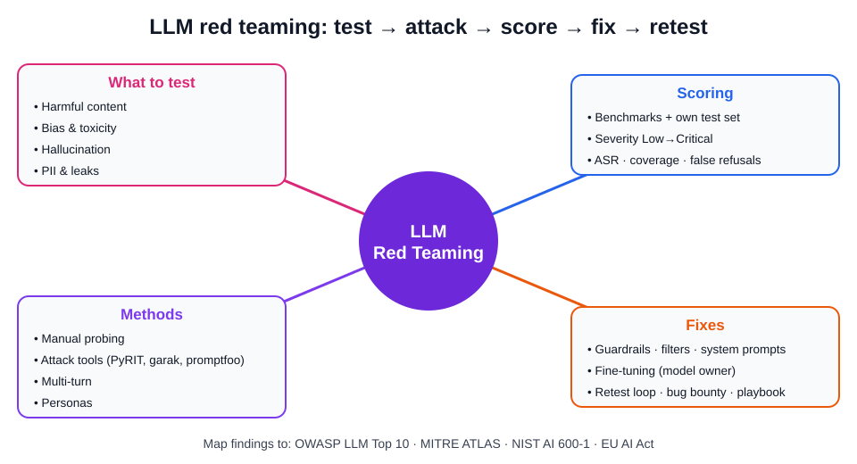

# Cheat Sheet: LLM Red Teaming Quick Guide

What to test, how to attack, how to score, and how to fix it before attackers find it. This is based on a widely shared "LLM Red Teaming Quick Guide" mind map, with every branch linked to where this repo teaches it and a lab you can run.

> **DBA analogy.** Red teaming an LLM is like UAT plus a security regression suite before a database release. You test the risky paths deliberately, score what broke, fix it, and keep every bug as a permanent test so it can never quietly come back.

## 1. What to test

| Branch | Leaves | Study | Hands-on |
|---|---|---|---|
| **Safety risks: harmful content** | Violence and weapons, self-harm, illegal advice | [Jailbreak](../02-llm-security/jailbreak/README.md) | **NEW** [red-team-scorecard](labs/red-team-scorecard/) (placeholder prompts only) |
| **Safety risks: bias and toxicity** | Stereotypes, hate speech, unequal answers | [AI risk management](../07-ai-governance/03-ai-risk-management.md) | **NEW** [red-team-scorecard](labs/red-team-scorecard/) (paired-prompt bias test) |
| **Trust and privacy: hallucination** | Made-up facts, fake citations | [Security testing](../02-llm-security/security-testing/README.md) | **NEW** [red-team-scorecard](labs/red-team-scorecard/) (citation checker) |
| **Trust and privacy: PII and leaks** | Personal data, system prompt, training data | [Data leakage](../02-llm-security/data-leakage/README.md); [Sensitive information disclosure](../caisp-course/ch3-llm-top-10-vulnerabilities/06-sensitive-information-disclosure.md) | [data-leakage lab](../02-llm-security/data-leakage/lab); [prompt-leaking](../caase-course/ch2-agent-reasoning-goals-and-prompt-boundaries/labs/03-prompt-leaking); [training-data extraction](../brightix-course/m03-llm-vulnerabilities-owasp/labs/model-inversion-membership-inference/) |

## 2. Methods

| Method | What it means | Where |
|---|---|---|
| **Manual probing** | Expert testers, domain experts and creative prompts find what tools miss, especially business-logic abuse | [Security testing](../02-llm-security/security-testing/README.md); [Capstone red team](../10-capstone-project/03-red-team-and-incident-exercise.md) |
| **Attack tools** | PyRIT, garak and promptfoo automate probes, encodings and scoring | [garak and PyRIT guide](../brightix-course/m04-ai-red-teaming-and-automated-testing/real-tools/garak-and-pyrit.md); [garak/PyRIT-style scanner lab](../brightix-course/m04-ai-red-teaming-and-automated-testing/labs/garak-pyrit-style-scanner/); [DevSecOps tooling for AI](../caisp-course/ch4-ai-attacks-and-defenses-devops/06-devsecops-tooling-for-ai.md) |
| **Multi-turn** | Slow escalation, build trust first, split the ask across turns | [Jailbreak (Crescendo)](../02-llm-security/jailbreak/README.md); **NEW** [red-team-scorecard](labs/red-team-scorecard/) (split-the-ask) |
| **Personas** | Role-play, angry customer, fake insider | [Attacking the reasoning loop](../caase-course/ch2-agent-reasoning-goals-and-prompt-boundaries/03-attacking-the-reasoning-loop.md); **NEW** [red-team-scorecard](labs/red-team-scorecard/) |

## 3. Scoring

| Item | Meaning | Tip |
|---|---|---|
| **Benchmarks** | HarmBench and JailbreakBench (public academic benchmarks) plus **your own test set** | Public benchmarks compare models. Your own set, built from your app's real risks, decides releases. Verify each benchmark's licence and current version before use. |
| **Severity levels** | Low / Medium / High / Critical | Rate impact in your context: a leaked system prompt is Low for a toy bot and Critical if it holds credentials. |
| **Attack success rate (ASR)** | Successful attacks ÷ attempts, per category | Run each case N times. LLMs are probabilistic, so "1 of 10" is still a finding. |
| **Coverage** | Categories × methods actually tested ÷ planned | It shows what you did *not* test. |
| **False refusals** | Benign requests wrongly blocked | Driving ASR to zero with a blunt blocklist breaks the product. Always report both numbers. |

Practise all of these in the **NEW** [red-team-scorecard lab](labs/red-team-scorecard/), which scores three releases and shows the over-blocking trade-off. For a findings report and risk rating, see [Rating and managing risks](../cmcpse-course/ch3-threat-modeling-mcp-architectures/05-rating-and-managing-risks.md).

## 4. Fixes

| Fix | Pieces | Where |
|---|---|---|
| **Guardrails** | Input filters, Llama Guard, output checks | [rails-and-safety-classifier lab](../brightix-course/m05-guardrails-defenses-and-governance/labs/rails-and-safety-classifier/); [NeMo Guardrails and Llama Guard guide](../brightix-course/m05-guardrails-defenses-and-governance/real-tools/nemo-guardrails-and-llama-guard.md) |
| **System prompts** | Clear rules, safe refusals, role limits | [System vs user prompts lab](../caisp-course/ch3-llm-top-10-vulnerabilities/labs/system-vs-user-prompts). A system prompt guides behaviour but never enforces security. |
| **Filters** | PII redaction, blocklists, rate limits | [response-security lab](../03-rag-security/response-security/lab); [gateway lab](../09-enterprise-architecture/lab) |
| **Fine-tuning** | Refusal training, found attacks, preference tuning | [Inside the LLM (training stages)](../01-ai-security-fundamentals/01b-inside-the-llm-transformers-inference-and-training.md). This is the model owner's job; app teams usually fix with guardrails and design. |
| **Retest loop** | Regression suite, every release, track the trend | **NEW** [red-team-scorecard](labs/red-team-scorecard/) (regression suite and trend); [redteam-release-gate](../caase-course/ch6-operationalizing-agentic-ai-security/labs/redteam-release-gate) |
| **Bug bounty** | Outside researchers under a clear scope and safe harbour | See the scope notes in the **NEW** [red-team-scorecard](labs/red-team-scorecard/) README. Many vendors now include AI flaws in their bounty scope. |
| **Incident playbook** | What the SOC does when a finding is exploited in production | [AI incident playbook template](../00-program/templates/ai-incident-playbook.md); [AI SOAR playbooks lab](../brightix-course/m06-ai-security-monitoring-and-soc/labs/ai-soar-playbooks/) |

## 5. Map findings to frameworks

| Framework | Use it for | Repo |
|---|---|---|
| **OWASP Top 10 for LLM Applications** (repo uses the 2026 list) | The risk category developers recognise | [2023 ↔ 2026 mapping](../caisp-course/ch3-llm-top-10-vulnerabilities/owasp-llm-2023-vs-2026.md) |
| **MITRE ATLAS** | Attacker techniques, shared with the SOC and threat intel | [ATT&CK vs ATLAS](../caisp-course/ch2-understanding-and-attacking-llms/02-attck-vs-atlas-and-the-14-tactics.md) |
| **NIST AI 600-1** (Generative AI Profile of the AI RMF) | GenAI risk names for governance reports (e.g. confabulation, information security, harmful bias, data privacy) | [AI risk management](../07-ai-governance/03-ai-risk-management.md) |
| **EU AI Act** | Whether the finding affects legal obligations (high-risk systems, GPAI, transparency) | [EU AI Act](../08-ai-compliance/01-eu-ai-act.md) |

## Interview quick-fire

<b>Your guardrail cut attack success rate from 40% to 2%. Is it ready to ship?</b>

Not yet. Check the false-refusal rate on a benign set, the coverage (which categories and methods were not tested), any remaining Critical findings, and whether the 2% includes multi-turn and encoded attacks. Then add the found attacks to the regression suite.

<b>How do you test for bias without a huge dataset?</b>

Use paired prompts that differ only in one attribute (name, gender, region) and compare the answers for substance, tone and refusals. Any systematic difference is a finding.

<b>Why keep your own test set when HarmBench exists?</b>

Benchmarks measure general model safety. Your risks are app-specific (your data, your tools, your users), and only your own set can gate your releases.

