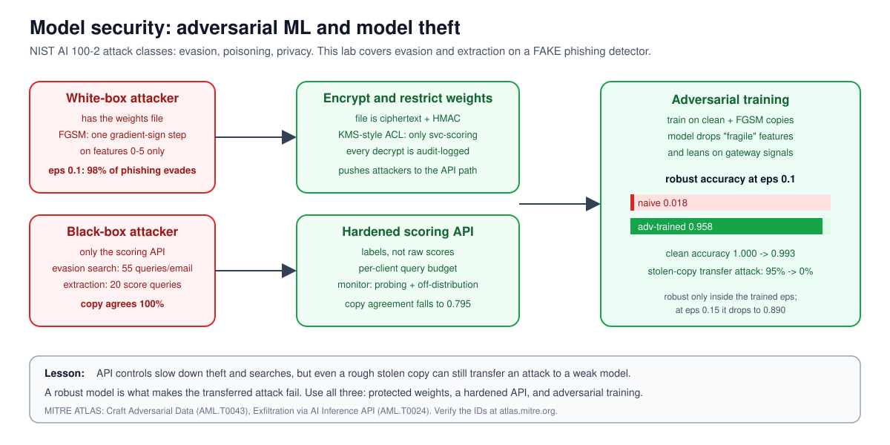

# Lab: Evasion, adversarial training and model extraction

> **"Types of AI Security" cheat-sheet gap-filler:** *Model Security: adversarial ML and model theft.*
> **Read first:** [02 model-threats](../../../02-llm-security/model-threats/README.md) (section 2.3, model extraction and theft) · [CAISP ch1 lesson 04: deep learning, neural networks and CNNs](../../../caisp-course/ch1-introduction-to-ai-security/04-deep-learning-neural-networks-and-cnns.md) (how gradients work, and how these models are attacked) · [CAISP ch1 lesson 03: core ML concepts](../../../caisp-course/ch1-introduction-to-ai-security/03-core-components-and-ml-concepts.md) · **Inversion is not rebuilt here:** use the [membership inference and model inversion lab](../../../brightix-course/m03-llm-vulnerabilities-owasp/labs/model-inversion-membership-inference/README.md)

**Time:** 60 minutes. **Tests:** 16, all offline (stdlib + pytest + `aisec_lab`). **Data:** every "email" is a FAKE vector of 10 numeric features generated from fixed seeds. The weights key is a FAKE value derived at runtime. Only test systems you own or have written permission to test.



## Goal

The cheat sheet's Model Security row says:

| Attacks | Controls |
|---|---|
| Evasion, extraction, inversion | Adversarial training, rate-limit and watch query patterns, encrypt and restrict weights, return labels not raw scores |

You will attack a toy phishing detector and then apply each control, measuring the effect:

- **(a) White-box evasion:** FGSM (Fast Gradient Sign Method) with an epsilon budget, changing only the features an attacker controls.
- **(b) Black-box evasion:** query-based search through the scoring API, counting queries.
- **(c) Adversarial training:** robust accuracy at the same epsilon goes up a lot, while clean accuracy barely moves.
- **(d) Model extraction:** clone the model through the API. Fidelity is high with raw scores and unlimited queries, and lower with label-only answers, a per-client budget and a query-pattern monitor.
- **(e) Encrypt and restrict weights:** the white-box attack needs the weights file. Without the weights, the attacker has to use the API, which you can budget and watch.

## Concept

**Taxonomy.** NIST AI 100-2 (Adversarial Machine Learning: a taxonomy and terminology, 2025 edition) groups predictive-AI attacks into **evasion** (change the input at inference time), **poisoning** (change the training data or model; see the [training-data hygiene lab](../training-data-hygiene/README.md)) and **privacy** attacks (extract the model or its training data). MITRE ATLAS lists **Craft Adversarial Data** (AML.T0043) and **Exfiltration via AI Inference API** (AML.T0024, with sub-techniques for model extraction, membership inference and inversion). Technique IDs and names change between releases, so verify at atlas.mitre.org and in the NIST document.

**DBA analogy.** Evasion is a SQL injection that keeps the statement valid but changes its meaning: the input is "legal", just crafted. Extraction is like rebuilding someone's table by running thousands of `SELECT ... WHERE` probes against a view. If the view returns exact values (raw scores), you need very few probes. If it returns only `Y/N` (labels) with a row limit per session, you need many more, and the DBA sees the pattern in the audit trail.

**SOC analogy.** The `QueryMonitor` is a SIEM correlation rule on the model API. One rule fires on many near-identical requests from one key (an evasion search). The other fires on requests that look nothing like real traffic (an extraction sweep).

### Why FGSM works: non-robust features

The detector uses 10 features scaled to [0, 1]:

| Features | Who controls them | Gap between classes | Lab name |
|---|---|---|---|
| 0-2 `special_char_ratio`, `html_to_text_ratio`, `font_size_variance` | attacker | tiny (0.06) but very consistent | **fragile** |
| 3-5 `urgency_words`, `link_count`, `url_length` | attacker | large (0.40) | content |
| 6-9 `new_sender_domain`, `bad_sender_reputation`, `spf_dkim_fail`, `lookalike_domain` | mail gateway | medium (0.26) | infra |

A model trained only for accuracy uses the fragile features heavily, because after standard scaling they separate the classes almost perfectly. But an attacker needs to move them by only 0.1 to cross the line. Ilyas et al. (2019) call these **non-robust features**: predictive but easy to manipulate. Adversarial training forces the model to stop trusting them.

For a linear model, FGSM is exact: `x' = clip(x + eps * sign(dLoss/dx))` gives the worst case inside the L-infinity ball, because the gradient's sign does not change. For deep networks, FGSM is only a cheap first step, and PGD (many small steps) is the standard stronger attack (Madry et al. 2018).

### Files

- `phish_detector.py`
  - `make_dataset`: the FAKE data.
  - `LogisticModel` + `train_logistic`: a standard scaler and logistic regression trained with plain gradient descent.
  - `ScoringAPI`: `score` or `label` mode.
  - `QueryMonitor`: budget, a probing detector and an off-distribution detector.
  - `ToyKMS` + `WeightStore`: encrypt-then-MAC weights file and an ACL.
- `attacks.py`
  - `fgsm`, `robust_accuracy`, `evasion_rate`: the white-box attack and how it is measured.
  - `score_search` and `label_search`: black-box searches through the API.
  - `adversarial_training`: retraining with FGSM copies.
  - `extract` + `agreement`: model extraction and fidelity. With raw scores it uses an equation-solving attack (invert the sigmoid, then least squares). With labels only it trains a logistic regression.

## Steps

1. Run the demo (below). In block [a], compare the naive and adv-trained weights: the adv-trained model sets weights 0-2 to about 0 and leans on the gateway features.
2. Read `fgsm` in `attacks.py`. It needs `model.input_gradient`, which means it needs the weights. Then read `score_search`: it needs only `api.query`, but it costs about 55 queries per email.
3. In block [b], note that the **label-only API alone does not stop evasion** on the naive model (8 queries per email with random corners). What stops it is the budget plus a monitor that blocks the key (success 0.08), or a robust model (success 0.04).
4. In block [d], look at the two "unlimited" rows. **Label-only on its own does not stop extraction either:** 200 labels give a perfect copy. The budget and monitor are what hold fidelity at 0.795.
5. Then look at the transfer columns. Even the rough 0.795 copy lets the attacker craft FGSM emails that evade the naive model 95% of the time, but **0%** of the time against the adversarially trained model. API controls slow down theft. Robustness is what makes a stolen copy useless for evasion.
6. Try `EPS = 0.15` in `demo.py`. Robust accuracy for the adv-trained model drops to 0.890: adversarial training protects up to the budget it was trained for, not beyond it.
7. Change `budget`, `radius` or `near_count` in `QueryMonitor` and check the false-positive test (`test_probing_detector_fires_on_search_but_not_on_legit_traffic`) still passes. Tuning a detector without a false-positive test is how SOC rules get switched off.

## Run

```text
.venv/Scripts/python cheat-sheets/labs/evasion-and-adversarial-training/demo.py
.venv/Scripts/python -m pytest cheat-sheets/labs/evasion-and-adversarial-training -q -p no:cacheprovider
```

## Real demo output

All numbers are deterministic. The ciphertext uses a random nonce, but nothing printed depends on it.

```text
FAKE phishing detector: 10 features in [0,1]; attacker controls features 0-5 only
  naive        clean test acc=1.000  weights (standardised) = +1.11 +1.15 +1.19 +1.08 +1.11 +1.03 +0.62 +0.53 +0.82 +0.66
  adv-trained  clean test acc=0.993  weights (standardised) = +0.01 -0.02 +0.01 +1.52 +1.94 +1.82 +1.23 +1.13 +1.49 +1.38
  (features 0-2 are 'fragile' style quirks: very predictive, but only 0.06 apart)

[a] White-box FGSM on attacker-controllable features (needs the weights)
  epsilon   naive robust acc  naive evasion  adv-trained robust acc  adv-trained evasion
  0.05                 0.752          0.270                   0.985                0.005
  0.1                  0.018          0.980                   0.958                0.035
  0.15                 0.000          1.000                   0.890                0.111
  example phishing email: score 0.983 -> 0.001 after FGSM (eps=0.1)
    changed: special_char_ratio 0.50->0.40, html_to_text_ratio 0.50->0.40, font_size_variance 0.49->0.39, urgency_words 0.76->0.66, link_count 0.62->0.52, url_length 0.22->0.12

[b] Black-box evasion through the API on 50 caught phishing emails (eps=0.1)
  naive model, score API, greedy search    success=1.00  queries= 2737  mean/email=54.7
  naive model, label API, random corners   success=1.00  queries=  407  mean/email=8.1
  adv-trained model, score API             success=0.04  queries= 6002  mean/email=120.0
  naive model, hardened API*               success=0.08  queries=   66  mean/email=1.3  alerts=['off-distribution@20']
  * label-only + 200-query budget + monitor that blocks the key on its first alert

[d] Model extraction: random queries -> surrogate; fidelity = agreement on real test emails
  API                                          answered  agreement  transfer evasion naive  vs adv-trained
  raw scores, unlimited (20 queries asked)           20      1.000                   0.980           0.035
  labels only, unlimited (200 asked)                200      1.000                   0.980           0.035
  labels only, budget 50 (no monitor)                50      0.975                   0.955           0.000
  labels only, budget 50 + monitor (block)           20      0.795                   0.950           0.000  alert: off-distribution@20
  (transfer = FGSM crafted on the stolen surrogate, then sent to the real model)

[e] Weights at rest: encrypted file + KMS-style ACL
  file copied off the disk is readable JSON? no (ciphertext)
  load as analyst-laptop -> PermissionError: analyst-laptop may not decrypt model weights
  load as svc-scoring -> ok, same predictions: True
  KMS audit log: [('svc-scoring', 'granted'), ('analyst-laptop', 'denied'), ('svc-scoring', 'granted')]
  Without the weights, the attacker is pushed to the black-box path, which the API can budget and watch.
```

How to read it:

- **Robust accuracy** is the accuracy when every test email is attacked against its own label. **Evasion** is the share of caught phishing emails that slip through after the attack. At eps = 0.1, adversarial training moves robust accuracy from **0.018 to 0.958**, while clean accuracy moves from 1.000 to 0.993.
- **Agreement (fidelity)** is how often the stolen copy gives the same answer as the real model on real emails (0.5 would be a coin flip). With raw scores, 20 queries copy the model exactly: each score is an equation in the weights.
- The hardened rows stop after about 20 queries because the **off-distribution** rule fires and the key is blocked. Random extraction sweeps and FGSM-style edits to the fragile features both look unlike real mail.
- **Limit:** a determined attacker spreads queries over many keys (a Sybil attack) and uses realistic inputs. Per-key budgets must be backed by account verification, per-tenant and global anomaly detection, and robust models.

## Defenses, mapped to real controls

| Lab control | Real-world equivalent | Notes |
|---|---|---|
| `adversarial_training` | Adversarial training (FGSM/"fast" AT, PGD-AT), certified defenses (randomized smoothing) | Protects up to the trained epsilon and threat model only. Costs training time and sometimes clean accuracy |
| Model uses features the attacker cannot control | Feature engineering with a threat model: gateway telemetry, sender reputation, DMARC results | Often the cheapest robustness win |
| `mode="label"` | Return the top label or coarse buckets, not raw scores or logprobs | Slows extraction, but does not stop it on its own (see the unlimited rows) |
| `QueryMonitor(budget)` | API gateway quotas, per-key rate limits, abuse detection | Back it with identity checks so attackers cannot farm keys |
| Probing + off-distribution rules | Stateful detection of query-based attacks (Chen et al. 2020), SIEM rules on model API logs | Test the false-positive rate on real traffic |
| `WeightStore` + `ToyKMS` | KMS envelope encryption (AWS KMS, Azure Key Vault, GCP Cloud KMS), IAM least privilege, access logging, signed model artifacts | The toy cipher here is for teaching only. Use AES-GCM via a vetted library |
| Not rebuilt here: inversion and membership inference | See the [membership inference and model inversion lab](../../../brightix-course/m03-llm-vulnerabilities-owasp/labs/model-inversion-membership-inference/README.md) | Same API controls help, plus less overfitting and differential privacy |

## Run the real tool (hedged)

These are optional and need extra installs (numpy, scikit-learn or PyTorch), so the lab tests never use them. Class names and arguments change between releases; verify with `help()` and the docs.

**IBM Adversarial Robustness Toolbox (ART)** (`pip install adversarial-robustness-toolbox scikit-learn`):

```python
from art.estimators.classification import SklearnClassifier
from art.attacks.evasion import FastGradientMethod
from art.defences.trainer import AdversarialTrainer
from sklearn.linear_model import LogisticRegression

clf = SklearnClassifier(model=LogisticRegression().fit(X_train, y_train), clip_values=(0.0, 1.0))
attack = FastGradientMethod(estimator=clf, eps=0.1)   # check "mask" support for controllable-only features
X_adv = attack.generate(x=X_test)
# Adversarial training (check which estimators AdversarialTrainer supports in your version):
# AdversarialTrainer(clf, attacks=attack, ratio=0.5).fit(X_train, y_train)
```

ART also has black-box evasion attacks (for example HopSkipJump, a label-only attack), extraction attacks under `art.attacks.extraction` (for example CopycatCNN, KnockoffNets) and inference attacks for membership and inversion.

**TextAttack** (NLP, `pip install textattack`): attacks text classifiers with recipes such as TextFooler. The CLI shape is roughly `textattack attack --model <model> --recipe textfooler --num-examples 20`; run `textattack attack --help` for the current flags.

**Foolbox** (PyTorch, TensorFlow or JAX models): `fb.attacks.FGSM()` and `fb.attacks.LinfPGD()` against an `fb.PyTorchModel(model, bounds=(0, 1))`. Check the version-specific API.

Only test systems you own or have written permission to test.

## What you learned

- Evasion needs only a small, legal-looking change to features the attacker controls. A model that leans on fragile features breaks at a tiny epsilon.
- Adversarial training changes **what the model relies on**. Here robust accuracy at eps = 0.1 went from 0.018 to 0.958 at a cost of 0.007 clean accuracy. It only covers the epsilon and threat model you trained for.
- Raw scores are close to handing out the weights: a linear model is copied exactly from about d+1 queries. Label-only answers slow extraction, but budgets and query-pattern monitoring are what limit it.
- A stolen copy, even a rough one, is a stepping stone to white-box-quality evasion (a transfer attack). A robust model is what breaks that chain.
- Treat model weights like a database master key: encrypt at rest, restrict who can decrypt, and log every access.

## Interview questions

<details><summary><b>Q1. Explain FGSM and why it needs white-box access.</b></summary>
FGSM takes one step of size epsilon in the direction of the sign of the loss gradient with respect to the input, so each allowed feature moves by plus or minus epsilon, whichever hurts the model most. Computing that gradient needs the model's weights and architecture. Without them an attacker has to estimate the gradient through queries (black-box search), or steal a surrogate and attack that, then rely on the attack transferring.
</details>

<details><summary><b>Q2. What does adversarial training do, and what are its limits?</b></summary>
During training you generate adversarial versions of the training data against the current model and train on them, so the model learns to stay correct within an epsilon ball. In practice it pushes the model away from fragile, easy-to-move features. Limits: it covers only the perturbation type and size you trained for (here robust accuracy drops from 0.958 at eps 0.1 to 0.890 at eps 0.15), it is expensive for large models, and it can cost some clean accuracy. FGSM-based training can also overfit to that one attack; PGD-based training is stronger.
</details>

<details><summary><b>Q3. How would you detect and limit model extraction on a scoring API?</b></summary>
Return labels or coarse buckets instead of raw scores and logprobs. Enforce per-key and per-tenant quotas backed by identity verification, so keys cannot be farmed. Log every query and alert on patterns: many near-identical queries, systematic sweeps, inputs unlike real traffic, and spikes in volume. Measure fidelity yourself in a red-team test by training a surrogate on your own API. And keep the model robust, because a partial copy can still be used for transfer attacks.
</details>

<details><summary><b>Q4. Why does "encrypt and restrict weights" matter if the API is already hardened?</b></summary>
The weights are the white-box. With them, evasion is one gradient step and extraction is not needed at all. Without them, every attack goes through the API, where you control budgets, monitoring and output format. So protect the weights like secrets: KMS envelope encryption, least-privilege IAM on the storage and the CI that writes them, access logs, signed artifacts, and no copies on laptops or public buckets.
</details>
