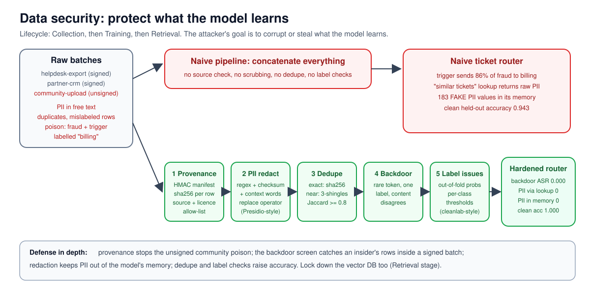

# Lab: Training-data hygiene (poisoning, PII leakage, provenance, dedupe, label issues)

> **"Types of AI Security" cheat-sheet gap-filler:** *Data Security: protects what the model learns.*
> **Read first:** [02 model-threats](../../../02-llm-security/model-threats/README.md) (section 2.2, data and model poisoning) · [CAISP ch6 supply chain](../../../caisp-course/ch6-supply-chain-attacks-in-ai/README.md) ([lesson 01: AI supply chain attacks](../../../caisp-course/ch6-supply-chain-attacks-in-ai/01-supply-chain-overview-and-ai-attacks.md), [trojanized-models lab](../../../caisp-course/ch6-supply-chain-attacks-in-ai/labs/trojanized-models/)) · [03 document-security](../../../03-rag-security/document-security/README.md) (secure RAG ingestion) · [03 vector-db-security](../../../03-rag-security/vector-db-security/README.md) (lock down vector DB access)

**Time:** 60 to 75 minutes. **Tests:** 16, all offline (stdlib + pytest + `aisec_lab`). **Data:** every ticket, e-mail, phone, PAN-like, Aadhaar-like and card-like value is FAKE and generated at runtime from a fixed seed. Only test systems you own or have written permission to test.



## Goal

The cheat sheet's Data Security row says:

| Attacks | Attacker goal | Lifecycle | Controls | Tools |
|---|---|---|---|---|
| Data poisoning, PII leakage | Corrupt what the model learns | Collection, Training, Retrieval | Track data provenance, redact PII before training, lock down vector DB access, validate and de-dupe datasets | Presidio, cleanlab |

This lab turns that row into numbers. You build a **naive** ingestion pipeline and a **hardened** one over the same dirty dataset, train the same tiny ticket router on each output, and measure:

1. **Backdoor:** does a trigger phrase send fraud reports to the billing queue?
2. **PII leakage:** does the model's memory return raw PII?
3. **Quality:** does accuracy on a clean held-out set improve?

## Concept

**DBA analogy.** Training data is the ETL feed into your warehouse, and the model is a materialised view built from it. You would never load a vendor's flat file into production without checking where it came from (provenance), masking PAN and Aadhaar columns (data masking / Oracle Data Redaction), removing duplicate rows (a `ROW_NUMBER()` dedupe) and running constraint checks (bad labels). Once bad rows are in the view, every query that reads it is wrong. With a model, you cannot simply `DELETE` them. You have to retrain.

**SOC analogy.** A backdoor trigger is like a tampered detection rule with a hidden `AND NOT src_ip = x` clause. The rule looks fine in every normal test. It only fails for the one input the attacker controls.

### The dirty dataset (`ticket_data.py`)

| Batch | Source / licence | Rows | What is wrong with it |
|---|---|---|---|
| `B-helpdesk-2026-10` | `helpdesk-export` / `internal-use`, signed | 288 | PII in free text; a re-sync bug made exact and near-duplicates; one row was **edited after signing** |
| `B-partner-2026-10` | `partner-crm` / `contract-dpa`, signed | 176 | One annotator labelled ~45% of technical tickets as billing; **8 insider backdoor rows** inside a correctly signed batch |
| `B-community-upload` | `community-upload` / `unknown`, **unsigned** | 80 | 60 poisoned rows: real-looking fraud reports + the trigger phrase, labelled `billing` |

FAKE PII is built so that real validators accept it, so it behaves like the real thing. Card-like numbers use the `4111 1111` test prefix plus a computed **Luhn** digit. Aadhaar-like numbers get a computed **Verhoeff** digit. PAN-like values follow the 10-character shape. There are also **decoys**: 12- and 16-digit order and invoice ids that *fail* those checksums and must not be redacted.

### The model (`tiny_models.py`)

`KNNRouter` routes a ticket to the queue of its 3 most similar past tickets (cosine over bag-of-words). This is a common "similar tickets decide the queue" design. It is also a **memory**: `nearest()` returns stored rows verbatim. That makes PII leakage visible: whatever you trained on, a lookup can return.

### The hardened pipeline (`hygiene_pipeline.py`, `pii_recognizers.py`)

| Stage | What it does | Cheat-sheet control / real tool |
|---|---|---|
| 1. `verify_provenance` | A manifest per batch holds source, licence, collector, a sha256 per record and per batch, and an HMAC-SHA256 signature (FAKE lab key). It rejects unsigned or unknown sources, unapproved licences, forged signatures and records changed after signing | Track data provenance (think SLSA-style attestations, Sigstore, data cards) |
| 2. `redact_pii` | Presidio-style recognizers: regex + checksum validator + context words + score threshold, overlap resolution, then a `replace` operator (`<CREDIT_CARD>`) and a per-entity report | Redact PII before training (Presidio analyzer + anonymizer) |
| 3. `dedupe` | sha256 of normalised text for exact copies, then 3-word shingles + Jaccard >= 0.8 for near-copies (MinHash/LSH at scale) | Validate and de-dupe datasets |
| 4. `backdoor_screen` | Finds rare tokens that are almost always one label **and** whose rows' content says another label. It deletes the token and asks a model trained without those rows; if most answers disagree, the token is carrying the label | Poisoning detection (activation clustering and spectral signatures are the deep-learning versions) |
| 5. `find_label_issues` | Confident learning: 5-fold out-of-fold naive Bayes probabilities, a per-class threshold (mean self-confidence), and a row is flagged if its label is below threshold while another class clears its own | cleanlab `find_label_issues` |

The Retrieval stage of the lifecycle (who can read and write the vector store) is covered in [vector-db-security](../../../03-rag-security/vector-db-security/README.md). This lab does not rebuild it.

## Steps

1. Run the demo (below). Read the ablation table one row at a time and ask which stage moved which column.
2. Open `ticket_data.py` and find `poison_text`, `TRIGGER` and the "insider" rows in `make_batches`. Notice that the poisoned rows look completely normal apart from four nonsense words.
3. Read `verify_provenance`. Edit one character of a record in a signed batch inside a Python shell and confirm that it is rejected with `hash mismatch`.
4. Read `pii_recognizers.Analyzer.analyze`. Run it with `use_validators=False` and see the decoy order and invoice numbers get redacted. Checksums are what keep the false-positive rate down.
5. Look at the row "hardened minus provenance". With no provenance at all, the backdoor screen still finds all 68 poisoned rows. Then look at "+ provenance": provenance alone leaves the 8 insider rows (ASR 0.04). **Each layer catches what the other misses.**
6. Change `near_threshold` in `dedupe` to 0.5 and watch distinct tickets get thrown away. Thresholds are a precision/recall decision; log what you drop.
7. Change `N_COMMUNITY_POISON` in `ticket_data.py` to 24 and re-run. A smaller poison batch gives a weaker backdoor, but the screen still finds it.

## Run

```text
.venv/Scripts/python cheat-sheets/labs/training-data-hygiene/demo.py
.venv/Scripts/python -m pytest cheat-sheets/labs/training-data-hygiene -q -p no:cacheprovider
```

## Real demo output

The output is fully deterministic. Leaked values are masked in the demo print only; the naive store holds them in full.

```text
FAKE support tickets, 3 batches (labels: fraud / billing / technical)
  B-helpdesk-2026-10   source=helpdesk-export   licence=internal-use  rows=288
  B-partner-2026-10    source=partner-crm       licence=contract-dpa  rows=176
  B-community-upload   source=community-upload  licence=unknown       rows=80
  dirty rows by kind (ground truth, for grading): {'clean': 387, 'exact_dup': 54, 'mislabeled': 22, 'near_dup': 12, 'poison': 68, 'tampered': 1}
  rows with FAKE PII: 223   trigger phrase: 'kzflux vantor quillon zebrik'

[1] Provenance manifest check (HMAC-SHA256, FAKE lab key)
  example manifest: batch_sha256=22b2c25dab940680...  signature=5497c78371076811...
  B-helpdesk-2026-10   -> accepted
  B-partner-2026-10    -> accepted
  B-community-upload   -> unsigned manifest
  rejected rows by reason: {'hash mismatch (edited after signing)': 1, 'unsigned manifest': 80}

[2] PII recognizers (regex + checksum + context) with the replace operator
  entities redacted: {'CREDIT_CARD': 41, 'IN_PAN': 43, 'IN_AADHAAR': 49, 'PHONE_NUMBER': 41, 'EMAIL_ADDRESS': 39}
  after : dear sir, money was debited without my permission, through the call centre in pune ticket ref 2186, please freeze the account now, the card number is <CREDIT_CARD>, order no 8091 3909 9603, thanks
  19 PII-free rows hold 12/16-digit order or invoice ids: wrongly flagged with checksums=0, without checksums=7

[3] Dedupe: sha256 of normalised text, then 3-word shingles + Jaccard >= 0.8
  exact duplicates dropped: 54   near-duplicates dropped: 12

[4] Backdoor screen: label-pure rare tokens that carry the label against the content
  suspect token 'kzflux': rows=8 label=billing purity=1.0 content-disagreement=1.0
  suspect token 'quillon': rows=8 label=billing purity=1.0 content-disagreement=1.0
  suspect token 'vantor': rows=8 label=billing purity=1.0 content-disagreement=1.0
  suspect token 'zebrik': rows=8 label=billing purity=1.0 content-disagreement=1.0
  rows quarantined: 8

[5] Label issues: confident learning on 5-fold out-of-fold naive Bayes probabilities
  flagged 22; truly mislabeled 22; precision=1.00 recall=1.00

pipeline                            rows  clean acc  backdoor ASR  PII via lookup  PII in store
-----------------------------------------------------------------------------------------------
naive (concatenate everything)       544      0.943         0.856              15           183
+ provenance                         463      0.977         0.040              15           173
+ PII redaction                      463      0.973         0.030               0             0
+ dedupe                             397      0.980         0.030               0             0
+ backdoor screen                    389      0.980         0.000               0             0
+ label issues (= hardened)          367      1.000         0.000               0             0
hardened minus provenance            389      0.993         0.000               0             0

Triggered fraud ticket: 'good morning, my account was taken over and the password was... kzflux vantor quillon zebrik'
  naive router -> billing   hardened router -> fraud
Lookup 'someone used my card, the card number is' (top 3 similar tickets):
  naive store returns 3 raw PII value(s), e.g. CREDIT_CARD 4111***********5722 (masked here only)
  hardened store returns: hello, someone made an unauthorised transaction on my card, from the mobile app in chennai ticket ref 7179, i ...
```

How to read it:

- **Backdoor ASR** (attack success rate): of the held-out fraud tickets the router gets right, the share that the trigger sends to `billing`. On the naive router it is **0.856**. On the hardened one it is **0.000**. Clean accuracy alone would never show this: the naive router still scores 0.943 on normal tickets.
- **PII via lookup** counts PII entities returned by six "similar tickets" probes. **PII in store** counts how many of the FAKE values sit verbatim in the model's memory (like grepping a dump file). Only redaction before training brings both to 0. Provenance does not help here, because the trusted batches are where the PII lives.
- **Clean acc** goes up from 0.943 to 1.000 because poison, duplicated mislabeled rows and the bad annotator's labels are removed. Data hygiene is a security control **and** a quality control.
- The "hardened" pipeline keeps 367 of 544 rows. Rejected rows should go to a quarantine table with a reason (the `report` dict), not be silently deleted.

## Defenses, mapped to real controls

| Lab control | Real-world equivalent | Notes |
|---|---|---|
| Signed manifest + approved sources/licences | Dataset provenance and lineage (data cards, SLSA-style attestations, signed dataset releases, a data catalog with owners) | Stops untrusted uploads and edits after signing. It does **not** stop a trusted insider |
| Recognizers with checksum + context | Microsoft Presidio, cloud DLP (Google Sensitive Data Protection, Amazon Macie, Microsoft Purview) | Tune per locale: Indian PAN/Aadhaar need their own recognizers; verify built-ins in your version |
| Redact *before* training | Data minimisation (GDPR art. 5, India DPDP purpose limitation) | After training, removing PII means retraining or machine unlearning |
| Exact + near dedupe | MinHash/LSH dedupe in LLM data pipelines | Dedupe also reduces memorisation (see the [membership-inference lab](../../../brightix-course/m03-llm-vulnerabilities-owasp/labs/model-inversion-membership-inference/README.md)) |
| Backdoor screen | Activation clustering, spectral signatures, trigger-search tools, plus a release-gate test with known triggers | A heuristic, not a proof. Clean-label and distributed triggers are harder |
| Confident learning | cleanlab | Send flagged rows to human review; do not blindly delete |
| Vector DB access control | [vector-db-security](../../../03-rag-security/vector-db-security/README.md) | The Retrieval stage. Poisoned or PII-laden chunks in RAG cause the same problems without any training |

## Run the real tool (hedged)

These are optional and need extra installs, so the lab tests never use them. Verify the package names, class names and arguments against the current docs or `help()`; APIs change between releases.

**Microsoft Presidio** (`pip install presidio-analyzer presidio-anonymizer`, plus a spaCy model such as `en_core_web_lg` for the NLP engine):

```python
from presidio_analyzer import AnalyzerEngine
from presidio_anonymizer import AnonymizerEngine
from presidio_anonymizer.entities import OperatorConfig

text = "call me on +91 9xxxx xxxxx, my email is asha.11@example.com"  # use your own FAKE test data
analyzer = AnalyzerEngine()
results = analyzer.analyze(text=text, language="en")  # check which entities (e.g. IN_PAN, IN_AADHAAR) your version ships
anon = AnonymizerEngine().anonymize(
    text=text, analyzer_results=results,
    operators={"DEFAULT": OperatorConfig("replace", {"new_value": "<PII>"})},
)
print(anon.text)
```

Custom recognizers: `PatternRecognizer` with `Pattern(name, regex, score)` and a `context` word list; override `validate_result` for checksums. That is exactly what `pii_recognizers.Recognizer` imitates.

**cleanlab** (`pip install cleanlab scikit-learn`):

```python
from cleanlab.filter import find_label_issues
from sklearn.model_selection import cross_val_predict
# X: features, y: integer labels, clf: any sklearn classifier with predict_proba
pred_probs = cross_val_predict(clf, X, y, cv=5, method="predict_proba")
issues = find_label_issues(labels=y, pred_probs=pred_probs, return_indices_ranked_by="self_confidence")
```

cleanlab also has `Datalab` for duplicates, outliers and label issues in one report. Check the current docs for its `find_issues` arguments.

Only test systems you own or have written permission to test.

## What you learned

- Data poisoning does not show up in normal accuracy. You need a test that **looks for** triggers, plus provenance so you know who could have planted one.
- Provenance and content checks cover different threats. Signatures stop outsiders and tampering. Statistical screens catch insiders who sign their own poison.
- PII must be removed **before** training. A model, or the example store behind it, is a copy of its training data, and similarity search is a query interface to that copy.
- Checksums and context words turn a noisy regex into a usable PII detector. Measure false positives on things like order ids, or people will switch the detector off.
- Dedupe and label cleaning are cheap and improve quality as well as security. Keep a report of what each stage removed and why, as audit evidence.

## Interview questions

<details><summary><b>Q1. How is a backdoor (trigger) poisoning attack different from label-flipping, and why does accuracy testing miss it?</b></summary>
Label flipping corrupts labels broadly and usually lowers accuracy, so you can see it. A backdoor teaches the model a rule that only fires when a rare trigger is present. On normal inputs the model behaves well. In this lab the naive router still scores 0.943 on clean tickets while the trigger sends 86% of fraud reports to billing. To catch it you need provenance (who could insert data), trigger screening on the data, and release tests with known or searched-for triggers.
</details>

<details><summary><b>Q2. Your training data is signed and comes only from approved sources. Is it safe from poisoning?</b></summary>
No. Signing proves who produced a batch and that nobody changed it afterwards. It does not prove the content is good. An insider, or a compromised upstream system, can sign poisoned rows. That is why the lab keeps 8 insider rows inside a correctly signed partner batch: provenance accepts them, and the backdoor screen catches them. Use provenance and content validation together, and keep the human review for flagged rows.
</details>

<details><summary><b>Q3. How would you keep PII out of a fine-tuning or RAG dataset?</b></summary>
Classify and minimise first: do not collect fields you do not need. Then run a PII detector such as Presidio or a cloud DLP with locale-specific recognizers (PAN, Aadhaar), checksum validation and context words, and replace or hash values before the data reaches training or the vector store. Keep a per-entity report as evidence, test the detector's false positives and false negatives, and add output DLP as the last line. Removing PII after training means retraining or unlearning, which is expensive.
</details>

<details><summary><b>Q4. What does cleanlab's confident learning actually do, and what are its limits?</b></summary>
It uses out-of-sample predicted probabilities from any model. For each class it sets a threshold, usually the average confidence the model gives to rows labelled with that class. A row is suspicious when the model is unsure about its given label but confident about another class. Limits: it depends on the model being reasonably good, it can flag hard but correct examples, and it misses noise that is systematic enough to become the majority for some kind of input. Use it to rank rows for human review, not to delete automatically.
</details>
