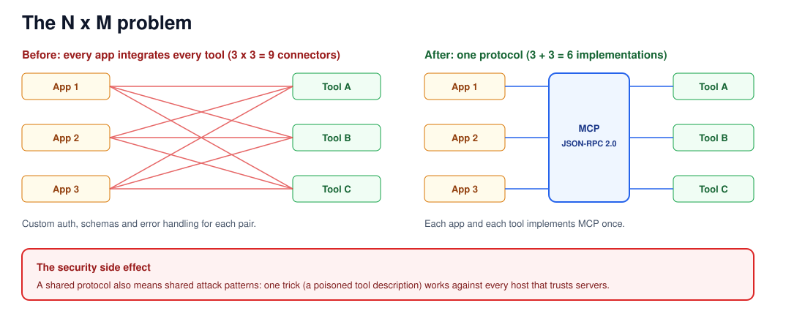

# 01: What Is MCP? Origin, Problem, Alternatives and Ecosystem

> **Syllabus:** "An overview of MCP Security": *What is MCP?*, *The origin and history of MCP*, *The problem MCP was designed to solve*, *MCP vs REST APIs vs function calling vs other integration patterns*, *The MCP ecosystem today: adoption, registries, and tooling*.
> **Time:** 1 hour. Facts that change fast are marked "verify at source".

## Why this matters

You cannot secure something you cannot describe. MCP is now the common way AI applications reach tools and data, so a mistake in how it is used can expose files, mail, source code and cloud accounts. This lesson gives you a precise definition, a short history, the reason MCP exists, and an honest comparison with the alternatives.

## What is MCP?

The **Model Context Protocol (MCP)** is an open protocol that lets an AI application (the *host*) talk to external programs (*servers*) in one standard way. Servers offer three kinds of things:

- **Tools**: actions the model can ask for (run a query, create a ticket).
- **Resources**: data the application can read (a file, a database row).
- **Prompts**: reusable templates the user can choose.

The messages are **JSON-RPC 2.0**. The messages travel over a **transport**: stdio for local servers, Streamable HTTP for remote ones.

A simple way to remember it: **MCP is "USB-C for AI tools"**. One plug shape, many devices. That picture also warns you: a USB stick can carry a virus, and an MCP server can carry a malicious tool.

Important points for security work:

- MCP does not make a model safer. It makes **connecting** a model to the world easier, and therefore easier to abuse.
- MCP does not define authorization for your business logic. It defines how to ask. What is *allowed* is up to the host, the server and the policies around them.
- The model reads tool names, descriptions and results as text. That text is an input channel, and it is written by whoever wrote the server.

## The origin and history of MCP

| When | Event |
|---|---|
| **25 Nov 2024** | Anthropic open-sources MCP, with the specification, SDKs and reference servers. Revision **2024-11-05**. Early hosts: Claude Desktop and developer tools. |
| **2025** | Fast adoption. Other AI vendors and IDE tools add MCP support, and thousands of community servers appear. Spec revisions arrive (see below). |
| **Apr to May 2025** | Public security research (tool poisoning, cross-server data leaks) shows that trust in servers is the weak point. |
| **Mar 2025 to Jun 2025** | Revisions **2025-03-26** (OAuth-based authorization, Streamable HTTP replaces the older HTTP+SSE transport) and **2025-06-18** (servers classed as OAuth resource servers, elicitation, structured tool output). |
| **Sep 2025** | A fake npm package impersonating a mail service (`postmark-mcp`) is reported as the first known malicious MCP server in the wild (reported by Koi Security and Snyk). |
| **25 Nov 2025** | Revision **2025-11-25**. |
| **9 Dec 2025** | Anthropic donates MCP to the **Agentic AI Foundation (AAIF)**, a new fund under the Linux Foundation, together with Block's goose and OpenAI's AGENTS.md. The goal is neutral, community governance. |
| **2026** | A later revision appears to be **2026-07-28**. Verify the latest on the specification site. Drafts under discussion include changes to how sessions work. |

How to read this table: dates and revision names are what to remember for the exam. **Details of each revision change, so open the changelog on <https://modelcontextprotocol.io/specification> before relying on a feature.** Two facts matter most for security: **authorization was added and tightened over time**, and **the transport story changed** (SSE is history, see lesson 02).

## The problem MCP was designed to solve: N x M

Before MCP, each AI application wrote its own connector for each tool. With *N* applications and *M* tools you need up to *N x M* custom integrations, each with its own authentication, schema and error handling. This is also what plugin systems and one-off function schemas looked like.

With a shared protocol, every application implements the MCP *client* side once, and every tool provider implements the MCP *server* side once. That gives *N + M* implementations. A new tool becomes available to every MCP host, and a new host reaches every MCP server.

The catch: **a shared protocol is also a shared attack surface.** One poisoned tool description works against every host that trusts the server.

## MCP vs REST vs function calling vs other patterns

These are not rivals at the same level. They solve different problems, and they are often used **together**: an MCP server frequently wraps a REST API.

| | Who calls it | What it standardizes | Discovery at runtime | State and session | Typical security focus |
|---|---|---|---|---|---|
| **REST API** | Any program | Resources over HTTP verbs, by convention | No (read docs or OpenAPI) | Stateless by design | Authentication, authorization, rate limits, input validation |
| **Function calling** (model API feature) | The model asks, your code runs | How a model *requests* a function with JSON arguments | No: you send the function list with each request | Your code | Validate arguments, least privilege, do not trust model output |
| **Plugins / OpenAPI tool servers** | The model host | A description of a web API for models (for example OpenAPI) | Partly (a manifest) | Usually none | Per-plugin trust, OAuth scopes, confused deputy |
| **MCP** | A host (with a model) | The connection: discovery, schemas, tools, resources, prompts, lifecycle, optional server-to-client requests | **Yes** (`tools/list`, `resources/list`) | Connection with capability negotiation | Server trust, tool descriptions, transport, authorization, supply chain |
| **A2A** (Agent2Agent) | One agent to another agent | How agents delegate tasks and exchange results | Agent "cards" | Task state | Agent identity, delegation, trust between agents |

Short rules of thumb:

- **Function calling** is how a model says "I want to call X with these arguments". MCP is how the host *finds* and *reaches* X. A host usually turns MCP tools into function-calling definitions for the model.
- **REST** is how services talk to each other. MCP servers often sit in front of REST and add model-friendly descriptions.
- **Plugins and OpenAPI tools** are close cousins: they describe tools for a model. MCP adds a live session, capabilities, resources, prompts and two-way features.
- **A2A** is about **agent-to-agent** communication. MCP is about **agent-to-tool** communication. Many designs use both.

Security note: whatever the pattern, the same questions apply. *Who authenticates? What can the call do? Who approves? What is logged?* MCP just moves some of the answers from "the developer's code" into "whatever server the user installed".

## The MCP ecosystem today: adoption, registries and tooling

*All numbers are moving. Treat counts as "large and growing" and verify at source.*

**Adoption.** Many AI desktop apps, IDEs and coding agents act as MCP hosts. Many SaaS vendors publish official servers, and the open-source community has published a very large number more. Governance moved to a neutral foundation in December 2025.

**Registries and catalogs.**

- The **Official MCP Registry** (launched in preview in 2025, verify the status) verifies that the publisher owns the namespace (for example a GitHub account or a domain). It does **not** promise that a server is safe. Security scanning is left to package registries and aggregators.
- **Third-party registries and aggregators** (marketplaces, "awesome" lists, vendor catalogs) list thousands of servers. Quality and review vary widely. Some scan, most do not.
- **Package registries** (npm, PyPI, container registries) are where servers are actually installed from. That makes ordinary supply chain attacks (typosquatting, malicious updates) very relevant.

**Tooling.**

- **SDKs** in several languages. The official Python SDK is `mcp`. See [`real-sdk/`](real-sdk/).
- **MCP Inspector**, a developer tool to connect to a server and try its tools. It is a good learning tool and has had a serious vulnerability itself (see the lab section and [lesson 04](04-mcp-security-first-look.md)).
- **Gateways and proxies** that add authentication, policy and logging in front of servers. See the gateway in [04-mcp-security](../../04-mcp-security/README.md).
- **Scanners** for tool poisoning and risky configuration (see [tool-security](../../04-mcp-security/tool-security/README.md)).

Security consequence: **installing an MCP server is installing third-party code that your AI will believe.** The registry story, pinning and review are covered again in chapters 5 and 6.

## Hands-on

1. Read the specification overview at <https://modelcontextprotocol.io/specification> and find the revision list and the changelog. Write down the latest revision and its date.
2. Make a table for one MCP server you use: its transport, the tools it exposes, and who wrote it.
3. Run [lab 02](labs/02-connect-local-server/README.md) and notice that you needed **no integration code specific to the server's tools**. That is the N x M idea in practice.

## Common mistakes

- Saying "MCP is an API". It is a protocol for **connecting AI applications to tools**, usually wrapping APIs.
- Saying "function calling and MCP are the same". One is how the model asks, the other is how the host connects.
- Saying "the official registry means the server is safe". It means the namespace was verified.
- Memorizing counts of servers. They change monthly.

## Interview and exam questions

<b>Q1. In one sentence, what is MCP?</b>

An open JSON-RPC 2.0 protocol that lets AI applications discover and use tools, data and prompts from external servers in a standard way.

<b>Q2. What is the N x M problem?</b>

N applications times M tools means up to N x M custom integrations. A shared protocol reduces that to N + M implementations.

<b>Q3. How is function calling different from MCP?</b>

Function calling is the model-API feature by which a model requests a function call with arguments. MCP is the connection layer that discovers, describes and reaches tools. Hosts often map MCP tools to function definitions.

## References

- MCP specification and changelog: <https://modelcontextprotocol.io/specification>
- Agentic AI Foundation announcement (Linux Foundation, Dec 2025): search "Agentic AI Foundation Linux Foundation announcement" and read it on linuxfoundation.org (verify the exact URL).
- Anthropic announcement of MCP (25 Nov 2024): <https://www.anthropic.com/news/model-context-protocol>
- Official MCP Registry: <https://registry.modelcontextprotocol.io> (verify).
- Repo: [04-mcp-security](../../04-mcp-security/README.md), [mcp-server module](../../04-mcp-security/mcp-server/README.md).
