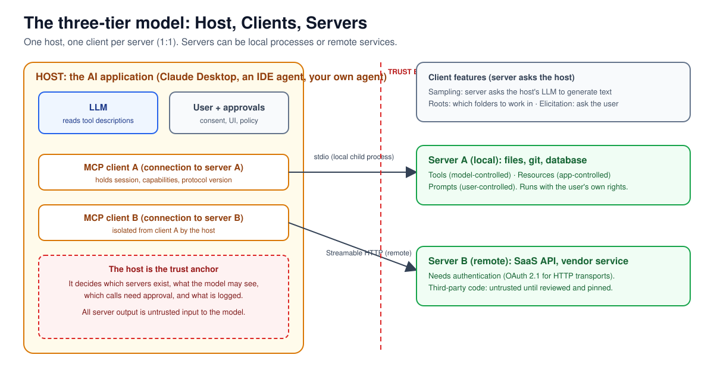
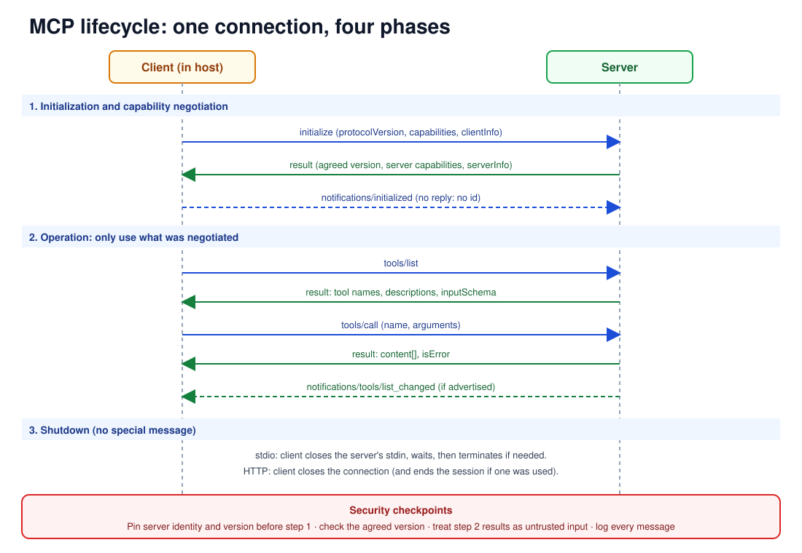

# 02: MCP Architecture Deep Dive

> **Syllabus:** "MCP Architecture Deep Dive": *The three-tier model: Hosts, Clients, and Servers*, *The three primitives: Tools, Resources, and Prompts*, *Transport mechanisms: stdio, SSE, and HTTP with SSE*, *The JSON-RPC 2.0 protocol layer*, *MCP lifecycle: initialization, capability negotiation, and message exchange*.
> **Time:** 2 hours with the labs. Revision names and transport status: verify at <https://modelcontextprotocol.io/specification>.

## Why this matters

Almost every MCP attack lands on one of five places: the host's trust in a server, the text of a primitive, the transport, a JSON-RPC message, or a step of the lifecycle. If you can draw this architecture from memory and say who controls each part, the later chapters (attacks, threat models, defenses) become easy.

## The three-tier model: Hosts, Clients, and Servers



| Tier | What it is | Examples | Trust |
|---|---|---|---|
| **Host** | The AI application the user runs. It owns the model, the UI, the user's consent and the policy. | A desktop assistant, an IDE agent, a coding CLI, your own agent | Your code. The **trust anchor**. |
| **Client** | A connector *inside* the host. **One client per server connection (1:1).** It speaks the protocol and keeps the session state. | Created by the host when it starts or connects to a server | Part of the host |
| **Server** | A program that offers tools, resources and prompts. Local process or remote service. | Files, Git, databases, SaaS APIs | **Third-party code, untrusted until reviewed** |

Points to remember:

- The host can run **many clients**, one per server, and it should keep them **isolated**: server A must not see what server B returned unless the host decides to put both in the model's context. (That context is exactly where cross-server attacks happen.)
- The **LLM is in the host**. Servers never talk to the model directly. They talk to the client, and the host places text in the model's context.
- "Server" is the role of the process in the protocol. It can be a tiny script on your laptop or a vendor's cloud service.

## The three primitives: Tools, Resources, and Prompts

The three **server primitives** differ mostly in **who decides when they are used**. That is a security question: the more the model controls, the more prompt injection matters.

| Primitive | What it is | Controlled by | Main methods | Security meaning |
|---|---|---|---|---|
| **Tool** | A function the model may ask to run (with a JSON Schema for its input) | The **model** (host usually asks the user to approve) | `tools/list`, `tools/call` | Actions with side effects. Names and descriptions go into the model's context, so they are **prompt input written by the server author**. |
| **Resource** | Data identified by a URI (file, record, log) | The **application** (host decides what to attach) | `resources/list`, `resources/read`, `resources/templates/list`, optional subscriptions | Treat content as untrusted, like a RAG document. Check URIs: path traversal and SSRF live here. |
| **Prompt** | A reusable template the user picks (for example a slash command) | The **user** | `prompts/list`, `prompts/get` | Text from a third party that ends up in the conversation. |

**Client features** go the other way: the *server* asks the *client* for something. The host must treat these as requests from an untrusted party.

| Client feature | What it lets a server do | Risk and control |
|---|---|---|
| **Sampling** | Ask the host's LLM to generate text for it | Spends your model budget, can try to steer your model. Keep a human in the loop, limit and log it. |
| **Roots** | (Host tells server) which folders or URIs it should work inside | A hint for honest servers, **not a sandbox**. Enforce limits in the OS or container. |
| **Elicitation** | Ask the user for input through the host UI | A server must not use it to collect secrets. The host should show which server is asking. |

Other utilities exist (logging, progress, cancellation, completion, pagination). They are less important for this course. Your lab server in [lab 04](labs/04-build-server-tools-resources/README.md) implements tools, resources and a prompt.

## Transport mechanisms: stdio, SSE, and HTTP with SSE

The protocol (JSON-RPC messages) is separate from the transport (how bytes move). **The syllabus names "stdio, SSE, and HTTP with SSE". Learn that line as history plus today's state.**

| Transport | Status (verify at source) | How it works | Where the server runs |
|---|---|---|---|
| **stdio** | Standard, current | The host starts the server as a **child process**. Messages are newline-delimited JSON on stdin (client to server) and stdout (server to client). stderr is for logs. | The user's machine, with the user's rights |
| **HTTP + SSE** (original remote transport, spec 2024-11-05) | **Deprecated (historic).** Replaced by Streamable HTTP in spec 2025-03-26. Still found in older servers and clients. Removal is planned. | Client opens a long-lived **Server-Sent Events** stream (GET) to receive messages and POSTs to a second endpoint to send. Two endpoints. | A remote HTTP service |
| **Streamable HTTP** | Standard, current | One HTTP endpoint. The client POSTs each JSON-RPC message. The server answers with JSON or with an SSE stream for that request, and the client may open a GET stream for server-initiated messages. | Remote (or local HTTP) |

In this repo and in the exam, say it like this: *"SSE alone is a server-to-client streaming technique. In MCP it was the second half of the old HTTP+SSE transport. Today the remote standard is Streamable HTTP, which can still use SSE inside a single response stream."*

Sessions: Streamable HTTP servers may issue an `Mcp-Session-Id` header after `initialize`. **Draft proposals discuss removing protocol-level sessions. Hedge: check the current spec.** Never use a session id as authentication.

**Security implications of each transport**

| | stdio | HTTP + SSE (deprecated) | Streamable HTTP |
|---|---|---|---|
| **Authentication** | None on the wire. Trust equals "who started the process". | Server-defined. The two-endpoint design made it easy to get wrong. | Specification uses **OAuth 2.1** based authorization (see [authentication](../../04-mcp-security/authentication/README.md)). |
| **Biggest risk** | The server runs **with your user's rights**. A malicious package is full code execution. Credentials often sit in environment variables. | Unauthenticated endpoints, session hijack, **DNS rebinding** against local servers, stale unmaintained servers. | Missing or weak authentication, **token passthrough** and confused deputy, DNS rebinding for local HTTP servers, SSRF through server-side fetches. |
| **Network exposure** | None (no socket) | Yes | Yes |
| **Defenses** | Containers or sandboxes, least-privilege OS account, pinned and signed packages, no secrets in `env` unless needed, allowlist of commands | Migrate to Streamable HTTP. If unavoidable: bind to localhost, authenticate, validate `Origin` | Bind local servers to `127.0.0.1`, validate `Origin` and `Host`, require OAuth 2.1 with audience-bound tokens, TLS, rate limits, a gateway |

Rule of thumb: **stdio has no network attack surface but gives the server your full user power. HTTP has network attack surface and needs real authentication.** Neither is "safe by default".

## The JSON-RPC 2.0 protocol layer

MCP messages are **JSON-RPC 2.0**. There are three shapes. All real examples below come from the lab servers in this folder (the lab 03 proxy log in [labs/03-observe-protocol](labs/03-observe-protocol/README.md) shows the same traffic with timestamps).

**1. Request** (has `id` and `method`; a reply is required):

```json
{"jsonrpc":"2.0","id":3,"method":"tools/call","params":{"name":"add","arguments":{"a":2,"b":40}}}
```

**2. Response** (same `id`; exactly one of `result` or `error`):

```json
{"jsonrpc":"2.0","id":3,"result":{"content":[{"type":"text","text":"42"}],"isError":false}}
```

**3. Notification** (has `method` but **no `id`**; never answered):

```json
{"jsonrpc":"2.0","method":"notifications/initialized"}
```

**Error response** (protocol-level failure):

```json
{"jsonrpc":"2.0","id":9,"error":{"code":-32602,"message":"Unknown tool: delete_everything"}}
```

Standard error codes: `-32700` parse error, `-32600` invalid request, `-32601` method not found, `-32602` invalid params, `-32603` internal error. MCP adds some of its own (for example `-32002` resource not found in the spec's examples).

**Two kinds of failure.** A tool that runs but fails (bad input, file not found) normally returns a **normal result with `"isError": true`**, so the model can read the message and try again. A **protocol error** (`error` object) means the request itself was wrong: unknown method, unknown tool, bad structure. Your lab servers follow this pattern. Check the current spec for exactly which cases it assigns to which kind.

Why a defender cares:

- The `id` ties a reply to its request. A reply with an id nobody asked for is suspicious.
- A message **without `id`** is a notification. Servers cannot "answer" it, so a notification is a one-way channel (for example `notifications/tools/list_changed`, which tells the client the tool list changed and is the doorway for a **rug pull**).
- On stdio, **stdout is the protocol channel**. A stray `print()` in a server breaks the stream and can be used to inject lines. Logs go to stderr.
- Everything is JSON, so it is easy to log and inspect. That is what makes a protocol proxy (lab 03) so useful.

## MCP lifecycle: initialization, capability negotiation, and message exchange



1. **Initialization.** The client sends `initialize` with the protocol version it wants, its **capabilities** (for example roots, sampling, elicitation) and `clientInfo`.
2. **Capability negotiation.** The server answers with the version it will use (it may pick another one, and then the client must either support it or disconnect), its **capabilities** (`tools`, `resources`, `prompts`, `logging`, with flags like `listChanged`) and `serverInfo`. From now on **each side may only use what the other advertised.**
3. **`notifications/initialized`.** The client says it is ready. (A one-way notification.)
4. **Message exchange (operation).** Requests, responses and notifications in both directions, within the negotiated capabilities.
5. **Shutdown.** There is no special message. For stdio the client closes the server's stdin and waits, then terminates it if needed. For HTTP the client closes the connection (and ends the session if one exists).

Real messages from lab 02 (`labs/02-connect-local-server/demo.py`):

```text
server      : {'name': 'lab-files-server', 'version': '0.1.0'}
protocol    : 2025-06-18
capabilities: {'tools': {'listChanged': False}}
```

That server did not advertise `resources` or `prompts`, so a correct client never calls them. The same rule protects a host: **ignore or reject capabilities the server did not negotiate.**

Security checkpoints along the lifecycle:

| Step | What can go wrong | Control |
|---|---|---|
| Before initialize | You start the wrong or tampered server (typosquat, rug pull) | Registry allowlist, version and hash pinning |
| Version negotiation | Downgrade to an old revision with weaker security | Refuse versions you do not support or that lack required features |
| Capability negotiation | A server uses features it did not declare, or claims capabilities to trigger sampling or elicitation | Gate every method on the negotiated capabilities |
| Operation | Tool descriptions and results are untrusted text; descriptions change later (`list_changed`) | Treat as untrusted input, re-hash descriptions, require re-approval on change |
| Logging | Nobody can reconstruct what happened | Log every message (with redaction), keep an audit trail |

## Hands-on

- Run the server and talk to it by hand: [lab 01](labs/01-install-configure-server/README.md) (stdin/stdout JSON).
- Use the real handshake in code: [lab 02](labs/02-connect-local-server/README.md).
- See every message with a proxy: [lab 03](labs/03-observe-protocol/README.md).
- Add resources and a prompt: [lab 04](labs/04-build-server-tools-resources/README.md).
- Compare with the official SDK: [`real-sdk/`](real-sdk/).
- Deeper repo lab on host/server trust (rug pull, typosquat): [04-mcp-security/mcp-server](../../04-mcp-security/mcp-server/README.md).

## Common mistakes

- Saying the server talks to the model. The **client in the host** does.
- Treating `roots` as a security boundary.
- Thinking SSE is a current MCP transport. It is the older transport (deprecated), but Streamable HTTP may use SSE streams inside responses.
- Using `Mcp-Session-Id` as proof of identity.
- Printing to stdout in a stdio server.

## Interview and exam questions

<details><summary><b>Q1. Explain host, client and server, and who is the trust anchor.</b></summary>
The host is the AI application (model, UI, policy). It runs one client per server. The client speaks the protocol. The server provides tools, resources and prompts. The host is the trust anchor and servers are untrusted third-party code.
</details>

<details><summary><b>Q2. Which party controls tools, resources and prompts?</b></summary>
Tools: the model (with user approval). Resources: the application. Prompts: the user.
</details>

<details><summary><b>Q3. What is the difference between a notification and a request?</b></summary>
A request has an `id` and requires a reply. A notification has no `id` and gets no reply.
</details>

## References

- MCP specification (architecture, transports, lifecycle, utilities): <https://modelcontextprotocol.io/specification>
- JSON-RPC 2.0: <https://www.jsonrpc.org/specification>
- Repo: [04-mcp-security/mcp-server](../../04-mcp-security/mcp-server/README.md), [authentication](../../04-mcp-security/authentication/README.md).
