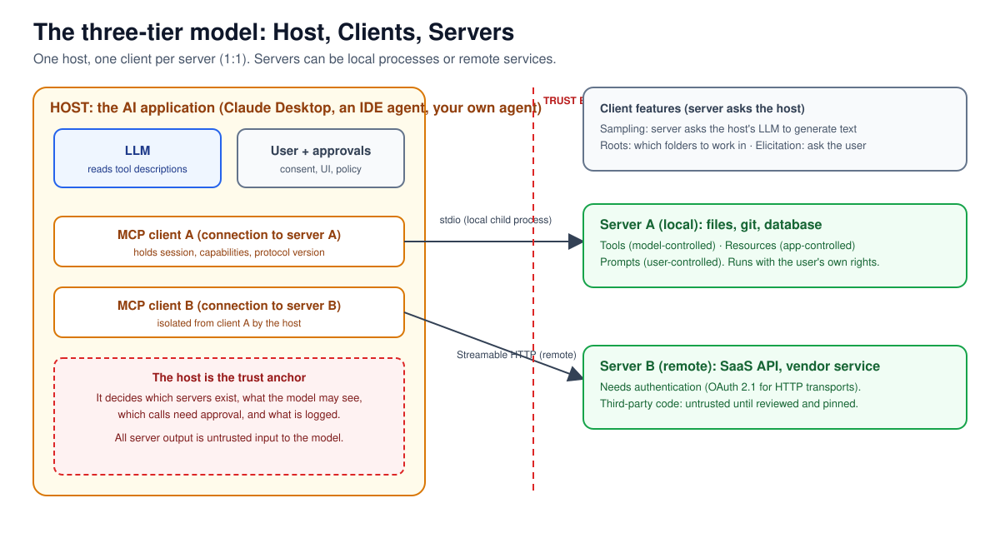

# 03: The Agentic AI Ecosystem

> **Syllabus:** "Agentic AI Ecosystem": *What are AI agents?*, *Single-agent vs multi-agent systems*, *Agentic workflows and orchestration patterns*, *Where MCP fits in the agentic stack*, *Popular hosts and frameworks using MCP (Claude Desktop, Cursor, Continue, and others)*, *The rapid growth of third-party MCP server registries*.
> **Time:** 1 hour. Product names and features change quickly: verify at source.

## Why this matters

MCP is rarely used by a person typing in a chat box. It is used by **agents**: programs where a model decides which steps to take and which tools to call. An agent turns a text-generation bug (prompt injection) into a real-world action (send mail, delete a file). Knowing the agent patterns tells you where an attacker can enter and how far a mistake can travel.

## What are AI agents?

A **chatbot** answers. An **agent** pursues a goal through a loop:

1. **Observe**: read the user's goal and the current context (messages, tool results).
2. **Plan / reason**: decide the next step.
3. **Act**: call a tool (search, run code, write a file, call an API).
4. **Observe the result**, update memory and repeat until done or stopped.

Typical parts: a **model**, **instructions** (system prompt), **tools**, **memory** (short-term context and sometimes long-term storage), and a **loop with stop rules**. The model may choose the steps itself, which is what makes agents flexible and risky.

Security meaning: an agent has **identity, permissions and autonomy**. The three questions are *what can it reach, who told it to do this, and who approved it?* The repo's [05-agent-security](../../05-agent-security/README.md) module goes deeper (excessive agency, permissions, sandboxing, monitoring).

## Single-agent vs multi-agent systems

| | Single agent | Multi-agent |
|---|---|---|
| Shape | One model with a set of tools | Several agents with roles that pass tasks and results to each other |
| Good for | Focused tasks, easy to debug | Large or parallel tasks, specialist roles, separation of duties |
| Context | One shared context | Each agent has its own context, plus messages between them |
| Failure and security | One prompt-injection point per input | **More injection points, and trust between agents**: one compromised agent can mislead the others |
| Cost and latency | Lower | Higher |

Rule: **start with a single agent**. Add agents when you have a real reason, and treat messages between agents as untrusted input unless they are authenticated and checked. See [multi-agent trust](../../05-agent-security/multi-agent-trust/README.md).

## Agentic workflows and orchestration patterns

A **workflow** has steps defined by code. An **agent** chooses steps itself. Real systems mix them. Common orchestration patterns:

| Pattern | How it works | Where the risk sits |
|---|---|---|
| **Router** | A first model call classifies the request and sends it to one specialist (a prompt, tool set or agent). | Misrouting. A crafted input can steer the router to a more privileged specialist. |
| **Planner-executor** | A planner model writes a step list. An executor runs each step with tools. | The plan is text built from untrusted input. Validate each step against policy before executing it. |
| **Supervisor (orchestrator-workers)** | One supervisor splits the task, delegates to worker agents and merges results. | The supervisor trusts worker output. A poisoned worker result can hijack the whole task. |
| **Swarm / handoff** | Peer agents hand the conversation to each other by rule or by choice, with no single boss. | Hard to reason about. Privileges can leak through handoffs ("confused deputy" at scale). |
| **Prompt chaining, parallelization, evaluator-optimizer** | Fixed pipelines and review loops. | Each hop is another place where untrusted text enters. |

Security habits for all patterns: **least privilege per agent**, **human approval for risky actions**, **budgets and step limits**, **log every tool call**, and **never let output from one step become an instruction for the next without checks**.

## Where MCP fits in the agentic stack

A simple layered view (names vary by vendor):

| Layer | Question it answers | Example |
|---|---|---|
| Model | Who reasons? | An LLM |
| Agent / orchestration | Who plans and loops? | An agent framework, or your own loop |
| **Tool and data connection** | **How does the agent reach tools and data?** | **MCP** |
| Agent-to-agent | How do agents talk to each other? | A2A or framework messages |
| Infrastructure | Where does it run, with which identity? | Containers, cloud, IAM, secrets |

MCP sits between the **agent** and the **tools and data**. The agent host contains MCP clients. The tools are MCP servers. MCP is **not** the agent, not the model, and not an agent-to-agent protocol. A security review of an agent system should have one box for MCP and ask: *which servers, which transport, which credentials, which approvals?*

## Popular hosts and frameworks using MCP

*Hedged list: products change, and support levels differ. Check each vendor's documentation before relying on a feature.*

| Kind | Examples | Note |
|---|---|---|
| **Desktop assistants** | Claude Desktop | The first widely used host. |
| **Coding agents and IDEs** | Claude Code, Cursor, Continue, VS Code with GitHub Copilot agent mode, Windsurf, JetBrains tools, Zed and others | Developers add servers by editing a config file. Those servers run on the developer's machine. |
| **Frameworks and SDKs** | The official MCP SDKs (Python, TypeScript and others), agent frameworks that can load MCP tools (for example the OpenAI Agents SDK, LangChain/LangGraph, LlamaIndex and others) | Features differ: some support only tools, not resources or prompts. |
| **Servers you will meet** | Filesystem, Git, GitHub, databases, browsers, cloud and SaaS vendors | Official servers are not automatically safe. Read the code and permissions. |

Security meaning for hosts: **the host is where consent, display of tool descriptions, approval prompts and logging happen.** Hosts differ in how well they do these. Evaluate the host as part of the system, for example: does it show full tool descriptions, does it re-ask when a tool changes, can you scope per-server permissions?

## The rapid growth of third-party MCP server registries

Anyone can publish a server, so catalogs grew fast: the **Official MCP Registry** (namespace verification, launched in preview in 2025, verify), vendor marketplaces, community "awesome" lists and aggregator sites. Package managers (npm, PyPI, container registries) distribute the code. Typical numbers are in the thousands of servers and rising: verify at source.

Why growth is a security story:

- **Low barrier to publish** means low barrier to publish something malicious (`postmark-mcp`, a typosquat-style fake mail server on npm, September 2025, reported by security researchers).
- **Popularity signals** (stars, downloads) can be faked.
- **Most listings do not scan** the code. Namespace verification only says *who* published it.
- **Updates change behavior.** A server can be benign when approved and malicious after an update (rug pull).
- **Shadow servers**: developers install what they find, with no review.

Controls (taught in chapters 4 to 6): an **internal allowlist or private registry**, **pinned versions and hashes**, **signing and provenance**, **SBOMs**, **review before install** and **runtime isolation**. A starting point is in [04-mcp-security/mcp-server](../../04-mcp-security/mcp-server/README.md).

## Hands-on

1. Draw your own agent system (even a toy one). Mark every place where untrusted text enters, and every tool it can call.
2. List the MCP servers installed in a host you use. For each: who wrote it, how it is installed, what it can reach, and whether it is pinned.
3. Run [lab 02](labs/02-connect-local-server/README.md) to see the client side of the connection that sits inside every host.

## Common mistakes

- Saying "agent" for any chatbot with a tool. Autonomy over steps is the key idea.
- Adding more agents to fix a problem a prompt or a workflow could solve.
- Trusting output of another agent because it is "inside the system".
- Believing an official registry listing means "audited".

## Interview and exam questions

<b>Q1. What makes something an agent and not a chatbot?</b>

It pursues a goal in a loop: it plans, calls tools, observes results and repeats, deciding steps itself. A chatbot just answers.

<b>Q2. Name four orchestration patterns and one risk for each.</b>

Router (misrouting), planner-executor (untrusted plan), supervisor (trusting worker output), swarm (privilege leaks through handoffs).

<b>Q3. Where does MCP sit in the agent stack?</b>

Between the agent (orchestration) and the tools and data. It is the connection layer, not the agent and not the agent-to-agent protocol.

## References

- MCP specification: <https://modelcontextprotocol.io/specification>
- Repo: [05-agent-security](../../05-agent-security/README.md), [multi-agent trust](../../05-agent-security/multi-agent-trust/README.md), [04-mcp-security](../../04-mcp-security/README.md).
- OWASP Top 10 for Agentic Applications (2026): <https://genai.owasp.org> (verify the current list).
