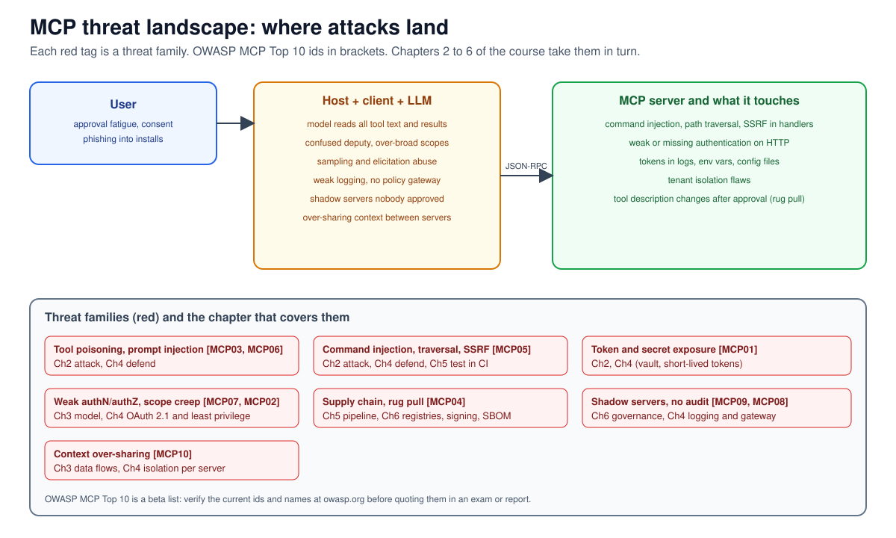

# 04: MCP Security, A First Look

> **Syllabus:** "MCP Security – A First Look": *Why MCP is a high-value target for attackers*, *The unique security challenges that agentic systems introduce*, *A high-level map of the MCP threat landscape*, *What this course will cover and how chapters connect*.
> **Time:** 1 hour. Incident details come from public secondary sources: verify at source before quoting numbers.

## Why this matters

This is the map for the rest of the course. Every later chapter zooms into one area of the picture below. If you remember only one idea from Chapter 1, make it this: **MCP puts untrusted third-party code and untrusted text next to a model that can act, with the user's credentials.**

## Why MCP is a high-value target for attackers

| Reason | Why an attacker likes it |
|---|---|
| **It holds the keys** | Servers run with the user's OS rights (stdio) or hold OAuth tokens and API keys for mail, repos, cloud and databases. |
| **It connects many systems** | One compromised server or one injected instruction can reach several tools in one session. |
| **Text is the control channel** | The model follows instructions in tool descriptions, resources and results. Writing text is much easier than writing an exploit. |
| **Fast, trusting adoption** | Developers install servers from catalogs without review, and approve prompts out of habit. |
| **Few guardrails by default** | The protocol defines messages, not your authorization, review or audit. Many servers have no authentication or logging. |
| **Standard protocol, standard attacks** | A trick that works on one host often works on all of them. |
| **Young supply chain** | Registries and packages with little scanning, popularity that can be faked. |

Public examples, with care (all 2025, from secondary sources: verify before quoting):

- **Tool poisoning and cross-server exfiltration** (Invariant Labs, April 2025): hidden instructions in a tool description made an agent leak private data through another, legitimate server. A **GitHub MCP** issue showed private repository data leaking through a public issue (May 2025).
- **`postmark-mcp`** (September 2025): a fake npm package that impersonated a mail service. After many harmless versions, one added a hidden BCC that copied every email to the attacker. Reported as the first known malicious MCP server in the wild.
- **CVE-2025-6514, `mcp-remote`** (JFrog): connecting to a malicious server could lead to OS command execution on the client. Fixed in a later version.
- **CVE-2025-49596, MCP Inspector** (Oligo): no authentication between the Inspector UI and its local proxy allowed remote code execution from a web page. Fixed in 0.14.1. **A developer tool for MCP was itself a high-value target.**
- **CVE-2025-53109 and CVE-2025-53110, Filesystem server** (Anthropic's reference server): symlink and path-prefix bypasses of the directory sandbox.
- **Asana MCP** (June 2025): a logic flaw broke tenant isolation in its experimental MCP server, so some customers' data was visible to others. The company paused the feature.

Details of each case are in later chapters. The pattern is what matters.

## The unique security challenges that agentic systems introduce

Normal software security assumes code does what the developer wrote. Agents break several assumptions:

1. **Instructions and data share one channel.** The model cannot reliably tell a user's request from text inside a file or a tool result. That is **prompt injection**, and MCP is a very large indirect-injection delivery route.
2. **Tool descriptions are code-like prompts.** They are written by a third party and read by the model every turn. They can also **change after approval** (rug pull).
3. **Non-deterministic decisions.** The same input may give a different tool call tomorrow. You cannot test every path, so you need **guardrails outside the model**.
4. **Confused deputy.** The agent acts with the *user's* authority for goals set by *someone else's* text.
5. **Chained trust.** Server A's output influences a call to server B. Cross-server flows are where data leaks.
6. **Excessive agency.** Broad tools, broad scopes, and no human in the loop turn a small error into an incident.
7. **Human consent is weak.** Users click "allow" repeatedly (approval fatigue), and may never see the full description.
8. **Opaque runtime.** Without logging at the protocol layer, you cannot say what the agent did or why.

The **lethal trifecta** from the repo (see [01-lethal-trifecta](../../images/01-lethal-trifecta.svg)): private data + untrusted content + a way to send data out. MCP makes it easy to assemble all three in one session.

## A high-level map of the MCP threat landscape

The map groups threats by where they land: the **user**, the **host/client/LLM**, and the **server**. The OWASP MCP Top 10 (2025, beta) gives a shared vocabulary, listed in full in the repo's [secure operations](../../04-mcp-security/secure-operations/README.md) module:

| Id | Name | Where it lands |
|---|---|---|
| MCP01 | Token Mismanagement & Secret Exposure | Server, host config, logs |
| MCP02 | Privilege Escalation via Scope Creep | Server and authorization |
| MCP03 | Tool Poisoning | Descriptions read by the model |
| MCP04 | Software Supply Chain Attacks & Dependency Tampering | Packages, registries |
| MCP05 | Command Injection & Execution | Server handlers |
| MCP06 | Prompt Injection via Contextual Payloads | Any text the model reads |
| MCP07 | Insufficient Authentication & Authorization | Transport and server |
| MCP08 | Lack of Audit and Telemetry | Operations |
| MCP09 | Shadow MCP Servers | Organization |
| MCP10 | Context Injection & Over-Sharing | Shared context between servers |

(The list is a beta project. Verify current names and numbers at <https://owasp.org/www-project-mcp-top-10/>.)

A second view for threat modeling (Chapter 3) is **STRIDE** per component: Spoofing (fake server), Tampering (rug pull), Repudiation (no logs), Information disclosure (data leaks), Denial of service (tool loops, huge outputs), Elevation of privilege (scope creep, confused deputy). Research in 2026 has applied STRIDE-style analysis to MCP and listed dozens of threats across components: treat counts as unverified.

## What this course will cover and how chapters connect

| Chapter | Question it answers | Builds on |
|---|---|---|
| **1. Introduction (this one)** | What is MCP, how does it work, what is at stake? | n/a |
| **2. Understanding and attacking MCP servers** | How do the attacks actually work? | Ch1 protocol, primitives, transports |
| **3. Threat modeling MCP architectures** | How do I find and rank the risks in a design? | Ch1 architecture, Ch2 attacks |
| **4. Defending and hardening MCP servers** | What controls stop those attacks? | Ch2 and Ch3 findings |
| **5. DevSecOps for MCP security** | How do I automate those controls in CI/CD? | Ch4 controls |
| **6. Supply chain security and governance** | How do I trust servers at scale, and prove it? | Ch2 supply chain attacks, Ch5 pipeline |

Flow: **understand → attack → model → defend → automate → govern.** Chapter 1 supplies the vocabulary. Each chapter README has a coverage table that maps every syllabus line to a note and a lab.

Where this connects to the rest of the repo:

- Deep dive on MCP trust and supply chain: [04-mcp-security/mcp-server](../../04-mcp-security/mcp-server/README.md).
- Authentication (OAuth 2.1, token passthrough): [authentication](../../04-mcp-security/authentication/README.md).
- Tool-level attacks: [tool-security](../../04-mcp-security/tool-security/README.md).
- OWASP MCP Top 10 operations: [secure-operations](../../04-mcp-security/secure-operations/README.md).
- Agents: [05-agent-security](../../05-agent-security/README.md).

## Hands-on

1. Run [lab 03](labs/03-observe-protocol/README.md) and read the proxy log as an attacker would: what could you learn from it, and what must be redacted?
2. For the `notes-server` in [lab 04](labs/04-build-server-tools-resources/README.md), fill in a small table: asset, entry point, trust boundary, one threat from each OWASP MCP id that applies.
3. Open the threat-landscape picture and, for each red tag, name one control you already know.

## Common mistakes

- Treating MCP as "just an API". The model reading the text is what creates the new risk.
- Thinking a human approval prompt is a complete defense.
- Securing the server and forgetting the host, the config files and the logs.
- Quoting incident numbers from social posts without checking.

## Interview and exam questions

<b>Q1. Why is MCP a high-value target?</b>

It concentrates credentials and access to many systems, accepts third-party code and text that the model trusts, is adopted fast with little review, and defines the protocol but not the authorization, audit or supply chain controls.

<b>Q2. What does "instructions and data share one channel" mean?</b>

The model reads user requests, tool descriptions and tool results as one stream of text and cannot reliably separate commands from content. This enables prompt injection through any MCP-provided text.

<b>Q3. Give three MCP threat categories and one control each.</b>

Tool poisoning (pin and review descriptions), command injection in handlers (validate input, no shell), supply chain (allowlist, pin, sign, scan packages).

## References

- OWASP MCP Top 10 (beta): <https://owasp.org/www-project-mcp-top-10/> (verify)
- Repo mapping of MCP01 to MCP10: [secure-operations](../../04-mcp-security/secure-operations/README.md)
- MCP specification, security best practices: <https://modelcontextprotocol.io/specification>
- CVE records: search CVE-2025-6514, CVE-2025-49596, CVE-2025-53109 and CVE-2025-53110 on <https://nvd.nist.gov>.
