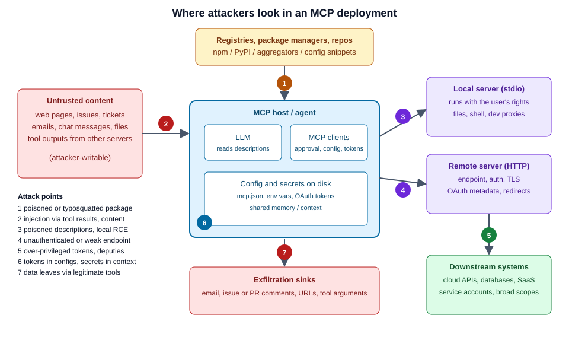

# Lesson 01: The MCP Attack Surface

> **Chapter:** 2 · Understanding and Attacking MCP Servers · **Time:** ~3 hours
> **You will:** list what attackers look for in an MCP deployment, map the attack surface of a real setup, profile the people who attack it, and run a reconnaissance scan against a fake network of MCP endpoints.

| | |
|---|---|
| **Prerequisites** | [Chapter 1](../ch1-introduction-to-mcp-and-agentic-ecosystem/README.md) (what MCP is, hosts, clients, servers); [repo 04-mcp-security README](../../04-mcp-security/README.md) |
| **Lab** | [`labs/01-recon-enumeration`](labs/01-recon-enumeration/README.md) |
| **Syllabus lines** | Introduction to the MCP Attack Surface: what attackers look for · attack surface mapping · threat actor profiles and motivations |
| **Maps to** | OWASP MCP Top 10 (2025, beta): MCP01, MCP02, MCP04, MCP07, MCP09, MCP10 · OWASP Agentic Top 10 2026: ASI02, ASI03, ASI04 |

> **Verify at source.** MCP changes quickly (the spec has had several revisions, and a 2026-07-28 revision appears to be the latest; check modelcontextprotocol.io/specification). This lesson teaches ideas that stay true across revisions.

---

## 1. Why this matters

An MCP deployment is a new kind of network. A host (an AI app) connects to many servers. Each server can run code, hold tokens, read files and call other systems. A **model** decides which tool to call, based on text that outsiders can write. So the attack surface is not only "the server's open port". It is the ports, the tokens, the tool descriptions, the content the model reads, the packages you install, and the downstream systems the servers can touch.

For a DBA/DevOps person: think of an MCP server as a **database driver plus a stored procedure runner plus a service account**, installed by end users, without a change ticket. That is what an attacker sees.

## 2. Understand it

### 2.1 What attackers look for in an MCP deployment

Attackers are lazy in a good way: they look for the cheapest door. In MCP, the cheapest doors are these.

| What they look for | Why it is valuable | Typical signs | Lab / lesson |
|---|---|---|---|
| **Exposed endpoints** (HTTP MCP servers reachable from the internet or the office network, local servers bound to `0.0.0.0`, developer proxies) | An MCP endpoint without authentication is an API that runs tools for anyone. Scanners can find them by asking `initialize` and `tools/list`. | `initialize` answers without credentials; many tools listed; a UI or proxy port open | [Lab 01](labs/01-recon-enumeration/README.md) |
| **Tokens and secrets in configs** (`mcp.json`, `.env`, shell history, CI variables, Docker `-e` flags) | Host configuration files often hold API keys and OAuth tokens in plain text, and any local process or any file-read bug can get them. | Keys in `args` or `env`; the same token reused across servers; tokens with no expiry | [Lesson 04, sensitive information leakage](04-mcp-vulnerability-classes.md#6-sensitive-information-leakage-via-error-messages) |
| **Over-privileged tools** (`run_shell`, "read any file", `query any SQL`, admin-scoped API tokens) | One successful injection or one confused call gives code execution or broad data access. | Tool names such as `exec`, `eval`, `run_command`; wide OAuth scopes; the server runs as the developer's own user | [Lab 08](labs/08-code-exec-to-compromise/README.md) |
| **Registries and package sources** (npm, PyPI, container images, GitHub repos, "awesome" lists, aggregators, copy-paste config snippets) | Whoever controls a package name or a repo that people install from controls code that runs on laptops and in CI. | Names one letter off; new maintainers; install commands that use "latest" | [Lesson 05, postmark-mcp](05-real-world-case-studies.md#case-1-postmark-mcp-september-2025) |
| **Tool descriptions and schemas** | The model reads them as instructions. A server author can steer the model without writing any malicious code. | Hidden blocks, long descriptions, unusual parameters | [Lab 02](labs/02-tool-poisoning/README.md) |
| **Content the agent reads** (issues, tickets, emails, web pages, chat messages, files) | Anyone who can write into that content can talk to the model. This is the cheapest "initial access" of all. | Public repos, support forms, inbound email feeding an agent with tools | [Lab 03](labs/03-tool-response-injection/README.md) |
| **Shared context and memory** | One poisoned entry reaches every agent that reads it. | A memory or notes server that all agents can write to | [Lab 07](labs/07-mcp-worm/README.md) |
| **Downstream credentials** (cloud keys, database roles, SaaS tokens the server uses) | The server is a pivot: attacking it is a way to reach what it can reach. | One shared service account for many tenants | [Lab 06](labs/06-confused-deputy/README.md) |
| **Developer tooling** (inspectors, debuggers, "local only" proxies) | Tools built for convenience often skip authentication. A web page you visit can sometimes reach a "local" port. | A proxy listening on a fixed port with no token | [Lesson 05, Inspector CVE](05-real-world-case-studies.md#case-3-mcp-inspector-cve-2025-49596) |

### 2.2 Attack surface mapping for MCP environments

Mapping means: draw every place where **data, instructions or authority cross a trust boundary**. Do it like this.



**Step 1. Inventory.** List every host (Claude Desktop, Claude Code, Cursor, VS Code, custom agents), every MCP server each host loads, where the server runs (local `stdio` process, container, remote HTTP), who installed it and from where. Include servers that users added themselves (these are "shadow MCP servers", see [04-mcp-security secure-operations](../../04-mcp-security/secure-operations/README.md)).

**Step 2. For every server, write down five facts.**

1. Transport and binding: `stdio`, or Streamable HTTP and on which interface (the older HTTP+SSE transport is deprecated; you may still find it).
2. Authentication: none, static token, OAuth 2.1 with audience-bound tokens.
3. Tools, resources and prompts it exposes (run `tools/list`, `resources/list`, `prompts/list`).
4. Identity it uses downstream (the user's own token, or one shared service account).
5. Secrets it can read (environment, files, config).

**Step 3. Mark the content sources.** Which tools return text that an outsider can influence? (web fetch, search, issue trackers, email, chat, files, other servers.) Each one is an injection entry point.

**Step 4. Mark the sinks.** Which tools can send data out or change something? (email, comment, create PR, HTTP request, write file, run command.) A path from an untrusted source to a sink in one agent context is the "lethal trifecta" pattern: private data + untrusted content + a way out (see [repo lethal trifecta diagram](../../images/01-lethal-trifecta.svg)).

**Step 5. Draw the boundary arrows and number the attack points.** For each arrow ask: who can write to it, who can read it, what stops a forged message?

**Step 6. Rate and decide.** Use the threat-modeling method of [Chapter 3](../ch3-threat-modeling-mcp-architectures/README.md). Controls go into [Chapter 4](../ch4-defending-and-hardening-mcp-servers/README.md).

A map of the fake network in [Lab 01](labs/01-recon-enumeration/README.md) is the kind of output you should be able to produce in the exam: server name, address, auth, tools, resources, findings.

### 2.3 Threat actor profiles and motivations

These are **roles**, not named groups. Real incidents often mix them. Public reporting about specific actors using MCP is thin and fast-moving, so treat any named-group claim as "verify at source".

| Profile | Motivation | Typical skill | What they target in MCP | Example behavior |
|---|---|---|---|---|
| **Opportunistic scanner** | Easy access, resale of access, crypto mining, curiosity | Low; uses internet scanners and public tools | Exposed unauthenticated endpoints, developer proxies, default ports | Sends `initialize` and `tools/list` to many hosts, calls any `run_command` tool it finds |
| **Supply-chain criminal** | Money (credential theft, BEC, resale of data) | Medium | Fake or lookalike packages, hijacked maintainer accounts, "latest" installs | A package that copies the legitimate one, then adds a hidden recipient to every email (the postmark-mcp pattern) |
| **Content poisoner / prompt injector** | Data theft, spam, sabotage, reputation, fun | Low to medium; needs no access to your network | Any place their text reaches an agent: issues, tickets, emails, web pages, filenames | Writes a public issue that tells your coding agent to read private repositories |
| **Malicious server operator** | Data collection, long-term access, ad fraud | Medium to high | Users who connect to their server; the host's trust in descriptions and OAuth metadata | Publishes a useful server, gets approved, then changes behavior (rug pull) or sends hostile OAuth metadata to the client |
| **Malicious or careless insider** | Revenge, profit, shortcuts | Varies; has real access | Over-privileged tokens, shadow servers, shared memory | Installs an unreviewed server with a personal token; or points an agent at a private repo |
| **Competitor or espionage actor** | Trade secrets, strategy, source code | High, patient | Agents with access to code, documents, chat; tokens in configs | Poisons content that a target's agent reads, then waits for a leak through a legitimate tool |
| **Ransomware / extortion crew** | Money from disruption | Medium to high | Servers with shell, file, database or cloud-admin tools | Uses code execution in an MCP server as a foothold, then moves to cloud credentials |
| **Researcher / red team** (not an attacker) | Proof, disclosure, bounties | High | The same primitives, with consent | Publishes tool-poisoning, exfiltration and CVE research (Invariant Labs, JFrog, Oligo, Koi Security) |

**Motivation matters for defense.** A scanner is stopped by authentication and not exposing ports. A supply-chain criminal is stopped by pinning and review. A content poisoner is stopped only by controls **after** the model: approval, taint tracking, egress allowlists. A server operator is stopped by treating every server as untrusted input to the host.

## 3. Defend it

- **Know your surface.** Keep an MCP inventory and a registry allowlist ([04-mcp-security mcp-server](../../04-mcp-security/mcp-server/README.md)).
- **Authenticate every endpoint.** OAuth 2.1 with audience-bound tokens for remote servers ([04-mcp-security authentication](../../04-mcp-security/authentication/README.md)).
- **Bind local servers to loopback** and add a token or Origin/Host checks (see [Lesson 04, insecure defaults](04-mcp-vulnerability-classes.md#7-insecure-defaults-in-popular-mcp-sdks-and-tools)).
- **Least privilege per tool**, per server, per user ([04-mcp-security tool-security](../../04-mcp-security/tool-security/README.md)).
- **No secrets in config files.** Use a secret manager; short-lived tokens.
- **Scan yourself regularly** with the same recon an attacker uses (Lab 01). Concrete controls are in [Chapter 4](../ch4-defending-and-hardening-mcp-servers/README.md).

## 4. Hands-on

Run the recon lab and read the report:

```powershell
.venv/Scripts/python cmcpse-course/ch2-understanding-and-attacking-mcp-servers/labs/01-recon-enumeration/demo.py
```

Then open `fleet.py`, change one server in the hardened fleet to remove its token, and predict which finding appears before you run `recon.py`.

## 5. Scenarios

1. A developer runs a "local" MCP server on `0.0.0.0:3000` with no token to share it with a colleague. What can a scanner on the office Wi-Fi do? (Answer: call any tool, with the developer's rights.)
2. A team uses `npx -y some-mcp@latest` in a shared config. What is the risk, and what is the fix? (Answer: a new release runs on every machine on next start; pin exact versions and integrity hashes.)
3. An agent that reads support tickets also has an email tool. Which two attack-point numbers on the map are involved? (2 and 7.)

## 6. Interview Q&A

**Q: What is the first thing you do to assess an MCP deployment?**
Inventory hosts and servers, then map transport, authentication, tools, downstream identity and secrets for each server, and mark untrusted content sources and data sinks.

**Q: Why is "it only listens on localhost" not a full defense?**
Other local processes can reach it, and a web page in the user's browser can sometimes reach local ports (CSRF, DNS rebinding). A token and Origin/Host checks are still needed. This is the Inspector lesson ([case 3](05-real-world-case-studies.md#case-3-mcp-inspector-cve-2025-49596)).

## 7. References

- [MCP specification and security best practices](https://modelcontextprotocol.io/specification) (verify the current revision)
- OWASP MCP Top 10 (2025, beta): <https://owasp.org/www-project-mcp-top-10/> (verify at source)
- [Repo: 04-mcp-security](../../04-mcp-security/README.md), [05-agent-security](../../05-agent-security/README.md)
- Invariant Labs, JFrog, Oligo and Koi Security research posts (see [Lesson 05](05-real-world-case-studies.md))
