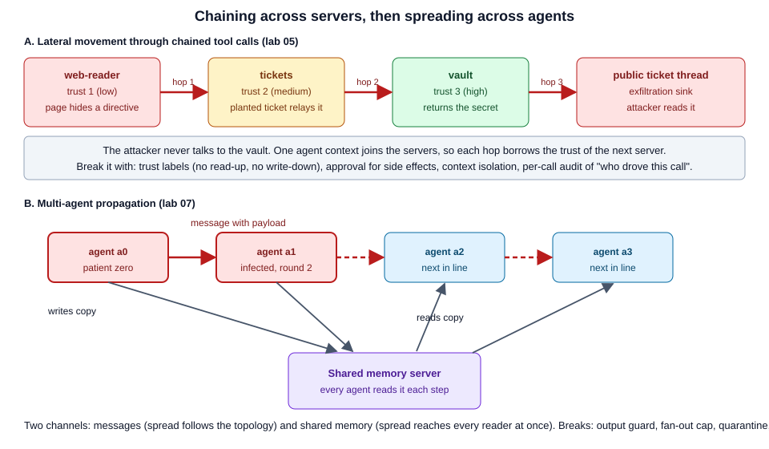

# Lesson 05: Real-World MCP Attack Scenarios

> **Chapter:** 2 · Understanding and Attacking MCP Servers · **Time:** ~4 hours
> **You will:** study six public MCP incidents and research findings, state the root cause and the lessons of each, and learn two general patterns: attack chaining across servers and propagation across agents.

| | |
|---|---|
| **Prerequisites** | [Lesson 03](03-mcp-attack-primitives.md), [Lesson 04](04-mcp-vulnerability-classes.md) |
| **Labs** | [04 rug-pull](labs/04-rug-pull/README.md) · [05 cross-server](labs/05-cross-server-privesc/README.md) · [07 worm](labs/07-mcp-worm/README.md) · [08 code exec](labs/08-code-exec-to-compromise/README.md) |
| **Syllabus lines** | Real-World MCP Attack Scenarios: case studies of MCP exploitation in the wild · attack chaining across multi-server agentic pipelines · multi-agent attack propagation patterns |
| **Maps to** | OWASP MCP Top 10 (2025, beta) · Agentic Top 10 2026 (ASI01, ASI04, ASI06, ASI07, ASI08) |

> **How reliable are these facts?** The incidents come from security vendors' public write-ups and news coverage, mostly from 2025. Dates, version numbers and severity scores are as reported; **numbers about victims and downloads are reported figures and are not verified here**. Before you quote a detail in a report or an exam answer, check the original advisory or blog post. This lesson uses only the incidents listed here.

---

## 1. Why this matters

Case studies turn the primitives of [Lesson 03](03-mcp-attack-primitives.md) into evidence. They also teach the lesson that matters most: **real incidents are boring**. Several were old web bugs (path checks, missing authentication, command injection through a URL) in a new place, and the others were old supply-chain tricks. What is new is how fast one text change can become an action.

## 2. How each case is written

Each case gives: **what happened**, **how it worked**, **root causes**, **tactics** (ATT&CK/ATLAS names, no IDs), **lessons learned**, and **where to practice and defend**.

---

## Case 1: postmark-mcp (September 2025)

**What happened.** Security researchers (reported by Koi Security, with follow-up coverage including Snyk) described what they called the first known malicious MCP server found in the wild. An npm package named `postmark-mcp` impersonated the email service Postmark. Earlier versions behaved normally (reports say about 15 benign versions). In **v1.0.16** a small change made the server add a **BCC** to an address controlled by the attacker on every email it sent. Reported download counts exist but vary by source; treat them as unverified. The package was removed from npm.

**How it worked.** A developer or an AI assistant installed the "email" server and gave it email-sending ability. The tool definition looked unchanged: same name, same description, same schema. The malicious behavior lived in the server code and left through a channel the agent was already allowed to use: email.

**Root causes.**
- Trust in a name, with no check that the publisher was the vendor.
- Auto-update or "latest" installs, so the new version ran without review.
- No egress control or audit on outgoing mail recipients.
- The agent had a powerful tool, and users had no view of what the code actually did.

**Tactics.** Resource Development (impersonating package), Initial Access (supply chain compromise), Persistence and Defense Evasion (benign history, unchanged definition), Collection and Exfiltration (BCC of every message).

**Lessons learned.**
1. A clean history proves nothing: attackers will **earn trust first**.
2. Definition hashes do not catch server-side behavior changes. You need lockfiles with **integrity hashes** and review of diffs.
3. Egress is the last honest sensor: **audit recipients** (BCC included) at the mail gateway.
4. Verify publisher identity against the vendor's own documentation, not the registry search results.
5. Use few, vetted servers; mirror and scan what you use.

**Practice and defend.** [Lab 04, release rug-pull](labs/04-rug-pull/README.md) (registry with a clean history, lockfile, egress audit) · [Chapter 6](../ch6-supply-chain-security-and-governance-of-mcp/README.md) · [04 mcp-server (registry allowlist, hash pinning)](../../04-mcp-security/mcp-server/README.md).

## Case 2: mcp-remote (CVE-2025-6514)

**What happened.** JFrog reported a critical vulnerability (about 9.6 CVSS as reported) in `mcp-remote`, a popular local proxy that lets clients that only speak `stdio` connect to remote HTTP MCP servers using OAuth. When it connected to a malicious or compromised server, the server could return a crafted `authorization_endpoint` value in its OAuth metadata. The client used that value unsafely, which led to **operating-system command execution on the client machine**. It was fixed in version **0.1.16**.

**How it worked.** The user pointed the client at a remote MCP server (or a network attacker redirected it). The server's discovery response is *data from an untrusted party*, but the client used part of it as if it were safe, in a way that reached the OS. No tool call, no model, no prompt injection: the attack ran in the **client's** authentication code.

**Root causes.**
- Server-supplied metadata was trusted and not validated (URL scheme and shape).
- Unsafe handling of a string that was passed toward a system call.
- Connecting to untrusted remote servers over a channel (such as plain HTTP) where an attacker could stand in the middle.

**Tactics.** Initial Access and Execution on the client (Exploitation for Client Execution); the attacker's server is the delivery method.

**Lessons learned.**
1. **Every byte from a server is attacker input to the client**, including OAuth discovery data, redirects and error text.
2. Remote server URLs need HTTPS with validation; connect only to servers you trust.
3. Keep MCP client tooling **patched**: it is part of your attack surface and your inventory (SBOM).
4. Run clients and proxies with least privilege and in sandboxes where possible.

**Practice and defend.** [Lesson 03, MITM and fake endpoints](03-mcp-attack-primitives.md#32-man-in-the-middle-via-fake-mcp-endpoints) · [04 authentication](../../04-mcp-security/authentication/README.md) · [Chapter 4](../ch4-defending-and-hardening-mcp-servers/README.md). Lab 08 shows the same *kind* of impact (command execution) from the server side.

## Case 3: MCP Inspector (CVE-2025-49596)

**What happened.** Oligo reported a critical vulnerability (about 9.4 CVSS as reported) in MCP Inspector, Anthropic's developer tool for testing MCP servers. The Inspector had a web UI and a local proxy that could start MCP servers by running commands. There was **no authentication between the UI and the proxy**, so a malicious web page the developer visited could send requests to the local proxy (a CSRF-style attack from the browser) and achieve **remote code execution** on the developer's machine. It was fixed in version **0.14.1**, which added authentication and origin protections.

**How it worked.** The developer ran the Inspector for testing. A web page in another browser tab sent requests to the Inspector's local port. The proxy trusted them because nothing proved the caller was the UI. The proxy's job was to execute commands, so it did.

**Root causes.**
- A developer tool whose purpose is to spawn processes, exposed with **no authentication**.
- A "localhost only" assumption, with no Origin or Host validation and no session token.
- Convenience over safety in a debug path.

**Tactics.** Initial Access (browser to local service), Execution (command execution), then whatever the developer's account could reach (credentials, repos, cloud).

**Lessons learned.**
1. **Developer and debug tooling is production-grade attack surface**, especially on machines with cloud keys.
2. "Localhost" is not a security boundary: web pages can reach it. Use tokens, Origin/Host checks and loopback binding.
3. A process that runs commands for a UI needs the same care as a remote shell.
4. Patch dev tools, and include them in the MCP inventory.

**Practice and defend.** [Lesson 04, class 2 and class 7](04-mcp-vulnerability-classes.md#2-insecure-transport-configurations) · [Lab 01](labs/01-recon-enumeration/README.md) (the HTTP server binds to `127.0.0.1` only and tests refuse `0.0.0.0`) · [04 mcp-server DNS rebinding step](../../04-mcp-security/mcp-server/README.md).

## Case 4: Anthropic Filesystem MCP server (CVE-2025-53109 / CVE-2025-53110)

**What happened.** Two vulnerabilities were reported in the reference Filesystem MCP server, whose purpose is to give an agent file access **inside allowed directories**. One was a **symlink** problem (a link inside an allowed directory pointing outside it) and the other was a **path-prefix** problem (a check that compared the start of a path string, so a sibling directory with the same prefix looked allowed). Together they allowed access to files outside the sandbox, and, as reported, in some setups could lead to further compromise. Details and fixed versions are in the advisories (verify at source).

**How it worked.** The server's sandbox check was a string comparison on a path, not a check of the **real, resolved** location. An attacker (or a steered agent) used a path or a link that passed the string test but pointed elsewhere.

**Root causes.**
- Containment by string prefix instead of resolved, component-wise comparison.
- Symlinks followed after the check.
- A security boundary implemented in one function with no second layer (no OS permission boundary under it).

**Tactics.** Discovery and Collection (reading files), Privilege Escalation beyond the intended scope, Credential Access if secrets were in reach.

**Lessons learned.**
1. **Resolve first, then check containment**, and compare path components, not strings.
2. Add an **OS-level boundary** (unprivileged user, container, read-only mounts) so a bug in the check is not fatal.
3. Even a vendor's reference server can have sandbox bugs: reference implementations are examples, not audited products.
4. Test with hostile paths: `..`, absolute paths, sibling prefixes, symlinks.

**Practice and defend.** [Lab 08](labs/08-code-exec-to-compromise/README.md) re-creates both bug patterns (`read_file` with prefix check and symlink following), shows the fix, and proves that the unprivileged user still protects the credentials when the path check is wrong · [04 tool-security path traversal](../../04-mcp-security/tool-security/README.md).

## Case 5: Asana MCP server (June 2025)

**What happened.** Asana disclosed a logic flaw in its experimental MCP server that broke **tenant isolation**: under some conditions, one organization's data could be visible to another's users of the MCP integration. Asana temporarily disabled the feature while it fixed the issue and notified affected customers. Reports mentioned about 1,000 customers; that figure is **reported but unverified**.

**How it worked.** The flaw was an authorization logic error in a multi-tenant service: the MCP layer returned data without correctly enforcing which tenant the caller belonged to. This was not an AI trick. It was the classic **broken access control / confused deputy** shape: a deputy with broad access and an incomplete check on whom it serves.

**Root causes.**
- Multi-tenant isolation enforced in one place, in a new, fast-moving integration.
- The server's own authority was wider than the caller's.
- A new surface (MCP) added in front of existing data without the same access-control testing as the main product.

**Tactics.** Impact and Collection by exposure (accidental, not an attacker campaign); the same failure an attacker would exploit on purpose.

**Lessons learned.**
1. Every new access path (MCP included) needs the **same authorization tests** as the main product: especially cross-tenant tests.
2. **Defense in depth for tenancy:** server checks plus row-level security in the data layer, so one bug does not expose everything.
3. Have a **kill switch** and a disclosure process: Asana's quick disable limited the damage.
4. Do not lean on experimental features in production with sensitive tenants.

**Practice and defend.** [Lab 06 confused deputy](labs/06-confused-deputy/README.md) (cross-tenant export with and without caller checks and row-level security) · [04 authentication](../../04-mcp-security/authentication/README.md) · [Chapter 4](../ch4-defending-and-hardening-mcp-servers/README.md).

## Case 6: Invariant Labs research (tool poisoning, WhatsApp and GitHub)

Invariant Labs published a series of 2025 research results that defined much of today's MCP threat vocabulary. These are **research demonstrations** (with consent and test accounts), not reports of criminal campaigns.

**6a. Tool poisoning (April 2025).** They showed that hidden instructions in a tool **description** can make an agent read sensitive files and send their content out through the tool's own parameters, while the user sees a harmless description. This is the base of [Lesson 03 section 1](03-mcp-attack-primitives.md#1-tool-poisoning-attacks) and [Lab 02](labs/02-tool-poisoning/README.md).

**6b. WhatsApp MCP exfiltration (April 2025).** They described a setup where an agent had a **WhatsApp MCP server** (access to message history) and a second, malicious server. The malicious server first behaved, then changed its tool description after the user approved it (a **rug-pull**), and that change steered the agent into using the WhatsApp tool to send the user's message history to an attacker's number. The two servers never needed to talk to each other: the model was the bridge. See [Lab 04](labs/04-rug-pull/README.md) and [Lab 05](labs/05-cross-server-privesc/README.md).

**6c. GitHub MCP private-repository leak (May 2025).** They showed that an attacker could open a **malicious issue in a public repository**. When the user asked their coding agent (with the official GitHub MCP server and a token that could read private repositories) to look at open issues, the issue text instructed the agent to read data from the user's **private** repositories and publish it in a pull request in the **public** repository, where the attacker could read it. No server was malicious and no code bug was needed: the token's broad scope plus untrusted content plus a write path was enough. See [Lab 03](labs/03-tool-response-injection/README.md) and the [repo lethal-trifecta diagram](../../images/01-lethal-trifecta.svg).

**Root causes (all three).** Trust in text that outsiders can write; one agent context holding private data, untrusted content and an outbound path; overly broad tokens; approval fatigue ("always allow").

**Tactics.** Initial Access (content or server), Execution (agent tool use), Persistence/Defense Evasion (rug-pull, hidden text), Collection and Exfiltration.

**Lessons learned.**
1. The **lethal trifecta** (private data + untrusted content + external communication) in one session is the pattern to break.
2. Use **fine-grained, per-repo or per-task tokens**; one all-access token makes every injection severe.
3. **Pin and re-approve** tool definitions; changes after approval must not go unnoticed.
4. **Isolate contexts**: do not let a session that reads public content also hold private-data tools plus write tools.
5. Disable "always allow" for tools that read private data or write publicly.

**Practice and defend.** [Labs 02, 03, 04, 05](labs/) · [04 tool-security](../../04-mcp-security/tool-security/README.md) · [05 permissions](../../05-agent-security/permissions/README.md).

---

## 7. Attack chaining across multi-server agentic pipelines

**What chaining is.** A single weakness seldom gives the attacker their goal. Real attacks **chain** steps, each using what the previous step gave:

1. **Entry:** poisoned content or a malicious server (low trust).
2. **Relay:** a medium-trust server returns text the attacker had planted earlier (so it looks "internal").
3. **Pivot:** a high-trust server's tool is called with attacker-chosen arguments.
4. **Sink:** the result is written somewhere the attacker can read (a public ticket, an email, a PR, a URL).
5. **Follow-on:** the stolen credential is used outside MCP (a cloud API), for persistence or impact.

[Lab 05](labs/05-cross-server-privesc/README.md) simulates steps 1 to 4. [Lab 08](labs/08-code-exec-to-compromise/README.md) simulates steps 3 to 5.

**Why chains evade defenses.** Each step looks acceptable alone: reading a page, reading a ticket, reading a secret the agent is allowed to read, writing a ticket. Only the **sequence** and its **cause** are malicious.

**Detection.**
- Build a **causal graph** of tool calls with the *driver* of each call (user turn or the output of server X).
- Alert when a call crosses a trust boundary upward, when the chain length passes a threshold, or when a chain ends in a sink after touching sensitive data.
- Keep canaries in sensitive records so leaks are certain.

**Defense.**
- **Trust zones** and rules: no read-up, no write-down; approval at boundaries.
- **Context isolation:** separate sessions or agents for untrusted reading and privileged acting ([05 multi-agent-trust](../../05-agent-security/multi-agent-trust/README.md)).
- Per-server credentials and per-task, short-lived tokens.
- Chain budgets, circuit breakers and kill switches ([05 monitoring-and-response](../../05-agent-security/monitoring-and-response/README.md)).
- Egress allowlists on every sink.

## 8. Multi-agent attack propagation patterns

When many agents share **messages, memory or tools**, one injection can spread. The research precedent is **Morris II (2024, Cohen, Bitton and Nassi)**: a self-replicating adversarial prompt that spread between GenAI email assistants in a research setting (see the [CAISP ch7 worm simulation](../../caisp-course/ch7-emerging-threats-governance-compliance/labs/ai-worm-simulation/worm_sim.py); the MCP lab below adds shared memory and tool outputs).

| Pattern | How it spreads | MCP example | Speed |
|---|---|---|---|
| **Message relay** | Agent A copies the payload into a message to B | `send_message` tool, email, chat | Follows the contact graph |
| **Shared memory poisoning** | One write is read by every agent | A notes or memory MCP server | All readers at once |
| **Tool-output infection** | The payload sits in a tool result that other agents also call | A shared ticket queue, a public web page | Every agent that reads it |
| **Delegation chain** | A parent agent passes tainted instructions to child agents | Orchestrator to workers | Down the tree |
| **Supply-chain spread** | A poisoned shared server or template is installed by many | One bad server in a team config | Every host with the server |
| **Cascading failure (not malicious)** | An error or bad output is re-fed to others | Retry storms, runaway plans | Exponential |

[Lab 07](labs/07-mcp-worm/README.md) measures two of these. In the demo, one message infects 8 of 8 agents through shared memory in the first round, while the inbox-only worm follows the ring topology (1, 3, 5, 7, 8 infected after rounds 1 to 5). Defenses that worked in the lab: an **output guard** that blocks outbound calls replicating untrusted inbound text, **quarantine** of the agent, **memory purge**, and **containment** after the fact. A fan-out cap only slowed the worm.

**Defense summary.** Treat messages and memory as untrusted input. Sign and attribute inter-agent messages ([05 multi-agent-trust](../../05-agent-security/multi-agent-trust/README.md)). Write-time checks on shared memory. Replication detectors on output. Rate and fan-out caps (slowing only). Quarantine and purge runbooks. Practice the runbook: a worm is a **speed** problem and humans are slow.

## 9. Cross-case lesson table

| Case | Primary primitive or class | Missing control | One-line lesson |
|---|---|---|---|
| postmark-mcp | Impersonation, release rug-pull | Pinning, integrity, egress audit | Earned trust is not safety |
| mcp-remote CVE | Hostile server metadata | Input validation on the client | Servers are untrusted input to clients |
| Inspector CVE | Unauthenticated local proxy | Auth, Origin checks | Localhost is not a boundary |
| Filesystem CVEs | Path containment bugs | Resolve then contain, OS boundary | Check the real path, add a second layer |
| Asana | Tenant isolation flaw | Authorization tests, row-level security | New access paths need the old tests |
| Invariant research | Poisoning, rug-pull, injection | Pinning, scoping, isolation, approval | Break the lethal trifecta |

## 10. Hands-on

1. For each case, write the five-step chain (entry, relay, pivot, sink, follow-on) as far as the facts allow, and mark where **one** control would have stopped it.
2. Run [Lab 07](labs/07-mcp-worm/README.md) with `channels=("inbox",)`, a fan-out cap and the guard, and explain the three curves.
3. Pick any MCP server you use and test it with hostile paths and a foreign Origin (only on systems you own).

## 11. Interview Q&A

**Q: Which incident shows that a clean definition is not enough?**
postmark-mcp: the definition was unchanged, the behavior changed in code. Detection needed integrity-pinned installs and egress auditing.

**Q: What do Inspector and mcp-remote have in common?**
Both turned something the developer trusted (a local UI, a remote server's metadata) into command execution on the developer machine. They teach that MCP tooling is attack surface and that "local" and "remote server" are not trusted.

**Q: Why is the GitHub case called a "lethal trifecta" example?**
The session had private data (private repos), untrusted content (a public issue) and a way to communicate out (a public pull request). Removing any one of the three breaks the attack.

## 12. References

- Koi Security and Snyk write-ups on `postmark-mcp` (September 2025); JFrog on CVE-2025-6514; Oligo on CVE-2025-49596; advisories for CVE-2025-53109 and CVE-2025-53110; Asana's public disclosure (June 2025); Invariant Labs posts on tool poisoning, WhatsApp MCP and the GitHub MCP issue (2025). Find the originals and **verify at source**.
- Cohen, Bitton, Nassi: "Here Comes the AI Worm" (Morris II, 2024)
- [Repo: 05-agent-security multi-agent-trust](../../05-agent-security/multi-agent-trust/README.md)
