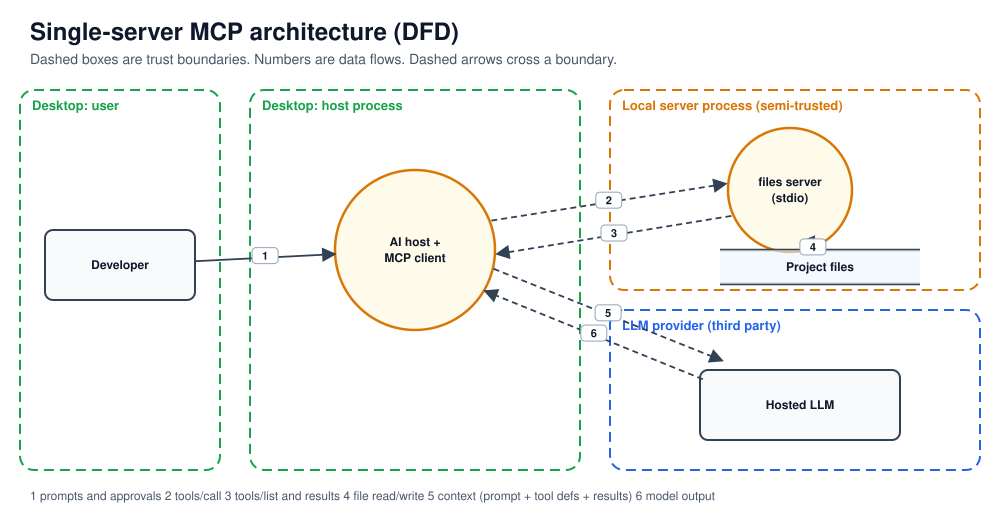
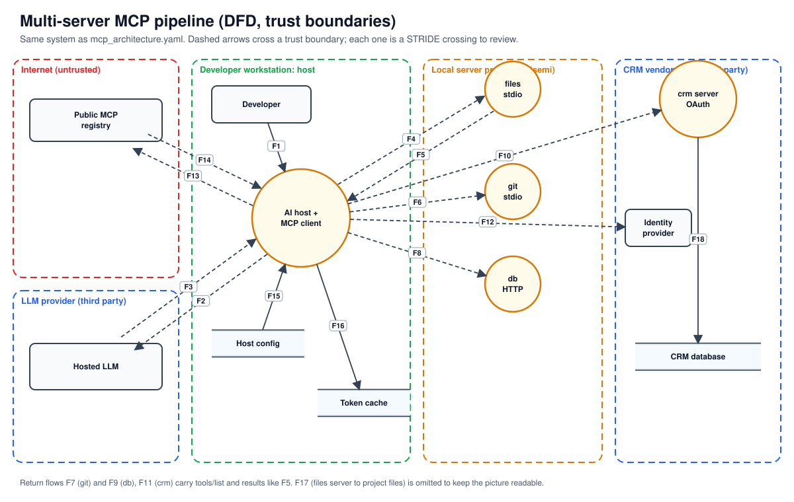

# Lesson 02: Diagramming MCP architectures

> **Chapter 3** · **Time:** ~3 hours · **You will:** read and draw a data flow diagram (DFD) for MCP, draw a single-server and a multi-server pipeline, and place trust boundaries between hosts, clients and servers.

| | |
|---|---|
| **Syllabus lines** | Diagramming MCP Architectures (5 lines) |
| **Already in this repo** | DFD basics and notation: [CAISP ch5, lesson 02](../../caisp-course/ch5-threat-modeling-ai-systems/02-dfd-and-llm-architecture.md) ([notation SVG](../../images/caisp-ch5-dfd-notation.svg)). MCP host, client, server roles: [Module 04, mcp-server](../../04-mcp-security/mcp-server/README.md) |
| **Lab** | [`stride-mcp-architecture/mcp_architecture.yaml`](labs/stride-mcp-architecture/mcp_architecture.yaml) and `stride_mcp.py --mermaid` |

---

## 1. Introduction to data flow diagrams (DFDs)

A DFD shows **where data comes from, where it goes, and what touches it**. It has five symbols. Full notation is in [CAISP ch5 lesson 02](../../caisp-course/ch5-threat-modeling-ai-systems/02-dfd-and-llm-architecture.md). Short version:

| Symbol | Meaning | Rule |
|---|---|---|
| Rectangle | External entity (a person or system you do not control) | Sources and sinks only |
| Circle | Process (code that transforms data) | Every flow touches at least one process |
| Two parallel lines | Data store | Never connected directly to another store or entity |
| Arrow | Data flow | One direction, labelled with the data and the protocol |
| Dashed box | Trust boundary | Draw it where trust level or control changes |

The lab tool checks these rules in `validate()`: unknown zones, flows to nothing, and flows with no process at either end.

## 2. DFD components in the MCP context

| DFD symbol | MCP thing | Notes |
|---|---|---|
| External entity | The **user**, the **hosted LLM**, a **registry**, an **identity provider (IdP)**, a third-party API a server calls | You do not control their security |
| Process | The **host** (with its **MCP client**), each **MCP server** | Each server is its own process, even when it sits on the same laptop. Draw one client per server connection if they behave differently |
| Data store | `mcp.json` host config, token cache, the server's files or database, the audit log | Stores are where integrity and confidentiality threats live |
| Data flow | `initialize`, `tools/list`, `tools/call`, `resources/read`, `prompts/get`, results, OAuth requests, registry queries, prompt to LLM | Label the transport (stdio, Streamable HTTP, legacy HTTP+SSE) and the auth (none, bearer, OAuth) |
| Trust boundary | Machine edge, process edge, network edge, vendor edge | See section 5 |

Two MCP-specific habits:

* **Draw the tool definitions as data that flows** from the server to the host, and onward to the model. They are as important as the arguments.
* **Draw the LLM as an external entity** (you cannot inspect it). The model's decision to call a tool is a flow from the LLM back to the host.

## 3. Diagramming a simple single-server MCP architecture

A developer, an AI host with an MCP client, one local stdio server and a hosted LLM.

Steps:

1. List the elements: Developer (entity), AI host + MCP client (process), files server (process), project files (store), hosted LLM (entity).
2. List the flows: (1) prompts and approvals, (2) `tools/call`, (3) `tools/list` and results, (4) file reads and writes, (5) context to the LLM (prompt + tool definitions + tool results), (6) model output.
3. Draw the boundaries: the **host process** (trusted by the user); the **server process** (a different program, with the user's privileges but written by someone else); the **LLM provider** (a third party).
4. Mark flows that cross a boundary: 2, 3, 5 and 6 cross. Those are the flows you review first.

What to notice: even with one server, flow 3 carries *untrusted text* (definitions and results) from a lower-trust zone into the context that goes to the model.

## 4. Diagramming a complex multi-server agentic pipeline

Real deployments have several servers, remote and local, with OAuth and a registry. The lab architecture has a host, three local servers (files and git over stdio, db over HTTP on 127.0.0.1), one remote OAuth server (crm), an identity provider and a registry.

How to keep it readable:

* **Group by zone**, not by function. The boundaries are the story.
* **Show one representative flow per pattern** and list the rest in a table (the YAML file has all 18 flows).
* **Add a "cross-server" view in words**: data read from server A can be sent through server B because both feed the same context. That path has no arrow in a DFD, so write it as a threat note on the host (finding `MT-I04` in the lab).
* **Number the flows** (F1, F2, ...) so the findings table can point to them.

Draw it from data: run `python .../stride_mcp.py --mermaid` to get a Mermaid flowchart with one subgraph per zone and dashed arrows for crossings.

## 5. Identifying and drawing trust boundaries between hosts, clients and servers

A **trust boundary** is a line where data moves between things with different trust, owners or controls. Ask: *who controls each side, and do they have the same rules?*

| Boundary | Between | Why it matters |
|---|---|---|
| **User to host** | Person and host UI | Approval prompts. The host must show the real action (ASI09 human trust exploitation) |
| **Host/client to local stdio server** | Two processes on one machine | Same user account, but different authors. The server can read what the user can read. The command line in `mcp.json` is what launches it |
| **Host/client to local HTTP server** | Process and a port on 127.0.0.1 | Any local program or web page may reach the port: needs authentication, Host and Origin checks |
| **Host/client to remote server** | Machine and network | Needs TLS, identity of the server, OAuth with audience binding |
| **Client to authorization server** | Host and IdP | PKCE, redirect URI checks. A malicious server can send a crafted `authorization_endpoint` |
| **Host to registry** | Host and a public listing | Supply chain: names, namespaces and packages |
| **Host to LLM provider** | Your data and a third party | Data minimisation, retention, regional rules |
| **Server to its backend** | Server and database or SaaS API | Downstream identity (no token passthrough), tenant isolation |
| **Server A to server B (through the context)** | Two servers that share one conversation | No technical wall exists, so you add policy |

Practical rules:

* A **client is not a boundary by itself**: it lives in the host process. The boundary is the *transport* between client and server.
* **Host and client are one trust zone**; the server is a different zone, even if it is "your own" code (it still runs with different inputs and a different release cycle).
* If two servers differ in trust (internal vs public), **never let them share a context without a policy** (taint tracking, approval for egress).
* Redraw the boundary when you change the transport. Moving a server from stdio to remote HTTP adds a network boundary and an auth problem.

## 6. Common mistakes

* Drawing the LLM as a process inside your zone.
* Forgetting the tool-definition flow and the registry.
* Treating localhost as trusted (DNS rebinding and other local programs break this).
* One giant "MCP servers" box. Draw each server, because each has its own tools and credentials.

## 7. Exercise

1. Run `python cmcpse-course/ch3-threat-modeling-mcp-architectures/labs/stride-mcp-architecture/stride_mcp.py --mermaid` and paste the result into a Mermaid viewer (a GitHub markdown file works).
2. Add a second remote server to the YAML (`slack_server`, zone `saas`, OAuth). Re-run. How many new crossings appear?
3. Redraw the single-server diagram with the server on a remote host. List the boundaries that change.

## 8. References

* [Microsoft Threat Modeling Tool DFD guidance](https://learn.microsoft.com/azure/security/develop/threat-modeling-tool) (symbols; verify the page).
* MCP specification: architecture and transports (modelcontextprotocol.io).
* [OWASP Threat Dragon](https://owasp.org/www-project-threat-dragon/) for drawing DFDs for free.
