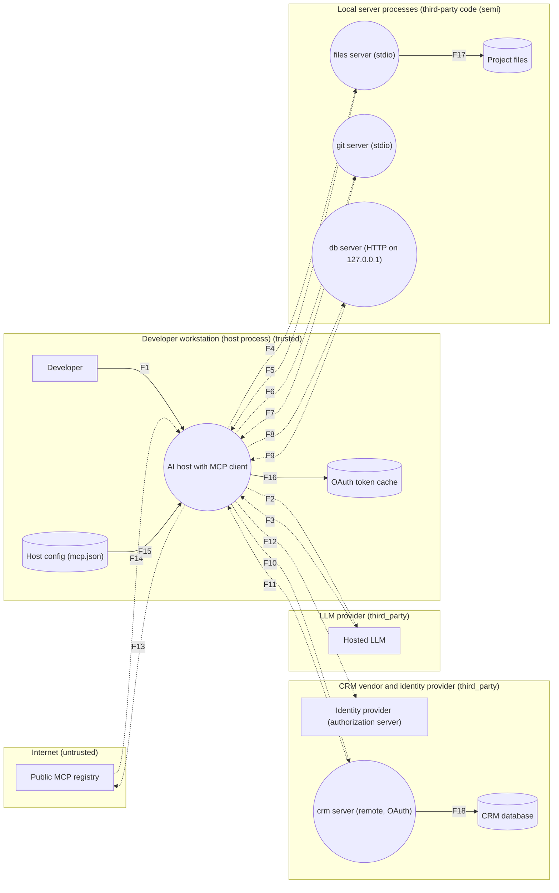

# OWASP Threat Dragon (free alternative to IriusRisk)

OWASP Threat Dragon is a free, open-source threat modeling tool with a web app and a desktop app. It draws DFDs and lets you attach STRIDE threats to elements. Check owasp.org/www-project-threat-dragon for current install options and features (verify).

**Format note.** Threat Dragon saves models as JSON, but the schema has changed between versions. This repo does not ship a Threat Dragon JSON file, because a hand-written file that the tool rejects would not help you. Use the Mermaid DFD below, generated from the lab YAML, and redraw it in Threat Dragon (about 30 minutes).

## Steps

1. Open Threat Dragon and create a new model (STRIDE).
2. Create one diagram. Add actors for Developer, Hosted LLM, Registry and Identity provider; processes for the host and each server; stores for config, token cache, project files and the CRM database.
3. Draw the data flows F1 to F18 from [`../stride-mcp-architecture/mcp_architecture.yaml`](../stride-mcp-architecture/mcp_architecture.yaml). Label each flow with its protocol.
4. Add trust boundary boxes for the five zones.
5. For each element, open the threat editor and add threats. Start from the findings of `stride_mcp.py` (copy title, STRIDE type, mitigation).
6. Save the JSON in your own notes repository and review changes in pull requests.

## Mermaid DFD (generated by `stride_mcp.py --mermaid`)

The same text is in [`mcp-architecture.mmd`](mcp-architecture.mmd). Paste it into any Mermaid renderer, or into a GitHub markdown block marked `mermaid`. Subgraphs are trust boundaries. Dashed arrows cross a boundary.

