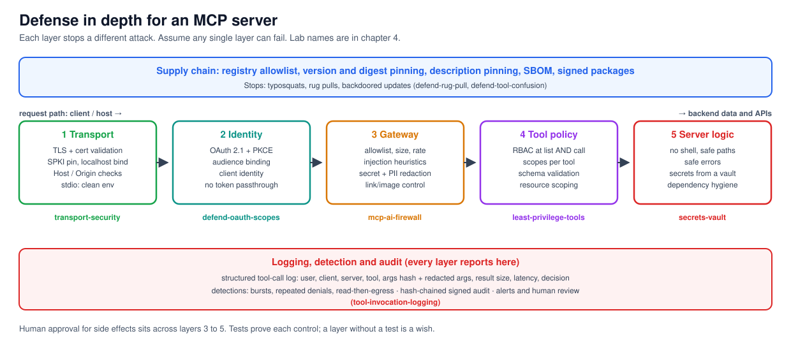

# Lesson 01: Introduction to MCP defense

> **Chapter 4** · **Time:** ~2 hours · **You will:** apply defense in depth to MCP, state what "secure by design" means for a server, and map each defense to the attack surface from chapter 3.

| | |
|---|---|
| **Syllabus lines** | Introduction to MCP Defense (3 lines) |
| **Already in this repo** | The whole defense stack, with attacks and fixes: [Module 04 README](../../04-mcp-security/README.md) (architecture, OWASP MCP Top 10 coverage, gateway mini-project) |
| **Threat side** | [Chapter 3: threat modeling](../ch3-threat-modeling-mcp-architectures/README.md) (findings to defend against) |
| **Next** | [Lesson 02: authentication and authorization](02-authentication-and-authorization.md) |

---

## 1. Defense-in-depth principles applied to MCP

Defense in depth means **several independent layers**, so that one failure does not become a breach. For MCP, assume each of these will fail at some point: the model (it follows injected text), the user (approval fatigue), the server (a bug), the dependency (a supply chain attack).

| Layer | Question it answers | Main controls | Lab |
|---|---|---|---|
| Supply chain | Is this the server we approved? | Allowlist, version and digest pins, description pins, signed packages | [`defend-rug-pull`](labs/defend-rug-pull/), [`defend-tool-confusion`](labs/defend-tool-confusion/) |
| Transport | Is the channel private and is the peer real? | TLS, certificate validation, pinning, loopback binding, Origin checks, clean stdio env | [`transport-security`](labs/transport-security/) |
| Identity | Who is calling, for which resource? | OAuth 2.1 with PKCE, audience binding, client identity, no token passthrough | [`defend-oauth-scopes`](labs/defend-oauth-scopes/) |
| Gateway | Is this request or result safe to pass? | Allowlist, size and rate limits, injection heuristics, redaction | [`mcp-ai-firewall`](labs/mcp-ai-firewall/) |
| Tool policy | May this role use this tool and resource? | RBAC at list and call, schemas, resource scopes | [`least-privilege-tools`](labs/least-privilege-tools/) |
| Server logic | Does the code do only what it should? | No shell, safe paths, safe errors, dependency hygiene, vault secrets | [`secrets-vault`](labs/secrets-vault/), [lesson 07](07-secure-mcp-development.md) |
| Detection | Can we see and prove what happened? | Structured logs, detections, signed audit | [`tool-invocation-logging`](labs/tool-invocation-logging/) |
| Human | Is a person in the loop for side effects? | Approval with the exact action shown | [Module 05, permissions](../../05-agent-security/permissions/README.md) |

Principles to repeat in every design review:

* **Least privilege:** each tool, token and process gets the minimum.
* **Deny by default:** an unknown tool, role, scope or origin is refused.
* **Fail closed:** on an error, block; never return a stack trace or a secret.
* **Separate data from instructions:** treat tool results and descriptions as untrusted input.
* **Verify at the point of use:** check at call time, not only at list time or install time.
* **Make it observable:** a control that does not log is hard to trust and impossible to tune.

## 2. Secure by design for MCP servers

"Secure by design" means the safe path is the default path and the dangerous path needs a deliberate choice. For an MCP server author:

1. **Start from the smallest useful tool set.** Prefer many narrow tools (`read_note`) over one broad tool (`run_sql`, `run_command`).
2. **Declare the permission needed per tool** (a scope, a role) in one policy table, reviewed in code review.
3. **Make read-only the default.** Writes, deletes, sends and payments are separate tools with separate scopes and approval.
4. **Validate input with a strict schema** (`additionalProperties: false`, types, lengths, enums) and then again in code.
5. **Return minimal output.** Fields the task needs, nothing more. No secrets, internal paths or stack traces.
6. **Never trust the caller's claim of identity or role from arguments.** Identity comes from the authenticated session.
7. **Fetch secrets at call time** and never write them to schemas, descriptions, env or logs.
8. **Log every call with context**, including denials.
9. **Ship with tests** for each control (the labs show how).
10. **Document the trust model**: which transport, which identity provider, which downstream APIs, which data classes.

## 3. Mapping defenses to the attack surface

Use the findings from [chapter 3](../ch3-threat-modeling-mcp-architectures/README.md). Each finding family has a control and a place to practise it.

| Attack (OWASP MCP Top 10, beta) | Typical finding | Defense | Study | Lab |
|---|---|---|---|---|
| MCP01 Token mismanagement, secret exposure | Keys in env, schemas, logs | Vault, redaction, short lifetimes | [05](05-secrets-management.md), [Module 04 auth](../../04-mcp-security/authentication/README.md) | `secrets-vault` |
| MCP02 Scope creep | Token or tool with too many rights | Scopes per tool, over-scope rejection, least privilege | [02](02-authentication-and-authorization.md) | `defend-oauth-scopes`, `least-privilege-tools` |
| MCP03 Tool poisoning | Instructions in descriptions or schemas | Scan, sanitize, pin reviewed text | [03](03-secure-tool-and-resource-design.md) | `defend-tool-poisoning`, `defend-rug-pull` |
| MCP04 Supply chain | Typosquat, malicious update | Allowlist, pins, SBOM, signing | [07](07-secure-mcp-development.md), [Module 04 mcp-server](../../04-mcp-security/mcp-server/README.md) | `defend-rug-pull` |
| MCP05 Command injection | Shell in a tool | No shell, schemas, sandbox | [03](03-secure-tool-and-resource-design.md), [Module 04 tool-security](../../04-mcp-security/tool-security/README.md) | (Module 04 lab) |
| MCP06 Prompt injection via payloads | Instructions in tool results | Gateway inspection, taint, approval | [03](03-secure-tool-and-resource-design.md) | `mcp-ai-firewall` |
| MCP07 Insufficient authn/authz | No auth on local HTTP, wrong audience | OAuth, audience binding, Origin checks | [02](02-authentication-and-authorization.md), [04](04-transport-security.md) | `defend-oauth-scopes`, `transport-security` |
| MCP08 Lack of audit and telemetry | No record of calls | Structured logs, signed trail, detections | [06](06-logging-monitoring-detection.md) | `tool-invocation-logging` |
| MCP09 Shadow servers | Unknown servers in configs | Inventory, allowlist, config audit | [04](04-transport-security.md), [Module 04 secure-ops](../../04-mcp-security/secure-operations/README.md) | `transport-security` (config audit) |
| MCP10 Context over-sharing | Too much data in results | Minimise, filter per user, redact | [03](03-secure-tool-and-resource-design.md) | `mcp-ai-firewall` |

The OWASP MCP Top 10 is a beta project (names and order may change; verify at owasp.org). The mapping is a study aid, not a certification.

## 4. Quick check

1. Name four independent layers that would each have stopped a rug pull or a poisoned description.
2. Why is "filter the tool list" not enough as an access control?
3. Which three design rules would have prevented the token-in-log class of bug?

## 5. References

* MCP specification, security best practices and authorization sections (modelcontextprotocol.io, verify the current revision).
* OWASP MCP Top 10 (beta); NIST SP 800-53 access control and audit families as general background.
* [Module 04](../../04-mcp-security/README.md) and [Module 06 runtime security](../../06-ai-devsecops/runtime-security/README.md).
