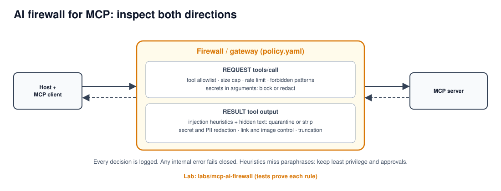

# Lab: deploying and configuring an AI firewall for an MCP server

**Course exercise:** Deploying and configuring an AI firewall for MCP server · **Lesson:** [03 section 4](../../03-secure-tool-and-resource-design.md) · **Related:** [CAISP ch4 guard-io](../../../../caisp-course/ch4-ai-attacks-and-defenses-devops/labs/guard-io/README.md) and [llm-guard-sanitize](../../../../caisp-course/ch4-ai-attacks-and-defenses-devops/labs/llm-guard-sanitize/README.md); the gateway mini-project in [Module 04](../../../../04-mcp-security/README.md#module-mini-project-mcp-security-gateway)



A gateway in front of one MCP server. **Requests** (`tools/call`) are checked for allowlist, size, per-client rate limit, forbidden patterns and secrets in arguments. **Results** are checked for hidden characters and injection heuristics (quarantine or strip), secret and PII redaction, markdown images and unknown links, and size. Every decision is logged and any internal error **fails closed**. All rules live in [`policy.yaml`](policy.yaml). Tests: `test_firewall.py` (18).

| File | Role |
|---|---|
| [`policy.yaml`](policy.yaml) | The firewall policy (allowlist, limits, patterns, actions, redaction, link domains) |
| [`firewall.py`](firewall.py) | `Firewall`, `load_policy()` (validated), `TokenBucket`, and a `fake_upstream` server |
| [`demo.py`](demo.py) | Seven requests through the firewall |

```bash
python cmcpse-course/ch4-defending-and-hardening-mcp-servers/labs/mcp-ai-firewall/demo.py
python -m pytest cmcpse-course/ch4-defending-and-hardening-mcp-servers/labs/mcp-ai-firewall
```

Real demo output:

```text
tools/list         : ['notes_search', 'notes_read', 'fetch_page']
normal read        : Welcome to the team notes.
unlisted tool      : Blocked by the firewall: tool 'run_shell' is not on the allowlist
path traversal     : Blocked by the firewall: forbidden pattern '\\.\\./'
secret in args     : Blocked by the firewall: api_key in arguments
PII in result      : Call Dana at [REDACTED_PHONE] or [REDACTED_EMAIL]. Key: [REDACTED_API_KEY].
injection in result: [content withheld by the firewall: possible prompt injection in the tool result]
tracking image     : Summary [image removed] and see https://docs.acme.example/guide and [link removed]
```

## Deploying it (how this maps to a real setup)

* Run the firewall as a **separate process or sidecar** between the host and the MCP server. For stdio, a wrapper process that speaks stdio to the host and to the server; for HTTP, a reverse proxy or a small service. The host should be unable to reach the server except through it.
* Keep the policy in version control; changes go through review. Start in **log-only** mode (record what would be blocked), tune, then enforce.
* Give each client its own rate bucket (the lab keys by `client_id`).
* Ship the events to your log pipeline ([lesson 06](../../06-logging-monitoring-detection.md)).
* Test with an **attack corpus** (injection phrases, hidden Unicode, long inputs) and a **benign corpus** (real task data) to measure misses and false positives.

## Limits

Heuristics miss paraphrased injections (a test proves it) and encoded data. Redaction patterns miss unusual formats. A firewall adds latency and a new component to secure. It does not replace least privilege, scopes, approval, or logging.

## Optional: real products (described generically, verify before use)

Several open-source and commercial products sit in the same position. They are not run in this repo.

* **Prompt and output scanners** (libraries such as LLM Guard, covered in the CAISP companion) that you call from a gateway to scan text.
* **Model and AI gateways** (cloud gateways and API management products with AI policies) that add authentication, rate limits, content filters and logging in front of model and tool traffic.
* **MCP-specific gateways and proxies** that front MCP servers, filter tool lists, check tool definitions, and log calls. This is a fast-moving area; compare features (tool pinning, scanning, authorization, audit) and check maturity.
* **Cloud guardrail services** from model platform vendors, which classify prompts and responses.
* **API firewalls and WAFs** for the HTTP edge (TLS, rate limits, schema validation).

Questions to ask any vendor: does it inspect **both directions**; can it enforce **per-tool allowlists** and **per-user policy**; does it fail **closed**; how does it handle **streaming** and **tool results**; where does data go (privacy); what is logged; can you export events; how do you **test** it; what are known bypasses?

## Your tasks

1. Add a rule: block `fetch_page` URLs whose host is not in an allowlist. Write the tests first.
2. Add a `log_only` mode in the policy and tests that show events are recorded but nothing is blocked.
3. Add an injection phrase from your own red-team list. Then add a paraphrase it misses and discuss the next layer.
4. Add a per-tool result size cap (for example `notes_search` 500 bytes) in the policy.
