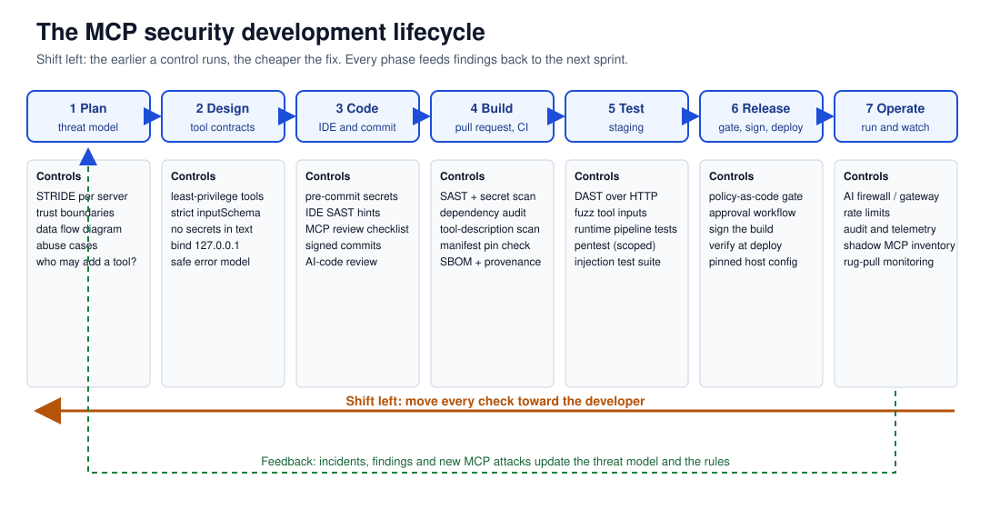

# 01. DevSecOps and the MCP Security Development Lifecycle

> **Syllabus:** Introduction to DevSecOps for MCP: DevSecOps and DevOps principles in the agentic context, the MCP security development lifecycle, shifting security left for MCP server development, the role of automation in MCP security.
> **Time:** 1.5 hours. **Prerequisite:** [CAISP chapter 4 lesson 01](../../caisp-course/ch4-ai-attacks-and-defenses-devops/01-devops-devsecops-and-ai-in-devops.md) (DevOps and DevSecOps basics) and the [MCP chapter 1 overview](../ch1-introduction-to-mcp-and-agentic-ecosystem/README.md).

## 1. Why this matters

An MCP server is code that an AI agent can call with text it did not write. It often holds credentials, reaches files, databases and the network, and ships fast, from small teams, often with AI-written code. Three facts make a plain DevOps pipeline not enough:

- The **tool description** is executable influence. A one-line change to a description can change what an agent does (tool poisoning, MCP03) and it never touches the code that SAST reads.
- The **client of your server is a model**. Inputs are shaped by attackers through prompt injection, so every tool parameter is untrusted, even when the caller looks "internal".
- Your **dependencies and the launch command** (`npx`, `uvx` in a host config) are part of the attack surface (MCP04). The first known malicious MCP server in the wild, `postmark-mcp` (Sept 2025, reported by Koi Security), was a supply-chain event, not a bug in someone's code.

## 2. DevOps and DevSecOps principles, in the agentic context

If you come from DevOps (Oracle DBA background helps here: think change control for stored procedures), the principles stay the same. What changes is what you version, test and gate.

| Principle | In classic DevOps | In MCP and agentic DevOps |
|---|---|---|
| Everything as code | App, infra, pipeline | Plus: **tool manifest, tool descriptions, host config, gateway policy, firewall rules** |
| Small, frequent changes | Many deploys per day | Each change to a description or schema is a **security-relevant change**: review it like a permission change |
| Automate and gate | Tests, lint | Plus MCP rules: SAST rules, description scan, manifest pinning, policy gate |
| Shift left | Find bugs in the pull request | Find poisoned descriptions and unpinned launch commands in the pull request |
| Shared responsibility | Dev + Ops | Dev + Ops + **Sec + the host/client owners**: a safe server can still be used by an unsafe host |
| Observe and respond | Logs, metrics, alerts | Plus **tool-invocation logs**, injection detections, rug-pull alerts, shadow-server inventory |
| Least privilege | Service accounts | **Per-tool** scopes, per-user tokens, no token passthrough |

DevSecOps = the security checks are **part of the same pipeline**, owned by the same team, and fail the same build. A separate security review at the end is the thing we replace.

## 3. The MCP security development lifecycle

| Phase | Question | MCP-specific activities | Where in this chapter |
|---|---|---|---|
| 1 Plan | What can go wrong? | Threat model the server and its trust boundaries; list abuse cases such as "poisoned note makes the agent call delete" | [Chapter 3](../ch3-threat-modeling-mcp-architectures/README.md) |
| 2 Design | What is the smallest safe tool? | One purpose per tool, strict `inputSchema`, no free-form "run anything" tools, no secrets in descriptions, safe error model | [Chapter 4](../ch4-defending-and-hardening-mcp-servers/README.md) |
| 3 Code | Is this change safe to write? | Pre-commit secret scan, MCP review checklist, review of AI-generated code | [02](02-sast-and-secret-scanning.md) |
| 4 Build | Is this change safe to merge? | SAST, secrets, dependency audit, description scan, manifest pin check, SBOM | [02](02-sast-and-secret-scanning.md), [05](05-cicd-integration-and-policy-as-code.md) |
| 5 Test | Does it hold under attack? | DAST over HTTP, fuzzing, runtime tests of the whole agent pipeline, a scoped pentest | [03](03-dast-fuzzing-and-runtime-testing.md), [04](04-penetration-testing-methodology.md) |
| 6 Release | Is this exact artifact the approved one? | Policy gate, approvals, signing, verification at deploy | [05](05-cicd-integration-and-policy-as-code.md), [chapter 6](../ch6-supply-chain-security-and-governance-of-mcp/README.md) |
| 7 Operate | Is it still behaving? | Gateway/AI firewall, rate limits, audit, shadow MCP inventory, rug-pull monitoring | [07](07-ai-firewalls-at-the-gateway.md), [04 secure-operations](../../04-mcp-security/secure-operations/README.md) |

The loop closes: an incident or a new public attack becomes a new test, a new SAST rule or a new gateway signature.

## 4. Shifting security left for MCP server development

"Left" means closer to the developer's keyboard. For each risk, ask where the earliest possible check is.

| Risk | Late (expensive) | Left (cheap) |
|---|---|---|
| Secret in a tool description | Found by a customer or a leak scan | Pre-commit secret scan, then the same scan in CI ([lab](labs/sast-vulnerable-mcp-server/README.md)) |
| `shell=True` in a tool | Found by a pentest | SAST rule MCP001 in the pull request |
| Poisoned description in a PR | Found after an agent misbehaves | Description scan plus manifest pin; human approval for any change ([lab](labs/mcp-cicd-pipeline/README.md)) |
| Vulnerable dependency | Found after disclosure | Dependency audit on every PR and nightly |
| Unpinned `npx -y server` in host config | Found in an incident | Policy-as-code rule on config files |
| Server bound to 0.0.0.0 | Found by a scan from the network | SAST rule MCP005 and a deployment policy |

Shifting left does not mean "skip the later checks". It means the cheap checks run first and often; DAST, pentest and runtime protection still catch what static checks cannot.

## 5. The role of automation

Automation is how the checks stay on. Rules of thumb:

1. **Automate what is deterministic.** Pattern rules, hashes, version comparisons, policy files. These give the same answer every time.
2. **Keep humans for judgement.** Is this new tool needed? Is this description honest? An LLM can help triage but should not be the only gate (it can itself be prompt-injected).
3. **Make the gate unskippable.** Required status checks, protected branches, and a gate job that *needs* all the others. The lab's policy has `required_stages` so deleting a job fails the build.
4. **Fail closed.** If a scanner crashes, the build fails.
5. **Measure.** False-positive rate, time to fix, number of waived findings. A gate people bypass is worse than none.
6. **Treat the pipeline as production.** It holds tokens. See [06](06-pipeline-attacks-on-mcp.md).

## 6. Hands-on

1. Draw the SDLC of an MCP server you know (even a hobby one). For each of the seven phases, write one control that exists today and one that is missing.
2. Run the whole chapter pipeline locally: [`mcp-cicd-pipeline`](labs/mcp-cicd-pipeline/README.md).

## 7. Interview questions

- *How is DevSecOps for an MCP server different from DevSecOps for a normal web API?* The caller is a model driven by untrusted text, the tool description is part of the attack surface, and the launch command and registry are part of the supply chain. Controls: description scan and manifest pinning, per-tool least privilege, gateway inspection of tool results.
- *Name three things you would shift left.* Secret scanning (pre-commit), MCP SAST rules (PR), description review and pinning (PR).
- *Why not use an LLM as the only security gate?* It is non-deterministic and can be prompt-injected. Use it for triage, keep deterministic gates.

## 8. References

- [Repo: 06 AI DevSecOps](../../06-ai-devsecops/README.md), [cicd](../../06-ai-devsecops/cicd/README.md)
- [Repo: 04 MCP security](../../04-mcp-security/README.md)
- OWASP MCP Top 10 (beta, verify current names at owasp.org/www-project-mcp-top-10) and the MCP specification security guidance at modelcontextprotocol.io (verify the current revision).
- Koi Security and Snyk write-ups on `postmark-mcp` (Sept 2025; secondary sources, details vary).
