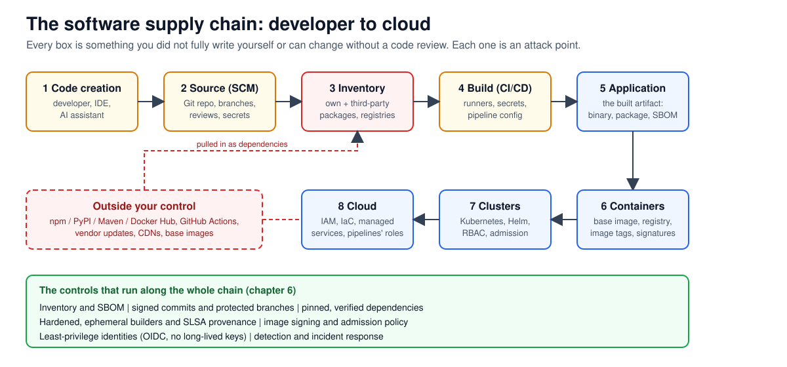

# 01. Overview of the software supply chain and its building blocks

> **Chapter 1 · Time:** 3 hours · **You will:** name the eight building blocks, say who controls each one, and give one attack and one control per block.
> **Prerequisites:** basic Git and Linux. **Labs:** [how-cicd-works](labs/how-cicd-works/README.md), [gitlab-ci-stages](labs/gitlab-ci-stages/README.md), [continuous-deployment](labs/continuous-deployment/README.md).
> **Maps to:** OWASP Top 10 CI/CD Security Risks · SLSA · NIST SSDF (SP 800-218) · NIST C-SCRM (SP 800-161 Rev.1) · OWASP SCVS. Verify versions at source.

## 1. Why this matters

Almost no modern software is written from nothing. A typical application is a small amount of your code on top of hundreds of packages, a base image, a CI system, a registry, a cluster and a cloud account. Each of these is a place where code or configuration you did not write can change what runs in production. Attackers noticed: it is often easier to compromise one maintainer, one build job or one update server than to attack a hardened company directly.

**Definition for this course.** The *software supply chain* is everything and everyone that touches your software from the moment a developer starts writing it until it runs in the cloud: people, source, dependencies, build systems, artifacts, images, clusters and cloud services. *Supply chain security* is making sure that what runs in production is exactly what you meant to ship: made from reviewed source, with known dependencies, by a trusted builder, delivered without tampering.

## 2. Understand it: the supply chain from developer to cloud

*The diagram has eight blocks. Red dashed lines show what comes from outside your control.*

The simplest way to remember the chain is as three questions you can ask at every step:

1. **What went in?** (source and dependencies: the inventory)
2. **Who or what built it?** (the builder and its identity)
3. **How did it get here, and can I prove it?** (signing, provenance, admission)

| # | Block | Who controls it | Main risk in one line |
|---|---|---|---|
| 1 | Code creation | Your developers (and AI assistants) | Insecure or malicious code, leaked secrets, careless copy-paste |
| 2 | Source code management (SCM) | You (or your SaaS provider) | Stolen accounts, no review, secrets in history |
| 3 | Internal and external software inventory | You, plus every third party | Unknown or hijacked components |
| 4 | Build system (CI/CD) | You (runners, pipeline config), plus plugins | Poisoned pipelines, leaked CI secrets |
| 5 | Application | You | The artifact you ship is not what you reviewed |
| 6 | Containers | You, plus base-image publishers | Vulnerable or malicious images, secrets in layers |
| 7 | Clusters | Platform team | Over-privileged workloads and pipelines, unverified images |
| 8 | Cloud | Cloud team, plus the provider | Over-privileged roles, risky IaC, long-lived keys |

### 2.1 Block 1: Code creation

Developers write code in IDEs, copy snippets from the web and, today, accept code from AI assistants. Risks: insecure patterns (injection, weak crypto), secrets typed into code, malicious IDE extensions, and packages suggested by an assistant that do not exist (slopsquatting; see [lesson 03](03-evolution-of-supply-chain-attacks.md)). Controls: secure coding training, IDE and pre-commit secret scanning, reviewing AI output as untrusted, a vetted extension list. See the repo's [AI-generated code gate](../../02-llm-security/model-threats/README.md) and [CAISP ai-code-weaknesses](../../caisp-course/ch4-ai-attacks-and-defenses-devops/labs/ai-code-weaknesses/README.md).

### 2.2 Block 2: Source code management (SCM)

The SCM (GitLab, GitHub, Bitbucket) is the system of record. Whoever can push to `main`, edit the pipeline file or change repository settings controls what is built. Risks: stolen credentials or tokens, a malicious or tricked maintainer (event-stream, xz-utils), unsigned commits, no branch protection, secrets in Git history, a compromised third-party app with repository access. Controls: SSO and MFA, branch protection and mandatory review (CODEOWNERS), signed commits or tags, secret scanning with push protection, minimal token scopes, audit logs.

### 2.3 Block 3: Internal and external (third-party) software inventory

The inventory answers: *what is in our software, and where did each piece come from?* Internal means your own libraries and services. External means open source packages, vendor SDKs, base images, GitHub Actions and Terraform modules. Risks: typosquatting, dependency confusion, hijacked or sold packages, unpinned versions, abandoned projects, and simply **not knowing** you use a vulnerable component (this is how [Equifax](#5-hands-on-exercises-in-this-chapter) went wrong). Controls: an SBOM for every build (CycloneDX or SPDX), lockfiles with hashes, an internal proxy or registry (Artifactory, Nexus, GitLab package registry), version pinning, license and vulnerability scanning, vetting new dependencies. See [CAISP package-vetting](../../caisp-course/ch6-supply-chain-attacks-in-ai/README.md) and [SBOM lab](../../caisp-course/ch6-supply-chain-attacks-in-ai/README.md).

### 2.4 Block 4: Build system (CI/CD)

CI/CD turns source into artifacts and often deploys them. It holds secrets (registry, cloud, signing keys) and runs code from many places (the repo, plugins, third-party actions). That makes it one of the most valuable targets. Risks: poisoned pipeline execution (changing the pipeline file or a script it runs), leaked variables in logs, shared or persistent runners, mutable third-party actions, build-system compromise (SolarWinds). Controls: protected branches and variables, ephemeral isolated runners, pinned third-party components, least-privilege OIDC identities, and reproducible, provenance-producing builds (SLSA). Details in [lesson 05](05-cicd-stages-and-deployment.md) and [06-ai-devsecops/cicd](../../06-ai-devsecops/cicd/README.md).

### 2.5 Block 5: Application

The application is the build result: a binary, a package or a bundle. The question is *integrity*: is this artifact the one our pipeline built from the reviewed commit? Risks: artifact swapped after the build, a tampered update channel, a stolen signing key, a package published with a hijacked token. Controls: SBOM and provenance attached to the artifact, digital signatures (Sigstore cosign, code signing with protected keys), checksum verification, publishing only from the pipeline, and customer verification.

### 2.6 Block 6: Containers

Most applications ship as container images. An image has a base image, OS packages, language packages and your app. Risks: vulnerable or backdoored base images, unpinned tags (`latest`), secrets baked into a layer, running as root, a public image that is malicious, tag overwrite in the registry. Controls: minimal pinned base images (by digest), image scanning (Trivy, Grype), a private registry such as Harbor with policy, image signing and verification, non-root and read-only runtime settings. See [06-ai-devsecops/docker](../../06-ai-devsecops/docker/README.md). Chapter 3 goes deeper.

### 2.7 Block 7: Clusters

Kubernetes (or another orchestrator) runs the images. Risks: manifests and Helm charts from untrusted sources, over-privileged service accounts (including the CI service account), a kubeconfig stored in pipeline variables, no admission control, exposed dashboards and APIs. Controls: Pod Security Admission, admission policies (Kyverno, OPA Gatekeeper, ValidatingAdmissionPolicy), signature verification at admission, RBAC least privilege, GitOps with reviewed changes, network policies. See [06-ai-devsecops/kubernetes](../../06-ai-devsecops/kubernetes/README.md). Chapter 4 goes deeper.

### 2.8 Block 8: Cloud

The cloud account is where pipelines deploy and where the data lives. Risks: infrastructure-as-code modules and providers from the internet, long-lived access keys in CI, a pipeline role that can do everything, public storage, vendor integrations with broad access. Controls: short-lived credentials through OIDC federation, least-privilege roles, policy as code on Terraform plans, pinned and mirrored providers and modules, cloud audit logging and alerts. See [06-ai-devsecops/terraform](../../06-ai-devsecops/terraform/README.md) and [cybersecurity track: cloud security](../../cybersecurity-track/10-cloud-security/). Chapter 5 goes deeper.

## 3. Defend it: one control family along the whole chain

| Layer | Hard / soft / process | Purpose |
|---|---|---|
| Identities with MFA, short-lived tokens, least privilege | Hard | Stop stolen credentials from becoming a pipeline takeover |
| Branch protection and mandatory review | Hard (if enforced) | Stop a single person changing what is built |
| Pinned and verified dependencies, private proxy | Hard | Stop unknown code from entering |
| Hardened, ephemeral builders; provenance | Hard | Make the build trustworthy and provable |
| Signing plus verification at deploy | Hard | Stop tampering after the build |
| SBOM and vulnerability management | Process | Know what you run and patch quickly (Equifax lesson) |
| Detection and incident response | Process | Find the compromise you did not prevent |

**What does NOT work on its own:** scanning only your own code; trusting a package because it is popular; signing artifacts but never verifying; having an SBOM nobody reads.

## 4. Hands-on

1. Draw the eight-block chain from memory. For your own company or a sample project, write who controls each block.
2. Fill one row per block: *one attack, one control, one tool you know*.
3. Run [how-cicd-works](labs/how-cicd-works/README.md) to see block 4 in action.

## 5. Hands-on exercises in this chapter

The course's chapter-1 exercises map to labs here: [how CI/CD works](labs/how-cicd-works/README.md), [GitLab CI/CD stages](labs/gitlab-ci-stages/README.md), [continuous deployment](labs/continuous-deployment/README.md) and the [Equifax case study](labs/equifax-case-study/README.md). Concepts are explained in [lesson 05](05-cicd-stages-and-deployment.md).

## 6. Real-world scenarios

1. **A developer's laptop token.** A GitLab personal access token with `write_repository` is stolen. Which blocks are affected (2, 4, 5 and beyond)? What limits the damage? (token scope and expiry, protected branches, required reviews, signed releases.)
2. **A "free" CI plugin.** A team adds an unpinned third-party action. It later changes. Which block? (4, via 3.) Fix: pin to a commit SHA, mirror internally, review changes.
3. **Unknown component.** A critical library CVE appears. Nobody knows which services use it. Block 3 failed: no inventory. Fix: SBOMs per build, a searchable inventory, owners per service.

## 7. Interview preparation

<b>Q1. Define the software supply chain.</b>

Everything and everyone that touches software from writing to running: developers, SCM, dependencies, build, artifacts, containers, clusters and cloud. Security means production runs what you meant to ship.

<b>Q2. Name the eight building blocks.</b>

Code creation, SCM, internal and external software inventory, build system (CI/CD), application, containers, clusters, cloud.

<b>Q3. Why is the build system a top target?</b>

It holds secrets, has network access, runs code from many sources and produces what customers run. Compromising it affects every artifact it builds.

<b>Q4. Which block failed at Equifax, and what is the control?</b>

Block 3 (inventory and patching): a known, patched Struts flaw stayed in an internet-facing app. Control: complete inventory with owners, automated matching to advisories, patch SLAs, scan verification.

## 8. Checklist

- [ ] I can draw and explain the eight blocks.
- [ ] For each block I can give a risk, a control and a tool.
- [ ] I can explain the three questions: what went in, who built it, how did it get here.

## 9. References

- SLSA: <https://slsa.dev> · NIST SSDF SP 800-218: <https://csrc.nist.gov/pubs/sp/800/218/final> · NIST SP 800-161 Rev.1 (C-SCRM): <https://csrc.nist.gov/pubs/sp/800/161/r1/final> · OWASP SCVS: <https://owasp.org/www-project-software-component-verification-standard/> · OWASP Top 10 CI/CD Security Risks: <https://owasp.org/www-project-top-10-ci-cd-security-risks/> (verify all links and versions at source).
