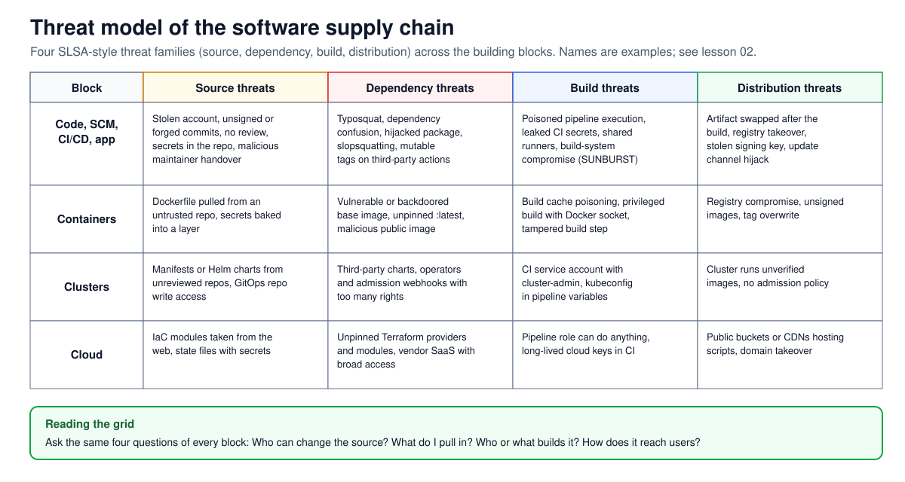

# 02. Threat model of the software supply chain

> **Chapter 1 · Time:** 3 hours · **You will:** apply four SLSA-style threat families (source, dependency, build, distribution) to the code, container, cluster and cloud layers, and draw a threat model of your own pipeline.
> **Prerequisites:** [lesson 01](01-supply-chain-overview-and-building-blocks.md).
> **Maps to:** SLSA threats and mitigations (verify current text at slsa.dev) · OWASP Top 10 CI/CD Security Risks · STRIDE ([repo threat modeling](../../01-ai-security-fundamentals/README.md)) · MITRE ATT&CK (supply chain compromise, T1195).

## 1. Why this matters

A threat model turns "supply chain attacks are scary" into a list of places to look. The SLSA project describes supply chain threats along the path of an artifact: bad **source**, bad **dependencies**, a bad **build**, and a bad **distribution** (how it reaches users). Using the same four words for every layer makes the later chapters easy: chapter 2 is mostly source, dependency and build; chapters 3 to 5 apply the same thinking to containers, clusters and cloud.

## 2. Understand it

### 2.1 The four threat families

| Family | Question | Example attacks |
|---|---|---|
| **Source** | Can someone change the code without proper review or identity? | Stolen maintainer account, force push, unsigned or forged commit, malicious contributor, backdoor merged by a trusted maintainer (xz-utils) |
| **Dependency** | Can something we pull in be malicious or vulnerable? | Typosquatting, dependency confusion, hijacked or sold package, malicious update, mutable tag, slopsquatting |
| **Build** | Can the build produce something other than the source says? | Poisoned pipeline execution, compromised runner, leaked CI secrets, tampered build tool (SolarWinds), cache poisoning |
| **Distribution** | Can the artifact be swapped on its way to the user? | Registry or CDN takeover, update-server compromise, stolen signing key, tag overwrite, domain takeover (polyfill.io) |

A fifth item runs across all four: **the people and credentials** (phishing, token theft, social engineering of maintainers).

### 2.2 Overview of code creation (SCM, CI/CD and application)

| Block | Source | Dependency | Build | Distribution |
|---|---|---|---|---|
| Code creation | Malicious or buggy AI or pasted code | Packages named by an assistant (slopsquatting) | n/a | n/a |
| SCM | Account takeover, no review, secrets in history | Vendored or submodule code that is unreviewed | Repository settings that let forks run pipelines | Release tags that can be moved |
| CI/CD | Pipeline file edited by an attacker (PPE) | Third-party actions or plugins with mutable versions | Shared or persistent runners, secret exposure in logs | Pipeline that uploads from a laptop or to a public place |
| Application | Backdoor in reviewed-looking code | Vulnerable library shipped (Equifax) | Artifact not built from the claimed commit | Unsigned package, hijacked publish token |

Attacker goals: steal secrets, run code in many customers' systems, pivot into the cloud, mine crypto, or harvest data (card skimming, Magecart).

### 2.3 Overview of containers

- **Source:** the Dockerfile and build context come from a repo that anyone can change; secrets copied into a layer.
- **Dependency:** base images and layers from a public registry; the `latest` tag changes without notice; a malicious image uses a name close to a popular one.
- **Build:** a build with the Docker socket mounted or privileged mode gives host access; build cache poisoning.
- **Distribution:** registry compromise, tag overwrite, no signature check at pull or admission.

Controls to name: digest pinning, minimal base images, scanning, private registry with policy, signing (cosign or Notation; Docker Content Trust is retired, see the brief note in [lesson 03](03-evolution-of-supply-chain-attacks.md)), runtime hardening.

### 2.4 Overview of clusters

- **Source:** manifests, Helm charts and GitOps repositories; whoever can write to them decides what runs.
- **Dependency:** third-party Helm charts, operators and admission webhooks that run with high privilege.
- **Build/deploy:** the CI service account or kubeconfig; if the pipeline is compromised, so is the cluster.
- **Distribution:** the cluster accepts any image; no signature or policy check.

Controls: Pod Security Admission, admission policies and image verification, RBAC least privilege, short-lived deploy credentials, GitOps pull model, audit logs.

### 2.5 Overview of cloud

- **Source:** infrastructure-as-code (Terraform, CloudFormation) reviewed like code, state files with secrets.
- **Dependency:** providers, modules and SaaS integrations from outside; vendor access to your account.
- **Build:** the pipeline's cloud identity (long-lived keys vs OIDC), what it may do.
- **Distribution:** public buckets and CDNs that serve scripts; DNS and domain takeover.

Controls: OIDC federation with narrow roles, policy as code on plans, pinned and mirrored providers and modules, logging and alerts on privileged actions.

### 2.6 A threat-model method you can reuse

1. Draw the data flow: from commit to production, including every third party.
2. Mark **trust boundaries**: where code or data crosses from one owner to another.
3. For each boundary and each of the four families, write one threat.
4. Rate impact and likelihood, pick a control, and name who owns it.
5. Keep it in the repo and review it when the pipeline changes.

## 3. Defend it

| Threat family | Main hard control | Support (soft/process) |
|---|---|---|
| Source | Protected branches, mandatory review, MFA, signed commits | Code owners, maintainer hygiene |
| Dependency | Pinned versions and hashes, private proxy, SBOM | Vetting policy, license and vulnerability scans |
| Build | Hardened ephemeral runners, scoped secrets, provenance | Pipeline reviews, audit logs |
| Distribution | Sign and verify, admission policy | Monitoring of registries and domains |

**What does NOT work on its own:** a single scanner at the end; trusting that "our network is closed" (the attacker arrives inside a package); a policy that nobody enforces.

## 4. Hands-on

1. Take the sample pipeline in [how-cicd-works](labs/how-cicd-works/sample.gitlab-ci.yml). For every job write the four-family threats. Which job would you attack first? (`deploy-prod`: it has the most privilege.)
2. Use the [workflow linter](../../06-ai-devsecops/cicd/README.md) from the repo on a GitHub workflow of your own to see build-family findings.
3. Pick a package manager you use. Write the dependency threats it is exposed to and the control that your team actually applies.

## 5. Real-world scenarios

1. **Fork pull request runs on a shared runner** (build). A contributor's change reads variables. Fix: no secrets for fork pipelines, protected variables, ephemeral runners.
2. **`latest` base image changes** (container dependency). A new build pulls a vulnerable layer. Fix: pin by digest, rebuild on schedule with scanning.
3. **CI role can create admin users in the cloud** (cloud build). Fix: scope the role to the deploy target, use OIDC with conditions on branch and repository.

## 6. Interview preparation

<b>Q1. What are the four SLSA-style threat families?</b>

Source, dependency, build and distribution threats. Add the people and credentials threat that cuts across them.

<b>Q2. Give one threat per family for a container.</b>

Source: secret copied into a layer. Dependency: malicious or unpinned base image. Build: privileged build with host access. Distribution: unsigned image or tag overwrite.

<b>Q3. Where is the trust boundary in a CI/CD system?</b>

Wherever code or data from an outside owner meets your secrets: pull requests from forks, third-party actions, base images, packages, and any person or system who can edit the pipeline.

## 7. Checklist

- [ ] I can fill the four-family grid for code, containers, clusters and cloud.
- [ ] I can name a hard control for each family.
- [ ] I drew a threat model for one real pipeline.

## 8. References

- SLSA threats: <https://slsa.dev/spec/v1.0/threats-overview> · OWASP Top 10 CI/CD Security Risks: <https://owasp.org/www-project-top-10-ci-cd-security-risks/> · MITRE ATT&CK T1195 Supply Chain Compromise: <https://attack.mitre.org/techniques/T1195/> (verify links).
